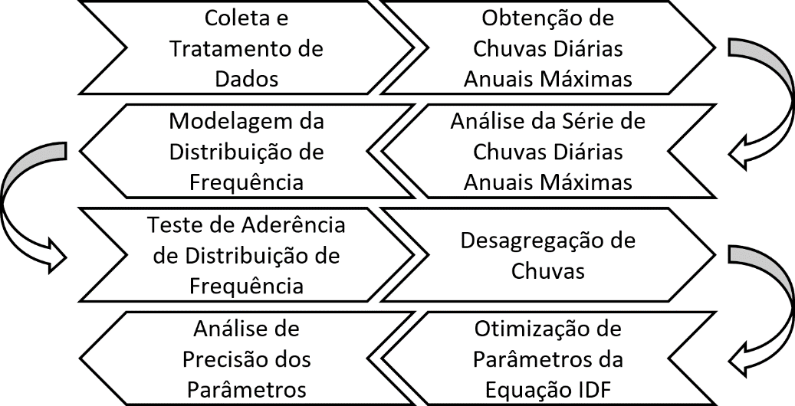
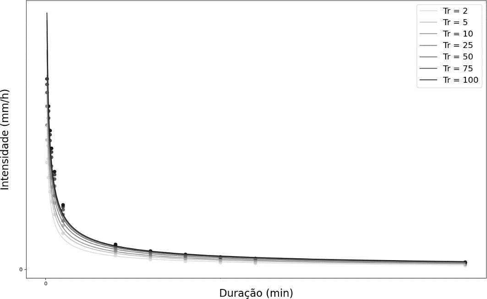
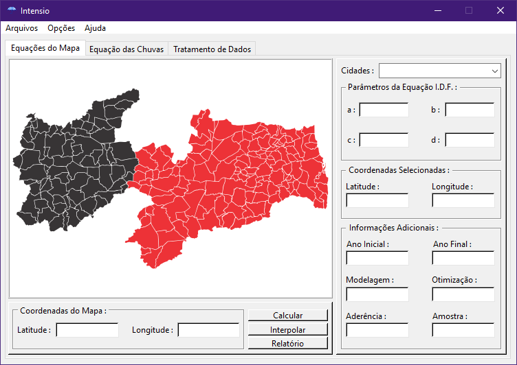
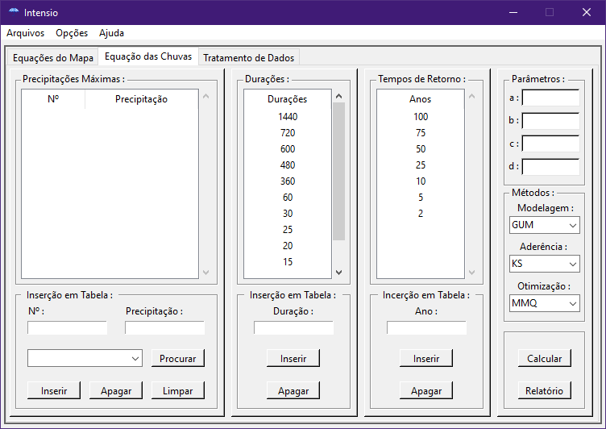
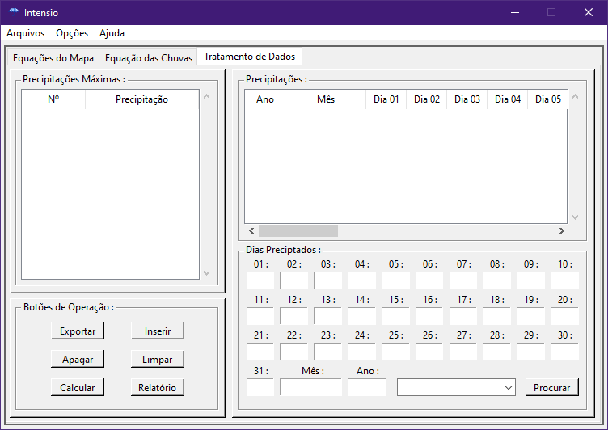
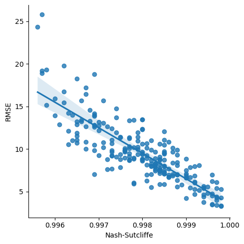

**Desenvolvimento de ferramenta computacional para determinação de equações de chuvas intensas**

*Development of a computational tool for determination of intense rainfall equation*

Alexandre Estrela de Lacerda Nóbrega¹  
Yuri Tomaz Neves²

*Revista COOPEX (ISSN: 2177-5052), v. 14, n. 05, p. 3802-3818, 2023. http://coopex.unifip.edu.br*

**RESUMO:** Compreender o comportamento das precipitações intensas de uma região através da equação das chuvas, é uma etapa importante do desenvolvimento de projetos que envolvem a análise e controle das águas pluviométricas. Os cálculos que conduzem a equação citada envolvem o entendimento da relação entre intensidade, duração e frequência, além de cálculos que passam por tratamento de dados de séries históricas, métodos de otimização, distribuições probabilísticas, e testes estatísticos de aderência, tendência e acurácia. Devido à complexidade que há na compreensão e determinação dessas equações, correspondente aos cálculos e análises probabilísticas extensas, o presente trabalho se propôs a desenvolver uma ferramenta computacional com interface gráfica de código aberto. Ela permite aos projetistas e estudiosos calcularem a equação para regiões escolhidas a partir de suas próprias bases de dados, ou estudarem os algoritmos que conduzem todo o processo de cálculo.

**Palavras-chave:** Ferramenta computacional; Desenvolvimento em python; Equação das chuvas intensas; Intensidade-Duração-Frequência.

**ABSTRACT:** Comprehend the behavior of intense rainfall in a region through the rainfall intensity-duration-frequency equation is an important step in the development of projects that involve the analysis and control of pluviometric waters. The calculations that lead to the equation mentioned involve the grasp of the relationship between intensity, duration and frequency, as well as calculations that go through treatment of historical data series, optimization methods, probabilistic distributions, and statistical tests of adherence, trend and accuracy. Due to the complexity that exists in the understanding and determination of these equations, corresponding to the extensive probabilistic calculations and analyses, the present work proposed to develop a computational tool with an open source graphical interface. It allows engineer and scholars to calculate the equation for chosen regions from their own databases, or to study the algorithms that drive the entire calculation process.

**Keywords:** Computational tool; Python development; Intense rainfall equation; Intensity-Duration-Frequency.

**DOI:** https://doi.org/10.61223/coopex.v14i5.550

¹ Graduando do curso de Engenharia Civil do Centro Universitário de Patos 2023 (UNIFIP).

² Docente do curso de Engenharia Civil do Centro Universitário de Patos 2023 (UNIFIP).

# INTRODUÇÃO

Ao reparar a chuva, não se considera tamanha complexidade concebida por um ser superior, devido a naturalidade em seu uso cotidiano. Porém a ausência de entendimento sobre esses eventos climáticos, em especial as precipitações pluviométricas de nível extremo, provoca catástrofes de ordem natural e antrópica, que impactam negativamente a sociedade. Isto posto, cabe aos profissionais que se dedicam aos estudos hidrológicos, desenvolverem os conhecimentos necessários para a resolução dos problemas causados pelas chuvas intensas.

Wilken (1978) deixa claro que, quanto ao projetista de águas pluviais, a parte que lhe interessa do ciclo hidrológico é justamente a precipitação de chuvas. Nesta área, métodos foram desenvolvidos para às previsões dos eventos citados, e aliado à tecnologia, a precisão atinge níveis cada vez maiores. Sobre isto, Bertoni e Tucci (2012) declaram que projetos pautados no movimento da água da chuva, como o dimensionamento de bueiros, vertedores de barragem, galerias pluviais, entre outros, necessitam de grandezas que caracterizam a precipitação pluvial máxima. Elas são conhecidas como a intensidade, duração e frequência.

A necessidade de expressar essas grandezas de forma matemática, para assim tornar possível a análise desse tipo fenômeno pluviométrico, proporcionou o desenvolvimento da equação da intensidade-duração-frequência (IDF), que é uma função que estima a intensidade da chuva. Ela é descrita por Chow, Maidment e Mays (1988) como a taxa média de precipitação em unidade de comprimento por unidade de tempo para uma determinada bacia ou sub-bacia de drenagem. Sendo necessária para o dimensionamento dos projetos citados, ela ajuda a compreender e sanar problemas causados pelas chuvas intensas. Entende-se então que a possibilidade de elaborar e fazer estudos sobre as equações IDF, de maneira mais acessível e confiável, se torna extremamente necessária para a sociedade.

Todavia, é notada a carência de dispositivos elaborados e disponíveis para esses fins. Entendendo esses problemas, o presente trabalho se justifica por desenvolver uma ferramenta computacional simples e intuitiva, para auxiliar na determinação das equações das chuvas intensas. Ela servirá de auxílio aos projetistas que contarão com mais um instrumento para aumentar a precisão dos seus dimensionamentos. Também terá o intuito de facilitar estudos sobre o tema, e por isso, após desenvolvida será disponibilizada em código aberto para análises e possíveis aprimoramentos.

# REVISÃO BIBLIOGRÁFICA

De Chamada por Wilken (1978) de equação intensidade-duração-frequência ou equação de chuvas, também conhecida popularmente como equação de chuvas intensas, ele é claro ao afirmar que a equação IDF é gerada a partir das relações entre a intensidade, duração e frequência, que por sinal a nomeiam. Elas são relacionadas através da observação de dados de séries históricas de precipitação em um tempo suficientemente grande para que seja possível aceitar às frequências como probabilidade. Como resultado, têm-se as curvas de intensidade-duração-frequência para cada frequência, com uma regularidade entre as mesmas que possibilita a tradução uniforme delas através do equacionamento. Existem equações que podem ser usadas para explicar as curvas matematicamente, porém apenas uma será tratada neste trabalho que é a apresentada a seguir, descrita por Bertoni e Tucci (2012) como genérica e boa representante das frequências citadas.

$$
I = \frac{a*{Tr}^{b}}{{(t + c)}^{d}} \tag{1}
$$

onde:  
*I* é a intensidade da chuva, (mm/h);  
*Tr* é o tempo de retorno, (ano);  
*t* é a duração, (min);  
*a, b, c, d* são os parâmetros da equação da intensidade das chuvas, (adimensional).

Sabendo disso, é necessário entender os processos matemáticos que levam aos resultados que se desejam, que são os parâmetros da equação da intensidade das chuvas. Baseado nos resumos esquemáticos dos estudos de Pinto (2013) e de Neto (2020), foi elaborado para o presente trabalho um fluxograma visualizado através da Figura 1, que define os passos a se seguir para determinar os parâmetros da equação IDF.

**Figura 1** – Fluxograma de equação das chuvas intensas.

**Fonte:** Elaboração Própria (2023).

Com relação a coleta e tratamento de dados, é preciso pensar sobre as falhas presentes nas séries históricas de precipitações diárias dos vários anos utilizados. Uma boa forma de analisar dados falhos, é estabelecendo limiares de falhas que caso ultrapassado, desconsidera-se a série analisada. É possível estabelecer esse limite de forma empírica, como no caso dos trabalhos de Santos (2017) e Beskow et al. (2013), e de forma estatística, como no estudo de Kim e Ryu (2015).

Uma forma mais simples de lidar com dados ausentes é os ignorando, como explicado por Allison (2001) e chamada de complete case analysis. O autor a descreve como de fácil implementação, porém destaca que deve ser usada com cuidado visto que a depender das falhas, ela pode excluir uma grande parcela da amostra original. Cabe ao calculista analisar e decidir qual método melhor se encaixa na especificação de sua base de dados.

Uma outra análise a ser feita, é a da quantidade de anos que se tem informações de precipitação. O Instituto Nacional de Pesquisas Espaciais (INPE) (2023) recomenda que para o comportamento estatístico das variáveis de tempo como temperatura, chuva e vento, possua-se dados de um período de pelo menos 30 anos. Porém, devido à escassez de informações para um tempo tão longo, alguns autores admitem menores períodos mínimos. É possível comprovar essa afirmação através de estudos como o de Pfafstetter (1957), que elaborou equações com dados de 98 postos meteorológicos ao longo de todo o Brasil, possuindo elas séries históricas com uma média de aproximadamente 22 anos. É visível também no trabalho de Martinez e Magni (1999), convênio do Departamento de Águas e Energia Elétrica e da Escola Politécnica da Universidade de São Paulo, a apresentação de períodos de anos menores que o recomendado pelo INPE, com uma média de 27 anos para 30 cidades do estado brasileiro de São Paulo.

Compreendendo essa questão, organiza-se os dados que serão usados no cálculo da equação das chuvas intensas e se seleciona a maior chuva diária de cada ano do conjunto de dados. Em posse da série histórica de chuva diária anual máxima, aplica-se o teste de Mann-Kendall (MK) proposto por Helsel et al. (2020), para busca por tendências em dados hidrológicos, que indica entre outras questões as mudanças climáticas, que por sua vez podem afetar previsões estatísticas.

Não havendo tendência na série de precipitações máximas diárias anuais, segue-se para modelagem probabilística dos dados de precipitação máxima diária anual, que é feita através de distribuições de probabilidade. Estas são usadas para análise de frequência, e estimam as precipitações para diferentes tempos de retorno. A escolha da distribuição probabilística para a modelagem será sempre a que, quando comparada com outras que apresentam bons ajustes para dados hidrológicos, terá a melhor precisão. Sabendo disso, é possível citar as distribuições de probabilidade Exponencial, Gama, de Gumbel, e Log-Normal que possuem dois parâmetros. Quando possuem três parâmetros, têm-se as Generalizada de Pareto, Logística Generalizada, Normal Generalizada, de Pearson tipo III, e de Weibull. Com quatro parâmetros, menciona-se a de Kappa 4.

Neghettini e Pinto (2007) tratando de hidrologia estatística, analisam todas as distribuições probabilísticas citadas, com exceção de Kappa 4. Lanna (2012) em sua abordagem de modelos probabilísticos cita como boas para aplicação na hidrologia as distribuições Exponencial, Gama, de Gumbel, Log-Normal, Normal e de Weibull.

Já Pinto (2013) em seu trabalho de elaboração da metodologia de cálculo das equações IDF para o Atlas Pluviométrico do Brasil, utiliza das distribuições de probabilidade Exponencial, Gama, de Gumbel, Generalizada de Pareto, e Generalizada Logística. Como única com quatro parâmetros, a distribuição de probabilidade de Kappa 4 se faz necessária para comparação com outras funções de menor quantidade de parâmetros, sendo descrita por Hosking e Wallis (1997) como ótima para este fim, aumentando a precisão dos modelos estatísticos.

Os parâmetros das distribuições citadas, necessitam de um método estimativo que facilite o seu cálculo, e ao mesmo tempo gere precisão. Entre os métodos citados por Neghettini e Pinto (2007), têm-se o da máxima verossimilhança (MVS), sendo ele destacado como o de maior eficiência por produzir os estimadores de menor variância.

A escolha de uma distribuição probabilística, também está ligada a aderência que ela tem com os dados utilizados. Para conferir se os dados observados estão realmente bons, precisa-se de um método estatístico que verifique se eles são provenientes de uma distribuição determinada.

Dentre os principais testes de aderência citados por Neghettini e Pinto (2007) empregados em hidrologia estatística, é possível citar o de Kolmogorov-Smirnov (KS) e o de Anderson-Darling (AD). Como explicado pelos autores, eles comparam as funções de distribuição acumulada empíricas das teóricas.

Neste sentido, há um cálculo estatístico de teste que mede a distância entre elas, descrita como a diferença máxima entre as duas distribuições. No caso dela ser maior que um valor crítico, encontrado a partir da significância arbitrada, então a hipótese nula é rejeitada e conclui-se que as amostras são extraídas de distribuições de probabilidade diferentes.

Após definir uma distribuição de probabilidade que se adéque aos dados observados, é necessário estabelecer uma relação entre as precipitações das chuvas e suas durações através da desagregação das chuvas. Explicada por Bertoni e Tucci (2012) por meio do método da relação entre durações, nele são aplicados os coeficientes de correção elaborados para desagregar chuvas máximas anuais de um dia em precipitações pluviométricas de menores durações.

Os coeficientes mais utilizados em estudos e projetos que recorrem à desagregação de chuvas no Brasil, são os desenvolvidos pela DAEE/CETESB (1980), que podem ser observados na Tabela 3.1, elaborados para abranger todo o território nacional.

**Tabela 1** – Relação entre chuvas de diferentes durações.

| Relação entre Alturas Pluviométricas | Coeficientes de Desagregação |
|:--:|:--:|
| 5 min / 30 min        | 0,34            |
| 10 min / 30 min       | 0,54            |
| 15 min / 30 min       | 0,70            |
| 20 min / 30 min       | 0,80            |
| 25 min / 30 min       | 0,90            |
| 30 min / 1 h          | 0,74            |
| 1 h / 24 h            | 0,42            |
| 6 h / 24 h            | 0,72            |
| 8 h / 24 h            | 0,78            |
| 10 h / 24 h           | 0,82            |
| 12 h / 24 h           | 0,85            |

**Fonte:** DAEE/CETESB (1980).

No trabalho da DAEE/CETESB (1980), também é possível ver diversos coeficientes de desagregação de outras fontes, a exemplo dos adotados pelo United State Weather Bureau conhecida atualmente por National Weather Service (NWS). Logo, fica claro é possível se utilizar de coeficientes de desagregação de outras fontes, ou até mesmo elaborados pelo próprio calculista. Com base na Tabela 3.1, Silveira (2000) desenvolveu a equação (3.2) com o menor erro possível através de regressões lineares e ajustes bi-logarítmicos, permitindo uma maior flexibilidade nos cálculos para durações iguais ou maiores a 5 minutos e menores que 24 horas.

$$
C = e^{1,5*\ln\ \left( \frac{\ln\ (t)\ }{7.3} \right)\ \ } \tag{2}
$$

onde:  
*C* é o coeficiente de desagregação, (adimensional);  
*e* é a constante de Euler, (adimensional);  
*t* é a duração, (min).

As intensidades nascem da relação entre as precipitações desagregadas em chuvas de menores durações, e as durações que definiram os coeficientes. Obtidas às intensidades, Wilken (1978) descreve a análise da frequência que estabelece uma relação analítica já explicada entre a intensidade, a duração e a frequência. Traça-se então, curvas dos pontos das várias frequências com as intensidades nas ordenadas, e as durações nas abscissas, vistas na Figura 2.

**Figura 2** – Curvas da relação entre intensidade e duração.

**Fonte:** Elaboração Própria (2023).

Para a obtenção dos parâmetros da fórmula (3.1), que representa todas as curvas numericamente, se fazem necessários métodos de otimização matemática. O presente trabalho dá enfoque a algoritmos de otimização em Python, que através de bibliotecas como o NumPy e SciPy, pode usar esses métodos de forma ágil. Os explorados foram o Constrained Optimization By Linear Approximations (COBYLA), Conjugate Gradient (CG), Dual-Annealing (DA), Differential Evolution (DE), Broyden-Fletcher-Goldfarb-Shanno (L-BFGS-B), Levenberg-Marquardt (LM), Nelder-Mead (NM), Método dos mínimos quadrados (MMQ), Powell e Truncated Newton (TNC).

A escolha de qual utilizar para encontrar os melhores parâmetros, que representam as curvas de frequência em uma equação IDF, dependerá unicamente da precisão que desempenharão de acordo com os dados e necessidades informadas pelo calculista. A melhor resposta nascerá da tentativa e erro, que é desenvolvida pela máquina de processamento ao relacionar a melhor modelagem probabilística junto do melhor método de otimização.

O desempenho dos resultados representado pelo grau de sua precisão, que informará qual equação IDF melhor se ajustou aos dados informados após as sucessivas tentativas explicadas anteriormente, será determinado a partir do coeficiente de Nash e Sutcliffe (NS) (1970), que detalharam seu uso para dados hidrológicos. Já para viés de aferição em conjunto com NS, é possível usar a Raiz do Erro Quadrático Médio (RMSE).

# METODOLOGIA

O desenvolvimento da ferramenta computacional se iniciou na elaboração de uma interface gráfica que permite a interação do usuário com a máquina, de forma que ele preencha a ferramenta computacional com todos os dados que se necessitam para a elaboração da equação, através do cálculo de seus parâmetros. É importante ter em mente, que durante o desenvolvimento da interface, priorizou-se a simplificação das funções de interação da ferramenta, visando torná-la intuitiva e de fácil compreensão, possibilitando um rápido aprendizado de uso.

A interface gráfica foi criada através da linguagem de programação Python. Para o seu desenvolvimento, foi utilizado o Tkinter, que é uma biblioteca nativa da própria linguagem. Ele permite a criação de telas, botões, tabelas, além de outras ferramentas. Através delas é possível a interação do usuário, pois todas as suas solicitações passam primeiramente por elas.

O cálculo da ferramenta computacional foi desenvolvido em duas direções, uma delas através de dados fornecidos pelo calculista, nomeada de independente para um melhor entendimento. A outra a direção segue a partir de um banco de dados prévio, sendo chamada de dependente. Fica claro então que para que ocorram os cálculos, são necessários dados.

Sabendo disso, de início foi programado um banco de dados com informações de precipitações diárias de postos pluviométricos que se estendem por todo o território da Paraíba. Sua escolha se deu devido a precisão e vastidão das informações, disponibilizadas pela Agência Executiva de Gestão das Águas do Estado da Paraíba (AESA), com séries históricas que variam entre os anos de 1994 e 2022.

Para esses dados, foram desenvolvidos um mapa interativo da Paraíba na interface gráfica, que tem seu território traçado a partir de sua latitude e longitude, e um algoritmo de interpolação de dados. Nesse mapa, ao selecionar uma determinada coordenada, é feito uma interpolação das precipitações diárias pelo método IDW, a partir dos cinco postos pluviométricos mais próximos que possuem a mesma quantidade de anos iguais. Assim, a coordenada selecionada passa a ter uma série histórica interpolada de precipitações diárias.

Também foi elaborada uma lista dos postos pluviométricos fornecidos pela AESA. Tudo isso para que seja possível calcular as equações IDF desses locais. Entende-se então, que é possível replicar isso para outras regiões do globo, desde que se tenha os dados delas.

Outra parte importante da ferramenta, está no algoritmo que permite a conversão de séries de precipitações diárias de vários anos, em séries de precipitações máximas diárias anuais. Ele auxiliará no tratamento dos dados interpolados do mapa paraibano, dos postos pluviométricos da Paraíba, e dos dados informados pelo usuário, de séries de precipitação de chuvas diárias de vários anos, para preenchimento de falhas. No que tange preencher os dados faltantes, foi programado um limiar de falhas, onde caso um determinado ano tenha dias sem informações que ultrapassem esse limite, ele será desconsiderado.

Tratando dos cálculos, o algoritmo que verifica se há tendência nas séries de precipitações máximas diárias anuais foi programado a partir das bibliotecas NumPy e pyMannKendall, estando a segunda delas disponível no PyPi, repositório oficial de bibliotecas de terceiros do Python.

Os algoritmos de distribuições de probabilidade, testes de aderência e métodos de otimização tiveram como bibliotecas em seus desenvolvimentos o SciPy e o NumPy, com exceção da distribuição de Gumbel e do método dos mínimos quadrados que se utilizaram apenas da segunda citada. Os algoritmos de análise de precisão dos parâmetros da equação IDF foram desenvolvidos utilizando a biblioteca NumPy. Já o algoritmo de desagregação das chuvas não necessitou de nenhuma biblioteca específica além do ambiente padrão de desenvolvimento.

A integração desses algoritmos possibilita a escolha por parte do usuário, dos tempos de retorno, durações, distribuição de frequência, teste de aderência e método de otimização, para o cálculo dos parâmetros da equação das chuvas intensas. Também é possível ajustar os intervalos ou números de partida dos métodos de otimização, para torná-los ainda mais precisos, além das funções que possibilitam a escolha dos melhores ajustes, onde a ferramenta calcula todas as combinações possíveis para determinar a equação IDF mais precisa.

Deu-se então a implementação de todos esses códigos na interface gráfica, permitindo ao usuário chegar aos parâmetros da equação IDF de três formas, duas delas se direcionando de maneira dependente, e uma independente. Quando o usuário decide pela interpolação das coordenadas do mapa da Paraíba, ou pela escolha de algum posto pluviométrico da lista que permeia o território paraibano, o direcionamento é dependente. Já quando o usuário fornece sua própria série histórica de precipitações diárias, a direção é independente.

Também foi escrito um manual de uso prático da ferramenta. Contudo, dentro da desta, também foram criados guias básicos de ajuda, além de como acessar seu repositório de códigos e o referencial teórico que guiou sua criação. Após finalizar toda sua programação, foi desenvolvido um arquivo executável com a biblioteca PyInstaller e um instalador com o programa Inno Setup, com a finalidade de facilitar o acesso à ferramenta para as pessoas que possuem menos familiaridade com linguagens de programação, em específico o Python.

Para que haja a possibilidade de estudos posteriores, adaptações, correções, e até mesmo melhoramentos e evoluções, todo o código fonte da ferramenta computacional foi disponibilizado no GitHub. A intenção é fomentar o desenvolvimento científico, e facilitar a compreensão de tudo que foi elaborado.

# RESULTADOS E DISCUSSÕES

As páginas da interface gráfica ficaram divididas entre as abas iniciais e a barra de ferramentas. A interface gráfica ficou dividida em três abas. A primeira e principal delas têm o nome de Equações do Mapa e mostra o mapa interativo da Paraíba, que como explicado anteriormente, permite o cálculo da equação IDF através da escolha de uma coordenada ao clicar no mapa, por meio de interpolação. Também é possível apenas escolher uma das cidades paraibanas contidas na lista. Tudo isso pode ser visto na Figura 3.

**Figura 3** – Fluxograma de equação das chuvas intensas.

**Fonte:** Elaboração Própria (2023)

A segunda aba é chamada de Equação das Chuvas e envolve os cálculos da equação IDF com base nos dados de séries temporais inseridos pelo usuário. Nela também é possível configurar as durações, tempos de retorno e métodos usados tanto nos cálculos citados anteriormente, como nos da primeira aba que utilizam as precipitações do banco de dados. Ou seja, suas configurações afetam toda a ferramenta e podem ser vistas na Figura 4.

**Figura 4** – Fluxograma de equação das chuvas intensas.

**Fonte:** Elaboração Própria (2023)

Observa-se a terceira e última aba na Figura 5, chamada de Tratamento de Dados, ela envolve o tratamento de séries históricas de precipitações diárias, resultando nas máximas diárias anuais, que podem ser exportadas para o cálculo da equação IDF na segunda aba.

**Figura 5** – Fluxograma de equação das chuvas intensas.

**Fonte:** Elaboração Própria (2023)

A primeira opção da barra de ferramentas é chamada Arquivos, e nela há a possibilidade de reiniciar ou apenas sair do programa. Já em Opções é possível acessar o Banco de Dados, Configurações e Varreduras. O Banco de Dados contém as informações de precipitações diárias das cidades da Paraíba, que são usados no desenvolvimento do método de preenchimento de falhas por interpolação IDW nos cálculos do mapa paraibano e da lista de cidades. Também é possível exportar os dados da cidade escolhida para a aba de tratamento de dados ou salvá-los na própria máquina do usuário, no formato de texto ou Comma-Separated-Values (CSV).

Já Configurações possibilita ao usuário definir manualmente algumas informações que são usadas nos cálculos. Seguindo pela ordem, é possível escolher entre coeficientes próprios de desagregação ou os estabelecidos pela DAEE/CETESB (1980), e a porcentagem de aderência usada no cálculo da equação IDF. Também é possível decidir a quantidade de dias que representará o limiar de falhas usado na terceira aba, as otimizações de modelagem, aderência e otimização que caso ativados buscarão sempre os métodos que resultam em mais precisão nos parâmetros da equação IDF gerada. Por fim há a possibilidade de selecionar a quantidade de iteração que o algoritmo fará durante o uso dos métodos de otimização no cálculo dos parâmetros da equação.

Em Varreduras é permitido ao usuário alterar os números de partida ou intervalos dos métodos de otimização. Bons ajustes manuais dos mesmos podem resultar em uma melhora na precisão das equações geradas, em contrapartida o mau-uso pode diminuir as porcentagens de acurácia ou até mesmo inviabilizar o cálculo.

E por fim tem-se Ajuda, tendo nela os itens para auxílio do usuário. Em Estudo é abordado o trabalho e suas referências, o item Ferramenta explica como funciona a inserção de dados e os cálculos computacionais, em Manual é aberto um arquivo no formato Portable Document Format (PDF) fora da ferramenta, que contém o manual de uso prático da ferramenta, e em Siglas aborda-se as abreviaturas usadas na ferramenta.

A validação das equações, trata-se da análise da acurácia destas após geradas. Sempre que o usuário submeter dados, escolher uma coordenada do mapa ou cidade da lista e calcular os parâmetros da equação IDF, será gerado um relatório que pode ser acionado ao clicar no botão de mesmo nome. Neles, estão contidos os testes de NS e RMSE, que informam o quão preciso estão os parâmetros em relação às curvas IDF qual foram calculados.

É importante notar que cada equação será analisada individualmente, cabendo ao calculista decidir de acordo com os testes feitos, se ele está satisfeito com a precisão dos parâmetros gerados. Outra observação a se fazer é a de que, os testes de acurácia analisam apenas se os parâmetros calculados estão precisos em relação aos dados observados, logo, cabe ao usuário discernir se as séries históricas que ele está informando representam bem a realidade.

É possível salvar o relatório gerado em um arquivo de texto, que informa a representação da equação IDF, um resumo de todo o processo de cálculo feito junto de todas as variáveis calculadas e uma tabela com intensidades calculadas a partir da equação gerada, utilizando as durações e tempos de retorno informados no início do cálculo

Existe também um relatório para o tratamento de dados que é acionado pelo botão de nome similar. Nele consegue-se analisar a quantidade de dias totais e faltantes, além da porcentagem de erros geral obtido, e anual permitido de acordo com o limiar de falhas informado. Também é possível salvar esse relatório em um arquivo de texto que contém as informações do tratamento de dados, tabela com as precipitações máximas diárias anuais geradas, e os dias faltantes de cada ano.

Como resultado foi criado repositório do código fonte no GitHub, com todos os algoritmos criados no desenvolvimento da ferramenta. Também foi disponibilizado o caminho para transferência do manual de uso prático da ferramenta no formato PDF, e do instalador da ferramenta computacional, de forma a facilitar o seu acesso.

## 4.2 Testes de uso da ferramenta computacional

Para constatar a funcionalidade da ferramenta em seu uso pleno, foram geradas equações para todas as cidades da Paraíba que se tinham uso, ajustando a melhor frequência probabilística para cada equação, e fixando a otimização no método de NM, e o teste de aderência como sendo o de KS com um nível de significância de cinco por cento. Fixou-se também as séries históricas com amostras de no mínimo dez anos, seguindo a linha dos estudos dos autores.

De um total de 242 cidades paraibanas, foi possível gerar 226 equações das chuvas intensas. A equação que relatou maior precisão, obteve 0.9998 no teste de NS e 3.2738 no RMSE, sendo eles os melhores ajustes para os respectivos testes. É possível atribuir que os ajustes são verdadeiros, visto que a mesma equação obteve a melhor precisão para os dois testes de acurácia. Assim sendo, para os outros parâmetros gerados, os dois testes se mantinham relatando precisões semelhantes, dada suas respectivas diferenças na forma interpretativa dos dados. É possível notar essa afirmação através do gráfico da Figura 6.

**Figura 6** – Relação entre testes de acurácia.

**Fonte:** Elaboração Própria (2023)

Constata-se também que a maioria das equações possuem a acurácia maior que 0.9980, e a sombra do desvio padrão mantém-se fina, principalmente para os dados que se aproximam de um, denotando alta precisão para as equações geradas.

Se tratando das cidades que não foram possíveis obter parâmetros contam-se 16, que possuíam menos de dez anos de série histórica de precipitação, ou apresentaram tendência no teste de Mann-Kendall.

# CONCLUSÕES

Entendendo tudo que envolve o desenvolvimento de uma equação IDF, fica claro que para chegar a um resultado consistente é necessário a compreensão de diversos fatores que vão além de seu cálculo. Mas, diante de tudo que foi criado, entende-se que a ferramenta cumpre seu dever no que se propõe, que é fornecer uma base sólida e confiável para o projetista que pretender a desenvolver a equação para um local específico.

Destaca-se que o programa não irá isentar o calculista da prévia análise da consistência dos dados de séries históricas que venha a ser usada como fonte, e das particularidades do local alvo, tendo ele responsabilidade de uso. Contudo, a ferramenta lhe oferecerá um ambiente propício para que seja viável o máximo de cálculos e análises em torno da equação IDF do lugar pretendido.

Indo além do caráter prático da ferramenta, é importante salientar todo o desenvolvimento da pesquisa, tratamento de dados e algoritmos que foram desempenhados em torno da equação para que o programa se tornasse viável. Porque todos eles são públicos, e por isso, passíveis de análise, estudo, melhora, modificação e evolução por parte daqueles que se interessam pelo tema.

Assim sendo, foi concluída a criação de uma ferramenta computacional que tem como pretensão servir de ajuda aos projetistas e estudiosos, tendo como características a sua simplicidade de uso, e facilidade de acesso em todos os seus âmbitos.

# REFERÊNCIAS

*ALLISON, P. D. Missing Data. Sage University Papers Series on Quantitative Applications in the Social Sciences. 07-136. Thousand Oaks, CA: Sage. 2001. Páginas 1 e 2.*

*BERTONI, J. C.; TUCCI, C. E. M. Hidrologia ciência e aplicação. Universidade Federal do Rio Grande do Sul, 4, 2012. Páginas 180-182, 200-203 e 207.*

*BESKOW, L; CORRÊA, L. L.; MAHL, M.; SIMÕES, M. C.; CALDEIRA, T. L.; NUNES, G. S.; LUCAS, E. H.; FARIA, L. C.; MELLO, C. R. Desenvolvimento de um sistema computacional de aquisição e análise de dados hidrológicos. In: XX Simpósio Brasileiro de Recursos Hídricos, 2013, Bento Gonçalves, RS. XX Simpósio Brasileiro de Recursos Hídricos – Água-Desenvolvimento Econômico e Socioambiental, 2013. Página 4.*

*CHOW, V.; MAIDMENT, D.; MAYS, L. Applied Hydrology. McGraw-Hill Book Company, New York, 1988. Página 499.*

*DAEE; CETESB. Drenagem Urbana 2a ed. São Paulo. 1980. Página 22.*

*HELSEL, D. R.; HIRSCH, R. M.; RYBERG, K. R.; ARCHFIELD, S. A.; GILROY, E. J. Statistical Methods in Water Resources. Capítulo 3. In: HYDROLOGIC ANALYSIS AND INTERPRETATION. Book 4. Reston, Virginia: U.S. Geological Survey, 2020. Página 327.*

*HOSKING, J. R. M., WALLIS, J. R. Regional Frequency Analysis: An Approach Based on L-Moments, 224p. Cambridge University Press, Cambridge, Reino Unido, 1997. Página 202.*

*INSTITUTO NACIONAL DE PESQUISAS ESPACIAIS (INPE). Glossário de Meteorologia - Diferença entre Tempo Meteorológico e Clima. Disponível em: \<https://www.cptec.inpe.br/glossario.shtml\> Acesso em: 18/05/2023.*

*KIM, J.; RYU, J. H. Quantifying a Threshold of Missing Values for Gap Filling Processes in Daily Precipitation Series. Water Resour. Manag. 29, 4173–4184. 2015. Página 4176.*

*MARTINEZ JUNIOR, F.; MAGNI, N. L. G. Equações de chuvas intensas do Estado de São Paulo. São Paulo Departamento de Águas e Energia Elétrica, Escola Politécnica da Universidade de São Paulo, São Paulo. 1999. páginas 2 e 3.*

*NAGHETTINI, M.; PINTO, E. J. A. (2007). Hidrologia Estatística. CPRM – Serviço Geológico do Brasil, páginas 130-173, 206, 271 e 275-278.*

*NASH, J. E.; SUTCLIFFE, J. V. River Flow Forecasting through Conceptual Model. Part 1—A Discussion of Principles. Journal of Hydrology, 10, 282-290. 1970.*

*NETO, E. de P. S. Atlas Pluviométrico do Brasil; Determinação de Parâmetros Ótimos da Equação Intensidade, Duração e Frequência de Chuvas Utilizando Otimização Heurística. Catalão-GO, UFG, 2020. Página 49.*

*PFAFSTETTER, O., Chuvas Intensas no Brasil, 2a. edição, Rio de Janeiro, DNOS, 1982, página 426.*

*PINTO, E. J. de A. Atlas Pluviométrico do Brasil; Metodologia para definição das equações Intensidade-Duração-Frequência do Projeto Atlas Pluviométrico. Belo Horizonte CPRM, 2013. Página 25.*

*SANTOS, V. C. Probabilidade de ocorrência de chuvas e sua variação espacial e temporal na Bacia Hidrográfica do Rio Tapajós. Dissertação de Mestrado – Universidade Federal do Pará. Instituto de Tecnologia. Programa de Pós-Graduação em Engenharia Civil, Belém, 2017.*

*SILVEIRA, A. L. L. da. Hidrologia ciência e aplicação. Universidade Federal do Rio Grande do Sul, 4, 2012. Página 36.*

*WILKEN, P. S. Engenharia de drenagem superficial. São Paulo, Companhia de Tecnologia de Saneamento Ambiental, 1978. Páginas 1-2, 23, 50-51.*
