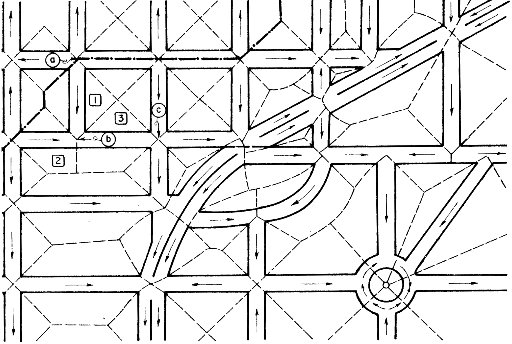
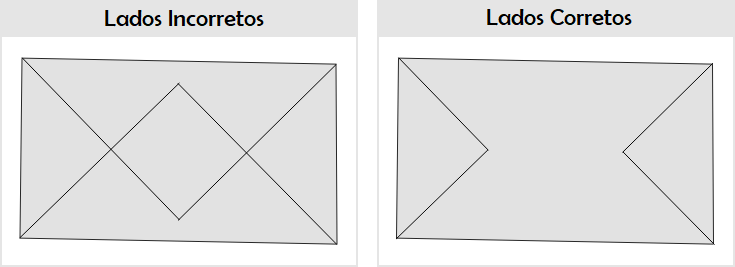
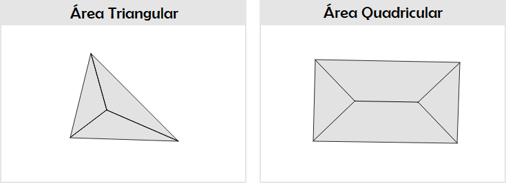
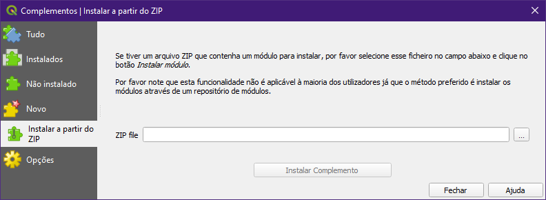
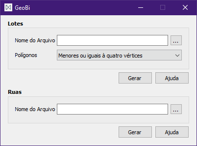
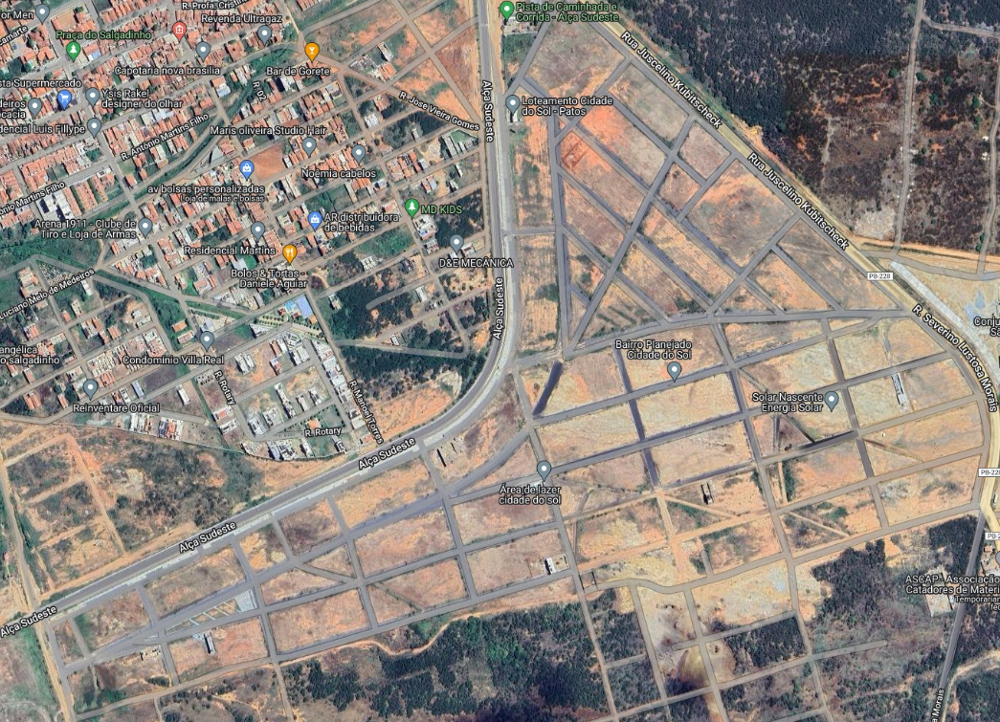
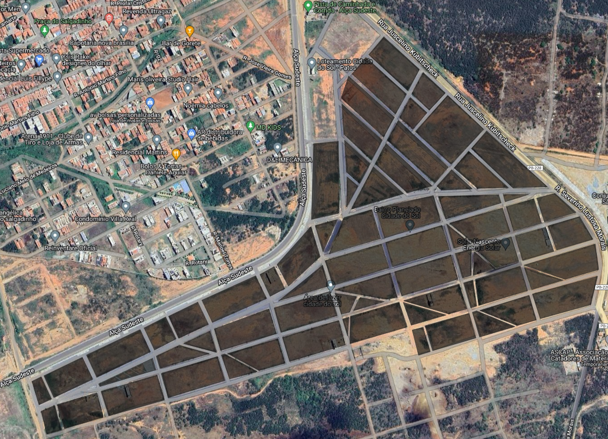
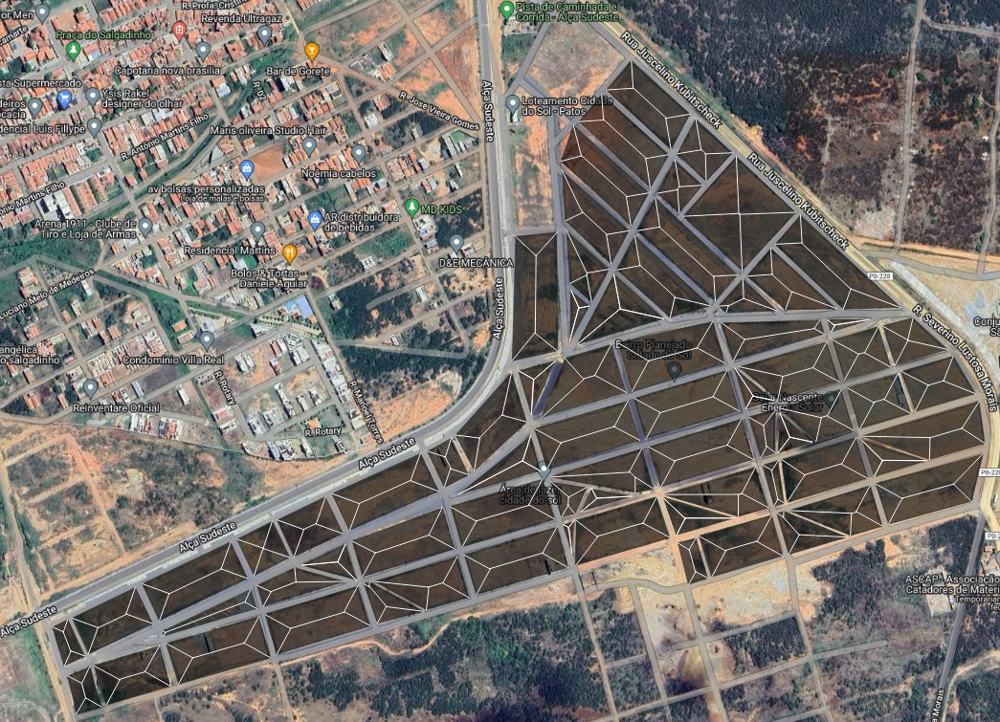
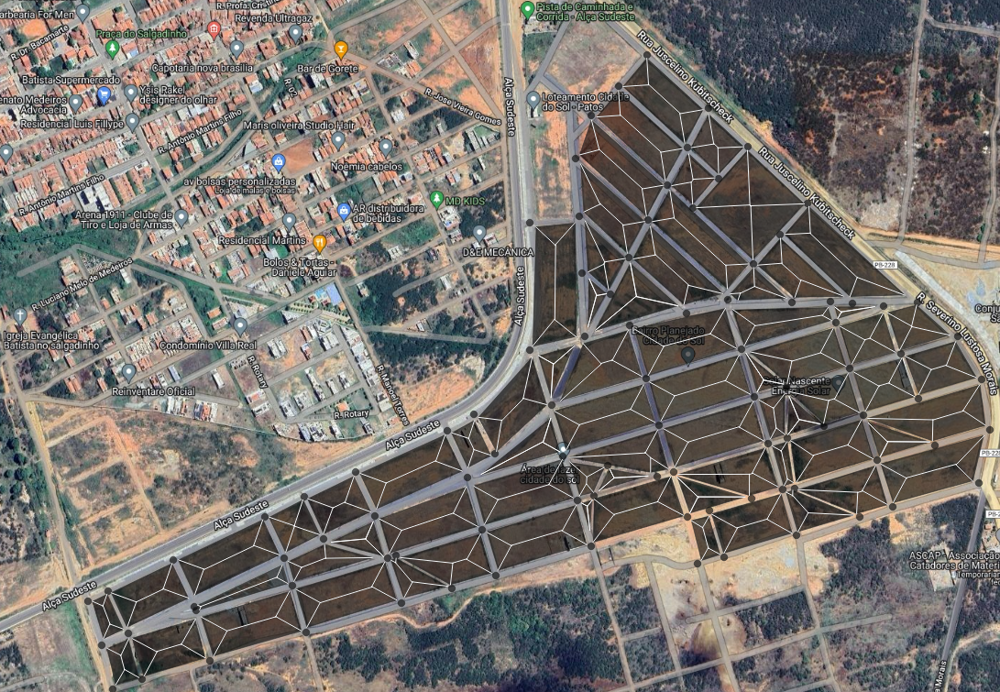
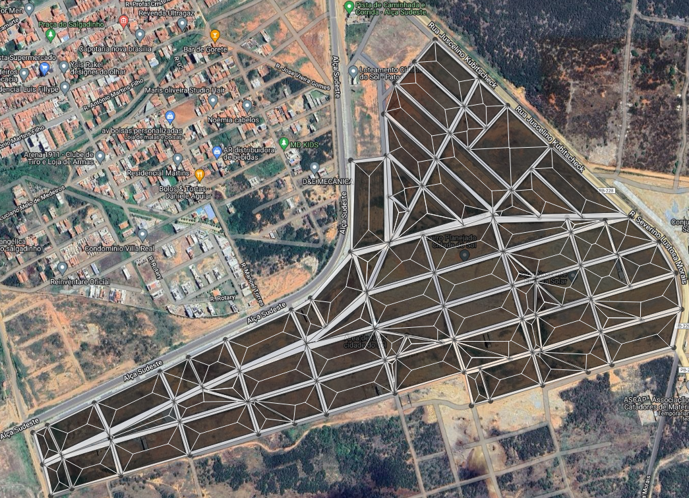

**Ferramenta GIS para auxiliar na determinação de área de contribuição em projetos de microdrenagem urbana**

*GIS tool to assist in determining the contributing area in urban microdrainage projects*

Alexandre Estrela de Lacerda Nóbrega¹  
Yuri Tomaz Neves²

*Revista COOPEX (ISSN: 2177-5052), v. 14, n. 05, p. 3819-3833, 2023. http://coopex.unifip.edu.br*

**RESUMO:** O crescimento das cidades destacou a importância do planejamento urbano para garantir segurança e bem-estar à população. A gestão da água das chuvas tornou-se crucial para evitar desastres naturais e impactos humanos. Isso levou ao desenvolvimento de projetos complexos de drenagem urbana. O QGIS, um *software* de código aberto, é uma ferramenta valiosa para esses projetos, mas algumas tarefas, como a definição das áreas de contribuição através do método das bissetrizes para o cálculo das vazões, ainda são manuais e morosas. Entendendo isso, este trabalho apresenta uma extensão de código aberto em Python que permite aos projetistas determinar essas áreas de forma automática no próprio QGIS, melhorando a precisão e velocidade de elaboração dos projetos de microdrenagem urbana.

**Palavras-chave:** método das bissetrizes; QGIS; Python.

**ABSTRACT:** The growth of cities has highlighted the importance of urban planning to ensure safety and well-being for the population. Managing rainfall water has become crucial to prevent natural disasters and human impacts. This has led to the development of complex urban drainage projects. QGIS, an open-source software, is a valuable tool for these projects, but some tasks, such as defining the contributing areas using the method of bisectors for flow calculations, are still manual and time-consuming. Recognizing this, this work presents an open-source Python extension that allows designers to automatically determine these areas within QGIS, improving the accuracy and speed of urban microdrainage project development.

**Keywords:** bisector method; QGIS; Python.

**DOI:** https://doi.org/10.61223/coopex.v14i5.551

¹ Graduando do curso de Engenharia Civil do Centro Universitário de Patos 2023 (UNIFIP).

² Docente do curso de Engenharia Civil do Centro Universitário de Patos 2023 (UNIFIP).

# INTRODUÇÃO

Com o crescimento das cidades, o planejamento urbano acabou por se tornar uma peça fundamental na ação de prover segurança e bem-estar para a população. Nesse cenário, o trabalho desenvolvido em torno de conter de forma eficaz a água que atinge as cidades através das precipitações, e escoá-las de maneira eficiente para corpos de água que darão continuidade ao ciclo hidrológico é crucial para evitar desastres de ordem natural e antrópica. Quanto a isso, Tucci (2012, p. 27) destaca o aumento na preocupação com os impactos das atividades humanas na natureza, aumentando a complexidade dos sistemas hídricos, provocando a necessidade de desenvolvimento de projetos com múltiplas finalidades, relacionados à hidrologia.

Dado essas crescentes demandas, têm-se a drenagem urbana, que é essencial na construção de sistemas e estruturas hidráulicas que conduzam as águas das chuvas sem ocasionar transtornos à população. Porto et al. (2012, p. 805) analisam que uma compreensão da zona das cidades e das relações dos sistemas que o compõe resultam em melhores soluções, dependendo de entre outros, a atuação de responsáveis de setores tecnológicos, e é nesse contexto que profissionais da área de engenharia desenvolvem sua expertise.

Muitas ferramentas são utilizadas na criação dos projetos de drenagem urbana, e com a evolução da tecnologia alguns deles têm se destacado como o programa de código aberto QGIS. Conhecido pela sua acessibilidade, é extremamente versátil devido a liberdade que a comunidade que o utiliza têm de desenvolver extensões que adicionam novas funcionalidades à ferramenta. Porém, dado a complexidades de projetos como os de drenagem, muitos aspectos de suas elaborações acabam por ainda serem manuais, como o traçado das áreas de contribuição que definem as áreas de influência das precipitações nas cidades e contribuem para o cálculo das vazões.

E entendendo as limitações das ferramentas computacionais e subjetividades do dimensionamento das estruturas hidráulicas, o presente trabalho tem por objetivo apresentar uma extensão de código aberto desenvolvido na linguagem de programação Python, que possibilite ao projetista determinar as áreas de contribuição de polígonos com até quatro vértices de maneira ágil através do método das bissetrizes dentro do próprio QGIS. A extensão resultará em mais precisão e celeridade em trabalhos que se utilizem da mesma.

# REVISÃO BIBLIOGRÁFICA

O processo de desenvolvimento de um projeto de estruturas hidráulicas passa por muitos métodos de cálculo para descobrir as variáveis que influenciam diretamente nos cálculos. Uma delas é a vazão, que dentro outros estudos, é possível achar através da teoria racional, que Wilken (1978, p. 128) descreve como exposta pela primeira vez por Emil Kuichling por volta de 1880, e vê como um axioma a relação direta entre a chuva e o deflúvio, e pode ser vista na equação (1).

$$
Q = C \bullet i \bullet A \tag{1}
$$

Em que *Q* representa o deflúvio, conhecido popularmente como vazão de projeto em litros ou metros cúbicos por segundo, *C* a relação entre o pico da vazão e a chuva média sobre a área receptora, *i* a intensidade média da chuva em litros, ou metros cúbicos por hectare e por segundo, e *A* a área da bacia receptora, ou, área de contribuição em hectares.

A variável da equação que interessa ao presente estudo é justamente a da área de contribuição. Bolinaga (1979, p. 50) indica para o cálculo delas o critério da subdivisão dos loteamentos em áreas formadas a partir de bissetrizes que partem de suas esquinas, como na Figura (1).

**Figura 1** – Áreas de contribuição a partir de bissetrizes.

**Fonte:** Bolinaga (1979, p. 51)

Em posse das coordenadas dos polígonos, nota-se facilidade no cálculo das bissetrizes deles, devido a percepção objetiva que o ser humano têm ao realizar as contas de forma manual, principalmente utilizando ferramentas computacionais como o AutoCad que facilita a obtenção de ângulos e o cálculo das distâncias.

Salienta-se a sua importância para áreas que não se têm uma boa base de dados e informações pluviométricas e topográficas. É possível ver seu uso em diversos trabalhos práticos, como o de Soares (2021), que se propôs a dimensionar um sistema de drenagem urbana para uma área comercial de Malta-PB, no de Costa (2022) que indica a implantação de microdrenagem para a cidade de Iguatu-CE, e de Santos (2023) que dimensionou um sistema de microdrenagem para todo um bairro de Patos-PB.

E indo além do caráter prático de seu uso, também se notam estudos que recorreram ao método das bissetrizes, como o Takahashi (2022) que o usou na sua análise comparativa do dimensionamento de galerias de águas pluviais abordando diferentes condições de escoamento, de Abreu (2019) que o utilizou no desenvolvimento de uma metodologia para o posicionamento de bocas de lobo aplicado à microdrenagem urbana, e o de Florêncio que fez um comparativo de preços para tubulações de PEAD e de concreto para sistemas de águas pluviais (2016).

Assim sendo, aplicar o método computacional de forma que seja possível a um algoritmo coletar as coordenadas, calcular de maneira automática, e após isso traçar as bissetrizes de forma correta, torna o processo mais complexo. Isto porque as diretrizes seguidas pela máquina programada devem ser sempre numéricas, necessitando de mais informações para que se chegue ao resultado.

Os cálculos feitos para chegar nas retas das bissetrizes, que formarão as áreas de contribuição, seguem um roteiro. Entretanto, é necessário entender que o presente estudo tratará apenas dos polígonos com quatro ou três vértices. Isto porque o ponto de intersecção das retas em triângulos e quadrados sempre será um, e estará em seu centro. Enquanto para quadriláteros com lados de comprimentos diferentes, haverão diversos pontos de intersecção, porém os escolhidos serão sempre os que partem dos vértices que formam as menores retas opostas, como pode ser visto na figura (2).

**Figura 2** – Traçado de intersecção das retas das bissetrizes.

**Fonte:** Próprio autor (2023)

Sabendo disso, é possível iniciar a obtenção das bissetrizes. Para descobrir de quais vértices partirão as bissetrizes dos quadriláteros, basta fazer um teste lógico, onde as menores somas dos comprimentos das retas opostas, terão os vértices escolhidos para gerar as bissetrizes que resultarão nos pontos de intersecção. Para isso, faz necessária a descoberta dos comprimentos das quatro retas do quadrilátero, descobertos a partir da equação da distância entre dois pontos (2).

$$
d = \sqrt{\left( x_{2} - x_{1} \right)^{2} + \left( y_{2} - y_{1} \right)^{2}} \tag{2}
$$

Em que *d* representa a distância ou comprimento da reta, *x*1 o ponto inicial e *x2* o ponto final do eixo das abscissas, e *y1* o ponto inicial e *y2* o ponto final do eixo das ordenadas.

Calculando os comprimentos das retas, basta somar as opostas e separar as que terão seus vértices usados para obter o ponto de intersecção entre as bissetrizes. Assim sendo, é possível iniciar o cálculo que resultará nas retas das bissetrizes. De início, calcula-se a equação da inclinação da reta (3) de um polígono regular.

$$
m = \frac{\left( y_{2} - y_{1} \right)}{\left( x_{2} - x_{1} \right)} \tag{3}
$$

Em que *m* representa a inclinação da reta. Assim, segue-se para o cálculo do ângulo dos vértices de origem das retas com inclinação obtida, usando a equação (4).

$$
\theta_{r} = \arctan\left( \frac{180}{\pi} \cdot \frac{m_{2} - m_{1}}{1 + m_{2} \cdot m_{1}} \right) \tag{4}
$$

Em que *θr* representa o ângulo do vértice, *m1* e *m2* são as retas que formam o ângulo e *π* o número pi. Em posse do ângulo do vértice, é possível traçar a bissetriz, que está na metade deste ângulo. É importante entender, que computacionalmente não é possível apenas traçar saindo de um ângulo que representa metade do descoberto para o vértice.

Isso porque o círculo trigonométrico convencionalmente rotaciona na direção anti-horária de acordo com o zero trigonométrico, logo, apenas gerar uma reta com um determinado ângulo, nem sempre a posicionará verdadeiramente onde se interessa, que é dentro do polígono partindo de um vértice.

Para corrigir o ângulo da reta da bissetriz, primeiro é necessário determinar um novo zero trigonométrico, e decidir em que sentido se seguirá o cálculo das retas. Para o presente estudo, será adotado o sentido horário, logo, será preciso determinar o ângulo da bissetriz com o sentido oposto ao encontrado a partir da equação (4), como na equação (5).

$$
\theta_{b} = - \frac{\theta_{r}}{2} \tag{5}
$$

Em que *θb* representa o ângulo no sentido correto convencionado para o cálculo. E para que a reta da bissetriz parta da origem correta na direção correta, é necessário descobrir um vetor formado do vértice de origem em direção a outro vértice do polígono, e usá-lo como novo zero trigonométrico. Para isso, basta utilizar o lado do polígono que possui o vértice de origem qual parte a reta da bissetriz, e aplicar as informações na equação (6).

$$
v_{r} = \left( x_{2} - x_{1},y_{2} - y_{1} \right) \tag{6}
$$

Em que *vr* é o vetor da reta. Com isso, têm-se o ponto de origem da reta da bissetriz, e um vetor que parte dele na direção de um dos lados do polígono . Para determinar a reta da bissetriz, se faz necessário ajustar a direção desse vetor de forma que ele seja o resultado do ponto inicial sendo o vértice, e do ponto da reta da bissetriz com comprimento semelhante ao do lado do polígono utilizado (7).

$$
v_{b} = \left( {v_{r}}_{x}*cos\left( \theta_{b} \right) - {v_{r}}_{y}*sen\left( \theta_{b} \right),\ {v_{r}}_{x}*sen\left( \theta_{b} \right) + {v_{r}}_{y}*cos\left( \theta_{b} \right) \right) \tag{7}
$$

Em que *vb* é o vetor da bissetriz, *vrx* e *vr*y são as coordenadas de *vr*. Obtendo o novo vetor, basta determinar a partir dele a coordenada do ponto que será usado para descobrir a reta da bissetriz com a equação (8).

$$
P_{b} = \left( x_{1} + v_{b_{x}},y_{1} + v_{b_{y}} \right) \tag{8}
$$

Em que *Pb* é um ponto da bissetriz, *vbx* e *vby* são as coordenadas de *vb*. Com a coordenada do vértice que é o ponto de origem, e a coordenada de um ponto da bissetriz, obtêm-se a inclinação da reta a partir da equação (3), e aplica as informações encontradas para obter equação da reta (9) da bissetriz.

$$
y - y_{0} = m \cdot \left( x - x_{0} \right) \tag{9}
$$

Em que *x* e *y* são variáveis que representam as coordenadas da reta, *x0* e *y0* são coordenadas de um ponto qualquer da reta, podendo se utilizar o do vértice, ou o da bissetriz calculado anteriormente. Obtendo as retas das bissetrizes dos vértices do polígono, basta calcular a coordenada do ponto de intersecção entre as retas das bissetrizes que partem dos vértices necessários para gerar o traçado através do sistema de equações (11), utilizando as equações reduzidas das retas (10).

$$
ax + by + c = 0 \tag{10}
$$

$$
\begin{cases} a_{1}x + b_{1}y + c_{1} = 0 \\ a_{2}x + b_{2}y + c_{2} = 0 \end{cases} \tag{11}
$$

E então basta traçar as retas, finalizando com uma ligando os dois pontos de intersecção, caso se trate de um quadrilátero. É possível ver um modelo de traçado na Figura 3.

**Figura 3** – Traçado final do método das bissetrizes.

**Fonte:** Próprio autor (2023)

# ASPECTOS METODOLÓGICOS

O desenvolvimento da ferramenta se deu através da linguagem de programação Python. As bibliotecas utilizadas para desenvolver as rotinas de cálculo foram a *Math*, Numpy, Scipy e Sympy, enquanto para o tratamento espacial das coordenadas dos pontos, geração de linhas e polígonos em arquivos no formato *shapefile* foram utilizadas as bibliotecas Shapely e GeoPandas. Elas permitem os cálculos geométricos geradores dos polígonos e linhas que resultam nas bissetrizes, comprimentos e áreas.

E para além das linhas e polígonos foi desenvolvido uma maneira de expandir de forma manual as áreas de contribuição pensando nas ruas, caso os polígonos sejam feitos apenas para os lotes. Será uma segunda opção de cálculo que só funcionará caso as bissetrizes já estejam calculadas. O usuário deverá alocar pontos ao redor dos polígonos na mesma quantidade do número de vértices dele, de forma que eles se ligarão ao ponto que está mais próximo, formando assim novas áreas, sendo elas extensões das formadas pelas bissetrizes.

Logo, haverá a possibilidade de interagir de duas formas com a extensão. A primeira é calculando as áreas de contribuição dos polígonos formados geralmente de lotes. E a segunda que precisará que a primeira já esteja calculada, para expandir as áreas de contribuição já calculadas.

A criação da interface gráfica para interação do usuário se deu através da biblioteca PyQt, e os ajustes para criação da extensão foram através do QGIS core. Todas as rotinas de cálculo foram compiladas junto da interface em um executável que funciona de maneira independente do QGIS, visto que elas não necessitam diretamente dele para exercer seu trabalho, podendo até mesmo ser usado com outros programas que se utilizam do formato de *shapefile* para criar polígonos, linhas e pontos.

Contudo, foram desenvolvidos os algoritmos para a extensão no QGIS, que quando acionada dentro dele, inicia o executável. E para facilitar sua instalação dentro do programa mencionado, os códigos da extensão foram comprimidos junto do executável no formato ZIP, tornando possível a instalação dela como complemento dentro do próprio QGIS, como mostra a Figura 4.

**Figura 4** – Instalar extensão a partir de ZIP.

**Fonte:** Próprio autor (2023)

# FERRAMENTA COMPUTACIONAL DESENVOLVIDA

A ferramenta computacional desenvolvida, denominada GeoBi, possibilita escolher em Lotes o arquivo *shapefile* com os polígonos desejados para calcular as áreas de contribuição a partir das bissetrizes, além da quantidade de lados que os polígonos que serão calculados devem ter. O mínimo de lados é três, e a ferramenta calcula com exatidão polígonos de até quatro lados. A Figura 5 apresenta a interface gráfica da ferramenta GeoBi.

**Figura 5** – Extensão para cálculo das áreas de contribuição.

**Fonte:** Próprio autor (2023)

Para expandir as áreas de contribuição já calculadas de forma manual, é necessário escolher um arquivo com pontos em “Ruas”, desde de que o primeiro cálculo já tenha acontecido. Ela funcionará apenas para polígonos com quatro ou menos lados.

O processo para gerar as áreas de contribuição é simples, intuitivo e rápido. Como exemplo de aplicação foi obtida a imagem espacial de um loteamento sem construções localizado na cidade de Patos na Paraíba, possível de se visualizar na Figura 6. Ela foi obtida através da extensão do QGIS, o *QuickMapServices*, utilizando as imagens do Google *Hydrid*.

**Figura 6** – Loteamento localizado na cidade de Patos-PB.

**Fonte:** Próprio autor (2023)

A partir do mapa, foi criado no QGIS uma camada em *shapefile* para polígonos, e nela foram demarcadas as áreas dos lotes, como é possível observar na Figura 7.

**Figura 7** – Camada poligonal em *shapefile* com polígonos.

**Fonte:** Próprio autor (2023)

Ao submeter a camada poligonal na extensão GeoBi, e determinar a geração de áreas a partir das bissetrizes em lotes com polígonos com quatro ou menos lados, foram obtidos dois arquivos em *shapefile*, um com as linhas que possuem informações de comprimentos, e outro com os polígonos com os dados das áreas de contribuição geradas a partir do cálculo. É possível visualizar as linhas geradas na Figura 8.

**Figura 8** – Camada de linhas em *shapefile* com bissetrizes.

**Fonte:** Próprio autor (2023)

E para estender as áreas de contribuição para as ruas, foram colocados pontos alinhados aos vértices em uma camada em *shapefile* para pontos, como visto na Figura 9.

**Figura 9** – Camada de linhas em *shapefile* para Lotes.

**Fonte:** Próprio autor (2023)

Com a primeira camada de polígonos já selecionada, e a segunda de pontos inserida em Rua, é possível gerar a extensão das áreas de contribuição que resulta em duas camadas de *shapefile*, uma de linhas com comprimentos, e uma de polígonos com áreas, de forma similar aos lotes. É possível ver as novas áreas geradas na Figura 10.

**Figura 10** – Camada de polígonos em *shapefile* para Ruas.

**Fonte:** Próprio autor (2023)

Nota-se que a extensão funciona bem para polígonos com três e quatro lados, e caso ultrapasse a quantidade de quatro vértices, não é garantido que saiam boas áreas de contribuição, sendo preciso recorrer à análise manual.

Contudo, ao que a extensão se propõe, dispõe-se de uma maior precisão nos cálculos das áreas, e grande velocidade na geração dos resultados. Contudo, ressalta-se que a velocidade de processamento é influenciada diretamente pelo computador utilizado para executar a extensão, podendo ter seu tempo de processamento das áreas aumentado ou diminuído.

E por fim, o código fonte com os algoritmos foi disponibilizado em um repositório no GitHub, além dos caminhos para realizar a transferência da extensão para o QGIS no formato ZIP, e do executável do GeoBi para o caso de querer usá-lo de forma separada.

# CONSIDERAÇÕES FINAIS

Espera-se com o presente trabalho poder contribuir com projetistas de microdrenagem na elaboração de projetos, dado sua facilidade de uso e aumento de praticidade na obtenção de resultados. Além disso, por a ferramenta possuir um executável que funciona de maneira independente do QGIS, devido ela modificar apenas o arquivo *shapefile*, dispõe-se de uma maior acessibilidade em seu uso, pois pode ser aplicada em outros programas que aceitem interagir com o formato citado.

Também se faz importante destacar que a ferramenta está disponível para futuros aprimoramentos, visto que todo seu código fonte é aberto, possibilitando análises, estudos e melhorias.

# REFERÊNCIAS

*ABREU, T. S. Q. Desenvolvimento de metodologia para o posicionamento de bocas de lobo aplicados à microdrenagem urbana. Universidade Federal Fluminense, 2019.*

*BERTONI, J. C.; TUCCI, C. E. M. Hidrologia ciência e aplicação. Universidade Federal do Rio Grande do Sul, 4, p. 177-243, 2012.*

*BOLINAGA, J. J. I. Drenaje Urbano; Ministerio del ambiente y de los recursos naturales renovables, INOD; Caracas, 1979.*

*COSTA, T. A. Proposta de implantação de microdrenagem urbana para a cidade de Iguatu-CE. Universidade Federal de Campina Grande, 2022.*

*FLORÊNCIO, G. M.; BACK, N. Comparativo de desempenho e viabilidade econômica entre tubulações de PEAD e concreto para sistemas de drenagem pluvial - Estudo de caso. UNESC, 2016.*

*PORTO, R. L.; FILHO, K. Z.; TUCCI, C. E. M.; BIDONE, F. Hidrologia ciência e aplicação. Universidade Federal do Rio Grande do Sul, 4, p. 805-849, 2012.*

*SANTOS, J. M. L. C. Proposta de sistema de microdrenagem urbana para bairro Maternidade no município de Patos/PB. Universidade Federal de Campina Grande, 2023.*

*SOARES, W. C. R. Sistema de drenagem urbana da área comercial de Malta-PB: Um estudo de caso. Universidade Federal de Campina Grande, 2021.*

*TAKAHASHI, F. Y. M. Análise comparativa do dimensionamento de galerias de águas pluviais: abordagem na condição de escoamento permanente e uniforme e na condição de escoamento não permanente e não uniforme. Universidade Federal de São Carlos, 2022.*

*TUCCI, C. E. M. Hidrologia ciência e aplicação. Universidade Federal do Rio Grande do Sul, 4, p. 25-35, 2012.*

*WILKEN, P. S. Engenharia de drenagem superficial. São Paulo, Companhia de Tecnologia de Saneamento Ambiental, 1978.*
