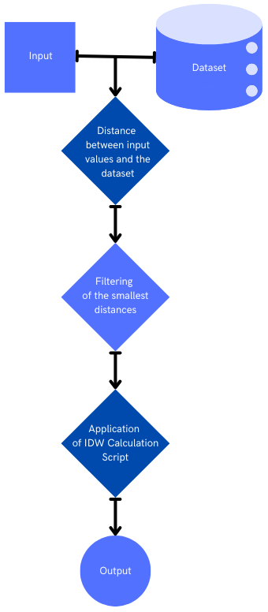
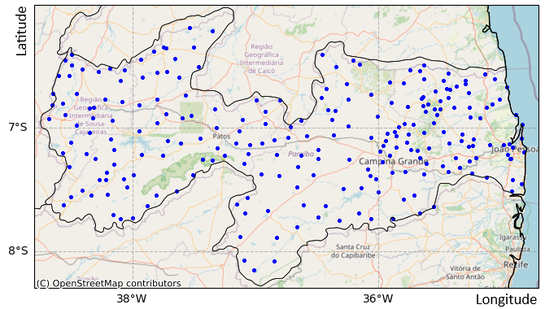
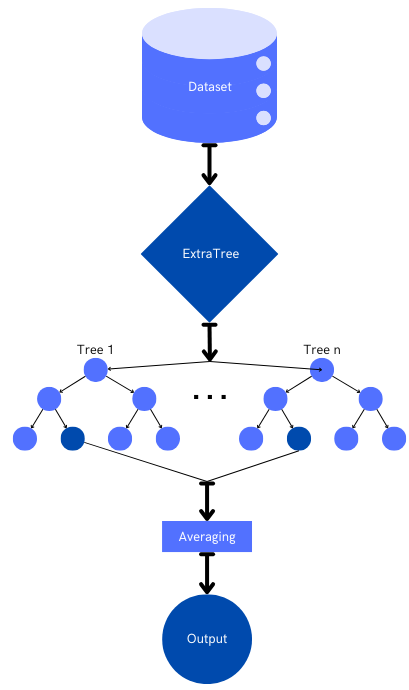
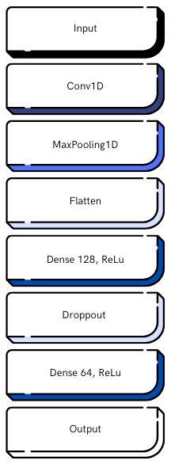
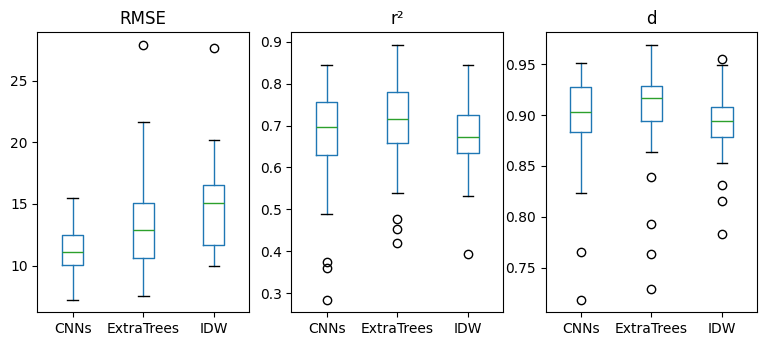
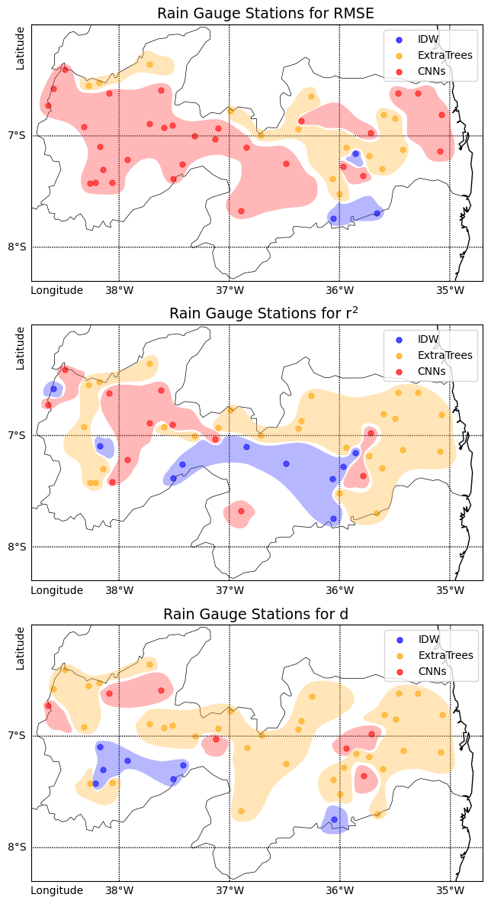
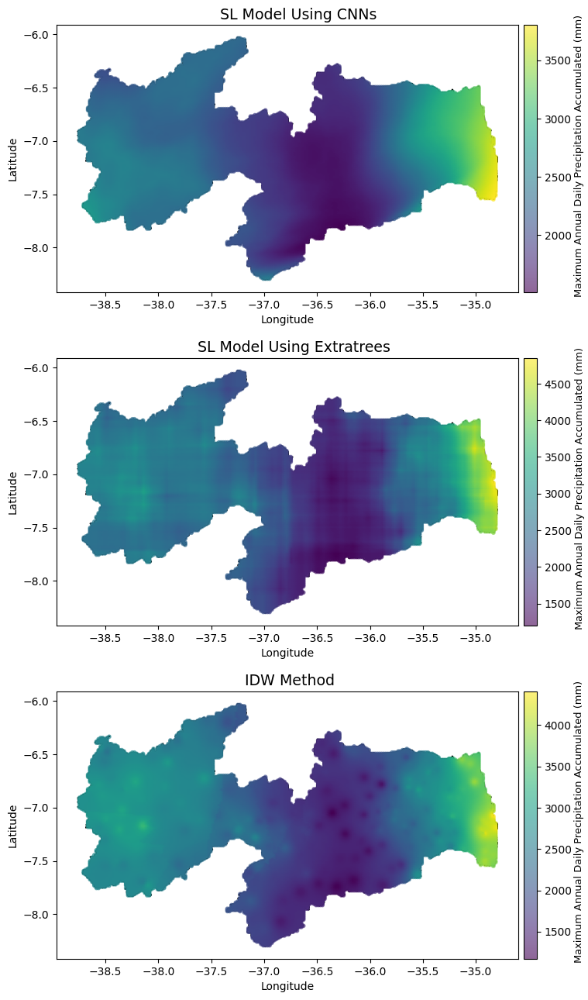

**Analysis of machine learning performance in spatial interpolation of rainfall data**

Alexandre E. L. Nobrega¹, Itamir M. B. Filho¹

¹Postgraduate Program in Information Technology, Institute Metrópole Digital, Federal University of Rio Grande do Norte, Natal, Rio Grande do Norte, Brazil

*Date of publication xxxx 00, 0000, date of current version xxxx 00, 0000.*

DOI: 10.1109/ACCESS.2024.0429000

Corresponding author: Alexandre E. L. Nobrega (e-mail: alexandre.estrela.085@ufrn.edu.br).

This work was supported by the Coordination for the Improvement of Higher Education Personnel - CAPES (identifier ROR: 00x0ma614). For open access purposes, the authors have assigned the Creative Commons CC BY license to any accepted version of the article.

# Abstract

The spatialization of precipitation data is crucial for studies on climatology, agriculture, and climate change, as well as for urban and environmental planning. Established spatial interpolation methods such as Inverse Distance Weighting are widely used for this purpose. With technological advancements, machine learning techniques have emerged as more efficient and computationally less costly alternatives for performing spatial interpolation calculations. Therefore, this study aims to analyze the performance of machine learning algorithms, including artificial neural networks, comparing them to the Inverse Distance Weighting method. The accuracy of the models was evaluated using the coefficient of determination, root mean square error, and concordance index, to confirm the effectiveness of these methodologies for maximum daily annual precipitation data. After testing different models for data spatialization and conducting a thorough statistical analysis, we conclude that machine learning models outperformed the Inverse Distance Weighting method, yielding greater variability in accumulated Annual Maximum Daily Precipitation values and improved overall results.

**Index Terms**: spacial interpolation, spatialization, machine learning.

# I. INTRODUCTION

The application of techniques for spatializing point rainfall data, such as peak or total precipitation, is of paramount importance for studies that depend on understanding the pluviometric behavior of a region. These studies encompass various areas, such as climatology, agriculture, and climate change, as demonstrated by Lopes \[1\] and Eugenio et al. \[2\]. They are also essential in urban and environmental planning, as discussed by Junior \[3\], and for analyzing the influence of pluviometric variability on the occurrence of extreme events, as evidenced by Caldana et al. \[4\].

There are several classic statistical methods for performing spatial interpolation of data, such as that proposed by Lennon and Tunner \[5\]. No method is universally superior, the choice of method depends on the specific circumstances. One such method is Inverse Distance Weighting (IDW). It is simple and recommended for regions with a large number of samples due to its low computational cost. This led to its use in this study \[6\], \[7\].

However, the use of artificial intelligence has also proven to be versatile and effective in tasks involving geospatial applications. For example, Kumar et al. \[8\] describe how deep learning models are now routinely used to downscale precipitation data, providing more accurate and reliable estimates at local scales. Additionally, its use in the interpolation of spatially distributed data can be highlighted, as demonstrated by Wanderley et al. \[9\] and Silva et al. \[10\], who identified AI as a more robust alternative for performing such tasks. Through the work of Zandi et al. \[11\], which applied machine learning models in high-resolution precipitation estimation, it is also understood that, when well-implemented, these models can have greater generalization capabilities, minimizing prediction errors.

The present study aims to analyze the performance of supervised learning (SL) algorithms, with one of them implemented using artificial neural networks (ANNs). For the evaluation of the accuracy and effectiveness of these models trained with annual maximum daily precipitation (AMDP) data, the well-established IDW method was used for comparison. Precision was measured using the coefficient of determination (r²), root mean square error (RMSE), and concordance index (d). These metrics are well-suited for comparing spatial interpolation methods for precipitation data, as demonstrated by Nogueira et al. \[12\] and Araujo et al. \[13\].

# II. STUDY AREA

The Brazilian State of Paraíba was selected for this study because of the large amount of high-quality data available from its water agencies. This study can be replicated in any region that has data with characteristics similar to those mentioned earlier. Paraíba has an area of 56,467.242 km² and 232 municipalities \[14\], with at least 98% of its territory located within the drought polygon. A semi-arid climate predominates in the central region and in most of the state. The hinterland region of the state experiences the lowest rainfall indices, ranging from 300 mm to 900 mm, concentrated in the first half of the year. However, the agreste (semi-arid transitional zone) and litoral (coastal) regions have their rainy season from April to June, with annual rainfall exceeding 1200 mm \[15\], \[16\].

Data on maximum annual daily precipitation and accumulated precipitation for the state of Paraíba span from 2015 to 2023, including at least 242 Rain Gauge Stations (RGSs). As mentioned above, these data were provided by the Executive Agency for Water Management of the State of Paraíba (AESA). A map of the state is shown in Figure 2, with a large number of rain gauge stations covering the entire state, enabling high-quality spatialization.

# III. MATERIALS AND METHODS

This section explores the theoretical foundation of the IDW statistical method, machine learning models, and the accuracy estimators used in the present study.

### 1) Inverse Distance Weighting (IDW)

In areas with scarse or irregularly distributed information, it becomes necessary to process and spatially interpolate the data \[17\]. In this context, commonly known statistical methods are applied, and the method that best fits the available data may vary depending on their temporal characteristics \[18\]. This is supported by studies from Tao et al. \[19\], Viola et al. \[20\], Junior et al. \[21\], Fim et al. \[22\], and Filho et al. \[23\], which compared different statistical methods—including triangulation, kriging, cokriging, minimum curvature, and IDW—showing varying results, with kriging and IDW performing best.

Beyond good performance on indicators, when comparing methods that require the coverage of a large number of interpolation points, it is necessary to select one with moderate computational cost, highlighting IDW as more feasible for this work. The IDW spatial interpolation method is deterministic and is described by Babak and Deutsch \[24\] as robust and of low complexity, estimating the variable of interest by assigning greater weight to nearby points. The function describing its calculation applied to the spatial interpolation of rainfall can be seen in Equation 1.

$$z_p = \frac{\sum _{i=1}^{n} \frac{z_i}{d_i^P}}{\sum _{i=1}^{n} \frac{1}{d_i^P}}\tag{1}$$

In this context, $Z_p$ represents the precipitation of interest in millimeters, $Z_i$ the precipitations at nearby points in millimeters, $d_i$ the distance to the nearby points, in degrees, and $P$ the interpolation exponent, which is dimensionless. The most commonly used value for the latter is 2, as it generally yields the best results in IDW calculations in previous studies \[24\], \[25\]. The architecture of the IDW method calculation algorithm process can be seen in Figure 1.

**FIGURE 1.** Abstraction of the algorithm for IDW calculation.



### 2) Extremely Randomized Trees

Regarding SL, it was utilized to implement predictive regression models using the Scikit-learn library, from the Python programming language, known for being simple and efficient for predictive data analysis, as well as being open-source and accessible \[26\]. The library provides a variety of regression models used for prediction and data imputation across diverse topics. In this context, aiming to apply data spatialization, studies like Ilambwetsi \[27\] demonstrated the effectiveness of using the random forest algorithm in interpolation processes to predict the spatial variability of average chestnut tree production based on soil samples and spatial variables. Similarly, Pereira \[28\] employed the support vector machine algorithm to generate spatial maps of physical and chemical soil attributes, aiming to characterize their spatial variability in precision agriculture. This approach was compared with the statistical interpolation method of ordinary kriging, with the SL algorithm showing superior performance. Silva \[29\] also achieved positive results using the k-nearest neighbors algorithm to model and predict characteristics of crustal structure in Brazil and fill missing data.

**FIGURE 2.** RGSs of the state of Paraíba.



To identify the SL model that performs best for the given data, Bishop \[30\] explains that a common and effective approach is to train multiple models using their default parameters and compare their performance using independent data subsets extracted from the original dataset. This process identifies the model that best fits the proposed problem. An effective method for evaluating performance and enabling model comparison is cross-validation, particularly the k-fold method. This method trains and tests the model on different data splits to ensure generalization \[31\]. Cross-validation is especially effective when data are scarce, aiding in identifying which model generalizes best to new data.

The hyperparameters of the chosen model are also analyzed to determine their ideal combination, as finding the most effective ones becomes crucial to optimize and ensure the highest possible generalization capacity, as they determine it, as explained by Arnold et al. \[32\]. A proven approach for this is grid search, where hyperparameters values are combined in different model training iterations, and the one with the best metrics is selected \[33\]. In determining the ideal model for the proposed data, ensembles for regression were utilized. As explained in Scikit-learn’s documentation \[34\], ensembles are methods that combine predictions from multiple base estimators created using a specific learning algorithm to enhance generalization and robustness compared to a single estimator.

The Scikit-learn documentation \[34\] highlights two famous and effective ensemble models: gradient-boosted trees and random forests. The latter is particularly suited for this study, as one of its algorithms, Extremely Randomized Trees (ExtraTrees), performed best with the precipitation data used. This algorithm works by randomly selecting $K$ attributes at each node and requires a minimum sample size nmin to split a node. A set of $M$ trees is then created using the complete training sample multiple times. For regression problems, as in this study, predictions are made through the arithmetic mean. The explicit randomization of the cut-off point and the attribute, combined with the ensemble’s averaging, effectively reduces variance compared to other methods employing different randomization schemes \[35\].

An abstraction of the architecture implemented for data spatialization is shown in Table 1 and Figure 3, where a grid search is performed to optimize the model’s parameters using cross-validation. A set of parameters is defined for tuning, such as the number of trees, the maximum number of features to be considered, the maximum depth of the trees, the minimum number of samples required to split a node, and the minimum number of samples required to be a leaf. Default values were provided for the grid search, however, additional values can be added if a search for better hyperparameters is desired. The model is evaluated using 5-fold cross-validation. The simplicity of the code is emphasized, making it consequently easy to understand.

**TABLE 1.** Spatial Data Interpolation Using the ExtraTrees Model

``` python
from sklearn.model_selection import GridSearchCV
from sklearn.ensemble import ExtraTreesRegressor
from sklearn.model_selection import KFold

# Define the parameters to be tuned
param_grid = {
    'n_estimators': [200],
    'max_features': [2],
    'max_depth': [20],
    'min_samples_split': [2],
    'min_samples_leaf': [1]
}

# Create the ExtraTreesRegressor model
model = ExtraTreesRegressor()

# Define the cross-validation strategy
kf = KFold(n_splits=5, shuffle=True, random_state=42)

# Perform the grid search
grid_search = GridSearchCV(model, param_grid, cv=kf, scoring='r2', verbose=0)
grid_search.fit(X, y)

# Retrieve the best model
best_model = grid_search.best_estimator_
```

### 3) Convolutional Neural Network

Regarding SL through ANNs, various studies have explored spatial interpolation using these algorithms across diverse applications. Miranda et al. \[36\] achieved satisfactory results by testing different ANNs architectures and comparing the best-performing one with the more traditional approach of kriging. They used this method to spatialize data, aiming to integrate and create a new dataset based on free-air gravity anomalies, filling data gaps and providing a more comprehensive representation of spatial variability. Another study by Salgado \[37\] applied convolutional neural network (CNN) models, achieving superior results to traditional methods when interpolating migrated and stacked seismic data with gaps caused by obstructions during the seismic acquisition process.

In the present study, the Python library TensorFlow was used, designed to facilitate research and application of models with flexibility and scalability \[38\]. Similar to the strategy employed with Scikit-learn to identify the ideal model, various neural network architectures were tested using the diverse layers available through TensorFlow’s Keras module \[39\]. The CNN learning approach yielded the best results among the models available in the library for precipitation data in Paraíba. When it comes to CNN architectures for structured data, such as those used in the present study, one can cite works like that of Fawaz et al. \[40\], who introduced CNN’s functionality, which processes data of this type by applying sliding filters to extract essential features. These filters perform convolutions to highlight relevant patterns while simultaneously reducing data dimensionality.

**FIGURE 3.** Abstraction of the process performed by ExtraTrees.



Some architectures also employ normalization layers, which facilitate faster convergence during training \[41\]. The output of the convolutional layers is passed through a final layer that generates class probabilities. Learning occurs as input data propagates through the neural network to produce a prediction. The difference between the prediction and the actual value is calculated and back-propagated through the network, from the output layer to the input, adjusting weights in the opposite direction of the error gradient to minimize the network’s loss function \[42\].

An abstraction of the CNN architecture implemented in this study is shown in Table 2 and Figure 4, where the process begins with the input data, with X.shape\[1\] and X.shape\[2\] representing its dimensions. The first layer is a Conv1D, which applies 64 convolution filters of size 3 to extract features from the sequential input data, with a ReLU activation function to introduce non-linearity. Next, there is a MaxPooling1D layer that reduces the dimensionality by performing a pooling operation of size 2 to simplify the representation. The Flatten layer transforms the 2D output into a 1D vector. Following that, a dense layer with 128 units and ReLU is applied, followed by a Dropout layer with a rate of 0.2 to prevent overfitting. Another dense layer with 64 units and ReLU is used before the final dense layer with a single unit, which is responsible for the output. Similar to the ExtraTrees architecture, this model demonstrates a simple, clean, and easily understandable code structure.

**TABLE 2.** Spatial Data Interpolation Using the CNN Model

``` python
from tensorflow.keras.models import Sequential
from tensorflow.keras.layers import Conv1D, MaxPooling1D, Flatten, Dense, Dropout
from tensorflow.keras.optimizers import Adam

# Define the CNN model
cnn = Sequential([
    Conv1D(64, 3, activation='relu', input_shape=(X.shape[1], X.shape[2])),
    MaxPooling1D(2),
    Flatten(),
    Dense(128, activation='relu'),
    Dropout(0.2),
    Dense(64, activation='relu'),
    Dense(1)
])

# Compile the model
cnn.compile(optimizer=Adam(learning_rate=0.001), loss='mse', metrics=['mse'])

# Train the model
history = cnn.fit(X, y, epochs=500, validation_split=0.2, verbose=0)
```

### 4) Precision Estimators

Precision estimators were used to compare different spatial interpolation methods and assess how closely SL models align with well-established techniques in the literature. As explained by Kuhn and Johnson \[43\], RMSE measures the difference between predicted and observed values through the root mean square error, providing results in the same unit as the analyzed variable. The lower the RMSE, the better. It is an easily interpretable measure since its result is expressed in the same unit as the analyzed variable. However, it is sensitive to outlier data, as it penalizes large errors and may overly amplify the influence of atypical values.

The r², on the other hand, measures the proportion of the total variability in the dependent variable explained by the model, thus providing a global perspective on the quality of the results. However, due to this, it can sometimes offer a misleading view of the model’s effectiveness, especially if there are systematic errors or if the model is overfitted, leading to an overestimation of the quality of the results \[43\].

Meanwhile, the d index evaluates the agreement between predicted and observed values, considering data variability and presenting low sensitivity to outliers. However, due to its generalized evaluation capability, the d index may not adequately reflect the precision of individual predictions \[44\]. The results for the two explained methods range from 0 to 1, with values closer to 1 indicating better model adjustment.

**FIGURE 4.** Abstraction of the process performed by CNN.



As observed, precision estimators have distinct strengths and weaknesses. The importance of evaluating predictive models from the perspective of different metrics lies precisely in this fact. By using a variety of indicators, they complement each other in the analysis, enabling a more rational and accurate view of the resulting data. The functions that allow the calculation of precision estimators are presented in Equations 2, 3, and 4.

$$r^2 = 1 - \frac{\sum _{i=1}^{n} (O_i - E_i)^2}{\sum _{i=1}^{n} (O_i - \overline{O})^2}
\tag{2}$$

$$RMSE = \sqrt{\frac{1}{n}\sum _{i=1}^{n}(O_i - E_i)^2}
\tag{3}$$

$$d = 1 - \frac{\sum _{i=1}^{n}(O_i - E_i)^2}{\sum _{i=1}^{n}(|E_i-\overline{O}|+|O_i - \overline{O}|)^2}
\tag{4}$$

Where $O_i$ represents the observed values, $E_i$ the estimated values, $O$ the mean of the observed values, and $n$ the number of observations. An abstraction of the implementation of these algorithms in Python, used to measure the models based on the calculated and observed values, can be seen in Table 3.

**TABLE 3.** Precision Estimator Algorithms

``` python
import numpy as np
from sklearn.metrics import mean_squared_error, r2_score

rmse = np.sqrt(mean_squared_error(observed, predicted))

r2 = r2_score(observed, predicted)

d = (1 - (np.sum((predicted - observed)**2) / np.sum((np.abs(predicted - np.mean(observed)) + np.abs(observed - np.mean(observed)))**2)))
```

# IV. RESULTS AND DISCUSSIONS

After programming the architectures of the SL models and developing an algorithm that performs calculations using the IDW method, precipitation data from AESA’s 242 RGSs were processed to be input into the algorithms. The columns of interest, referring to dates, station locations, and precipitation levels, were separated and used to create the datasets employed in the models.

To avoid overfitting, minimize potential biases in the modeling process, and ensure an unbiased evaluation of the precision estimators, several strategies were employed during data preparation and evaluation. First, the random selection of 49 RGSs for the test set, representing approximately 20% of the total stations, ensured that the models were evaluated on data not used during training. The remaining 193 RGSs had their datasets prepared by separating the labels, corresponding to the precipitation values to be predicted, from their attributes, derived from other columns. This prevented the models from excessively fitting to specific characteristics of the training data, thereby reducing the risk of overfitting.

After this preparation, the datasets were used to train the SL models ExtraTrees and CNNs, as well as to apply the IDW statistical method. Since they are trained independently, the risk of bias that can occur when any single model is excessively adjusted to the specific training data is reduced, as it will deviate from the others.

Using the precision estimators described in Equations 1, 2, and 3, the precision values for each of the 49 test RGSs were calculated based on their observed and estimated values. Calculating the average of these values, in order to contribute to a more representative and generalized estimate of the models’ real performance, while mitigating potential biases, the results presented in Table 4 were obtained.

**TABLE 4.** Average Precision Estimators for AMDP of Test RGSs

| Model      | RMSE (mm) | r²      | d       |
|:-----------|:----------|:--------|:--------|
| IDW        | 14,62593  | 0,67375 | 0,89047 |
| ExtraTrees | 13,31727  | 0,70748 | 0,90674 |
| CNNs       | 11,23504  | 0,67626 | 0,89689 |

**FIGURE 5.** Comparison of Precision Estimators for AMDP of Test RGSs.



The results in Table 4 show that the IDW method, on average, performed less precisely than the SL models. For the RMSE estimator, the CNN model achieved the lowest average compared to the others, indicating better generalization in its results. Conversely, the ExtraTrees SL model demonstrated values closer to 1 for the r² and d estimators, indicating greater accuracy on average in calculating the test RGSs. Given that the mean is highly influenced by outlier values, it is important to gain a broader understanding of the data’s behavior. The graphs presented in Figure 5 show that the CNN model generally achieved better and more consistent results for RMSE, while for the other estimators, it exhibited more dispersed results, sometimes even inferior to the other methods. On the other hand, the ExtraTrees model demonstrated the best performance compared to the other methods for both r² and d.

Finally, the IDW method showed consistent but less significant results across all estimators. While this method was reliable with low dispersion, its overall performance was inferior to the other approaches. Thus, Table 5 presents the quantities of RGSs for the spatialization methods that achieved the best precision estimators, along with their distribution and influence across the Paraíba territory in the graphs of Figure 6.

**TABLE 5.** Number of Test RGSs Where Spatialization Methods Achieved the Best Individual Performance for Different Precision Estimators

| Metric | IDW (RGS) | ExtraTrees (RGS) | CNNs (RGS) |
|:-------|:----------|:-----------------|:-----------|
| RMSE   | 3         | 15               | 31         |
| r²     | 10        | 27               | 12         |
| d      | 7         | 35               | 7          |

By associating Table 5 with Figure 6, it is possible to observe how the test RGSs cluster for each spatialization method, forming zones on the maps. For RMSE, the CNN model clearly dominates, with 31 out of the 49 test RGSs, as shown in the graphical representation, which indicates higher estimators throughout the sertão (backlands) and litoral regions of Paraíba. On the other hand, ExtraTrees showed versatility for RMSE, with 15 RGSs and stronger representation in the agreste region of the state, as well as some presence in the sertão. In contrast, IDW was less effective for this estimator, with only 3 RGSs in the agreste region, where CNN performed less well.

Regarding r², ExtraTrees performed best with 27 superior test RGSs. Upon analyzing the map, it is clear that the influence zones for each spatialization method are distinct. ExtraTrees excels in the litoral region and also appears in other areas. It shares influence in the agreste region with IDW and in the sertão with CNN. For d, ExtraTrees dominates all state regions with 35 superior test RGSs, while the other methods form small, scattered zones, with each of them showing only 7 better RGSs.

Furthermore, it is important to understand that, in addition to precision estimators, other factors should positively or negatively influence whether a model is practical and viable for use, such as the time required to perform spatialization, which is related to computational cost. To assess this factor and simultaneously develop the spatialization maps, a grid of RGSs was simulated for the entire Paraíba territory, consisting of 20,247 posts spanning from 2015 to 2023. The training and prediction times for each spatialization method can be seen in Table 6. Based on the training and prediction of the grid of RGSs, it was possible to spatialize the accumulated AMDPs, as observed for each method in Figure 7.

**FIGURE 6.** Precision of Different Spatialization Methods for AMDP of Test RGSs.



**FIGURE 7.** Spatialization by CNNs, ExtraTrees, and IDW for Accumulated AMDPs for Generated RGSs.



Analyzing Table 6 in conjunction with the maps in Figure 7, it is observed that for CNNs, the model training time is reasonable. However, even though the prediction time is almost double compared to ExtraTrees, the prediction of RGSs is still fast. The map for this model shows the smallest scale for accumulated AMDP, with a smooth transition between the different rainfall zones.

ExtraTrees presented the lowest computational cost among all the other methods, with the sum of training and prediction times being well below that of the others. The map for this method showed the largest color scale, with the highest and lowest accumulated AMDP rates. In contrast to the CNN modeling, for ExtraTrees, well-defined precipitation zones were seen, with specific points of rain and drought in a cross-like pattern. However, it is important to emphasize that computational capacity can directly influence the training time of the models. Since the models in the present study were trained under the same hardware conditions, the reliability of the results can be ensured.

**TABLE 6.** Training and Prediction Time for AMDP of Generated RGSs for Spatialization

| Model      | Training Time (s) | Prediction Time (s) |
|:-----------|:------------------|:--------------------|
| IDW        | 0                 | 5401                |
| ExtraTrees | 16                | 52                  |
| CNNs       | 487               | 95                  |

The IDW method was a middle ground between ExtraTrees and CNNs, with a scale not as large as the first, but larger than the second. It also presented a somewhat defined transition between color zones, with some smoothness in the transitions. Similar to ExtraTrees, this method also showed points of rain and drought, but in a more rounded pattern. As for the computational cost of IDW, it was the highest, with a total time significantly greater than that of the other methods.

However, despite the particularities of each spatialization method used, the rain and drought zones were generally very similar and aligned with reality, with the litoral zone and part of the agreste showing the highest precipitation rates, and the rest of the agreste and sertão having the lowest rainfall indices.

# V. CONCLUSION

From the presented analysis, the spatialization methods proved to be consistent with each other, with precision estimators being close, and the specialized maps displaying climatological characteristics that were not divergent.

However, it was possible to observe that the SL models were more effective than the IDW method, with ExtraTrees standing out due to its computational speed and lower cost, offering greater variability in accumulated AMDP values and generally superior accuracy indices compared to the other methods for the state of Paraíba. Therefore, in this study, the use of SL models proved to be not only feasible but also superior to the classical method commonly used for spatial interpolation of precipitation data.

With this result, it is also evident the flexibility that artificial intelligence application methods have, in that, with well-adjusted data, well-defined models, and the right computational capacity, various problems that were previously restricted to traditional statistical applications can now be addressed, often achieving superior results. In the case of the present study, spatial interpolation was applied in a specific context, but the concept can be expanded to many other areas that would benefit from its use.

However, it is important to exercise caution when training machine learning models, as data limitations can directly influence the results obtained. One example is the biases that may arise in regions with significant spatial variation in precipitation distribution. The concentration of stations in more urbanized or accessible areas may lead to an underrepresentation of more remote or difficult-to-reach areas, which would impact the accuracy of interpolation. There is also concern regarding missing data, as large gaps, particularly at critical points, can compromise the quality of generated predictions and the generalization capacity of the models. Therefore, careful attention to data selection and preprocessing is essential.

Within this scope, the data used refers to a dry region with low precipitation, specifically Paraíba. It is suggested that SL models be further applied to precipitation data in regions with different climatological characteristics than the one studied, as well as testing with other potential machine learning libraries or different programming languages, thereby aiming to improve the precision of results through new techniques and models.

# References

\[1\] J. R. R. F. M. LOPES. Metodologias Para Avaliação dos Impactes das Mudanças Climáticas na Agricultura de Regadio e nos Sistemas de Rega. Universidade Técnica De Lisboa, Instituto Superior De Agronomia, 2013. \[Online\]. Available: https://www.proquest.com/openview/cbd6c942a99522fe5768f8589fe8de0 9/1?pq-origsite=gscholar&cbl=2026366&diss=y/. Accessed: May 29, 2024.

\[2\] F. C. EUGENIO; et al. Zoneamento agroclimatológico do Coffea canephora para Espírito Santo mediante interpolação espacial. *Coffee Science*, Lavras, vol. 9, no. 3, pp. 319-328, Jul./Sep. 2014. \[Online\]. Available: http://www.sbicafe.ufv.br/handle/123456789/8056/. Accessed: May 29, 2024.

\[3\] W. E. JUNIOR. Mapeamento e Análise Espacial de Dados Climáticos do Município de Ribas do Rio Pardo-MS. Fundação Universidade Federal de Mato Grosso do Sul, 2023. \[Online\]. Available: https://repositorio.ufms.br/jspui/retrieve/4f33f9d0-7a03-4e9d-ae2a-58ce1 0fd53a1/9826.pdf/. Accessed: May 29, 2024.

\[4\] N. F. S. Caldana et al., "Ocorrências De Alagamentos, Enxurradas E Inundações E A Variabilidade Pluviométrica Na Bacia Hidrográfica Do Rio Iguaçu," Revista Brasileira De Climatologia, vol. 23, 2021. \[Online\]. Available: https://ojs.ufgd.edu.br/index.php/rbclima/article/view/14099/. Accessed: May 29, 2024.

\[5\] J. J. LENNON; J. R. G. TURNER. Predicting the spatial distribution of climate: temperature in Great Britain. *Journal of Animal Ecology*, vol. 64, no. 3, pp. 670-392, 1995.

\[6\] K. N. DIRKS; J. E. HAY; C. D. STOW; D. HARRIS. High-resolution studies of rainfall on Norfolk Island Part II: Interpolation of rainfall data. *J. Hidr.*, vol. 208, no. 3-4, pp. 187-193, 1998. \[Online\]. Available: https://www.sciencedirect.com/science/article/abs/pii/S002216949800155 3/. Accessed: May 29, 2024.

\[7\] B. V. DEUS; P. ZEILHOFER; G. C. ARAUJO; A. S. L. SANTOS. Interpolação pluviométrica na Bacia do Alto e Médio Rio Teles Pires: uma análise de séries históricas e interpoladores. In: Simpósio Brasileiro De Ciências Geodésicas E Tecnologias Da Geoinformação, 3., 2010, Recife. Anais. Recife: UFPE, 2010. pp. 1-7.

\[8\] B. Kumar al., "On the modern deep learning approaches for precipitation downscaling," *Earth Science Informatics*, vol. 16, 2023. Available: https://doi.org/10.1007/s12145-023-00970-4. Accessed on: Mar 05, 2025.

\[9\] H. S. WANDERLEY; et al. Interpolação espacial de dados médios mensais pluviométricos com redes neurais artificiais. *Revista Brasileira de Meteorologia*, vol. 29, no. 3, pp. 389-396, 2014. \[Online\]. Available: https://www.scielo.br/j/rbmet/a/9Njh63QG7X8xtBkTmRK7XJS/?lang=pt/. Accessed on: May 29, 2024.

\[10\] V. A. SILVA; et al. Previsão de precipitação mensal no município de Barra Mansa/RJ usando técnicas de deep learning time series. *Revista Holos*, vol. 5, no. 39, pp. xxx–xxx, 2023. \[Online\]. Available: https://www2.ifrn.edu.br/ojs/index.php/HOLOS/article/view/16340/. Accessed on: May 29, 2024.

\[11\] O. Zandi al., "Stacking machine learning models versus a locally weighted linear model to generate high-resolution monthly precipitation over a topographically complex area," *Atmospheric Research*, vol. 272, 2022. Available: https://doi.org/10.1016/j.atmosres.2022.106159. Accessed on: Mar 05, 2025.

\[12\] B. N. NOGUEIRA; et al. Comparação entre métodos de interpolação espacial para a estimativa da distribuição de precipitação no Ceará-Brasil. *Irriga*, vol. 25, no. 1, pp. 131-142, 2020. \[Online\]. Available: https://irriga.fca.unesp.br/index.php/irriga/article/view/3782/2629/. Accessed on: May 29, 2024.

\[13\] F. C. ARAUJO; E. L. DE MELLO; B. B. DA SILVA; E. MERCANTE; G. M. GOLIN. Comparação de técnicas de interpolação para espacialização da precipitação pluvial na bacia do rio Piquiri (PR). *Brazilian Journal of Development*, vol. 7, no. 12, pp. 117497–117506, 2021. \[Online\]. Available: https://ojs.brazilianjournals.com.br/ojs/index.php/BRJD/article/view/4136. Accessed on: May 29, 2024.

\[14\] IBGE – Instituto Brasileiro de Geografia e Estatística. CIDADES E ESTADOS - PARAÍBA. 2024. \[Online\]. Available: https://www.ibge.gov.br/cidades-e-estados/pb.html/. Accessed on: May 21, 2024.

\[15\] J. J. S. GURGEL. Sobre a produção de pescado dos açudes públicos do semi-árido nordeste brasileiro. presented at *Taller internacional sobre ecología y manejo de peces en lagos y embalses*, Santiago de Chile, COPESCAL Doc. Téc., (4), 1984. \[Online\]. Available: https://www.fao.org/4/ad772s/AD772S05.htm#ch5/. Accessed on: May 29, 2024.

\[16\] R. M. F. FRANCISCO; D. SANTOS. Climatologia do Estado da Paraíba. 1st ed. Campina Grande-PB: EDUFCG, 2017. \[Online\]. Available: https://educapes.capes.gov.br/bitstream/capes/573985/2/Climatologia%20 do%20Estado%20da%20Paraiba.pdf/. Accessed on: May 29, 2024.

\[17\] F. F. N. MARCUZZO; L. R. ANDRADE; D. C. R. MELO. Métodos de interpolação matemática no mapeamento de chuvas no estado do Mato Grosso. *Revista Brasileira de Geografia Física*, vol. 4, pp. 793-804, 2011.

\[18\] E. CAMARGO; S. DRUCK; G. C MARA. Análise de Superfícies por Geoestatística Linear, in *Análise Espacial de Dados Geográficos*, S. DRUCK, M. S. CARVALHO, G. C MARA, A. V. M. MONTEIRO, Eds., Brasília, DF: Embrapa, 2004, pp. 209.

\[19\] T. TAO; B. CHOCAT; S. LIU; K. XIN. Uncertainty analysis of interpolation methods in rainfall spatial distribution: A case of small catchment in Lyon. *Journal Water Resource and Protection*, vol. 1, no. 2, pp. 136-144, 2009.

\[20\] M. R. VIOLA; C. R. MELLO; D. B. F. PINTO; J. M. MELLO; L. F. ÁVILA. Métodos de interpolação espacial para o mapeamento da precipitação pluvial. *Revista Brasileira de Engenharia Agrícola e Ambiental*, vol. 14, no. 9, pp. 970-978, 2010.

\[21\] B. S. G. JUNIOR; I. A. L. MAGALHÃES; C. A. A. FREITAS; R. A. CECÍLIO. Análise de técnicas de interpolação para espacialização da precipitação pluvial na bacia do rio Itapemirim (ES). *Ambiência*, Guarapuava (PR), pp. 61-71, 2011.

\[22\] B. M. FIM; D. L. de ARAÚJO; H. G. de A. LARA; H. L. ROIG. Interpolação espacial da precipitação mensal média no Distrito Federal, Brasil. *Revista Brasileira de Climatologia*, 2017.

\[23\] D. F. F. FILHO; P. E. S. BEZERRA; M. N. A. SILVA; R. S. S. RODRIGUES; N. M. FIGUEIREDO. Análise climatológica e tendências de precipitação na região norte do Brasil. *Revista Brasileira de Climatologia*, ano 15, v. 24, jan./jun. 2019, pp. 277-299.

\[24\] O. BABAK; C. V. DEUTSCH. Statistical approach to inverse distance interpolation. *Stochastic Environmental Research and Risk Assessment*, v. 23, n. 5, 2009, pp. 543-553. Disponível em: https://www.ccgalberta.com/ccgresources/report10/2008-131_statistical_i nverse_distance.pdf. Acesso em: 29 mai. 2024.

\[25\] D. F. WATSON; G. M. PHILIP. A Refinement of inverse distance weighted interpolation. *GeoProcessing*, v. 2, 1985, pp. 315-327. Disponível em: https://www.scirp.org/reference/referencespapers?referenceid=435000. Acesso em: 29 mai. 2024.

\[26\] F. PEDREGOSA; G. VAROQUAUX; A. GRAMFORT; V. MICHEL; B. THIRION; O. GRISEL; M. BLONDEL; P. PRETTENHOFER; R. WEISS; V. DUBOURG; J. VANDERPLAS; A. PASSOS; D. COURNAPEAU; M. BRUCHER; M. PERROT; É. DUCHESNAY. Scikit-learn: Machine Learning in Python. *Journal of Machine Learning Research*, v. 12, 2011, pp. 2825-2830. \[Online\]. Available: https://www.jmlr.org/papers/volume12/pedregosa11a/pedregosa11a.pdf. Accessed on: Jul. 30, 2024.

\[27\] P. de S. ILAMBWETSI. Proposta de um interpolador geoestatístico híbrido com aprendizado de máquina. 2020. Universidade Federal de Viçosa, Viçosa - Minas Gerais.

\[28\] G. W. PEREIRA. Ferramentas computacionais para suporte à decisão no mapeamento de atributos do solo. Tese (Doutorado em Engenharia Agrícola) – Universidade Federal de Viçosa, Viçosa, 108 f. 2021.

\[29\] W. de J. SILVA. Reamostragem em redes neurais: uma abordagem alternativa aos métodos tradicionais de interpolação espacial para modelagem de superfícies em áreas agrícolas. Dissertação (Mestrado em Agricultura e Informações Geoespaciais) – Universidade Federal de Uberlândia, Campus Monte Carmelo, Monte Carmelo - Minas Gerais, 2024.

\[30\] C. M. BISHOP. Pattern recognition and machine learning. 1st ed. 2006. Corr. 2nd printing. New York: Springer, 2006. 32-33 p.

\[31\] J. FRIEDMAN; T. HASTIE; R. TIBSHIRANI. The elements of statistical learning. New York: Springer, 2008. 215-216 p.

\[32\] C. Arnold et al., "The role of hyperparameters in machine learning models and how to tune them," *Political Science Research and Methods*, vol. 12(4), 2024. Available: https://doi.org/10.1017/psrm.2023.61. Accessed on: Mar 05, 2025.

\[33\] SCIKIT-LEARN. GridSearchCV. \[Online\]. Available: https://www.scikit-learn.org/dev/modules/generated/sklearn.model_selecti on.GridSearchCV.html/. Accessed on: Oct. 8, 2024.

\[34\] SCIKIT-LEARN. Ensembles: Gradient boosting, random forests, bagging, voting, stacking. \[Online\]. Available: https://www.scikit-learn.org/dev/modules/ensemble.html/. Accessed on: Oct. 8, 2024.

\[35\] P. Geurts, D. Ernst, and L. Wehenkel, "Extremely randomized trees," *Machine Learning*, vol. 63, no. 1, pp. 3–42, 2006.

\[36\] F. A. Miranda, S. R. Correia de Freitas, and P. L. Faggion, "Integração e interpolação de dados de anomalias ar livre utilizando-se a técnica de RNA e krigagem," *Boletim de Ciências Geodésicas*, vol. 15, no. 3, pp. 428–443, Jul./Sep. 2009.

\[37\] M. F. Salgado, "Redes neurais convolucionais como ferramenta de interpolação de dados sísmicos," M.S. thesis, Inst. Astron., Geofísica e Ciências Atmosféricas, Univ. de São Paulo, São Paulo, Brazil, 2022.

\[38\] M. Abadi et al. "TensorFlow: Large-Scale Machine Learning on Heterogeneous Distributed Systems," arXiv preprint arXiv:1603.04467, 2016. \[Online\]. Available: https://arxiv.org/abs/1603.04467. Accessed on: Jul. 30, 2024.

\[39\] Keras, "The Model class," \[Online\]. Available: https://keras.io/api/models/model/. Accessed on: Oct. 8, 2024.

\[40\] H. I. Fawaz et al. "Deep learning for time series classification: a review," *Data Mining and Knowledge Discovery*, vol. 33, pp. 917–963, 2019. \[Online\]. Available: https://link.springer.com/article/10.1007/s10618-019-00619-1/. Accessed on: May 29, 2024.

\[41\] S. Ioffe and C. Szegedy, "Batch normalization: Accelerating deep network training by reducing internal covariate shift," in *Proc. International Conference on Machine Learning*, vol. 37, 2015, pp. 448–456.

\[42\] Y. LeCun, L. Bottou, G. B. Orr, and K. R. Müller, "Efficient backprop," in *Neural Networks: Tricks of the Trade*, Springer, Berlin, 1998, pp. 9–50.

\[43\] M. Kuhn and K. Johnson, *Applied Predictive Modeling*, Springer, New York, Heidelberg, Dordrecht, London, 2013, pp. 95–97.

\[44\] C. J. Willmott et al., "Statistics for the evaluation and comparison of models," *Journal of Geophysical Research*, vol. 90, no. C5, 1985.


**Alexandre E. L. Nobrega** received the B.S. degree in Civil Engineering from the Centro Universitário de Patos (UNIFIP), Patos, Brazil, in 2023, and is currently pursuing the M.S. degree in Information Technology with an emphasis on Computational Intelligence at the Instituto Metrópole Digital (IMD), Universidade Federal do Rio Grande do Norte (UFRN), Natal, Brazil.

His research interests include machine learning, time series analysis, optimization methods, and data analysis. With a focus on the application of these techniques, he aims to address challenges in diverse domains, contributing to the advancement of intelligent computational systems.


**Itamir M. Barroca Filho** received the B.S. degree in Computer Engineering and a specialization in Computer Networks from the Universidade Federal do Rio Grande do Norte (UFRN), Brazil, and the M.S. and Ph.D. degrees in Systems and Computing from UFRN.

He is currently a Professor at the Instituto Metrópole Digital (IMD/UFRN) and a permanent member of the Graduate Program in Information Technology (PPGTI/UFRN). He also serves as Deputy Director of Projects at IMD/UFRN and Coordinator of the Embrapii unit at IMD/UFRN.

His research interests include information systems, mobile applications, IoT, cloud computing, and artificial intelligence. He has led over 20 projects, securing and managing more than 20 million BRL in funding between 2021 and 2023. He is the author of over 30 software registrations and has published award-winning scientific works.
