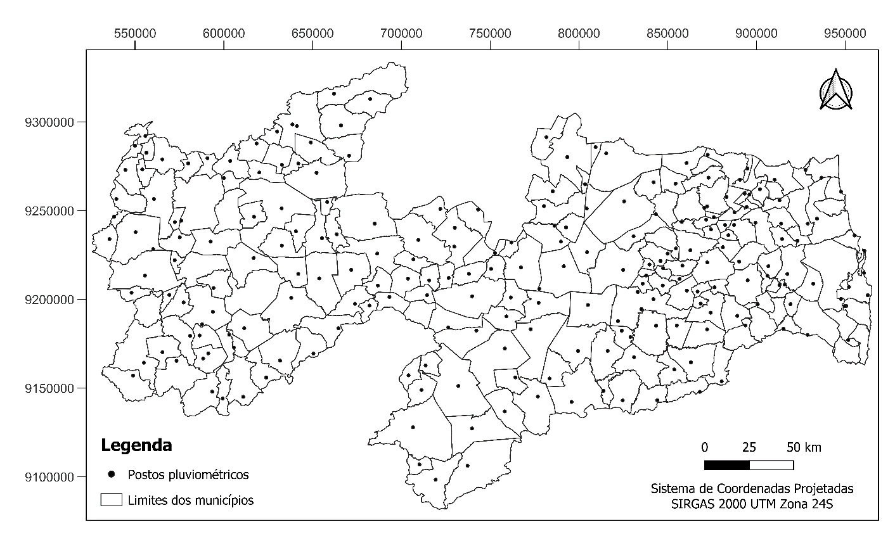
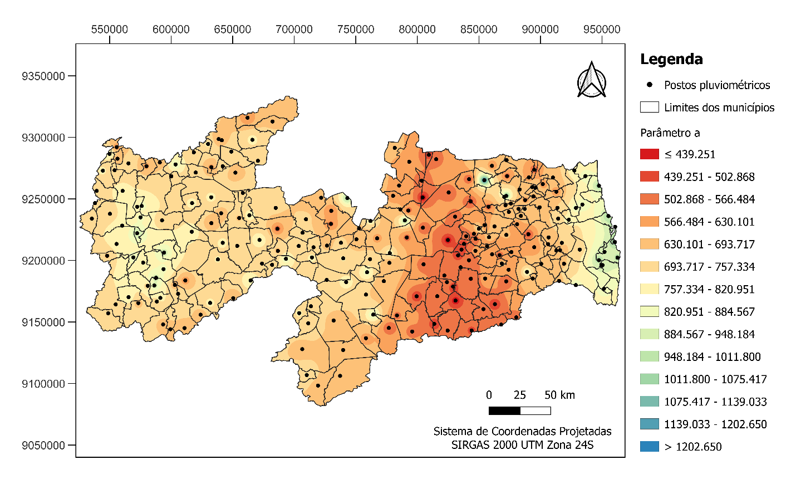
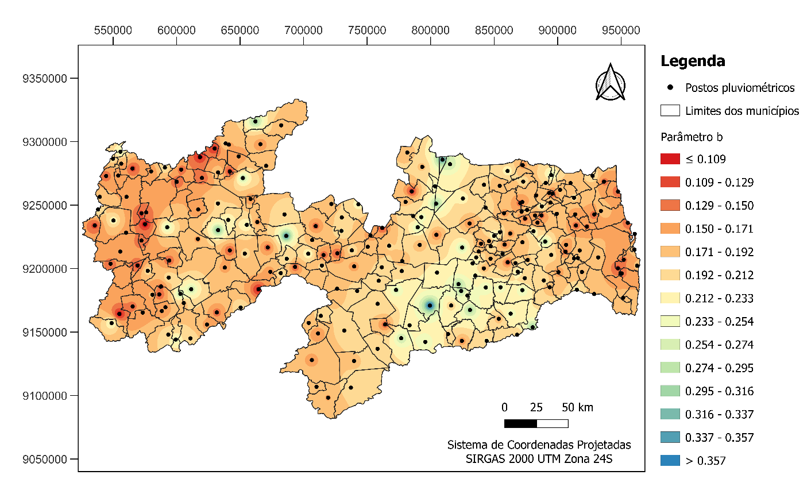
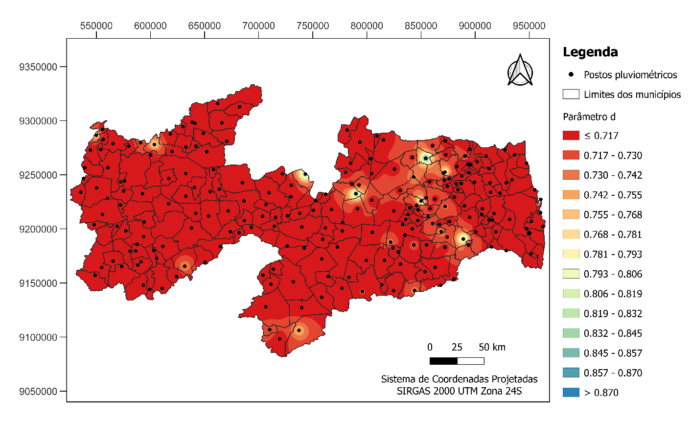

**Coletânea de equações de chuvas intensas e espacialização de seus parâmetros para o estado da Paraíba**

**Resumo**

Chuvas intensas são eventos que podem causar grandes prejuízos humanos e materiais. Para mitigar tais problemas, é fundamental que estruturas hidráulicas sejam projetadas e analisadas considerando a intensidade das chuvas. Nesse cenário, têm-se equações de chuvas intensas, expressões analíticas obtidas a partir de análise estatística, que relacionam as grandezas intensidade, duração e frequência das maiores chuvas de uma determinada duração. Com objetivo de apresentar uma coletânea de equações de chuvas intensas e espacializar os seus parâmetros para todo o estado da Paraíba, foram utilizadas as ferramentas computacionais GAM-IDF e QGIS, bem como, desenvolvidos algoritmos de automação em Python. Como resultado foram geradas, para o estado da Paraíba, 226 equações e mapas que permitem estimar os seus parâmetros para os locais sem dados. Espera-se com esse trabalho fornecer informações valiosas para a realização de estudos e elaboração de projetos que dependem da intensidade das chuvas no território paraibano.

**Palavras-chave:** intensidade das chuvas; GAM-IDF; QGIS; Python.

**Compilation of intensity rainfall equations and spatialization of their parameters for the state of Paraíba**

**Abstract**

Intensity rainfall are events that can cause great human and material losses. To mitigate such problems, it is essential that hydraulic structures are designed and analyzed considering the intensity of the rains. In this scenario, there are intensity equation rainfall, analytical expressions obtained from statistical analysis, that relate he intensity, duration and frequency of the largest rains of a certain duration. With the aim of presenting a collection of intense rain equations and spatializing their parameters for the entire state of Paraíba, the computational tools GAM-IDF and QGIS were used, as well as, automation algorithms in Python were developed. As a result, 226 equations and maps were generated for the state of Paraíba, which allow estimating their parameters for places without data. It is expected with this work to provide valuable information for conducting studies and developing projects that depend on the intensity of rainfall in state of Paraíba.

**Keywords:** rainfall intensity; GAM-IDF; QGIS; Python.

**Colección de ecuaciones de lluvias intensas y espacialización de sus parámetros para el estado de Paraíba**

**Resumen**

Lluvias intensas son eventos que pueden causar grandes daños humanos y materiales. Para mitigar tales problemas, es fundamental que las estructuras hidráulicas se diseñen y analicen considerando la intensidad de lluvias. En este escenario, se tienen ecuaciones de lluvias intensas, expresiones analíticas obtenidas a partir del análisis estadístico, que relacionan las magnitudes intensidad, duración y frecuencia de las mayores lluvias de una determinada duración. Con objetivo de presentar una colección de ecuaciones de lluvias intensas y espacializar sus parámetros para todo estado de Paraíba, se utilizaron herramientas computacionales GAM-IDF y QGIS, así como se desarrollaron algoritmos de automatización en Python. Como resultado se generaron, para estado de Paraíba, 226 ecuaciones y mapas que permiten estimar sus parámetros para lugares sin datos. Se espera con este trabajo proporcionar información valiosa para la realización de estudios y elaboración de proyectos que dependen de la intensidad de las lluvias en territorio paraibano.

**Palabras clave:** intensidad de las lluvias; GAM-IDF; QGIS; Python.

# Introdução

Chuvas intensas são eventos que podem causar grandes prejuízos humanos e materiais. Os prejuízos humanos incluem afogamentos, ferimentos, e doenças de veiculação hídrica, como leptospirose, hepatite, cólera e giardíase. Já os prejuízos materiais vão desde os custos com reparos, até perdas e reconstruções de bens públicos e privados.

Com o propósito de mitigar tais problemas, é fundamental que as estruturas hidráulicas sejam projetadas e analisadas considerando a intensidade das chuvas. Nesse cenário, surgem as equações de chuvas intensas, expressões analíticas obtidas a partir de análise estatística, que buscam relacionar as grandezas intensidade, duração e frequência das maiores chuvas de uma duração escolhida da série de dados de um pluviógrafo.

Devido à falta de dados pluviográficos em quantidade e qualidade suficientes no Brasil, normalmente são utilizados dados de precipitação máxima diária anual fornecidos por estações pluviométricas. Em seguida, aplica-se um método de desagregação para estimar a precipitação com durações sub-diárias.

Os parâmetros das equações de chuvas intensas obtidos utilizando pluviógrafos e pluviômetros são pontuais e podem variar significativamente de um ponto para outro. Como alternativa para estimar esses parâmetros em locais sem dados, é possível espacializar os parâmetros obtidos utilizando dados de estações existentes. Sampaio (2011) realizou a determinação e a espacialização dos coeficientes das equações de chuvas intensas em diferentes bacias hidrográficas do Rio Grande do Sul, a partir da desagregação de chuvas de 24 horas de duração. Rabelo et al. (2017), realizaram a espacialização dos parâmetros de equações de chuvas intensas para a Região Metropolitana do Recife (RMR) e para o município de Goiana.

Na Paraíba, alguns estudos já foram desenvolvidos buscando determinar os parâmetros das equações de chuvas intensas. Estudos pioneiros foram conduzidos por Pfafstetter (1957) que utilizou dados de registros de chuva de estações localizadas em João Pessoa, no Litoral, e em São Gonçalo, no Sertão, para ajustar os coeficientes da relação entre a precipitação e o período de retorno considerando várias durações. Aragão et al. (2000) desenvolveram equações de chuvas intensas para 15 municípios, bem como, geraram isolinhas que permitem a determinação dos parâmetros para qualquer local do estado da Paraíba. Recentemente, Campos et al. (2017), avaliaram a aderência de séries de dados pluviométricos a diferentes modelos probabilísticos e estimaram os parâmetros das equações de chuvas intensas de 90 municípios do estado da Paraíba.

A Paraíba possui 223 municípios (IBGE, 2010) e 242 estações pluviométricas (AESA, 2023). Diante do exposto, se faz necessário gerar os parâmetros das equações de chuvas intensas com dados mais abrangentes e atuais.

Nessa ótica, o presente trabalho tem como objetivo apresentar uma coletânea de equações de chuvas intensas, utilizando o máximo de estações pluviométricas possível, e espacializar os seus parâmetros para o todo o estado da Paraíba.

# Material e métodos

Para elaborar as equações de chuvas intensas de todo o estado da Paraíba, foi utilizada a ferramenta *web Genetic Algorithm Methodology For I-D-F* (GAM-IDF, 2020). Ela aplica um conjunto de métodos consagrados na literatura, que seguem uma lógica de desenvolvimento a partir dos dados inseridos.

A ferramenta inicia o seu método de cálculo verificando a existência de tendência estatística nos dados de precipitação, utilizando-se do teste não paramétrico de Mann-Kendall ao nível de significância de 5%. Ele detecta a existência de tendências monotônicas em séries temporais ou conjuntos de dados correlacionados. Seu uso é útil especialmente em distribuições onde a relação entre as variáveis é desconhecida ou não linear.

Caso os dados não apresentem tendência, inicia-se a modelagem probabilística. A GAM-IDF utiliza diversas distribuições probabilísticas, submetendo-as posteriormente ao teste de aderência não paramétrico de Anderson-Darling, ao nível de significância de 5%, definindo as que melhor se adequam aos dados. Ele é descrito por Beskow et al. (2015) como robusto para checagem dos ajustes dessas distribuições, para séries de chuvas diárias anuais máximas. Dentre as disponibilizadas pela ferramenta, é possível citar a Gama, a Generalizada de Valores Extremos, a Logística Generalizada, a Normal Generalizada, a Generalizada de Pareto, a de Gumbel, a de Kappa, a de Pearson tipo III, de Log-Normal 3 Parâmetros, e a de Weibull, pois apresentaram os melhores ajustes na geração das equações do presente trabalho. A GAM-IDF os calcula a partir do método dos momentos-L, tendo os cálculos definidos pelos autores citados anteriormente como um sistema estatístico com maior confiabilidade, sendo este argumento corroborado por Parida (1999) e Valverde et al. (2004). As equações das funções citadas podem ser vistas de (1.1) à (1.11).

$$
F_{GA} = G\left( \frac{x}{\beta},\alpha \right) \tag{1.1}
$$

onde:

*F_(GA)* é a função acumulativa de probabilidade Gama;

*G* é a função matemática Gama;

*x* é a variável aleatória da distribuição;

*β* é o ajuste de escala da distribuição;

*α* é o ajuste de forma da distribuição.

$$
F_{GU} = e^{\left\lbrack {- e}^{\left\{ \frac{- (x - \xi)}{\alpha} \right\}} \right\rbrack} \tag{1.2}
$$

onde:

*F_(GU)* é a função acumulativa de probabilidade de Gumbel;

*ξ* é o ajuste de localização da distribuição;

*α* é o ajuste de escala da distribuição.

$$
F_{GV} = e^{\left\lbrack - \left\{ \frac{1 - k(x - \xi)}{\alpha} \right\}^{\frac{1}{k}} \right\rbrack} \tag{1.3}
$$

onde:

*F_(GV)* é a função acumulativa de probabilidade Generalizada de Valores Extremos;

*k* é o parâmetro de forma da distribuição.

$$
F_{LG} = \frac{1}{\left\lbrack 1 + \left\{ \frac{1 - k(x - \xi)}{\alpha} \right\}^{\frac{1}{k}} \right\rbrack} \tag{1.4}
$$

onde:

*F_(LG)* é a função acumulativa de probabilidade Logística Generalizada;

*α* é o ajuste de escala da distribuição.

$$
F_{GP} = 1 - \left\{ 1 - \frac{k(x - \xi)}{\alpha} \right\}^{\frac{1}{k}} \tag{1.5}
$$

onde:

*F_(GP)* é a função acumulativa de probabilidade Generalizada de Pareto;

*α* é o ajuste de escala da distribuição.

$$
F_{NG} = \phi\left\lbrack - k^{- 1} \bullet log\left\{ 1 - \frac{k(x - \xi)}{\alpha} \right\} \right\rbrack \tag{1.6}
$$

onde:

*F_(NG)* é a função acumulativa de probabilidade Normal Generalizada;

*α* é o ajuste de escala da distribuição.

$$
F_{KA} = \left\lbrack 1 - h\left\{ 1 - \frac{k(x - \xi)}{\alpha} \right\}^{\frac{1}{k}} \right\rbrack^{\frac{1}{h}} \tag{1.7}
$$

onde:

*F_(KA)* é a função acumulativa de probabilidade de Kappa;

*h* é o ajuste de escala alternativo da distribuição;

*α* é o ajuste de escala da distribuição.

$$
F_{LN} = \phi\left( \frac{\log\log\ (x - \xi) - \mu\ }{\sigma} \right) \tag{1.8}
$$

onde:

*F_(LN)* é a função acumulativa de probabilidade Log-Normal 3 parâmetros;

*ϕ* é a função acumulativa de probabilidade de uma distribuição normal padrão;

*μ* é a média da distribuição;

*σ* é o desvio padrão da distribuição.

$$
F_{WE} = 1 - e^{\left\lbrack - \left\{ \frac{(x - \zeta)}{\beta} \right\}^{\beta} \right\rbrack} \tag{1.9}
$$

onde:

*F_(WE)* é a função acumulativa de probabilidade de Weibull;

*ζ* é o ajuste de localização da distribuição;

*β* é o ajuste de forma da distribuição.

$$
F_{P3} = G\left( \left( x - \mu + \frac{2\sigma}{\gamma} \right)\left| \frac{\sigma\gamma}{2} \right|,\frac{4}{\gamma^{2}} \right),\gamma > \tag{1.10}
$$

$$
F_{P3} = 1 - G\left( - \left( x - \mu + \frac{2\sigma}{\gamma} \right)\left| \frac{\sigma\gamma}{2} \right|,\frac{4}{\gamma^{2}} \right), \tag{1.11}
$$

onde:

*F_(P3)* é a função acumulativa de probabilidade de Pearson tipo III;

*G* é a função de distribuição acumulada;

γ é o ajuste de assimetria da distribuição.

Após a ferramenta definir as chuvas diárias anuais máximas para os períodos de retorno que serão de 2, 5, 10, 20, 50 e 100 anos, escolhidos e aplicados às funções acumulativas de probabilidade, ela desenvolve a desagregação das precipitações diárias a partir da relação entre durações. A GAM-IDF utiliza como padrão os coeficientes de desagregação da CETESB (1979), empregados em todo o território brasileiro, que podem ser vistos na Tabela 1.

**Tabela 1** – Coeficientes de desagregação para diferentes durações.

| Relação entre durações | Constantes |
|:--|:--|
| h 24° /h 1 dia | 1.14 |
| h 6° /h 24° | 0.72 |
| h 1° /h 24° | 0.42 |
| h 30' /h 1° | 0.74 |
| h 20' /h 30' | 0.81 |
| h 15' /h 30' | 0.70 |
| h 10' /h 30' | 0.54 |
| h 5' /h 30' | 0.34 |

**Fonte:** DAEE/CETESB (1979).

Com os dados desagregados segue-se para o ajuste dos parâmetros da equação das chuvas intensas para o modelo matemático descrito por Tucci (2012), que pode ser visto na equação (1.12). Ele é feito através do algoritmo genético de otimização *Shuffled Complex Evolution – University of Arizona*, apresentado por Duan et al. (1992), e aplicado por Vargas et al. (2019) nas cinco regiões do Brasil, obtendo ótimas otimizações para as equações de chuvas intensas.

$$
I = \frac{a\  \bullet \ {Tr}^{b}}{(t + c)^{d}} \tag{1.12}
$$

onde:

*I* é a intensidade de precipitação, em mm/h;

*Tr* é o tempo de retorno, em anos;

*t* é a duração em minutos;

*a, b, c, d* são os parâmetros da equação.

Para que todos os processos explicitados sejam bem desenvolvidos, é necessário a obtenção dos dados de precipitação de uma fonte confiável. Para a determinação das equações das chuvas intensas da Paraíba, os que foram utilizados são de precipitações diárias, contabilizados até o ano de 2022. Estes foram disponibilizados pelo órgão gestor dos recursos hídricos paraibanos, que é a Agência Executiva de Gestão das Águas do Estado da Paraíba (AESA). Estes dados propiciam séries mínimas iguais ou maiores a 15 anos de registro. Enquanto isso, a ferramenta GAM-IDF exige pelo menos 10 anos de séries registradas. Também é possível citar trabalhos como os de Back (2001), Souza et al. (2012), Aragão et al. (2013) e Caldeira et al. (2015) que admitem séries históricas mínimas com anos observados entre 10 e 15.

Após a obtenção desses dados, é preciso tratá-los, visto que a ferramenta web aceita apenas eles no formato emitido pela Agência Nacional de Águas (ANA). Esse tratamento se deu a partir de algoritmos implementados através da linguagem de programação Python, extraindo os dados da AESA, e gerando arquivos de texto no estilo da ANA. Também foram elaborados algoritmos para otimização da inserção desses dados na GAM-IDF, e extração dos resultados obtidos, além da organização e compilação destes em planilhas no software Excel, que detalham a estação, cidade e localização dos mesmos, para que assim haja uma melhor empregabilidade.

Posteriormente, mapas foram desenvolvidos no software livre QGIS, que permite a análise de dados georreferenciados. A geração deles foi possível através dos parâmetros das equações IDF e informações de suas localidades, já compiladas nas planilhas citadas anteriormente. Os mapas permitem analises específicas sobre cada um dos parâmetros, e a partir deles o entendimento de como a precipitação se comporta ao longo do estado da Paraíba, além da possibilidade de observar os postos pluviométricos do território paraibano.

# Resultados e discussão

Após utilizar todos os dados tratados da AESA nos algoritmos programados em Python para tal, foram gerados 242 arquivos de texto contendo os dados de precipitação dos seus respectivos postos pluviométricos. Ao aplica-los na GAM-IDF, extrair, compilar, organizar e referencia-los com base no seu local de origem, foi possível gerar 226 equações de chuvas intensas, com funções probabilidades distintas, seguindo sempre o melhor ajuste calculado pela ferramenta. Logo, é possível notar que 16 postos pluviométricos não conseguiram passar no critério do teste de Mann Kendall ao nível de 5% de significância, estabelecido pela ferramenta e explicitado anteriormente. Isto pois segundo o mesmo, as séries apresentaram tendência. Outro problema apresentado em algumas das cidades foi de não possuírem ao menos 10 anos de dados de precipitação. Os postos falhos podem ser observados na Tabela 2.

**Tabela 2** – Cidades e Postos onde não foi possível gerar as equações das chuvas intensas.

| Cidade/Estação | Latitude | Longitude |
|:--|:--|:--|
| Aparecida | -6.7864 | -38.0847 |
| Bayeux | -7.1336 | -34.9383 |
| Bonito de Santa Fé | -7.3144 | -38.5144 |
| Caaporã | -7.5156 | -34.9172 |
| Cajazeiras/Açude Lagoa do Arroz | -6.7986 | -38.5681 |
| Desterro | -7.2903 | -37.0881 |
| Itabaiana | -7.3250 | -35.3375 |
| Marcação | -6.7717 | -35.0163 |
| Piancó | -7.2150 | -35.2942 |
| Pilar | -7.2675 | -37.9258 |
| Pitimbu | -7.4544 | -35.2608 |
| Riachão | -6.5403 | -35.6603 |
| Santa Rita | -7.1406 | -34.9828 |
| Sousa | -6.7694 | -38.2194 |
| Sumé/UFCG | -7.6736 | -36.8965 |

**Fonte:** Elaboração dos Autores (2023).

Quanto aos 226 postos que obtiveram sucesso na geração de suas equações, é possível visualizar seus dados nas Tabelas 3 a 11 que se seguem. Elas são divididas de acordo com os tipos de funções acumulativas de probabilidade, visto que cada uma delas possuem diferentes parâmetros.

**Tabela 3** – Dados da equação das chuvas intensas para função acumulativa de probabilidade Gamma.

| Código | Lat. | Lon. | Cidade / Estação | Ano Inicial | Ano Final | a | b | c | d | α | β | NS | RMSE |
|:--|:--|:--|:--|:--|:--|:--|:--|:--|:--|:--|:--|:--|:--|
| 3847505 | -7.2478 | -36.4892 | Gurjão | 1994 | 2022 | 658.839 | 0.212 | 9.217 | 0.707 | 4.361 | 16.902 | 0.991 | 6.392 |
| 3849429 | -7.2475 | -35.3728 | São José dos Ramos | 1999 | 2022 | 633.384 | 0.150 | 9.206 | 0.706 | 10.317 | 6.809 | 0.995 | 3.547 |

**Fonte:** Elaboração dos Autores (2023).

**Tabela 4** – Dados da equação das chuvas intensas para função de probabilidade de Gumbel.

| Código | Lat. | Lon. | Cidade / Estação | Ano Inicial | Ano Final | a | b | c | d | ξ | α | NS | RMSE |
|:--|:--|:--|:--|:--|:--|:--|:--|:--|:--|:--|:--|:--|:--|
| 3839727 | -6.8333 | -35.3878 | Araçagi | 1994 | 2022 | 625.788 | 0.181 | 9.215 | 0.706 | 61.763 | 19.199 | 0.996 | 3.489 |
| 3845491 | -7.2114 | -37.0583 | Cacimbas | 2004 | 2022 | 786.995 | 0.198 | 9.227 | 0.707 | 75.263 | 27.804 | 0.995 | 5.335 |
| 3839208 | -6.6147 | -35.4681 | Caiçara | 1994 | 2022 | 589.734 | 0.196 | 10.167 | 0.729 | 51.455 | 18.335 | 0.995 | 3.497 |
| 3940513 | -7.2532 | -34.9297 | Conde / Açude Gramame Mamuaba | 1995 | 2022 | 824.226 | 0.159 | 9.219 | 0.707 | 83.843 | 20.652 | 0.997 | 3.491 |
| 3849384 | -7.1408 | -35.0911 | Cruz do Espírito Santo | 1995 | 2022 | 730.937 | 0.174 | 9.207 | 0.706 | 73.055 | 20.957 | 0.997 | 3.713 |
| 3839851 | -6.9150 | -35.2517 | Cuité de Mamanguape | 2000 | 2022 | 758.736 | 0.135 | 9.205 | 0.707 | 79.040 | 14.989 | 0.998 | 2.356 |
| 3858145 | -7.5831 | -35.7953 | Gado Bravo | 2003 | 2022 | 507.353 | 0.176 | 9.211 | 0.706 | 50.513 | 14.877 | 0.996 | 2.658 |
| 3848579 | -7.2925 | -35.6119 | Ingá | 1994 | 2022 | 568.788 | 0.197 | 10.023 | 0.725 | 49.478 | 18.385 | 0.995 | 3.554 |
| 3940226 | -7.0833 | -34.8333 | João Pessoa / DFAARA | 1994 | 2022 | 1057.27 | 0.187 | 9.221 | 0.707 | 103.331 | 33.896 | 0.996 | 6.266 |
| 3940343 | -7.1972 | -34.8131 | João Pessoa / Mangabeira | 1996 | 2022 | 973.047 | 0.176 | 9.246 | 0.707 | 96.530 | 28.368 | 0.996 | 5.065 |
| 3848384 | -7.1628 | -35.5931 | Juarez Távora | 1994 | 2022 | 554.825 | 0.189 | 9.120 | 0.705 | 54.547 | 18.283 | 0.996 | 3.403 |
| 3846185 | -7.0683 | -36.58 | Juazeirinho | 1994 | 2022 | 589.068 | 0.193 | 9.218 | 0.707 | 56.968 | 19.889 | 0.995 | 3.749 |
| 3845531 | -7.2661 | -37.3514 | Maturéia | 2004 | 2022 | 738.063 | 0.208 | 9.218 | 0.707 | 69.137 | 28.285 | 0.994 | 5.602 |
| 3848214 | -7.1053 | -35.9419 | Montadas | 1995 | 2022 | 451.894 | 0.180 | 9.205 | 0.706 | 44.723 | 13.785 | 0.996 | 2.499 |
| 3855777 | -7.885 | -37.1269 | Monteiro / EMBRAPA | 1994 | 2022 | 670.379 | 0.162 | 9.292 | 0.708 | 67.380 | 17.216 | 0.997 | 2.943 |
| 3844448 | -7.2278 | -37.7506 | Olho D‘Água | 1994 | 2022 | 763.698 | 0.164 | 9.296 | 0.710 | 75.963 | 19.730 | 0.997 | 3.391 |
| 3857471 | -7.6942 | -36.1561 | Riacho de Santo Antônio | 1994 | 2022 | 454.586 | 0.210 | 9.231 | 0.707 | 42.356 | 17.633 | 0.994 | 3.511 |
| 3834614 | -6.815 | -37.9413 | São Domingos | 2001 | 2022 | 773.246 | 0.147 | 9.223 | 0.707 | 79.578 | 17.308 | 0.998 | 2.821 |
| 3866128 | -8.0800 | -36.8472 | São João do Tigre | 1994 | 2022 | 636.844 | 0.205 | 11.096 | 0.755 | 47.851 | 19.333 | 0.994 | 3.872 |
| 3839316 | -6.6853 | -35.4436 | Serra da Raiz | 1995 | 2022 | 692.032 | 0.174 | 9.1890 | 0.706 | 69.297 | 19.896 | 0.997 | 3.526 |

**Fonte:** Elaboração dos Autores (2023).

**Tabela 5** – Dados das equações das chuvas intensas para função de probabilidade Generalizada de Pareto.

| Código | Lat. | Lon. | Cidade / Estação | Ano Inicial | Ano Final | a | b | c | d | ξ | α | k | NS | RMSE |
|:--|:--|:--|:--|:--|:--|:--|:--|:--|:--|:--|:--|:--|:--|:--|
| 3846215 | -7.1236 | -36.9483 | Areia de Baraúnas | 2004 | 2022 | 682.567 | 0.118 | 9.237 | 0.707 | 52.133 | 30.992 | 0.375 | 0.993 | 4.072 |
| 3848029 | -7.0494 | -35.9258 | Areial | 1994 | 2022 | 490.882 | 0.138 | 9.179 | 0.705 | 28.531 | 34.590 | 0.461 | 0.986 | 4.488 |
| 3930312 | -6.6714 | -34.9539 | Baía da Traição | 1995 | 2022 | 997.914 | 0.135 | 9.213 | 0.707 | 65.020 | 60.052 | 0.410 | 0.989 | 7.985 |
| 3847979 | -7.4908 | -36.1358 | Boqueirão/Açude Boqueirão | 1994 | 2022 | 564.069 | 0.194 | 9.241 | 0.707 | 15.177 | 59.162 | 0.410 | 0.974 | 8.617 |
| 3843036 | -7.0369 | -38.3453 | Carrapateira | 1995 | 2022 | 971.487 | 0.126 | 9.205 | 0.706 | 55.087 | 71.245 | 0.542 | 0.985 | 8.600 |
| 3856278 | -7.6286 | -36.6056 | Coxixola | 1994 | 2022 | 909.393 | 0.134 | 9.219 | 0.707 | 22.778 | 111.151 | 0.738 | 0.972 | 11.464 |
| 3838222 | -6.6303 | -35.9069 | Damião | 2000 | 2022 | 494.648 | 0.197 | 9.329 | 0.709 | 20.264 | 42.185 | 0.320 | 0.981 | 6.492 |
| 3843761 | -7.3638 | -38.2053 | Itaporanga / Fazenda Veludo | 2004 | 2022 | 940.860 | 0.140 | 9.218 | 0.707 | 34.684 | 95.180 | 0.622 | 0.977 | 10.964 |
| 3940321 | -7.1558 | -34.9089 | João Pessoa / Mares | 1996 | 2022 | 953.681 | 0.144 | 9.214 | 0.706 | 56.115 | 65.142 | 0.426 | 0.986 | 8.694 |
| 3834063 | -6.5433 | -37.7164 | Mato Grosso | 2004 | 2022 | 756.223 | 0.112 | 9.233 | 0.707 | 58.000 | 34.034 | 0.400 | 0.993 | 4.389 |
| 3837318 | -6.6797 | -36.4206 | Nova Palmeira | 1996 | 2022 | 621.501 | 0.109 | 9.221 | 0.707 | 17.935 | 77.585 | 0.900 | 0.976 | 6.679 |
| 3846672 | -7.3178 | -36.6531 | Parari | 2000 | 2022 | 878.052 | 0.194 | 9.237 | 0.707 | 27.849 | 86.710 | 0.387 | 0.976 | 12.806 |
| 3838782 | -6.8689 | -35.6136 | Pilões | 1995 | 2022 | 689.631 | 0.129 | 9.379 | 0.711 | 45.771 | 38.853 | 0.421 | 0.990 | 5.082 |
| 3852292 | -7.6253 | -38.5569 | Santa Inês | 2004 | 2022 | 725.681 | 0.237 | 9.227 | 0.707 | 47.744 | 42.712 | 0.053 | 0.992 | 7.160 |
| 3853486 | -7.7417 | -38.0992 | São José de Princesa | 2004 | 2022 | 671.455 | 0.245 | 9.240 | 0.707 | 55.230 | 29.804 | -0.066 | 0.997 | 4.308 |

**Fonte:** Elaboração dos Autores (2023).

**Tabela 6** – Dados das equações das chuvas intensas para função de probabilidade Generalizada de Valores Extremos.

(Continua)

| Código | Lat. | Lon. | Cidade / Estação | Ano Inicial | Ano Final | a | b | c | d | ξ | α | k | NS | RMSE |
|:--|:--|:--|:--|:--|:--|:--|:--|:--|:--|:--|:--|:--|:--|:--|
| 3838991 | -6.9589 | -35.5525 | Alagoinha | 1994 | 2022 | 542.323 | 0.254 | 9.331 | 0.710 | 57.734 | 16.222 | -0.203 | 0.999 | 2.131 |
| 3837796 | -6.9061 | -36.0075 | Algodão de Jandaíra | 1994 | 2022 | 517.181 | 0.141 | 9.485 | 0.713 | 45.258 | 18.922 | 0.237 | 0.991 | 3.660 |
| 3858065 | -7.5458 | -35.7111 | Aroeiras | 1994 | 2022 | 430.693 | 0.250 | 9.187 | 0.704 | 41.578 | 17.500 | -0.099 | 0.996 | 3.385 |
| 3837253 | -6.6428 | -36.2556 | Baraúna | 2006 | 2022 | 500.164 | 0.238 | 9.218 | 0.707 | 46.589 | 20.748 | -0.054 | 0.995 | 4.174 |
| 3822994 | -6.4536 | -38.5483 | Bernardino Batista | 2004 | 2022 | 851.772 | 0.205 | 11.579 | 0.772 | 67.506 | 16.767 | -0.134 | 0.998 | 2.643 |
| 3832789 | -6.8942 | -38.5444 | Cajazeiras | 1994 | 2022 | 733.298 | 0.230 | 9.218 | 0.707 | 77.701 | 21.379 | -0.158 | 0.999 | 3.049 |
| 3856498 | -7.7253 | -36.4903 | Caraúbas | 1994 | 2022 | 500.375 | 0.278 | 9.234 | 0.707 | 47.819 | 21.393 | -0.143 | 0.996 | 4.149 |
| 3834877 | -6.9231 | -37.5947 | Condado | 1994 | 2022 | 683.299 | 0.245 | 9.221 | 0.707 | 70.321 | 22.867 | -0.149 | 0.998 | 3.688 |
| 3837731 | -6.8631 | -36.3514 | Cubati | 1996 | 2022 | 521.888 | 0.251 | 9.720 | 0.727 | 43.859 | 21.390 | -0.064 | 0.994 | 4.452 |
| 3843852 | -7.4228 | -38.2661 | Diamante | 1995 | 2022 | 725.394 | 0.179 | 9.215 | 0.706 | 73.257 | 20.406 | -0.025 | 0.997 | 3.514 |
| 3838277 | -6.6056 | -35.6283 | Dona Inês | 1994 | 2022 | 521.322 | 0.203 | 9.212 | 0.706 | 52.831 | 15.858 | -0.071 | 0.997 | 2.695 |
| 3843919 | -7.5064 | -38.4072 | Ibiara | 1994 | 2022 | 803.752 | 0.142 | 9.205 | 0.706 | 72.372 | 30.273 | 0.228 | 0.991 | 5.871 |
| 3843375 | -7.1786 | -38.1472 | Igaracy | 1994 | 2022 | 925.016 | 0.130 | 9.290 | 0.709 | 88.822 | 24.814 | 0.146 | 0.995 | 4.590 |

**Tabela 6** – Dados das equações das chuvas intensas para função de probabilidade Generalizada de Valores Extremos.

(Conclusão)

| Código | Lat. | Lon. | Cidade / Estação | Ano Inicial | Ano Final | a | b | c | d | ξ | α | k | NS | RMSE |
|:--|:--|:--|:--|:--|:--|:--|:--|:--|:--|:--|:--|:--|:--|:--|
| 3823906 | -6.489194 | -38.49 | Joca Claudino / Santarém | 2004 | 2022 | 644.560 | 0.170 | 9.204 | 0.706 | 66.287 | 16.302 | -0.034 | 0.998 | 2.662 |
| 3853467 | -7.7069 | -38.1525 | Manaíra | 1994 | 2022 | 667.556 | 0.202 | 9.211 | 0.706 | 67.191 | 20.668 | -0.062 | 0.997 | 3.581 |
| 3834274 | -6.59 | -37.6233 | Paulista | 1994 | 2022 | 623.632 | 0.283 | 9.238 | 0.707 | 66.064 | 21.827 | -0.222 | 0.999 | 3.149 |
| 3837028 | -6.505 | -36.3469 | Picuí | 1994 | 2022 | 579.744 | 0.185 | 9.625 | 0.711 | 50.335 | 23.508 | 0.109 | 0.991 | 4.812 |
| 3836715 | -6.8681 | -36.9181 | Santa Luzia | 1994 | 2022 | 549.015 | 0.196 | 9.217 | 0.706 | 50.352 | 21.723 | 0.049 | 0.993 | 4.386 |
| 3845113 | -7.0842 | -37.445 | Santa Teresinha | 1994 | 2022 | 835.194 | 0.134 | 9.232 | 0.707 | 76.162 | 29.294 | 0.236 | 0.992 | 5.603 |
| 3848132 | -7.0675 | -35.8561 | São Sebastião de Lagoa de Roça | 1996 | 2022 | 523.170 | 0.213 | 9.226 | 0.707 | 52.867 | 16.480 | -0.085 | 0.997 | 2.807 |
| 3837552 | -6.7664 | -36.2467 | Sossêgo | 1994 | 2022 | 385.404 | 0.312 | 9.201 | 0.706 | 36.370 | 18.294 | -0.187 | 0.996 | 3.678 |

**Fonte:** Elaboração dos Autores (2023).

**Tabela 7** – Dados das equações das chuvas intensas para função de probabilidade Logística Generalizada.

(Continua)

| Código | Lat. | Lon. | Cidade / Estação | Ano Inicial | Ano Final | a | b | c | d | ξ | α | k | NS | RMSE |
|:--|:--|:--|:--|:--|:--|:--|:--|:--|:--|:--|:--|:--|:--|:--|
| 3843166 | -7.5118 | -38.1733 | Aguiar | 1994 | 2022 | 772.193 | 0.157 | 9.224 | 0.707 | 86.660 | 13.989 | -0.094 | 0.998 | 2.628 |
| 3940819 | -7.4256 | -34.9106 | Alhandra | 1994 | 2022 | 868.470 | 0.181 | 9.220 | 0.707 | 99.133 | 17.185 | -0.142 | 0.999 | 2.993 |
| 3855192 | -7.5697 | -37.0639 | Amparo | 1998 | 2022 | 736.782 | 0.205 | 9.200 | 0.706 | 82.422 | 19.215 | -0.114 | 0.997 | 4.066 |
| 3858002 | -7.5217 | -36.0008 | Barra de Santana | 1995 | 2022 | 383.217 | 0.297 | 9.294 | 0.707 | 46.113 | 11.825 | -0.284 | 0.999 | 1.875 |
| 3857534 | -7.7517 | -36.3181 | Barra de São Miguel | 1994 | 2022 | 545.264 | 0.254 | 9.620 | 0.718 | 59.941 | 15.293 | -0.203 | 0.998 | 2.942 |
| 3824396 | -6.1864 | -37.5356 | Belém do Brejo do Cruz | 1994 | 2022 | 561.963 | 0.297 | 9.200 | 0.706 | 70.620 | 15.543 | -0.323 | 1.000 | 1.821 |
| 3832671 | -6.8156 | -38.6544 | Bom Jesus | 1995 | 2022 | 709.138 | 0.220 | 9.217 | 0.707 | 84.569 | 14.781 | -0.235 | 0.999 | 1.938 |
| 3838681 | -6.8069 | -35.5997 | Borborema | 1996 | 2022 | 609.344 | 0.205 | 9.251 | 0.707 | 70.906 | 12.693 | -0.193 | 0.999 | 1.955 |
| 3857044 | -7.4922 | -36.2869 | Cabaceiras | 1994 | 2022 | 436.095 | 0.378 | 9.255 | 0.708 | 51.969 | 18.792 | -0.341 | 0.998 | 3.729 |
| 3834945 | -6.9614 | -37.7992 | Cajazeirinhas | 2000 | 2022 | 615.253 | 0.322 | 9.258 | 0.708 | 76.779 | 19.092 | -0.337 | 0.999 | 2.461 |
| 3848306 | -7.1897 | -35.9844 | Campina Grande / São José da Mata | 1994 | 2022 | 441.542 | 0.231 | 9.226 | 0.707 | 51.227 | 11.168 | -0.196 | 0.998 | 1.948 |
| 3847686 | -7.3386 | -36.0842 | Campina Grande / Sítio Açude de Dentro | 1994 | 2022 | 532.892 | 0.304 | 10.870 | 0.743 | 54.411 | 14.561 | -0.284 | 0.999 | 2.525 |
| 3838526 | -6.7931 | -35.8944 | Casserengue / Sítio Salgado | 1994 | 2022 | 463.936 | 0.216 | 10.815 | 0.748 | 43.515 | 10.372 | -0.131 | 0.997 | 2.213 |
| 3844279 | -7.1283 | -37.6083 | Catingueira | 1994 | 2022 | 700.509 | 0.201 | 9.219 | 0.707 | 80.631 | 15.282 | -0.166 | 0.999 | 2.629 |
| 3847793 | -7.3872 | -36.0647 | Caturité / Fazenda Campo de Emas | 1998 | 2022 | 556.608 | 0.289 | 9.232 | 0.707 | 64.673 | 18.568 | -0.241 | 0.998 | 3.612 |
| 3856667 | -7.8022 | -36.6586 | Congo | 1994 | 2022 | 609.340 | 0.195 | 9.206 | 0.706 | 67.257 | 15.955 | -0.083 | 0.996 | 3.537 |
| 3844008 | -7.0250 | -37.9428 | Coremas / Açude Coremas | 1994 | 2022 | 809.610 | 0.166 | 9.226 | 0.707 | 90.607 | 15.977 | -0.093 | 0.998 | 3.110 |
| 3827973 | -6.4850 | -36.1492 | Cuité | 1994 | 2022 | 535.410 | 0.270 | 9.228 | 0.707 | 63.766 | 15.184 | -0.254 | 0.999 | 2.439 |
| 3839452 | -6.7181 | -35.2664 | Curral de Cima | 2000 | 2022 | 574.317 | 0.200 | 9.229 | 0.707 | 66.133 | 12.326 | -0.169 | 0.999 | 2.086 |
| 3853066 | -7.5383 | -38.1992 | Curral Velho | 1995 | 2022 | 739.269 | 0.159 | 9.214 | 0.706 | 84.754 | 11.920 | -0.146 | 0.999 | 1.872 |

**Tabela 7** – Dados das equações das chuvas intensas para função de probabilidade Logística Generalizada.

(Continua)

| Código | Lat. | Lon. | Cidade / Estação | Ano Inicial | Ano Final | a | b | c | d | ξ | α | k | NS | RMSE |
|:--|:--|:--|:--|:--|:--|:--|:--|:--|:--|:--|:--|:--|:--|:--|
| 3838939 | -6.9936 | -35.8331 | Esperança / São Miguel | 1996 | 2022 | 816.575 | 0.272 | 14.655 | 0.863 | 52.098 | 9.501 | -0.329 | 0.999 | 2.019 |
| 3849218 | -7.1261 | -35.4250 | Gurinhém | 1995 | 2022 | 551.940 | 0.211 | 9.319 | 0.709 | 63.219 | 12.316 | -0.183 | 0.999 | 2.062 |
| 3843667 | -7.3000 | -38.1500 | Itaporanga | 1994 | 2022 | 837.821 | 0.215 | 9.222 | 0.707 | 96.904 | 19.459 | -0.182 | 0.999 | 3.327 |
| 3839653 | -6.8361 | -35.2569 | Itapororoca | 1995 | 2022 | 692.381 | 0.156 | 9.210 | 0.706 | 77.281 | 12.995 | -0.076 | 0.998 | 2.560 |
| 3848778 | -7.3778 | -35.6297 | Itatuba | 1994 | 2022 | 483.262 | 0.267 | 9.302 | 0.710 | 57.712 | 12.564 | -0.272 | 0.999 | 1.753 |
| 3839345 | -6.6136 | -35.2917 | Jacaraú | 1994 | 2022 | 670.280 | 0.190 | 9.214 | 0.707 | 78.055 | 12.671 | -0.187 | 0.999 | 1.876 |
| 3834137 | -6.5500 | -37.8000 | Jericó | 1994 | 2022 | 599.278 | 0.196 | 9.225 | 0.707 | 71.714 | 9.999 | -0.247 | 1.000 | 1.118 |
| 3849755 | -7.3717 | -35.2408 | Juripiranga | 1995 | 2022 | 674.456 | 0.222 | 9.220 | 0.707 | 77.505 | 16.918 | -0.175 | 0.998 | 3.102 |
| 3848331 | -7.1556 | -35.8572 | Lagoa Seca | 1995 | 2022 | 588.847 | 0.168 | 9.209 | 0.706 | 66.654 | 11.147 | -0.115 | 0.998 | 2.033 |
| 3853067 | -6.5168 | -38.1791 | Lastro | 1995 | 2022 | 634.403 | 0.221 | 9.932 | 0.728 | 69.951 | 11.788 | -0.246 | 0.999 | 1.501 |
| 3839218 | -6.5577 | -35.4299 | Logradouro | 2010 | 2022 | 498.026 | 0.273 | 9.261 | 0.708 | 60.437 | 13.079 | -0.284 | 0.999 | 1.735 |
| 3845514 | -7.2572 | -37.4253 | Mãe D‘Água | 1994 | 2022 | 689.617 | 0.156 | 9.227 | 0.707 | 76.759 | 13.063 | -0.074 | 0.998 | 2.595 |
| 3849137 | -7.0536 | -35.3200 | Mari | 1996 | 2022 | 686.489 | 0.155 | 9.248 | 0.707 | 76.360 | 12.707 | -0.078 | 0.998 | 2.487 |
| 3839291 | -6.6014 | -35.0536 | Mataraca | 1996 | 2022 | 876.918 | 0.139 | 9.235 | 0.707 | 98.096 | 13.451 | -0.088 | 0.999 | 2.430 |
| 3849006 | -7.0311 | -35.4692 | Mulungu | 1994 | 2022 | 448.324 | 0.297 | 9.258 | 0.708 | 57.229 | 11.416 | -0.349 | 0.999 | 1.148 |
| 3858293 | -7.6414 | -35.5533 | Natuba | 1995 | 2022 | 529.708 | 0.298 | 9.222 | 0.707 | 65.561 | 15.271 | -0.311 | 0.999 | 1.989 |
| 3827961 | -6.4531 | -36.2036 | Nova Floresta | 1996 | 2022 | 454.965 | 0.345 | 9.198 | 0.706 | 60.848 | 13.437 | -0.401 | 0.999 | 1.352 |
| 3843992 | -7.4819 | -38.0425 | Nova Olinda | 1994 | 2022 | 734.914 | 0.183 | 9.234 | 0.707 | 82.829 | 15.783 | -0.118 | 0.998 | 3.026 |
| 3845041 | -7.0008 | -37.3131 | Patos / EMBRAPA | 1994 | 2022 | 527.202 | 0.351 | 9.180 | 0.706 | 70.508 | 15.968 | -0.404 | 0.999 | 1.606 |
| 3843888 | -7.4167 | -38.0667 | Pedra Branca | 1995 | 2022 | 648.598 | 0.293 | 9.205 | 0.706 | 80.775 | 18.023 | -0.313 | 0.999 | 2.221 |
| 3838696 | -6.8458 | -35.5422 | Pilõezinhos | 1996 | 2022 | 694.323 | 0.147 | 9.213 | 0.707 | 75.945 | 13.948 | -0.018 | 0.997 | 3.057 |
| 3823806 | -6.4039 | -38.4953 | Poço Dantas | 2001 | 2022 | 589.585 | 0.250 | 9.232 | 0.707 | 70.884 | 14.357 | -0.257 | 0.999 | 1.964 |
| 3834538 | -6.7719 | -37.8006 | Pombal | 1994 | 2022 | 783.773 | 0.195 | 9.207 | 0.706 | 89.387 | 17.280 | -0.144 | 0.998 | 3.166 |
| 3848311 | -7.1472 | -35.9594 | Puxinanã | 1994 | 2022 | 436.640 | 0.235 | 9.233 | 0.707 | 51.225 | 10.747 | -0.216 | 0.999 | 1.732 |
| 3836916 | -6.9639 | -36.9203 | Santa Luzia / Riacho do Saco | 1994 | 2022 | 539.927 | 0.218 | 9.224 | 0.706 | 61.863 | 13.504 | -0.166 | 0.998 | 2.526 |
| 3853134 | -7.5503 | -38.3353 | Santana de Mangueira | 1994 | 2022 | 653.468 | 0.161 | 9.227 | 0.707 | 72.972 | 12.603 | -0.085 | 0.998 | 2.468 |
| 3844703 | -7.3833 | -37.9897 | Santana dos Garrotes | 1994 | 2022 | 577.115 | 0.277 | 9.242 | 0.707 | 74.203 | 12.609 | -0.355 | 0.999 | 1.350 |
| 3846475 | -7.2214 | -36.6311 | Santo André | 2003 | 2022 | 751.281 | 0.194 | 9.232 | 0.707 | 82.977 | 19.188 | -0.089 | 0.997 | 4.183 |
| 3825913 | -6.5022 | -37.4581 | São Bento | 1994 | 2022 | 745.311 | 0.183 | 9.213 | 0.706 | 85.041 | 15.025 | -0.140 | 0.998 | 2.651 |
| 3857218 | -7.6331 | -36.4311 | São Domingos do Cariri | 1998 | 2022 | 550.383 | 0.234 | 9.219 | 0.707 | 62.865 | 15.145 | -0.175 | 0.998 | 2.955 |
| 3846894 | -7.3825 | -36.5286 | São João do Cariri | 1994 | 2022 | 629.331 | 0.268 | 9.211 | 0.707 | 71.169 | 21.065 | -0.192 | 0.997 | 4.536 |
| 3833869 | -6.9422 | -38.1619 | São José da Lagoa Tapada | 1994 | 2022 | 699.552 | 0.269 | 9.211 | 0.707 | 88.728 | 15.535 | -0.333 | 0.999 | 1.563 |
| 3845341 | -7.1636 | -37.3092 | São José do Bonfim | 1995 | 2022 | 679.645 | 0.220 | 9.210 | 0.706 | 83.037 | 12.512 | -0.278 | 0.999 | 1.319 |
| 3836542 | -6.7742 | -36.8000 | São José do Sabugi | 1994 | 2022 | 995.026 | 0.226 | 14.309 | 0.839 | 64.051 | 14.009 | -0.178 | 0.997 | 3.150 |
| 3849463 | -7.2458 | -35.2058 | São Miguel de Taipu | 1994 | 2022 | 690.459 | 0.180 | 9.203 | 0.707 | 78.255 | 14.242 | -0.124 | 0.998 | 2.641 |
| 3837829 | -6.9356 | -36.3772 | São Vicente do Seridó | 1996 | 2022 | 1014.168 | 0.272 | 14.718 | 0.868 | 58.189 | 16.033 | -0.215 | 0.996 | 3.874 |
| 3839514 | -6.7533 | -35.4333 | Sertãozinho | 2010 | 2022 | 609.678 | 0.193 | 9.243 | 0.707 | 69.576 | 12.899 | -0.152 | 0.998 | 2.269 |
| 3849256 | -7.1461 | -35.2359 | Sobrado | 2010 | 2022 | 639.931 | 0.193 | 9.216 | 0.707 | 76.530 | 10.501 | -0.245 | 0.999 | 1.177 |
| 3833639 | -6.8358 | -38.3117 | Sousa / São Gonçalo | 1994 | 2022 | 860.679 | 0.143 | 9.239 | 0.707 | 95.077 | 15.361 | -0.047 | 0.998 | 3.134 |

**Tabela 7** – Dados das equações das chuvas intensas para função de probabilidade Logística Generalizada.

(Conclusão)

| Código | Lat. | Lon. | Cidade / Estação | Ano Inicial | Ano Final | a | b | c | d | ξ | α | k | NS | RMSE |
|:--|:--|:--|:--|:--|:--|:--|:--|:--|:--|:--|:--|:--|:--|:--|
| 3856314 | -7.6736 | -36.8964 | Sumé | 1994 | 2022 | 677.909 | 0.209 | 9.204 | 0.706 | 74.282 | 19.609 | -0.086 | 0.996 | 4.517 |
| 3854229 | -7.6344 | -37.8769 | Tavares | 1995 | 2022 | 662.564 | 0.165 | 9.226 | 0.707 | 73.444 | 13.714 | -0.069 | 0.997 | 2.831 |
| 3858467 | -7.6958 | -35.6642 | Umbuzeiro | 1994 | 2022 | 564.471 | 0.196 | 9.210 | 0.706 | 63.986 | 13.042 | -0.131 | 0.998 | 2.517 |
| 3834389 | -6.7386 | -37.5683 | Vista Serrana / Desterro de Malta | 1994 | 2022 | 761.310 | 0.152 | 9.211 | 0.707 | 84.489 | 14.386 | -0.060 | 0.998 | 2.922 |

**Fonte:** Elaboração dos Autores (2023).

**Tabela 8** – Dados das equações das chuvas intensas para função de probabilidade Normal Generalizada.

| Código | Lat. | Lon. | Cidade / Estação | Ano Inicial | Ano Final | a | b | c | d | ξ | α | k | NS | RMSE |
|:--|:--|:--|:--|:--|:--|:--|:--|:--|:--|:--|:--|:--|:--|:--|
| 3849232 | -7.1025 | -35.3244 | Caldas Brandão | 1994 | 2022 | 686.398 | 0.130 | 9.181 | 0.705 | 73.660 | 21.511 | -0.099 | 0.995 | 3.475 |
| 3848318 | -7.2769 | -35.9652 | Campina Grande / INSA | 2007 | 2022 | 527.693 | 0.240 | 9.268 | 0.708 | 56.051 | 26.613 | -0.437 | 0.994 | 4.809 |
| 3847898 | -7.4192 | -36.0200 | Caturité | 2004 | 2022 | 443.999 | 0.241 | 9.217 | 0.707 | 46.904 | 23.531 | -0.414 | 0.993 | 4.341 |
| 3848741 | -7.3586 | -35.7844 | Fagundes | 1994 | 2022 | 578.402 | 0.255 | 9.182 | 0.706 | 63.403 | 29.053 | -0.521 | 0.995 | 5.153 |
| 3836963 | -6.9950 | -36.7131 | Junco do Seridó | 1994 | 2022 | 687.486 | 0.150 | 9.422 | 0.713 | 71.018 | 24.853 | -0.124 | 0.994 | 4.152 |
| 3839331 | -6.6625 | -35.3661 | Lagoa de Dentro | 1995 | 2022 | 587.584 | 0.181 | 9.214 | 0.707 | 66.307 | 17.710 | -0.476 | 0.998 | 2.474 |
| 3847188 | -7.0778 | -36.0592 | Pocinhos | 1994 | 2022 | 375.632 | 0.288 | 9.236 | 0.707 | 42.137 | 18.934 | -0.665 | 0.996 | 3.268 |
| 3833102 | -6.5744 | -38.5111 | Poço de José de Moura | 2004 | 2022 | 709.692 | 0.160 | 9.229 | 0.707 | 76.738 | 24.233 | -0.257 | 0.996 | 3.897 |
| 3855383 | -7.6950 | -37.0842 | Prata | 1994 | 2022 | 744.383 | 0.150 | 9.208 | 0.706 | 79.699 | 25.875 | -0.175 | 0.995 | 4.239 |
| 3838945 | -6.9669 | -35.7914 | Remígio | 1995 | 2022 | 528.107 | 0.220 | 9.202 | 0.706 | 60.572 | 18.589 | -0.583 | 0.998 | 2.615 |
| 3858429 | -7.7403 | -35.8808 | Santa Cecília | 2000 | 2022 | 480.780 | 0.213 | 10.320 | 0.736 | 46.082 | 18.230 | -0.415 | 0.995 | 3.100 |
| 3834759 | -6.8889 | -37.7278 | São Bentinho | 2000 | 2022 | 659.512 | 0.231 | 9.219 | 0.707 | 72.934 | 28.607 | -0.500 | 0.996 | 4.732 |
| 3843202 | -7.1156 | -38.4967 | São José de Piranhas | 1994 | 2022 | 779.663 | 0.167 | 9.224 | 0.707 | 85.749 | 24.974 | -0.347 | 0.997 | 3.831 |
| 3833049 | -6.5436 | -38.2772 | Vieirópolis | 2004 | 2022 | 608.777 | 0.158 | 9.220 | 0.707 | 69.191 | 14.513 | -0.497 | 0.999 | 1.798 |

**Fonte:** Elaboração dos Autores (2023).

**Tabela 9** – Dados das equações das chuvas intensas para função de probabilidade de Pearson tipo III.

(Continua)

| Código | Lat. | Lon. | Cidade / Estação | Ano Inicial | Ano Final | a | b | c | d | μ | σ | γ | NS | RMSE |
|:--|:--|:--|:--|:--|:--|:--|:--|:--|:--|:--|:--|:--|:--|:--|
| 3848174 | -7.0367 | -35.6311 | Alagoa Grande | 1994 | 2022 | 640.205 | 0.179 | 10.297 | 0.738 | 65.686 | 20.793 | 1.345 | 0.996 | 3.242 |
| 3848428 | -7.2256 | -35.9042 | Campina Grande / EMBRAPA | 1994 | 2022 | 507.622 | 0.172 | 9.287 | 0.709 | 56.783 | 19.804 | 0.878 | 0.994 | 3.271 |
| 3824757 | -6.3519 | -37.7239 | Catolé do Rocha / Escola Técnica | 1994 | 2022 | 689.444 | 0.161 | 9.252 | 0.707 | 78.374 | 23.725 | 0.965 | 0.996 | 3.742 |
| 3940522 | -7.2533 | -34.9217 | Conde | 1996 | 2022 | 1009.816 | 0.138 | 9.241 | 0.707 | 113.192 | 29.275 | 0.781 | 0.997 | 4.499 |

**Tabela 9** – Dados das equações das chuvas intensas para função de probabilidade de Pearson tipo III.

(Conclusão)

| Código | Lat. | Lon. | Cidade / Estação | Ano Inicial | Ano Final | a | b | c | d | μ | σ | γ | NS | RMSE |
|:--|:--|:--|:--|:--|:--|:--|:--|:--|:--|:--|:--|:--|:--|:--|
| 3854036 | -7.5478 | -37.8067 | Juru | 1994 | 2022 | 778.679 | 0.138 | 10.448 | 0.745 | 73.869 | 19.968 | 0.682 | 0.996 | 3.166 |
| 3834894 | -6.9033 | -37.5197 | Malta | 1994 | 2022 | 799.778 | 0.159 | 9.245 | 0.707 | 90.186 | 27.890 | 0.872 | 0.995 | 4.455 |
| 3842491 | -7.2031 | -38.5653 | Monte Horebe | 1995 | 2022 | 684.132 | 0.139 | 9.241 | 0.707 | 76.882 | 19.868 | 0.812 | 0.997 | 3.044 |
| 3849877 | -7.4014 | -35.1175 | Pedras de Fogo | 1994 | 2022 | 885.552 | 0.185 | 9.250 | 0.707 | 100.464 | 37.513 | 0.991 | 0.994 | 6.290 |
| 3839505 | -6.7811 | -35.4947 | Pirpirituba | 1996 | 2022 | 585.468 | 0.249 | 9.222 | 0.707 | 69.985 | 35.237 | 1.602 | 0.991 | 6.391 |
| 3853499 | -7.7331 | -37.9944 | Princesa Isabel | 1994 | 2022 | 647.891 | 0.200 | 9.142 | 0.705 | 77.443 | 28.112 | 1.432 | 0.995 | 4.531 |
| 3848473 | -7.2472 | -35.6631 | Riachão do Bacamarte | 1999 | 2022 | 669.718 | 0.241 | 10.868 | 0.753 | 67.538 | 29.457 | 1.857 | 0.994 | 4.977 |
| 3832475 | -6.7253 | -38.6431 | Santa Helena | 1995 | 2022 | 753.110 | 0.183 | 9.234 | 0.707 | 86.352 | 30.513 | 1.087 | 0.995 | 5.002 |
| 3825431 | -6.2133 | -37.3514 | São José do Brejo do Cruz | 1998 | 2022 | 690.254 | 0.176 | 9.309 | 0.710 | 77.442 | 27.025 | 0.966 | 0.994 | 4.445 |
| 3848369 | -7.1861 | -35.6797 | Serra Redonda | 1996 | 2022 | 518.524 | 0.200 | 9.210 | 0.706 | 59.804 | 23.934 | 1.149 | 0.993 | 4.075 |
| 3865185 | -8.0747 | -37.0930 | Zabelê | 2004 | 2022 | 764.355 | 0.175 | 9.856 | 0.729 | 76.565 | 30.377 | 0.637 | 0.993 | 5.241 |

**Fonte:** Elaboração dos Autores (2023).

**Tabela 10** – Dados das equações das chuvas intensas para função de probabilidade de Weibull.

(Continua)

| Código | Lat. | Lon. | Cidade / Estação | Ano Inicial | Ano Final | a | b | c | d | ζ | β | δ | NS | RMSE |
|:--|:--|:--|:--|:--|:--|:--|:--|:--|:--|:--|:--|:--|:--|:--|
| 3838962 | -6.9756 | -35.7178 | Areia | 1994 | 2022 | 706.020 | 0.153 | 9.214 | 0.707 | 35.262 | 48.558 | 1.818 | 0.994 | 4.432 |
| 3838575 | -6.7514 | -35.6342 | Bananeiras | 1994 | 2022 | 1266.317 | 0.156 | 14.927 | 0.852 | 35.837 | 41.248 | 1.660 | 0.993 | 4.490 |
| 3837488 | -6.7289 | -36.0564 | Barra de Santa Rosa | 1994 | 2022 | 494.247 | 0.223 | 9.224 | 0.707 | 7.144 | 52.156 | 1.627 | 0.987 | 6.067 |
| 3847555 | -7.2575 | -36.2375 | Boa Vista | 1994 | 2022 | 513.310 | 0.226 | 9.233 | 0.707 | 4.719 | 56.712 | 1.648 | 0.986 | 6.583 |
| 3838246 | -6.6367 | -35.7953 | Cacimba de Dentro | 1994 | 2022 | 1236.704 | 0.169 | 15.591 | 0.883 | 22.695 | 44.158 | 1.763 | 0.991 | 4.726 |
| 3856828 | -7.8900 | -36.8256 | Camalaú | 1994 | 2022 | 648.429 | 0.188 | 9.214 | 0.707 | 34.597 | 43.739 | 1.461 | 0.993 | 5.045 |
| 3828979 | -6.4892 | -35.6328 | Campo de Santana / Tacima | 1995 | 2022 | 671.955 | 0.159 | 9.211 | 0.706 | -0.130 | 79.428 | 2.577 | 0.990 | 5.535 |
| 3844261 | -7.1058 | -37.7153 | Emas | 1994 | 2022 | 783.182 | 0.122 | 9.226 | 0.707 | 2.976 | 87.952 | 3.362 | 0.994 | 4.529 |
| 3848028 | -7.0311 | -35.8692 | Esperança | 1995 | 2022 | 550.497 | 0.156 | 9.228 | 0.707 | 20.642 | 44.510 | 1.998 | 0.993 | 3.807 |
| 3848355 | -7.1808 | -35.7344 | Massaranduba | 1994 | 2022 | 577.707 | 0.110 | 9.859 | 0.726 | 23.546 | 37.939 | 2.616 | 0.996 | 2.395 |
| 3848248 | -7.1214 | -35.7717 | Matinhas | 2000 | 2022 | 585.714 | 0.202 | 9.647 | 0.720 | 32.477 | 35.164 | 1.311 | 0.993 | 4.498 |
| 3855272 | -7.6206 | -37.1508 | Ouro Velho | 1995 | 2022 | 767.765 | 0.178 | 9.249 | 0.707 | 19.787 | 71.410 | 1.924 | 0.991 | 6.587 |
| 3849253 | -7.1493 | -35.2634 | Riachão do Poço | 2010 | 2022 | 637.997 | 0.197 | 9.252 | 0.708 | 14.772 | 61.343 | 1.753 | 0.989 | 6.364 |
| 3849714 | -7.3558 | -35.4344 | Salgado de São Félix | 1996 | 2022 | 636.348 | 0.174 | 9.229 | 0.707 | 29.784 | 46.277 | 1.667 | 0.993 | 4.712 |
| 3833092 | -6.5308 | -38.0631 | Santa Cruz | 1995 | 2022 | 895.043 | 0.144 | 11.698 | 0.776 | 32.848 | 45.247 | 1.909 | 0.994 | 4.035 |
| 3833285 | -6.6178 | -38.0947 | São Francisco | 1994 | 2022 | 714.777 | 0.132 | 9.202 | 0.706 | 22.268 | 61.521 | 2.494 | 0.994 | 4.185 |
| 3833413 | -6.7253 | -38.4518 | São João do Rio do Peixe / Antenor Navarro | 1994 | 2022 | 803.588 | 0.171 | 9.234 | 0.707 | 39.151 | 56.841 | 1.664 | 0.993 | 5.754 |
| 3837717 | -6.8553 | -36.4106 | São Vicente do Seridó / Seridó | 1994 | 2022 | 635.416 | 0.187 | 9.226 | 0.707 | 7.884 | 67.836 | 1.991 | 0.989 | 6.218 |

**Tabela 10** – Dados das equações das chuvas intensas para função de probabilidade de Weibull.

(Conclusão)

| Código | Lat. | Lon. | Cidade / Estação | Ano Inicial | Ano Final | a | b | c | d | ζ | β | δ | NS | RMSE |
|:--|:--|:--|:--|:--|:--|:--|:--|:--|:--|:--|:--|:--|:--|:--|
| 3846969 | -7.4819 | -36.6600 | Serra Branca | 1994 | 2022 | 695.104 | 0.201 | 9.225 | 0.707 | -2.507 | 85.233 | 2.022 | 0.986 | 7.940 |
| 3846434 | -7.2163 | -36.8281 | Taperoá | 1994 | 2022 | 769.944 | 0.157 | 9.243 | 0.707 | 4.571 | 86.005 | 2.521 | 0.991 | 6.078 |
| 3845448 | -7.2217 | -37.2497 | Teixeira | 1994 | 2022 | 880.417 | 0.127 | 9.220 | 0.707 | 26.832 | 75.898 | 2.614 | 0.994 | 4.913 |
| 3833018 | -6.5231 | -38.4092 | Uiraúna | 1994 | 2022 | 718.796 | 0.116 | 9.235 | 0.707 | 31.359 | 51.940 | 2.503 | 0.995 | 3.424 |

**Fonte:** Elaboração dos Autores (2023).

**Tabela 11** – Dados das equações das chuvas intensas para função de probabilidade de Kappa.

(Continua)

| Código | Lat. | Lon. | Cidade / Estação | Ano Inicial | Ano Final | a | b | c | d | ξ | α | k | h | NS | RMSE |
|:--|:--|:--|:--|:--|:--|:--|:--|:--|:--|:--|:--|:--|:--|:--|:--|
| 3854072 | -7.5118 | -37.6366 | Agua Branca | 1994 | 2022 | 622.528 | 0.216 | 9.212 | 0.707 | 66.015 | 18.112 | -0.118 | -0.298 | 0.998 | 3.149 |
| 3848145 | -7.0542 | -35.7578 | Alagoa Nova | 1994 | 2022 | 684.840 | 0.129 | 9.211 | 0.707 | 52.058 | 34.748 | 0.391 | 0.544 | 0.989 | 5.370 |
| 3857493 | -7.7422 | -36.0572 | Alcantil | 2000 | 2022 | 516.690 | 0.157 | 9.223 | 0.707 | 37.213 | 29.210 | 0.317 | 0.470 | 0.986 | 4.961 |
| 3838652 | -6.8314 | -35.7625 | Arara | 1996 | 2022 | 513.907 | 0.159 | 9.206 | 0.706 | 30.442 | 34.933 | 0.365 | 0.917 | 0.986 | 5.066 |
| 3838055 | -6.5314 | -35.7397 | Araruna | 1994 | 2022 | 584.242 | 0.232 | 9.464 | 0.713 | 60.216 | 17.990 | -0.130 | -0.406 | 0.997 | 3.367 |
| 3846152 | -7.0764 | -36.7322 | Assunção | 2004 | 2022 | 635.813 | 0.181 | 9.198 | 0.706 | 64.617 | 18.258 | -0.019 | -0.178 | 0.996 | 3.399 |
| 3838494 | -6.7031 | -35.5356 | Belém | 1994 | 2022 | 688.627 | 0.166 | 9.259 | 0.708 | 38.158 | 50.204 | 0.372 | 0.829 | 0.983 | 7.553 |
| 3843857 | -7.4206 | -38.2178 | Boa Ventura | 1994 | 2022 | 944.653 | 0.113 | 9.222 | 0.707 | 56.464 | 67.273 | 0.606 | 0.913 | 0.986 | 7.854 |
| 3824914 | -6.4414 | -37.9292 | Bom Sucesso | 1994 | 2022 | 732.711 | 0.099 | 9.229 | 0.707 | 63.234 | 27.096 | 0.419 | 0.397 | 0.993 | 4.178 |
| 3825701 | -6.3483 | -37.4997 | Brejo do Cruz | 1994 | 2022 | 788.327 | 0.157 | 9.217 | 0.707 | 58.023 | 42.397 | 0.292 | 0.548 | 0.988 | 7.071 |
| 3824739 | -6.38 | -37.8247 | Brejo dos Santos | 1994 | 2022 | 772.600 | 0.099 | 9.219 | 0.707 | 56.041 | 42.812 | 0.589 | 0.705 | 0.989 | 5.368 |
| 3930938 | -6.9714 | -34.8325 | Cabedelo | 1998 | 2022 | 1036.427 | 0.139 | 9.211 | 0.707 | 85.729 | 46.031 | 0.297 | 0.285 | 0.990 | 8.091 |
| 3832868 | -6.9297 | -38.6781 | Cachoeira dos Índios | 1995 | 2022 | 744.327 | 0.119 | 9.231 | 0.707 | 59.759 | 31.713 | 0.356 | 0.735 | 0.992 | 4.590 |
| 3845272 | -7.1275 | -37.1558 | Cacimba de Areia | 1994 | 2022 | 712.596 | 0.239 | 9.208 | 0.707 | 78.093 | 20.837 | -0.174 | -0.412 | 0.998 | 3.406 |
| 3833908 | -6.9808 | -38.4550 | Cajazeiras / Açude Engenheiro Avidos | 1994 | 2022 | 767.111 | 0.168 | 9.230 | 0.707 | 78.550 | 20.097 | -0.010 | -0.193 | 0.997 | 3.668 |
| 3839862 | -6.9228 | -35.1731 | Capim | 2000 | 2022 | 808.257 | 0.144 | 9.231 | 0.707 | 46.602 | 56.816 | 0.441 | 0.942 | 0.985 | 7.671 |
| 3824751 | -6.3439 | -37.7467 | Catolé do Rocha | 1994 | 2022 | 634.902 | 0.207 | 9.240 | 0.707 | 64.660 | 18.629 | -0.095 | 0.086 | 0.998 | 2.913 |
| 3852197 | -7.56 | -38.5019 | Conceição | 1994 | 2022 | 744.521 | 0.095 | 9.239 | 0.707 | 64.641 | 27.398 | 0.452 | 0.312 | 0.992 | 4.262 |
| 3838799 | -6.8975 | -35.5247 | Cuitegi | 1996 | 2022 | 680.958 | 0.136 | 9.335 | 0.713 | 55.017 | 28.830 | 0.298 | 0.390 | 0.991 | 4.875 |
| 3839319 | -6.6897 | -35.4197 | Duas Estradas | 1996 | 2022 | 676.366 | 0.101 | 9.213 | 0.707 | 49.627 | 35.437 | 0.539 | 0.825 | 0.990 | 4.420 |
| 3827811 | -6.4039 | -36.4539 | Frei Martinho | 1996 | 2022 | 662.412 | 0.177 | 9.225 | 0.706 | 28.388 | 60.807 | 0.433 | 0.709 | 0.975 | 9.332 |
| 3839704 | -6.8453 | -35.4964 | Guarabira | 1994 | 2022 | 719.380 | 0.125 | 9.240 | 0.707 | 53.875 | 37.185 | 0.420 | 0.561 | 0.988 | 5.606 |
| 3845703 | -7.3822 | -37.5094 | Imaculada | 1994 | 2022 | 834.079 | 0.098 | 9.221 | 0.707 | 32.861 | 92.190 | 0.920 | 0.950 | 0.980 | 7.864 |
| 3940415 | -7.2171 | -34.9496 | João Pessoa / CEDRES | 2006 | 2022 | 1027.221 | 0.113 | 9.235 | 0.707 | 103.902 | 21.905 | 0.131 | -0.182 | 0.997 | 4.122 |
| 3834217 | -6.5894 | -37.9150 | Lagoa | 1994 | 2022 | 715.808 | 0.125 | 9.312 | 0.710 | 70.659 | 17.394 | 0.134 | -0.170 | 0.996 | 3.339 |
| 3846715 | -7.3761 | -36.9492 | Livramento | 1994 | 2022 | 749.700 | 0.181 | 9.251 | 0.708 | 66.726 | 29.877 | 0.102 | 0.085 | 0.992 | 5.883 |
| 3930729 | -6.8933 | -34.8825 | Lucena | 1996 | 2022 | 1026.913 | 0.138 | 9.234 | 0.707 | 100.676 | 29.093 | 0.136 | -0.246 | 0.994 | 5.885 |

**Tabela 11** – Dados das equações das chuvas intensas para função de probabilidade de Kappa.

(Conclusão)

| Código | Lat. | Lon. | Cidade / Estação | Ano Inicial | Ano Final | a | b | c | d | ξ | α | k | h | NS | RMSE |
|:--|:--|:--|:--|:--|:--|:--|:--|:--|:--|:--|:--|:--|:--|:--|:--|
| 3839679 | -6.8356 | -35.1214 | Mamanguape | 1994 | 2022 | 870.075 | 0.130 | 9.230 | 0.707 | 64.252 | 44.786 | 0.382 | 0.725 | 0.990 | 6.555 |
| 3839174 | -6.5611 | -35.135 | Mamanguape / ASPLAN | 1995 | 2022 | 818.986 | 0.218 | 9.230 | 0.707 | 94.671 | 16.937 | -0.242 | -0.259 | 0.999 | 1.593 |
| 3833636 | -6.8428 | -38.3447 | Marizópolis | 2001 | 2022 | 789.928 | 0.118 | 9.224 | 0.707 | 65.836 | 32.250 | 0.352 | 0.494 | 0.992 | 5.060 |
| 3849604 | -7.3075 | -35.4764 | Mogeiro | 1994 | 2022 | 857.444 | 0.203 | 14.596 | 0.855 | 50.590 | 9.585 | -0.188 | -0.623 | 0.998 | 2.012 |
| 3833835 | -6.92 | -38.3197 | Nazarezinho | 1994 | 2022 | 838.006 | 0.088 | 9.209 | 0.706 | 70.203 | 32.180 | 0.490 | 0.694 | 0.994 | 4.273 |
| 3837953 | -6.9886 | -36.2436 | Olivedos | 1994 | 2022 | 509.024 | 0.139 | 9.221 | 0.707 | 23.547 | 46.175 | 0.591 | 0.805 | 0.978 | 5.837 |
| 3845289 | -7.1364 | -37.0475 | Passagem | 1994 | 2022 | 695.055 | 0.128 | 9.211 | 0.707 | 51.466 | 36.677 | 0.408 | 0.621 | 0.989 | 5.475 |
| 3837507 | -6.7553 | -36.4644 | Pedra Lavrada | 1994 | 2022 | 602.871 | 0.190 | 9.203 | 0.706 | 50.289 | 28.141 | 0.128 | 0.202 | 0.990 | 5.530 |
| 3848724 | -7.3606 | -35.8897 | Queimadas | 1994 | 2022 | 489.319 | 0.261 | 9.607 | 0.721 | 47.713 | 16.913 | -0.153 | -0.297 | 0.997 | 3.248 |
| 3845078 | -7.0294 | -37.1281 | Quixaba | 1995 | 2022 | 738.203 | 0.179 | 9.226 | 0.707 | 72.932 | 23.485 | 0.027 | -0.251 | 0.995 | 4.778 |
| 3824992 | -6.4353 | -37.6531 | Riacho dos Cavalos / Jenipapeiro dos Carreiros | 1994 | 2022 | 733.231 | 0.152 | 9.219 | 0.707 | 72.481 | 20.655 | 0.076 | -0.128 | 0.995 | 3.961 |
| 3839687 | -6.81 | -35.0747 | Rio Tinto | 1996 | 2022 | 886.004 | 0.194 | 9.215 | 0.707 | 92.852 | 23.747 | -0.084 | -0.197 | 0.998 | 4.014 |
| 3846231 | -7.1022 | -36.8453 | Salgadinho | 1994 | 2022 | 714.426 | 0.206 | 9.232 | 0.707 | 28.472 | 60.181 | 0.273 | 1.205 | 0.984 | 9.010 |
| 3843544 | -7.2525 | -38.2997 | São José de Caiana | 1995 | 2022 | 787.778 | 0.208 | 9.222 | 0.707 | 71.852 | 31.164 | 0.011 | 0.149 | 0.994 | 5.960 |
| 3835734 | -6.8481 | -37.3264 | São José de Espinharas | 1994 | 2022 | 703.239 | 0.200 | 9.233 | 0.706 | 70.906 | 22.779 | -0.030 | -0.302 | 0.995 | 4.603 |
| 3846739 | -7.3908 | -36.8058 | São José dos Cordeiros | 1994 | 2022 | 822.054 | 0.205 | 9.213 | 0.706 | 71.996 | 37.256 | 0.074 | -0.072 | 0.990 | 8.028 |
| 3835882 | -6.9306 | -37.1036 | São Mamede | 1994 | 2022 | 709.001 | 0.136 | 9.233 | 0.707 | 71.138 | 17.986 | 0.103 | -0.269 | 0.996 | 3.563 |
| 3865397 | -8.1517 | -37.0097 | São Sebastião do Umbuzeiro | 1994 | 2022 | 665.423 | 0.169 | 9.235 | 0.707 | 40.855 | 45.571 | 0.344 | 0.606 | 0.983 | 7.490 |
| 3849254 | -7.0925 | -35.2233 | Sapé | 1994 | 2022 | 704.423 | 0.192 | 9.213 | 0.706 | 71.004 | 21.740 | -0.027 | -0.196 | 0.996 | 4.162 |
| 3843537 | -7.2142 | -38.3722 | Serra Grande | 1994 | 2022 | 855.174 | 0.117 | 9.201 | 0.706 | 46.668 | 62.331 | 0.564 | 1.317 | 0.988 | 6.546 |
| 3838675 | -6.8192 | -35.6386 | Serraria | 1994 | 2022 | 673.080 | 0.173 | 9.224 | 0.707 | 61.823 | 24.028 | 0.080 | 0.214 | 0.994 | 4.386 |
| 3838574 | -6.7594 | -35.6478 | Solânea | 1994 | 2022 | 658.615 | 0.117 | 9.214 | 0.706 | 32.937 | 55.311 | 0.649 | 1.054 | 0.984 | 5.950 |
| 3847128 | -7.0608 | -36.3619 | Soledade | 1994 | 2022 | 532.135 | 0.176 | 9.224 | 0.707 | 37.809 | 31.262 | 0.262 | 0.394 | 0.985 | 5.696 |
| 3847305 | -7.1768 | -36.4863 | Soledade / Fazenda Pendência | 1994 | 2022 | 814.632 | 0.166 | 9.246 | 0.707 | 26.612 | 85.951 | 0.535 | 0.825 | 0.972 | 11.643 |
| 3836879 | -6.9408 | -36.6294 | Tenório | 1998 | 2022 | 807.296 | 0.116 | 9.236 | 0.707 | 50.215 | 57.612 | 0.610 | 0.628 | 0.983 | 7.446 |
| 3832185 | -6.5767 | -38.5972 | Triunfo | 1995 | 2022 | 768.420 | 0.132 | 9.310 | 0.709 | 76.794 | 17.934 | 0.084 | -0.156 | 0.997 | 3.343 |
| 3836505 | -6.7722 | -36.9925 | Várzea | 1994 | 2022 | 645.462 | 0.184 | 9.208 | 0.706 | 44.223 | 37.138 | 0.211 | 0.787 | 0.989 | 6.106 |

**Fonte:** Elaboração dos Autores (2023).

Nas Tabelas 5 a 10 é possível visualizar os códigos dos postos pluviométricos, as latitudes e longitudes destes, suas cidades, anos iniciais e finais dos registros de precipitação diária, os parâmetros das equações de chuvas intensas, os parâmetros de suas respectivas funções acumulativas de probabilidade. Por fim também há os coeficientes de Nash e Sutcliffe (NS), e os erros quadráticos médios (RMSE) referentes aos parâmetros, que demonstrarão quão bem ajustados eles estão, para aqueles que pretendem os utilizar em comparações estatísticas, ou apenas checar os ajustes.

Após os dados das tabelas apresentadas, seguem os mapas representativos. O mapeamento se inicia com os postos pluviométricos vistos na Figura 1, permitindo assim que se visualize a disposição dos locais que tiveram os dados de precipitação usados para gerar os parâmetros das equações IDF.

**Figura 1** – Estações pluviométricas do estado da Paraíba.

**Fonte:** Elaboração dos Autores (2023).

Os próximos mapas gerados que vão da figura 2 a 5, foram desenvolvidos a partir da espacialização dos parâmetros da equação das chuvas intensas. Segundo Silva e Oliveira (2017) é possível fazer observações dos parâmetros isolados quando especializados.

**Figura 2** – Superfície interpolada dos parâmetros “a”.

**Fonte:** Elaboração dos Autores (2023).

**Figura 3** – Superfície interpolada dos parâmetros “b”.

**Fonte:** Elaboração dos Autores (2023).

**Figura 4** – Superfície interpolada dos parâmetros “c”.

**Fonte:** Elaboração dos Autores (2023).

**Figura 5** – Superfície interpolada dos parâmetros “d”.

**Fonte:** Elaboração dos Autores (2023).

Silva e Oliveira (2017) observaram que os parâmetros *a* e *b* da equação IDF estão relacionados a quantidade de chuva que cai em um local, sendo os maiores valores de *a* refletidos nas regiões com maiores precipitações. Um fator que corrobora com esta análise é o fato desses dois parâmetros variarem mais conforme a região do posto pluviométrico, visto que o mesmo ocorre com a precipitação, que muda frequentemente dependendo do local que ela é analisada. Já os parâmetros *c* e *d* estão ligados em sua uniformidade, tendo os dois pouca variação mesmo para áreas distintas dos mapas.

# Conclusões

É possível inferir que os dados fornecidos pela AESA se mostraram excelentes, visto que foi possível gerar equações de chuvas intensas para a grande maioria dos postos pluviométricos atingindo o objetivo proposto e possibilitando a geração de equações de chuvas intensas para todo o território paraibano, permeando todas as suas sub-regiões. Nota-se também a partir do coeficiente de NS que os dados estão muito bem ajustados, visto que estão muito próximos de 1.

Tratando das séries de dados registrados, a grande maioria dos postos pluviométricos possuem 28 anos de dados, compreendidos entre 1994 e 2022, sendo esse o maior intervalo registrado. Já o menor é de 15 anos, sendo uma minoria de postos com essa série histórica, com registros entre os anos de 2007 e 2022

Quanto a parte estatística, as distribuições de probabilidade que melhor se ajustaram aos dados foram a Logística Generalizada, e a de Kappa, que possuem três e quatro parâmetros respectivamente. Também fica clara a eficiência da ferramenta *web* GAM-IDF, dos algoritmos programados em Python e *software* Excel utilizados na geração das equações, diante da imensa quantidade de dados processados e informações compiladas.

Referente à análise espacial, observando os mapas é possível notar que o parâmetro *a* está diretamente relacionado ao parâmetro *b*, e o *c* ao *d.* Os dois primeiros apresentam uma alta taxa de variação, sendo uniformes apenas em regiões de climas similares. É possível aferir isto ao verificar a zona da mata e o agreste do estado, que apresentam os maiores valores para o parâmetro *a*. Enquanto isso, o sertão segue com os menores valores para ele, o que é refletido na realidade, visto que é a sub-região do estado com os menores índices de chuva, o exato contrário dos dois territórios citados primeiramente. Já o parâmetro *c* e *d* apresentam uma uniformidade tamanha, independente de qual sub-região se observe no espaço, que se tornam quase que constantes.

Logo, o resultado deste trabalho apresenta-se como útil para projetistas hidráulicos da Paraíba que pretendem utilizar a intensidade das chuvas para seus mais diversos ursos, a citar a determinação da vazão através do método racional ou estudos hídricos.

# Referências

AESA – AGÊNCIA EXECUTIVA DE GESTÃO DAS ÁGUAS DO ESTADO DA PARAÍBA. Precipitação Máxima dos Municípios / Postos no Ano de 2023. Disponível em: http://www.aesa.pb.gov.br/aesa-website/meteorologia-chuvas/?formdate=2023&produto=municipio&periodo=anual/

ARAGÃO, R. de; SANTANA, G. R. de; COSTA, C. E. F. F. da; CRUZ, M. A. S.; FIGUEIREDO, E. E. de; SRINIVASAN, V. S. Chuvas intensas para o estado de Sergipe com base em dados desagregados de chuva diária. Revista Brasileira de Engenharia Agrícola e Ambiental, v.17, p.243-252, 2013. Disponível em: https://www.scielo.br/j/rbeaa/a/BhXZtxVXDqwJJjwLD9X6GXS/?lang=pt

ARAGÃO, R.; FIGUEIREDO, E.; SRINIVASAN, V. S.; GOIS, R. S. S. Chuvas intensas no estado da Paraíba. DEC/CCT/UFPB, Campina Grande-PB, 2000. Disponível em: https://docplayer.com.br/60545167-Chuvas-intensas-no-estado-da-paraiba-ricardo-de-aragao-1-eduardo-e-de-figueiredo-2-vajapeyam-s-srinivasan-3-raimundo-s-s.html/

BACK, A. J.; HENN, A.; OLIVEIRA, J. L. R. Heavy rainfall equations for Santa Catarina, Brazil. Revista Brasileira de Ciência do Solo, v.35, p.2127-2134, 2011. Disponível em: https://www.scielo.br/j/rbcs/a/R4gffRJcY7msDtxqpbWpZfj/?lang=en/

BESKOW, S.; CALDEIRA, T. L.; MELLO, C. R., FARIA, L. C.; GUEDES, H. A. S. Multiparameter probability distributions for heavy rainfall modeling in extreme southern Brazil. Journal of Hydrology: Regional Studies, v. 4, p. 123-133, 2015. Disponível em: https://www.sciencedirect.com/science/article/pii/S221458181500066X?via%3Dihub/

CALDEIRA, T. L.; BESKOW, S.; MELLO, C. R. de; VARGAS, M. M., GUEDES, H. A. S.; FARIA, L. C. Daily rainfall disaggregation: an analysis for the Rio Grande do Sul state. Scientia Agraria, v. 16, n. 3, p. 1- 21, 2015. Disponível em: https://revistas.ufpr.br/agraria/article/view/46320/27847

CAMPOS, A. R.; SILVA, J. B. L.; SANTOS, G. G.; RATKE, R. F.; ITAUANE, O. A. *Estimate of intense rainfall equation parameters for rainfall stations of the Paraíba State, Brazil.* Pesquisa Agropecuária Tropical, Goiânia, 47 (1), p. 15–21. 2017. Disponível em: https://www.scielo.br/j/pat/a/TSYx7TkKrrmrPZLvxQR5vsR/?format=pdf&lang=en/

CETESB – Companhia de Tecnologia de Saneamento Ambiental. Drenagem urbana – Manual de Projeto. 3 ed. São Paulo. 464 p., 1979.

DUAN, Q.; SOROOSHIAN, S.; GUPTA, V. *Effective and efficient global optimization for conceptual rainfall-runoff models. Water Resources Research*, 28 (4), p. 1015-1031. 1992. Disponível em: https://agupubs.onlinelibrary.wiley.com/doi/abs/10.1029/91WR02985/

IBGE – INSTITUTO BRASILEIRO DE GEOGRAFIA E ESTATÍSTICA. Censo Brasileiro de 2010. Rio de Janeiro: IBGE, 2012. Disponível em: https://www.ibge.gov.br/censo2010/apps/sinopse/index.php?dados=0&uf=25/

PARIDA, B. P. *Modelling of Indian summer monsoon rainfall using a four-parameter Kappa distribution. International Journal of Climatology* Soc. 19, p. 1389–1398. 1999. Disponível em: https://rmets.onlinelibrary.wiley.com/doi/10.1002/(SICI)1097-0088(199910)19:12%3C1389::AID-JOC435%3E3.0.CO;2-T/

PFAFSTETTER, O. (1957). Chuvas Intensas no Brasil. DNOS, Rio de Janeiro, edição de 1982, 419p. Disponível em: https://koha.inpa.gov.br/cgi-bin/koha/opac-detail.pl?biblionumber=18647/

RABELO, A. E. C. G. C.; RIBAS, L. V. S.; COUTINHO, A. P.; NETO, A. R.; ANTONINO, A. C. D. Espacialização dos parâmetros de equações de chuvas intensas para a Região Metropolitana de Recife. Revista Brasileira de Geografia Física. Vol. 11, N. 04, 1542-1554, 2017. Disponível em: https://periodicos.ufpe.br/revistas/rbgfe/article/view/234038/30746/

SAMPAIO, Marcela. Determinação e espacialização das equações de chuvas intensas em bacias hidrográficas do Rio Grande do Sul. Tese apresentada ao Curso de Doutorado do Programa de Pós-Graduação em Engenharia Agrícola, em Área de Concentração Engenharia de Água e Solo – Universidade Federal de Santa Maria, Santa Maria, RS, 2011. Disponível em: https://repositorio.ufsm.br/bitstream/handle/1/3593/SAMPAIO%2C%20MARCELA%20VILAR.pdf?sequence=1&isAllowed=y/

SILVA, C. B.; OLIVEIRA, F. C. de. Relação intensidade-duração-frequência de chuvas extremas na região Nordeste do Brasil. Revista Brasileira de Climatologia, v. 20, p. 267-283, 2017. Disponível em: https://revistas.ufpr.br/revistaabclima/article/view/49286

SILVEIRA, J. P. M.; MOURA, M. M; BESKOW, S; BESKOW, T. L. C.; CUNHA, Z. A. *Genetic Algorithm Methodology For I-D-F.* GAM-IDF, 2020. Disponível em: https://gphidro.shinyapps.io/gam-idf/

SOUZA, R. O. R. M.; SCARAMUSSA, P. H. M.; AMARAL, M. A. C. M. do; NETO, J. A. P.; PANTOJA, A. V.; SADECK, L. W. R. Equações de chuvas intensas para o estado do Pará. Revista Brasileira de Engenharia Agrícola e Ambiental, v.16, p.999-1005, 2012. Disponível em: https://www.scielo.br/j/rbeaa/a/S5YrxRjKF6T6n9Bh3bmXKcr/?lang=pt

TUCCI, Carlos E. M. Hidrologia ciência e aplicação. Universidade Federal do Rio Grande do Sul, 4, p. 203. 2012.

VALVERDE, A. E. L.; LEITE, H. G.; SILVA D. D.; PRUSKI, F. F. Momentos-L: teoria e aplicação em hidrologia. Rev Árvore, 28 (6), p. 927-933. 2004. Disponível em: https://www.scielo.br/j/rarv/a/jrHbkM5fg54tKxbbcmH975w/?lang=pt/

VARGAS, M. M.; MOURA, M. M.; CUNHA, Z. A.; BESKOW, S.; CALDEIRA, T. L. Propostas baseadas em algoritmos genéticos para otimização de parâmetros de curvas Intensidade-Duração-Frequência (IDF). In: Anais do XXI Encontro de Pós-Graduação da Universidade Federal de Pelotas, Capão do Leão, 2019. Disponível em: https://anais.abrhidro.org.br/works/6279/

# Contribuições de autoria

Autor 1: Pesquisa do tema, elaboração de algoritmos para análise, tratamento e aplicação de dados, desenvolvimento de resultados, execução dos procedimentos metodológicos.

Autor 2: Proposta do tema, elaboração de espacialização de mapas, análise de dados, discussão de resultados, revisão dos procedimentos metodológicos.
