 

UNIVERSIDADE FEDERAL DO RIO GRANDE DO NORTE  
INSTITUTO METRÓPOLE DIGITAL  
PROGRAMA DE PÓS-GRADUAÇÃO EM TECNOLOGIA DA INFORMAÇÃO  
MESTRADO PROFISSIONAL EM TECNOLOGIA DA INFORMAÇÃO

**Desenvolvimento de uma ferramenta baseada em aprendizado de máquina para previsão de séries temporais de precipitação em cenários de mudança climática**

**Alexandre Estrela de Lacerda Nobrega**

Natal-RN  
01 de dezembro de 2025

Alexandre Estrela de Lacerda Nobrega

**Desenvolvimento de uma ferramenta baseada em aprendizado de máquina para previsão de séries temporais de precipitação em cenários de mudança climática**

> Defesa de Mestrado apresentada ao Programa de Pós-graduação em Tecnologia da Informação da Universidade Federal do Rio Grande do Norte como requisito parcial para a obtenção do grau de Mestre em Tecnologia da Informação.
>
> *Linha de pesquisa*: Inteligência Computacional
>
> **Orientador:** Dr. Itamir de Morais Barroca Filho

Universidade Federal do Rio Grande do Norte – UFRN  
Instituto Metrópole Digital – IMD  
Programa de Pós-Graduação em Tecnologia da Informação – PPgTI

Natal-RN  
01 de dezembro de 2025

## Folha de aprovação

Defesa de Mestrado sob o título Desenvolvimento de uma ferramenta baseada em aprendizado de máquina para previsão de séries temporais de precipitação em cenários de mudança climática da Qualificação apresentada por Alexandre Estrela de Lacerda Nobrega e aceita pelo Programa de Pós-graduação em Tecnologia da Informação da Universidade Federal do Rio Grande do Norte, sendo aprovada por todos os membros da banca examinadora abaixo especificada:

- **Dr. Itamir de Morais Barroca Filho** – Presidente (IMD – Instituto Metrópole Digital / UFRN – Universidade Federal do Rio Grande do Norte)

- **Dr. Daniel Sabino Amorim de Araujo** – Examinador Interno (IMD – Instituto Metrópole Digital / UFRN – Universidade Federal do Rio Grande do Norte)

- **Dr. Andre Morais Gurgel** – Examinador Externo ao Programa (DEPAD – Departamento de Ciências Administrativas / UFRN – Universidade Federal do Rio Grande do Norte)

- **Dr. Gutemberg Gonçalves dos Santos Júnior** – Examinador Externo à Instituição (DEE – Departamento de Engenharia Elétrica / UFCG – Universidade Federal de Campine Grande)

- **Dra. Juscimara Gomes Avelino** – Examinadora Externa à Instituição (CIn – Centro de Informática / UFPE – Universidade Federal de Pernambuco)

Natal-RN, 01 de dezembro de 2025.

*\[Documento incluído como PDF: FolhaCatalogacao.pdf (ficha catalográfica)\]*

# Agradecimentos

Agradeço a princípio a Deus, que me presenteou imerecidamente com o dom da vida, por meio de seu filho Jesus Cristo.

Agradeço também à minha mãe Sara Lacerda, que sem dúvidas é a pessoa mais importante da minha vida.

Agradeço às minhas tias Samira Lacerda e Silva Lacerda, que nunca me negaram o bem mais necessário ao ser humano, o amor.

Agradeço à minha tia Wilma da Nóbrega, que sempre dedicou seu tempo ao meu ensino infantil na matemática básica.

Agradeço ao meu orientador Itamir Filho, que me auxiliou e prestou apoio durante toda a elaboração do presente trabalho.

Agradeço por fim a todos que de alguma forma contribuíram ou se fizeram presentes durante esta trajetória.

> *Porque eu, o Senhor teu Deus, te tomo pela tua mão direita; e te digo: Não temas, eu te ajudo.*
>
> *- Isaías 41:13*

**Desenvolvimento de uma ferramenta baseada em aprendizado de máquina para previsão de séries temporais de precipitação em cenários de mudança climática**

Autor: Alexandre Estrela de Lacerda Nobrega  
Orientador: Dr. Itamir de Morais Barroca Filho

**RESUMO**

As mudanças climáticas, impulsionadas em grande parte pela atividade humana, têm gerado impactos globais severos, com destaque para o aumento de eventos extremos. A previsão dessas mudanças é feita por meio de modelos climáticos globais, que simulam o comportamento do clima com base em diferentes cenários de emissões. No entanto, esses modelos possuem baixa resolução espacial, dificultando sua aplicação direta em contextos regionais e locais. Para contornar essa limitação, técnicas de redução de escala estatística têm sido utilizadas, permitindo a geração de séries temporais de variáveis climáticas, como a precipitação, com maior detalhamento regional. Com os avanços tecnológicos, técnicas de Inteligência Artificial e Aprendizado de Máquina têm se destacado na construção desses modelos, apresentando desempenho superior aos métodos tradicionais. Contudo, sua aplicação ainda é limitada, em parte pela falta de padronização do processo e pela complexidade envolvida. Além disso, após a aplicação da redução de escala, os dados gerados ficam restritos aos pontos ajustados, exigindo a utilização de modelos de espacialização para estimar informações em áreas adjacentes. Esse processo completo, que vai da redução de escala à espacialização, costuma ser inacessível para profissionais que necessitam desses dados, mas não possuem domínio técnico sobre os métodos empregados. Diante disso, este trabalho investigou as principais técnicas utilizadas na redução de escala estatística e propôs um fluxo padronizado para sua aplicação. A pesquisa foi aplicada em uma região específica como estudo de caso, integrando dados de modelos climáticos globais e informações locais. A partir disso, foi desenvolvida uma ferramenta computacional escalável, com interface intuitiva, capaz de aplicar os modelos construídos e gerar séries temporais de forma prática e acessível, a partir da localização informada pelo usuário.

*Palavras-chave*: aprendizado de máquinas, mudanças climáticas, redução de escala.

**Development of a machine learning-based tool for precipitation time series forecasting under climate change scenarios**

Author: Alexandre Estrela de Lacerda Nobrega  
Supervisor: Dr. Itamir de Morais Barroca Filho

**ABSTRACT**

Climate change, largely driven by human activity, has led to severe global impacts, particularly the increase in extreme weather events. The projection of these changes relies on global climate models, which simulate climate behavior based on different emission scenarios. However, these models have low spatial resolution, limiting their direct application to regional and local contexts. To address this limitation, statistical downscaling techniques have been employed to generate time series of climate variables, such as precipitation, with greater regional detail. With technological advancements, artificial intelligence and machine learning techniques have shown promising results in the development of such models, often outperforming traditional methods. Nevertheless, their application remains limited, partly due to the lack of standardized procedures and the complexity involved. Furthermore, after applying statistical downscaling, the generated data are restricted to specific adjusted points, requiring the use of spatialization models to estimate values in surrounding areas. This entire process, from downscaling to spatialization, is often inaccessible to professionals who need these data but lack technical expertise in the methodologies used. In this context, the present study investigated the main techniques employed in statistical downscaling and proposed a standardized workflow for their application. The research was conducted in a specific region as a case study, integrating data from global climate models with local information. Based on this, a scalable computational tool was developed, featuring an intuitive interface capable of applying the constructed models and generating time series data in a practical and accessible manner, based on the user’s specified location.

*Keywords*: machine learning, climatic changes, downscaling.

# Lista de abreviaturas e siglas

| Sigla | Significado |
|:--|:--|
| UFRN | Universidade Federal do Rio Grande do Norte |
| AR | *Assessment Report* |
| IPCC | *Intergovernmental Panel on Climate Change* |
| GCMs | *General Circulation Models* |
| CMIP | *Coupled Model Intercomparison Project* |
| RCPs | *Representative Concentration Pathways* |
| SSPs | *Shared Socio-economic Pathways* |
| SD | *Statistical Downscaling* |
| GEEs | Gases do Efeito Estufa |
| ANA | Agência Nacional de Água |
| IDW | *Inverse Distance Weighting* |
| WMO | *World Meteorological Organization* |
| UNEP | *United Nations Environment Programme* |
| ONU | Organização das Nações Unidas |
| SRES | *Special Report on Emissions Scenarios* |
| WGCM | *Working Group on Coupled Modelling* |
| RCMs | *Regional Climate Models* |
| ExtraTrees | *Extremely Randomized Trees* |
| ANN | *Artificial Neural Network* |
| MLP | *Multilayer Perceptron* |
| CNN | *convolutional Neural Network* |
| AESA | Agência Executiva de Gestão das Águas do Estado da Paraíba |
| CSV | *Comma Separated Values* |
| CNRM-CERFACS | *Centre National de Recherches Météorologiques - Centre Européen de Recherche et de Formation Avancée en Calcul Scientifique* |
| NetCDF | *Network Common Data Form* |
| WCRP | *World Climate Research Programme* |
| FAC | Função de Autocorrelação |
| FACP | Função de Autocorrelação Parcial |
| RF | Requisitos Funcionais |
| RNF | Requisitos Não Funcionais |
| MTV | *Model-Template-View* |
| MVC | *Model-View-Controller* |
| ORM | *Object-Relational Mapping* |
| CRUD | *Create, Read, Update and Delete* |

# Lista de símbolos

| Símbolo | Significado |
|:--|:--|
| $Z_i$ | Precipitação conhecida de um ponto |
| $D_{ij}$ | Distância entre pontos com precipitação conhecida e desconhecida |
| $P$ | Expoente constante escolhido no método de interpolação IDW |
| $Z_j$ | Precipitação desconhecido de um ponto |
| $w_i^{(x)}$ | Peso associado à amostra $x^{(i)}$ na previsão do ponto $x$ |
| $x^{(i)}$, $x_i$, $X_i$ | Ponto de entrada conhecido utilizado na predição |
| $x$, $x_i$ | Ponto de entrada para o qual se deseja prever a saída |
| $w_i^{(x)} \geq 0$ | Restrição que garante que os pesos são não-negativos |
| $\sum_i w_i^{(x)} = 1$ | Restrição que garante que a soma dos pesos é igual a 1 |
| $w_0$ | Viés, também conhecido como intercepto do modelo |
| $w_i$ | Coeficiente associado ao recurso $x_i$ |
| $Z_m$ | Valor ativado do neurônio $m$ na camada oculta |
| $\sigma$ | Função de ativação escolhida para o neurônio |
| $\alpha_{0m}$ | Viés associado ao neurônio $m$ |
| $\alpha_{im}$ | Peso que conecta a entrada $X_i$ ao neurônio oculto $m$ |
| $f(x)$, $y$ | Saída final da rede neural |
| $\beta_0$ | Viés da camada de saída |
| $\beta_m$ | Peso que conecta o neurônio oculto $m$ à saída |
| $O_i$ | Valores observados na observação $i$ |
| $E_i$ | Valores estimados na observação $i$ |
| $O$ | Média dos valores observados, ou seja, $\frac{1}{n}\sum_i O_i$ |
| $n$ | Número total de observações |

# 1 Introdução

O mundo está em constante transformação em decorrência de dentre outros fatores, a atividade humana. Os maiores impactos dela podem ser notados por meio das mudanças climáticas. Foi exposta na sexta edição do Relatório de Avaliação (*Assessment Report*, AR) do Painel Intergovernamental sobre Mudanças Climáticas (*Intergovernmental Panel on Climate Change*, IPCC), o AR6, que a ineficácia na diminuição da emissão de gases tóxicos à atmosfera pode levar a um aumento na temperatura global para mais de 1,5°C, dificultando a limitação do aquecimento terrestre para temperaturas abaixo de 2°C, proporcionando eventos climáticos extremos de forma mais frequente, que levam a destruição das pessoas e do planeta (Portner et al., 2022).

A partir disso, apresentam-se as projeções climáticas, que são cenários e metas possíveis desenvolvidas por meio da relação entre emissões, concentrações e mudanças de temperatura junto das ações humanas. Alguns cenários são mais pessimistas e estão alinhados à dependência continua de combustíveis fósseis, enquanto outros são otimistas e só podem ser alcançados com a redução de emissões. Os diferentes cenários são reflexo da incerteza inerente a quantificação das atividades do homem, incluindo mudanças tecnológicas, e sua influência no clima. O primeiro relatório do IPCC, em 1990, surge justamente a partir dessa discussão, propondo cenários de equilíbrio e transitórios, com concentrações fixas e crescentes de dióxido de carbono, além dos baseados em projeções populacionais do Banco Mundial (Bretherton et al., 1990).

Nesse contexto, têm-se os modelos numéricos chamados de Modelos de Circulação Geral (*General Circulation Models*, GCMs), que são ferramentas essenciais para a simulação do clima global, e permitem a projeção de mudanças climáticas de maneira temporal. Desenvolvidos por instituições de pesquisa climática ao redor do mundo, eles integram processos físicos, químicos e biológicos da atmosfera, oceanos, superfície terrestre e criosfera (Flato et al., 2013). Para gerar projeções futuras, os GCMs utilizam cenários climáticos de emissão, que estão em constante evolução e são apresentados pelo IPCC através do Projeto de Intercomparação de Modelos Acoplados (*Coupled Model Intercomparison Project*, CMIP), que possue diversas fases, sendo as mais recentes a 5 e a 6. No CMIP5, os Caminhos de Concentração Representativos (*Representative Concentration Pathways*, RCPs) foram adotados como base, enquanto o CMIP6 introduziu os Caminhos Socioeconômicos Compartilhados (*Shared Socio-economic Pathways*, SSPs), que complementam os RCPs ao considerar diferentes trajetórias de desenvolvimento econômico, social e político (Hayhoe et al., 2017).

Apesar dos avanços na resolução espacial dos modelos globais, que se refere ao tamanho das grades usadas para representar a superfície terrestre nos modelos, com dimensões de dezenas a centenas de quilômetros, os GCMs ainda enfrentam limitações na simulação de processos climáticos de pequena escala, como eventos extremos locais e padrões regionais de precipitação, visto que essas previsões dos dados pluviométricos a partir das mudanças no clima para diferentes cenários, são considerados de baixa resolução e não conseguem traduzir com eficiência essas mudanças a nível local, como explicam Barbosa e Marengo (2023). Para contornar essas restrições é possível ajustar esses dados para altas resoluções, gerando séries históricas para pequenas regiões de forma mais precisa, ao regular os resultados dos modelos globais para capturar melhor as variações regionais.

Esses ajustes podem ser feitos de forma empírica e com baixo custo computacional por meio de técnicas de redução de escala estatística (*Statistical Downscaling*, SD). Essa abordagem associa variáveis semelhantes em escalas global e regional, permitindo a obtenção de séries temporais de variáveis climáticas, como a precipitação no local analisado, para anos futuros com base nas mudanças climáticas globais (Benestad, 2016). A aplicação do SD envolve o uso de modelos estatísticos preditivos, e nesse campo, a Inteligência Artificial (IA) e técnicas de Aprendizado de Máquina (AM) têm ganhado destaque com o avanço tecnológico, superando os modelos tradicionais. No entanto, apesar do seu potencial e crescente adesão, eles ainda possuem baixa utilização para esse fim, considerando seus bons resultados (He et al., 2016).

## 1.1 Motivação

A utilização de modelos climáticos para previsão de mudanças climáticas futuras no clima a partir de GCMs e diferentes cenários é crucial para o entendimento dos possíveis impactos das emissões de Gases do Efeito Estufa (GEEs), auxiliando na elaboração de políticas de mitigação e adaptação aos riscos gerados pelas alterações no clima global. Entretanto, como ja mencionado, a baixa resolução dos modelos climáticos gera incertezas em escalas regionais, dificultando a realização de estudos e o desenvolvimento de projetos em setores como o agrícola, de recursos hídricos e planejamento urbano, entre outros.

Esses setores dependem de séries temporais com variáveis climáticas para coisas como compreender a relação entre clima e precipitação, calcular estruturas hidráulicas, realizar estudos pluviométricos e identificar tendências que possam orientar políticas públicas. Em contrapartida, os dados climáticos locais geralmente se restringem à retroanálise, o que limita previsões e dificulta a consideração dos impactos das mudanças climáticas.

Isso posto, a redução de escala desses dados climáticos, com o SD, torna-se essencial para a viabilização de seu uso nos contextos mencionados anteriormente. Assim, um novo desafio se apresenta, que é a padronização de aplicação do SD. Isso porque a extensa variedade de GCMs, cenários climáticos, variáveis e períodos analisados, somada às características únicas que envolvem os dados locais, e ao avanço tecnológico com novas formas de desenvolver modelos preditivos a partir de AM com desempenhos por vezes superior aos métodos tradicionais, torna o processo de SD complexo e, muitas vezes, pouco claro.

Além disso, após a aplicação do SD, as séries temporais podem ficar limitadas a alguns pontos específicos onde os dados dos GCMs foram ajustados. Isso dificulta a obtenção de informações para outras áreas próximas, criando a necessidade de desenvolver modelos de espacialização. Esses modelos permitem estimar séries temporais para pontos ao redor daqueles utilizados no SD, ampliando a cobertura dos dados.

Diante da complexidade e da multiplicidade de etapas envolvidas, que vai desde a seleção dos modelos climáticos, aplicação do SD, até a espacialização dos dados, o desenvolvimento e a padronização de modelos metodológicos robustos configuram o principal foco deste trabalho. No entanto, a aplicação prática desses modelos ainda enfrenta barreiras, uma vez que os dados e procedimentos envolvidos tendem a se tornar inacessíveis a profissionais que não possuem familiaridade com métodos computacionais ou técnicas avançadas de modelagem climática. Revela-se então a necessidade de ferramentas computacionais acessíveis, que cortem esse caminho entre os usuários e os dados.

Nesse sentido, o presente trabalho se propôs a pesquisar e analisar as principais técnicas utilizadas na realização do SD. Sendo esse o ponto de partida, também foi conduzido um estudo de caso em uma região específica, buscando definir parâmetros e padronizar as etapas do processo, desde a aplicação do SD com GCMs, cenários climáticos e dados locais, até a espacialização dos pontos, por meio de modelos preditivos de AM. Por fim, foi desenvolvida uma ferramenta escalável, com uma interface intuitiva, capaz de integrar esses modelos e gerar séries temporais de dados de forma prática e acessível, a partir da localização informada dentro da região espacializada.

Nesse sentido, o presente trabalho propôs-se principalmente à análise de estudos e modelos existentes, investigando as principais técnicas empregadas por eles, bem como ao desenvolvimento de uma metodologia para a realização da redução de escala estatística e da espacialização de dados climáticos. A metodologia proposta foi estruturada em três etapas principais: (i) a espacialização inicial dos dados observacionais de precipitação, com o objetivo de promover a convergência espacial entre os pontos do estado da Paraíba e os dados provenientes do CMIP6, através de um modelo de AM; (ii) a aplicação de técnicas de redução de escala estatística, baseadas em modelos de AM, visando ao alongamento temporal das séries de precipitação sob diferentes cenários climáticos; e (iii) a espacialização das séries temporalmente alongadas, permitindo a estimativa de séries temporais de precipitação para qualquer ponto da região de estudo, em um modelo final de AM.

Como forma de delimitar uma área de estudo, definir parâmetros, padronizar as etapas do processo, desde a aplicação do SD com GCMs, cenários climáticos e dados locais, até a espacialização dos pontos, por meio de modelos preditivos de AM, foi conduzido um estudo de caso no estado da Paraíba, escolhido em função de suas características climáticas e da disponibilidade de dados observacionais.

Ressalta-se que essa escolha teve caráter metodológico, visando à validação dos modelos desenvolvidos, sendo estes passíveis de aplicação em outras regiões com diferentes condições climáticas e disponibilidade de dados. Como resultado complementar desse processo, foi desenvolvida uma ferramenta computacional escalável, com interface intuitiva, destinada a integrar os modelos propostos e facilitar o acesso às séries temporais geradas a partir da localização informada dentro da região espacializada.

## 1.2 Objetivos

Neste item serão apresentados os objetivos da presente pesquisa.

### 1.2.1 Objetivo Geral

Desenvolver uma metodologia para a criação de modelos de AM, através de etapas definidas que incorporam técnicas de espacialização de dados e redução de escala estatística, capazes de gerar séries temporais futuras de precipitação, influenciadas por cenários de mudanças climáticas.

### 1.2.2 Objetivos Específicos

Foram definidos os seguintes objetivos específicos para o alcance do objetivo geral:

- Caracterizar estudo de estado da arte sobre técnicas de SD para séries temporais de precipitação, considerando a influência das mudanças climáticas e o uso de modelos de AM;

- Realizar a espacialização inicial dos dados observacionais de precipitação regional, através do desenvolvimento de um modelo de AM, visando à convergência espacial com os dados provenientes do CMIP6;

- Aplicar técnicas de SD, baseadas em modelos de AM, para o alongamento temporal das séries de precipitação regionais espacializadas, a partir dos dados obtidos do CMIP6;

- Desenvolver modelos de AM de espacialização para estimar séries temporais de precipitação em qualquer ponto da região de estudo, a partir das séries temporalmente alongadas;

- Validar os modelos preditivos de AM por meio de testes de validação e verificação de acurácia, além de análise gráfica e de contexto, a partir da base de dados gerada no estudo de caso;

- Elaborar de forma complementar ferramenta computacional web, com uma interface gráfica intuitiva, que permita aos usuários acessar e gerar séries temporais de precipitação de forma prática e acessível;

- Disponibilizar a ferramenta, o código-fonte e cadernos detalhados sobre a lógica de funcionamento dos modelos desenvolvidos, garantindo transparência e reprodutibilidade.

## 1.3 Metodologia

A partir da problematização explicitada e dos objetivos traçados anteriormente, foram sistematizadas uma série de ações que possibilitaram a obtenção dos resultados planejados, que podem ser vistas na Figura 1.

**Figura 1.1** – Fluxograma de pesquisa.

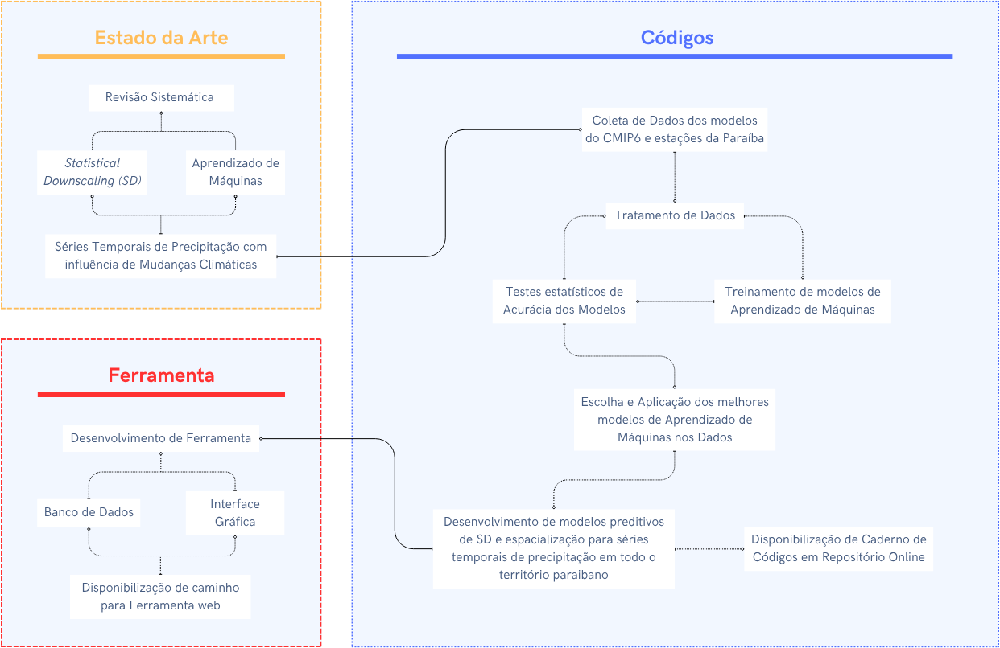

**Fonte:** Elaborado pelo autor (2025).

Como visto na Figura 1.1, o trabalho teve início com uma revisão sistemática de estudos relacionados ao tema da dissertação. Foram analisados artigos sobre os impactos das mudanças climáticas em variáveis como a precipitação e sua influência em regiões menores, como a Paraíba. Além disso, foram revisadas pesquisas e teses que abordam a aplicação do SD no AM para a geração de séries temporais, abrangendo todo o escopo do estudo de forma a definir uma metodologia única.

Em seguida, foram coletados dados de séries temporais de precipitação dos modelos climáticos do CMIP6 e das estações pluviométricas da Paraíba. Com base nesses dados e na metodologia definida, iniciou-se o desenvolvimento dos cadernos de código, onde foram implementados algoritmos padronizados para o tratamento de dados, treinamento dos modelos de AM, testes de validação e estatísticos de acurácia. Dessa forma, foram registrados os modelos, mais eficientes para extrapolação de dados e espacialização de cenários climáticos, permitindo a geração aprimorada de séries temporais de precipitação para a região.

Em posse desses registros, foram disponibilizados os cadernos de códigos em um repositório com o desenvolvimento dos modelos, de forma *online*. Assim, foi criada uma ferramenta computacional web, onde eles foram inseridos, que permite o acesso à geração das séries temporais a partir dos modelos treinados. A ferramenta possui uma estrutura para armazenar os modelos em um banco de dados, garantindo sua organização e disponibilidade para futuras consultas. Com uma interface gráfica intuitiva e integração ao banco de dados, a aplicação facilita a utilização dos modelos e a obtenção de previsões de precipitação de forma acessível e eficiente. Como resultado, a ferramenta foi disponibilizada, e seu código-fonte foi publicado em um repositório *online*, permitindo o acesso livre ao que foi desenvolvido.

## 1.4 Estrutura de trabalho

O presente trabalho se estrutura em 6 capítulos. Os que restam a seguir, contidos no documento, organizam-se como exposto abaixo:

- O Capítulo 2 contextualiza o assunto ligado às mudanças climáticas através de referências literárias, que descrevem os seus conceitos e sua influência no planeta, além do uso de séries temporais relacionadas a elas na elaboração de trabalhos e estudos;

- O Capítulo 3 percorre trabalhos que se relacionam de alguma forma ao tema principal, através de uma revisão sistemática, abordando o SD e o AM aplicados às séries temporais;

- O Capítulo 4 apresenta a metodologia empregada no estudo de caso que resultou na criação dos cadernos de códigos, padronização e geração dos modelos de AM, incluindo a coleta e o tratamento dos dados, a configuração dos experimentos, a definição das métricas de avaliação e a comparação com métodos tradicionais;

- O Capítulo 5 descreve o desenvolvimento da ferramenta proposta, ao explicar a arquitetura do projeto, detalhar as tecnologias usadas, e apresentar sua versão em produção junto dos recursos que ela dispõe;

- O Capítulo 6 encerra o trabalho apresentando uma síntese das principais contribuições alcançadas ao longo da pesquisa, discute as limitações enfrentadas durante o desenvolvimento do estudo, e com base nelas, propõe direções para trabalhos futuros que possam explorar as lacunas encontradas.

# 2 Referencial Teórico

Este capítulo apresenta os fundamentos teóricos essenciais para a dissertação. Nele são abordados os conceitos e principais aspectos sobre precipitação, mudanças climáticas, SD, espacialização de dados e o uso de inteligência artificial, com foco no desenvolvimento de modelos preditivos de regressão por meio de aprendizado de máquina supervisionado.

## 2.1 Precipitação

A precipitação é a representação da água que cai da atmosfera direcionada à superfície, em seus mais diferentes estados. Ela se forma conforme o ar atmosférico se resfria e tem sua capacidade de retenção de água reduzida. A precipitação ocorre através das nuvens, e é a força motriz do ciclo hidrológico (Pimentel, 2015).

### 2.1.1 Tipos de precipitação e fatores que a influenciam

A ocorrência de precipitação é influenciada por diversos fatores, tanto conhecidos quanto desconhecidos. Pimentel (2015) entende que, entre os que se têm ciência, destacam-se as variáveis meteorológicas como a pressão atmosférica, a umidade do ar, a temperatura, as nuvens, a radiação solar e a velocidade dos ventos. Essas condições afetam a formação das nuvens e a condensação do vapor d’água na atmosfera. Quando o ar se resfria, o vapor d’água se acumula nas nuvens, formando gotículas de água que se condensam e caem em direção à superfície. Além disso, partículas em suspensão na atmosfera, como poeira, fumaça e sal do mar, servem como núcleos de condensação, facilitando a formação dessas gotículas.

De forma geral, além dos fatores mencionados, Collischonn e Dornelles (2015) explicam que a formação de nuvens de chuva está diretamente associada ao movimento ascendente das massas de ar úmido, processo considerado para diferenciar os principais tipos de chuva, que são as frontais, convectivas e orográficas, observadas na Figura 2.1. Cada tipo de precipitação está associado a um padrão específico de movimentação e interação dessas massas de ar com o ambiente.

**Figura 2.1** – Chuvas orográficas, frontais e convectivas.

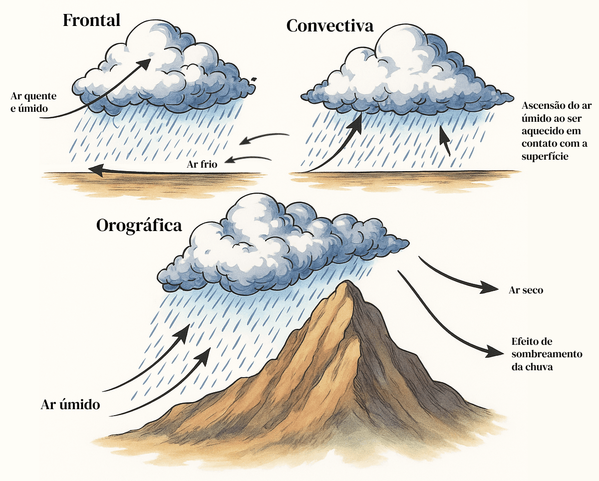

**Fonte:** Adaptado de Ward e Elliot (1995).

Com a Figura 2.1, entende-se que a chuva frontal acontece quando massas de ar quente e úmido encontram massas de ar frio, o ar frio desce e o quente sobe, gerando uma zona de contato e consequentemente a precipitação. A convectiva é resultado da ascensão do ar que ao aquecido pela superfície se torna leve, sendo a principal causa de grandes precipitações, associadas a tempestades e instabilidade atmosférica. Por fim, a orográfica ocorre quando massas de ar úmido são forçadas a ascender por montanhas ou morros, resfriando-se e gerando a precipitação (Ward e Elliot, 1995).

### 2.1.2 Medição da chuva

A chuva pode ser medida por uma variedade de forma, das menos às mais tecnológicas. Nessa linha, têm-se os instrumentos denominados pluviômetros, que são recipientes com dimensões definidas usados para coletar a água precipitada. Eles podem ser classificados como pluviômetros automáticos que registram os dados medidos em intervalos de tempo menores que um dia, e como pluviógrafos que originalmente utilizavam uma balança para pesar a água da chuva coletada, e papéis para registro de forma analógica. Pluviômetros são amplamente usados no Brasil, onde no ano de 2015 a Agência Nacional de Água (ANA) registrou pelo menos 2473 estações pluviométricas que se utilizam dele, espalhadas por todo o território brasileiro (Collischonn e Dornelles, 2015).

Radares meteorológicos também são usados para a estimar a chuva, através da medição da intensidade do sinal refletido pelas partículas de precipitação na atmosfera, ao se ter sobre elas a emissão de pulsos de radiação eletromagnética. A intensidade do sinal enviado e recebido está relacionada a quantidade de chuva de uma região. Estimativas são feitas também com imagens de satélite, obtidas por meio de sensores instalados nos mesmos. Eles tem a capacidade de medir por exemplo, a temperatura do topo das nuvens, que possuem uma boa correlação com a precipitação (Collischonn e Dornelles, 2015).

### 2.1.3 Análise dados e séries temporais de precipitação

A quantificação de variáveis hidrológicas como a precipitação existe devido à coleta sistemática e precisa dos dados ao longo do tempo e espaço. As resposta aos mais diversos questionamentos que surgem entorno dessas variáveis serão tão mais corretos, quanto mais longos e precisos forem os registros de dados. Eles são obtidos em redes hidrométricas ou hidrometeorológicas, formadas e geridas por entidades e instituições da região, como a ANA no caso do Brasil. A partir desses dados são formadas as séries de precipitação, classificadas como séries hidrológicas, que registram sua variabilidade por meio das denominadas séries temporais, e são constituídas por observações ou medições organizadas de acordo com sua ocorrência no tempo ou espaço, com intervalos regulares ou irregulares. As séries podem incluir todas as observações coletadas no intervalo de tempo de registro, sendo séries hidrológicas completas, ou séries hidrológicas reduzidas para casos de valores característicos como máximos anuais e médias mensais (Naghettini e Pinto, 2007).

Essas séries temporais podem ser classificadas em estacionárias e não estacionárias. As séries estacionárias possuem propriedades estatísticas que permanecem constantes ao longo do tempo. Já as séries não estacionárias apresentam variações periódicas, que podem ser causadas por fatores naturais, como as mudanças climáticas, ou por intervenções humanas. Além disso, essas séries podem ser heterogêneas ou homogêneas. A principal diferença entre elas é que, nas séries homogêneas, o padrão de variabilidade em torno da média é consistente e igual ao longo do tempo. Por fim, é fundamental que as séries hidrológicas sejam representativas, ou seja, que reflitam adequadamente a variabilidade do fenômeno estudado (Naghettini e Pinto, 2007).

### 2.1.4 Espacialização de Dados Pontuais de Chuva

A aplicação de técnicas para espacialização através da interpolação de dados de precipitação pontual, como a máxima ou acumulada, é de extrema importância para estudos que dependem da compreensão do comportamento pluviométrico de uma região a partir de dados de séries temporais. Esses estudos abrangem diversas áreas, como climatologia, agricultura e mudanças climáticas, conforme demonstrado por Lopes (2013) e Eugenio et al. (2014). Eles também são essenciais no planejamento urbano e ambiental, conforme discutido por Junior (2023), e para analisar a influência da variabilidade pluviométrica na ocorrência de eventos extremos, como evidenciado por Caldana et al. (2021).

Existem vários métodos clássicos para realizar a interpolação espacial dos dados (Lennon e Tunner, 1995). Eles podem ser classificados em geoestatísticos, quando se baseiam em variáveis regionalizadas, ou determinísticos, quando estimam valores considerando apenas a distância entre os pontos amostrados (Yamamoto e Landim, 2013). Nenhum método é universalmente superior, e sua escolha depende de circunstâncias específicas. O método estatístico clássico em destaque para o presente trabalho é o da Distância Inversa (*Inverse Distance Weighting*, IDW). Ele é matematicamente simples, como observa-se na Equação 2.1, e recomendado para regiões com um grande número de amostras devido ao seu baixo custo computacional (Dirks et al., 1998; Deus et al., 2010).

$$z_j = \frac{\sum_{i=1} \frac{Z_i}{D^P_{ij}}}{\sum_{i=1} \frac{1}{D^P_{ij}}} \tag{2.1}$$

Onde $Z_j$ é o valor desconhecido do ponto a ser interpolado, $Z_i$ é o valor conhecido de um ponto próximo, $D_{ij}$ é a distância conhecida entre os pontos com valor desconhecido e próximo, e $P$ é o expoente constante escolhido.

Contudo, o uso de diferentes métodos clássicos para interpolação pode ser visto em diversos estudos, como o de Viola *et al.* (2010), que avaliaram os métodos de Krigagem, Cokrigagem e IDW na espacialização de dados de precipitação em Minas Gerais no Brasil, concluindo que a Cokrigagem apresentou os menores erros em cerca de metade dos casos analisados. Na Índia, Das *et al.* (2017) compararam os métodos Krigagem, IDW e Spline na interpolação da precipitação média semanal de 79 estações, concluindo que o IDW apresentou o melhor desempenho. Também é possível citar Amini *et al.* (2019) que avaliaram seis métodos de interpolação para mapear a precipitação mensal na bacia do rio Zayandeh-Rud, no Irã, e concluíram que o método do vizinho natural foi o mais preciso.

Embora os métodos estatísticos clássicos ainda tenham uso predominante, o uso de IA também se mostrou versátil e eficaz em tarefas envolvendo aplicações geoespaciais. Por exemplo, Kumar et al. (2023) descrevem como modelos de aprendizado profundo são agora usados rotineiramente para reduzir os dados de precipitação, fornecendo estimativas mais precisas e confiáveis em escalas locais. Além disso, seu uso na interpolação de dados distribuídos espacialmente pode ser destacado, como demonstrado por Wanderley, Amorim e Carvalho (2014) e Silva, Peixoto e Santos (2023), que identificaram a IA como uma alternativa mais robusta para realizar tais tarefas. Através do trabalho de Zandi et al. (2022), que aplicou modelos de aprendizado de máquina na estimativa de precipitação de alta resolução, também se entende que, quando bem implementados, esses modelos podem ter maiores capacidades de generalização, minimizando erros de previsão.

## 2.2 Mudanças Climáticas

Desde que de que se têm registro, o clima terrestre se apresenta dinâmico, reagindo a fatores naturais e ações humanas. Embora seja normal e esperado a ocorrência de mudanças climáticas influenciadas pela natureza, notou-se que as modificações no clima da Terra estão ocorrendo em tamanho ritmo e padrão, que não podem ser explicados por influências naturais. Com isso, entende-se que o planeta aqueceu nos últimos 150 anos, com ênfase nas últimas seis décadas, o que desencadeou diversas mudanças no clima, como nas temperaturas da superfície, atmosfera e oceanos, coberturas de neve desaparecendo, derretimento de geleiras, diminuição do gelo do mar e elevação de seu nível, aumento do vapor de água na atmosfera, além das mudanças no padrão das precipitações, tempestades e ocorrência de secas (Wubbles, 2017).

Essas mudanças têm como principal explicação os altos níveis de atividade industrial e econômica, causando fortes emissões de GEEs, a exemplo do dióxido de carbono, metano, óxidos de nitrogênio, entre outros (IPCC, 1996; Protocolo de Kyoto, 1997). Observa-se também que, mesmo que as concentrações existentes desses gases pudessem ser estabilizadas de imediato, a temperatura continuaria a aumentar, devido ao longo período de tempo sobre o qual algumas interações atuam no sistema climático, que é cíclico, e nele o resultado de influências em um processo inicial provocam mudanças em outros processos, que, por sua vez, podem retornar e amplificar ou atenuar o primeiro processo no reinicio do ciclo (Fahey, 2017).

### 2.2.1 Painel Intergovernamental sobre Mudanças Climáticas

O IPCC, criado em 1988 pela Organização Meteorológica Mundial (*World Meteorological Organization*, WMO) e pelo Programa das Nações Unidas para o Meio Ambiente (*United Nations Environment Programme*, UNEP), tem como missão fornecer informações científicas aos governos para apoiar o desenvolvimento de políticas climáticas. Como sendo uma organização de governos membros das Nações Unidas (ONU) ou da WMO, os ARs do IPCC são desenvolvidos por espacialistas ao redor do mundo, que oferecem seu tempo como autores para analisar milhares de artigos científicos publicados a cada ano, de forma a fornecer um resumo do mais atual conhecimento científico sobre os impulsionadores das mudanças climáticas, seus impactos, riscos futuros e estratégias de adaptação e mitigação. Assim, o IPCC não realiza suas próprias pesquisas, e baseados em uma revisão aberta e transparente por parte de especialistas e governos, os relatórios refletem uma diversidade de visões e conhecimentos, e a partir disso são identificadas as áreas de consenso científico e as lacunas que demandam mais investigação (IPCC, 2025).

### 2.2.2 Relatórios de Avaliação

Os ARs do IPCC são elaborados a partir da composição de três relatórios parciais de três grupos de trabalho sobre o tema que é atribuído a cada um pela plenária do painel, e uma síntese que os condensa (Neto, 2010). O primeiro AR do IPCC concluiu que não havia evidência de influência humana no clima, mas que seria difícil detectar o efeito de estufa nas observações por pelo menos uma década (IPCC, 1990). Já o segundo AR indicou que havia uma influência humana perceptível no clima (IPCC, 1996). O terceiro reforçou que a maior parte do aquecimento nos últimos 50 anos provavelmente foi causado pelo aumento dos GEEs (IPCC, 2001).

O quarto AR afirmou que o aquecimento observado desde meados do século XX foi muito provavelmente devido ao aumento desses gases (IPCC, 2007). O quinto AR concluiu que é extremamente provável que mais da metade do aquecimento global entre 1951 e 2010 tenha sido causado por GEEs e outras ações humanas (IPCC, 2013). O sexto AR foi ainda mais enfático ao afirmar que as atividades humanas, principalmente por meio da emissão de GEEs, causaram inequivocamente o aquecimento global, que atingiu 1,1°C acima dos níveis pré-industriais no período de 2011 a 2020, destacando ainda as contribuições desiguais entre regiões, países e indivíduos em sua mitigação (IPCC, 2023).

### 2.2.3 Cenários Climáticos Futuros

Para além das analises a respeito dos impactos já causados pelas mudanças climáticas, fatores que também são relevantes e discutidos são as projeções climáticas. Elas normalmente são apresentadas para uma série de caminhos e metas possíveis, traçados a partir da captura dos seus principais agentes causadores conhecidos, como as escolhas humanas, emissões, concentrações e mudanças na temperatura global. Desde o AR1 do IPCC, uma expansão desses cenários aconteceu, de forma a abranger uma ampla variedade deles, dependentes do tempo ou transitórios, que projetam as mudanças temporais que ocorrem com a população, fontes de energia, tecnologia, emissões, concentrações atmosféricas, temperatura global e até mesmo a força radiativa (Hayhoe, 2017).

Também existem cenários expressos em termos de meta, como limitar emissões de carbono em níveis específicos ou estabilizar a temperatura global em determinados limites. De qualquer forma, eles buscam explorar questões hipotéticas previamente definidas, de forma a avaliar impactos e informar metas políticas. Por consequência, os cenários climáticos tornam-se fontes usadas pela comunidade científica, que os modelam como entradas para as simulações de modelos climáticos globais, conhecidos GCMs, e fornecem a base para a maioria das projeções apresentadas nos ARs do IPCC (Hayhoe, 2017).

Os cenários climáticos passaram por diversas atualizações ao longo do tempo, que os tornaram cada vez mais abrangentes. A evolução dos cenários de mudanças climáticas teve origem com os SA90, que foram substituídos pelo cenários de emissão IS92 nos anos 1990, e eram baseados em projeções populacionais e focavam nas emissões de GEEs (IPCC, 1990; Leggett et al., 1992). O Relatório Especial sobre Cenários de Emissões (Special Report on Emissions Scenarios, SRES) em 2000, sucedeu os cenários anteriores com a inclusão de uma variedade de histórias socioeconômicas, com diferentes trajetórias de desenvolvimento, de forma a permitir a modelagem de emissões de forma mais complexa (Nakicenovic e Swart, 2000).

No entanto, o grande avanço ocorreu com os RCPs, nos anos de 2010, que mudaram o foco de emissões para forçamento radiativo, proporcionando maior flexibilidade ao considerar diferentes políticas climáticas, como emissões líquidas negativas e mitigação explícita (Moss et al., 2010). Finalmente, os SSPs foram introduzidos para explorar a interação entre diferentes trajetórias socioeconômicas e as mudanças climáticas. Cada SSP representa diferentes níveis de desafio para mitigação e adaptação, permitindo uma análise mais profunda das implicações das escolhas humanas no futuro climático. Esses cenários oferecem uma visão mais detalhada das possíveis respostas globais às mudanças climáticas, combinando trajetórias socioeconômicas com os RCPs para uma modelagem climática mais realista e multifacetada (O’Neill et al., 2014).

### 2.2.4 Modelos de Circulação Geral

Os GCMs, também conhecidos como modelos climáticos globais, são estruturas matemáticas baseadas em equações fundamentais da física, e simulam o funcionamento do sistema climático da Terra através de padrões globais em larga escala, como temperatura, precipitação, eventos extremos e mudanças causadas por emissões humanas. Eles consideram leis de conservação de energia, massa e momento, bem como as trocas desses elementos entre os componentes do clima, como a atmosfera, os oceanos e a superfície terrestre (Flato et al., 2013). Inicialmente desenvolvidos para representar apenas a circulação geral da atmosfera, os GCMs evoluíram em complexidade, e passaram a incorporar uma variedade de processos adicionais, como química atmosférica, aerossóis, interações com o solo e a vegetação, gelo terrestre e marinho e até ciclos biogeoquímicos. Uma representação dessa evolução pode ser observada na Figura 2.2.

**Figura 2.2** – Linha do tempo das modelagens climáticas.

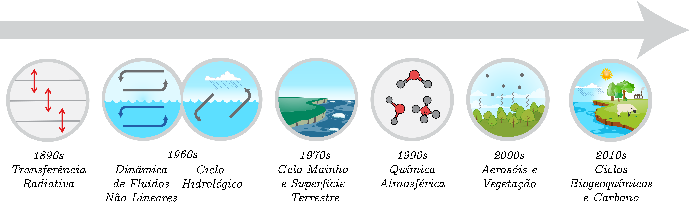

**Fonte:** Adaptado de Hayhoe et al. (2017).

Destaca-se também a evolução dos GCMs a partir dos avanços computacionais, que com o passar do tempo possibilitaram um aumento de seus números, junto de aumentos na resolução espacial horizontal média dos modelos (Hayhoe et al., 2017). É possível observar a partir da Figura 2.3, o progresso do nível de detalhamento dos modelos climáticos usados nos quatro primeiros ARs do IPCC, representados pelas siglas FAR, SAR, TAR e AR4, sucessivamente os primeiro, segundo, terceiro, e quarto relatórios, com as siglas sem numeral tendo como primeira letra o indicativo do número do relatório.

Os quatro mapas presentes a Figura 2.3 evidenciam como as gerações sucessivas de GCMs progrediram com uma resolução horizontal mais detalhada, usada para simulações climáticas de curto prazo no norte da Europa. A resolução vertical nos modelos atmosférico e oceânico não é mostrada, mas também aumentou de forma comparável à resolução horizontal, começando tipicamente com um oceano em camada única e dez camadas atmosféricas no FAR e progredindo para cerca de trinta níveis tanto na atmosfera quanto no oceano (IPCC, 2007).

**Figura 2.3** – Aumento de resolução espacial de modelos climáticos usados no IPCC.

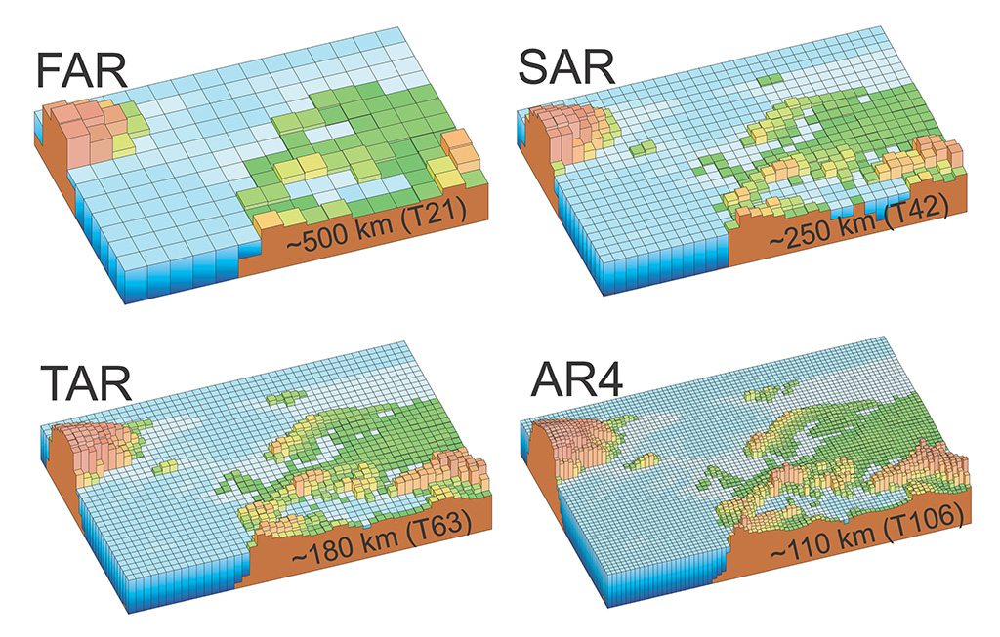

**Fonte:** Adaptado de IPCC (2007).

Além disso, outro ponto crucial para o desenvolvimento dos GCMs foi o surgimento do CMIP, que é uma iniciativa internacional de modelagem climática que busca a melhora da compreensão das mudanças climáticas passadas, presentes e futuras. Criado em 1995 pelo Grupo de Trabalho em Modelagem Acoplada (Working Group on Coupled Modelling, WGCM), o CMIP reúne GCMs com o objetivo principal de entender como diferentes modelos, mesmo com entradas semelhantes, podem gerar resultados distintos, ajudando a identificar os aspectos do clima que são amplamente acordados entre os modelos e aqueles que ainda são mais incertos (CMIP, 2025).

Ao longo de suas fases, o CMIP tem promovido a evolução dos GCMs, ao ampliar tanto o número de modelos envolvidos quanto a complexidade dos experimentos realizados. A cada nova fase, como o CMIP3, CMIP5 e CMIP6, o projeto aumentou a quantidade de dados e o número de experimentos, proporcionando uma melhor compreensão dos processos climáticos e suas projeções futuras. Com mais de 50 centros de modelagem participantes para o CMIP6, a fase mais recente, o projeto gerou dados que ultrapassam 14 petabytes. A evolução dos GCMs no âmbito do CMIP contribuiu além de tudo para o aprimoramento contínuo das simulações e ao desenvolvimento de uma infraestrutura global de dados climáticos (CMIP, 2025).

### 2.2.5 Redução de Escala Estatística

Mesmo com o aumento significativo da resolução dos últimos GCMs, eles são incapazes de simular todos os importantes processos de escala fina, regionais à locais. Para contornar esse problema, métodos de redução de escala são usados com frequência, para corrigir vieses em projeções climáticas globais e gerar informações de maior resolução, necessárias para avaliações de impacto (Hayhoe et al., 2017). Os métodos de redução de escala podem ser definidos como dinâmicos, ou empírico estatísticos, já citados por SD. Os modelos de redução de escala dinâmica, também são conhecidos como modelos climáticos regionais (*Regional Climate Models*, RCMs), por incluir muitos dos mesmos processos físicos que compõem um GCM, e os simular em maior resolução espacial em regiões menores (Kotamarthi et al., 2016).

Por outro lado, os modelos que usam o SD são desenvolvidos com base na premissa de que, a relação entre os sistemas meteorológicos de larga escala, e o clima local ou o padrão espacial do clima da superfície, permanecerá constante ao longo do período das projeções. Assim, eles tendem a ser mais flexíveis e computacionalmente eficientes, ao combinar os resultados do GCM com observações históricas locais, para traduzir preditores ou padrões de larga escala em projeções de alta resolução. Ressalta-se também a eficácia do SD na remoção de vieses, ajustando bem as estatísticas médias do clima observado e simulado ao longo do período histórico (Hayhoe et al., 2017). Nesse sentido, técnicas de AM têm cada vez mais destaque no desenvolvimento de modelos de SD, dado sua capacidade de representar relações não lineares, ao aprender características e padrões mais complexos (Chaudhary, Agarwal e Nakamura, 2019; Baño-Medina, Manzanas e Gutiérrez, 2020).

Em contrapartida, algumas das limitações dos modelos estatísticos passam pela dependência de dados longos e completos. Evidencia-se isso com as dificuldades enfrentadas para regiões remotas, onde os registros são escassos, o que exige a utilização de dados históricos locais ou imagens de satélite (Brands et al., 2012; Thrasher et al., 2013). De maneira geral, entende-se que o SD é mais adequado para as análises que necessitam de diversas projeções futuras para variáveis como temperatura e precipitação, em escalas de observação já usadas para fins de planejamento (Hayhoe et al., 2017).

Logo, é importante perceber que mesmo no SD, a seleção do método para desenvolvimento do modelo dependerá de fatores que envolvem os objetivos do estudo. Assim torna-se fundamental durante sua escolha, realizar a avaliação da qualidade dos modelos de SD que estão sendo desenvolvidos. A qualidade do ajuste deles, por exemplo, pode ser obtida ao comparar simulações que passaram pela redução de escala para o período histórico, com as observações reais utilizadas para treinar o modelo. Já sua capacidade de generalização pode ser testada ao comparar simulações históricas reduzidas, com observações de um período diferente do usado para o treinamento, método também conhecido como validação cruzada (Kotamarthi et al., 2016).

## 2.3 Aprendizado de Máquina

O termo aprendizado de máquina, também chamado de aprendizado estatístico, foi cunhado por engenheiros e cientistas da computação, e popularizado por Samuel (1959), em um artigo onde o autor prova que treinar uma máquina a partir de dados é uma estratégia mais eficiente do que programá-la com regras cada vez mais complexas para a realização de tarefas inteligentes (Cerulli, 2023). Assim, o AM refere-se à detecção automatizada de padrões significativos presentes nos dados, e pode ser descrito como o processo de conveter experiência em conhecimento. A entrada dos algoritmos de AM são os dados de treino que representam justamente a experiência, e a saída é a expertise (Shalev-Shwartz e Ben-David, 2014).

Entre os tipos de AM, a literatura os distingue como aprendizado supervisionado, não supervisionado e por reforço, onde suas características podem ser observadas através do diagrama na Figura 2.4, com destaque tracejado para as áreas tratadas no presente estudo.

**Figura 2.4** – Diagrama de tipos de aprendizado em inteligência artificial.

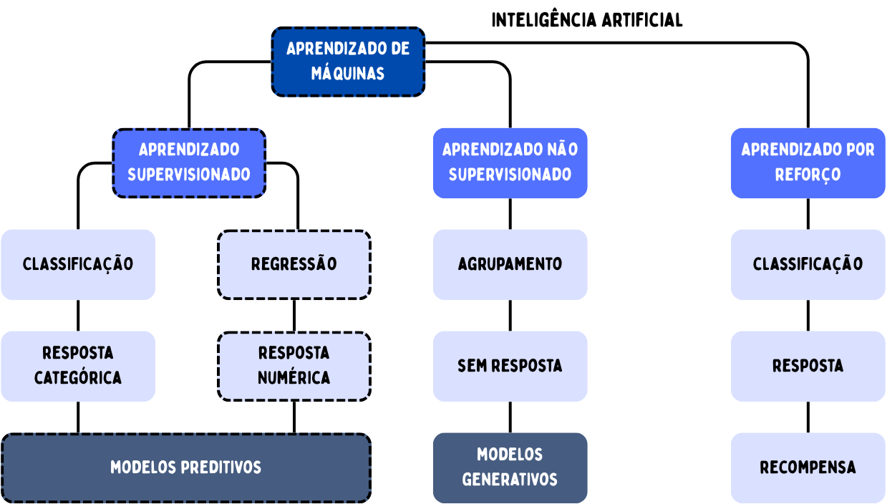

**Fonte:** Adaptado de Cerulli (2023).

O aprendizado supervisionado usa dados rotulados, onde cada atributo possui uma resposta, para prever valores numéricos com regressão ou categorias com classificação. O não supervisionado trabalha com dados não rotulados para descobrir padrões, como em agrupamentos ou modelos generativos. Já o aprendizado por reforço envolve um agente que aprende a tomar decisões com base em recompensas, útil em aplicações como robótica (Cerulli, 2023).

### 2.3.1 Modelos de Aprendizado por Regressão

Como mencionado anteriormente, os modelos de regressão são usados quando necessita-se da predição de dados numéricos, como é o caso da interpolação espacial e séries temporais. Os erros de predição ocorrem quando a estimativa realizadas se afastam do valor real, e é justamente isso que os modelos de AM buscam o minimizar em dados de treino, que ainda não são conhecidos (Cerulli, 2023).

Conforme a complexidade de um modelo cresce, ele tende a um melhor ajuste aos dados de treino ao reduzir seu viés. Em contrapartida, os modelos se tornam mais sensíveis às variações dos dados, aumentando sua variância. A relação de equilíbrio relatada é chamada de *trade-off* entre viés e variância, para qual se existe um nível ideal de complexidade, de forma a minimizar ao máximo o erro da predição dos modelos para novos dados (Hastie, Tibshirani e Friedman, 2009).

Assim, altas complexidades em modelos levam ao sobreajuste dos dados, enquanto os mais simples podem incorrer à não captura de ajustes relevantes, resultando no subajuste. O erro total também inclui o erro irredutível, proveniente da própria natureza dos dados, sendo ele imprevisível e inevitável (Cerulli, 2023).

### 2.3.2 Modelos Clássicos de Aprendizado por Regressão

Existem inúmeros métodos clássicos de AM por regressão, e dentre seus principais, destacam-se os vizinhos mais próximos, a regressão linear, a regressão de máquina de vetores de suporte, e os modelos baseados em árvores (Faouzi e Colliot, 2023). A abordagem dos vizinhos mais próximos é uma das mais intuitivas no AM, e usa amostras de treinamento da vizinhança de um ponto $x$, em $N(x)$ para que assim seja feita a predição (Murphy, 2012). Para o caso da regressão, a previsão é calculada como uma média ponderada dos alvos em $N(X)$, como visto na Equação 2.2.

$$f(x) = \sum_{x^{(i)} \in N(x)} w_i^{(x)} \cdot y^{i} \tag{2.2}$$

Onde $w_i^{(x)}$ é o peso associado à $x^{(i)}$ para prever a saída de $x$, com $w_i^{(x)} \geq 0 \forall i$ e $\sum_{i} w_i^{(x)} = 1$. O método de regressão linear, representado na Equação 2.3, combina linearmente as características dos dados do recurso em coeficientes que representam o peso relativo deles, em comparação com as demais (Bishop e Nasrabadi, 2006).

$$f(x) = w_{0} + \sum_{i=1} w_{i} \cdot x_{i} \tag{2.3}$$

Onde $w_{0}$ é o viés, e $w_{i}$ o coeficiente associado ao recurso $x_{i}$. A máquina de vetores de suporte, inicialmente proposta por Vapnik e Lerner (1963) como um método de classificação binária linear, foi posteriormente estendida para tarefas de regressão. Diferente da classificação, em que o objetivo é encontrar o hiperplano que maximiza a margem entre classes separáveis linearmente, no caso da regressão, busca-se, por meio da função de perda $\epsilon$-insensitive, ajustar uma função de predição cujos valores permaneçam dentro de uma faixa de tolerância $\epsilon$ em relação aos valores observados, como mostra a Figura 2.5. Nessa abordagem, erros menores que $\epsilon$ são ignorados, ou seja, não contribuem para a penalização no processo de otimização (Faouzi e Colliot, 2023).

**Figura 2.5** – Função de regressão de máquina de vetores de suporte.

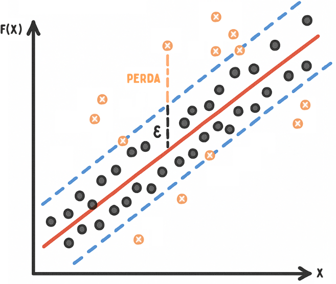

**Fonte:** Elaborado pelo Autor (2025).

Métodos com arquiteturas de decisões binárias, baseadas em algoritmos que contém apenas declarações condicionais, são frequentemente utilizados em AM por terem interpretabilidade intuitiva, como mostra a Figura 2.6, e denominam-se árvores de decisão. Uma árvore de decisão é um algoritmo de aprendizado supervisionado que divide recursivamente o espaço de características, com o objetivo de agrupar amostras com rótulos ou valores-alvo semelhantes. A cada nó, busca-se o melhor par que minimize a impureza, tornando os subconjuntos resultantes o mais homogêneos possível. Nas tarefas de regressão, o critério de impureza é frequentemente baseado no erro médio de um valor de referência, como a média ou mediana (Breiman *et al.*, 1984).

**Figura 2.6** – Função de regressão de árvore de decisão.

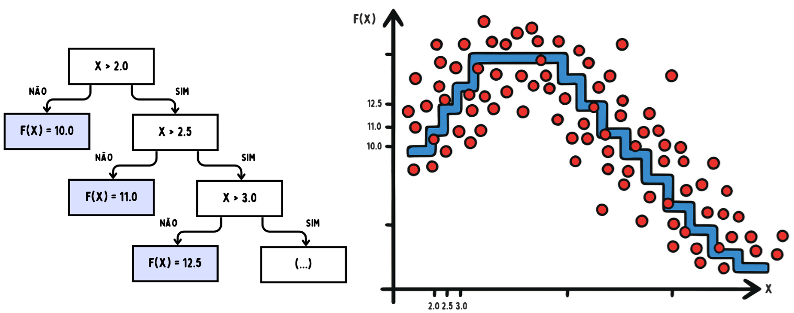

**Fonte:** Elaborado pelo Autor (2025).

Embora simples, as árvores de decisão podem sofrer de sobreajuste ao se tornarem muito grandes, usando apenas uma fração dos recursos na decisão final. Para reduzir a variância sem aumentar muito o viés, utilizam-se florestas aleatórias, que combinam várias árvores construídas com subconjuntos aleatórios das amostras e características (Breiman, 2001). Entretanto, as árvores em uma floresta aleatória podem ainda ser correlacionadas, o que limita a redução de variância. Assim, o modelo de árvores extremamente aleatórias (*Extremely Randomized Trees*, ExtraTrees) buscar resolver esse problema ao introduzir mais aleatoriedade, ao escolher divisões baseadas em limiares aleatórios, ao invés de buscar a melhor divisão entre todos os pares candidatos (Geurts, Ernst e Wehenkel, 2006).

### 2.3.3 Modelos Profundos de Aprendizado por Regressão

Dado a vasta quantidade de algoritmos de AM, aqueles denominados de aprendizado profundo representam um subconjunto desse total, desenvolvidos em arquiteturas sofisticadas de Redes Neurais Artificiais (*Artificial Neural Networks*, ANN) multicamadas. Assim, uma ANN é encarada no aprendizado estatístico como um modelo de regressão ou classificação que funciona em múltiplos estágios, conectando variáveis latentes dentro de uma estrutura de entrada-saída. As entradas iniciais são características observáveis, enquanto as saídas finais são as variáveis-alvo, numéricas em casos de regressão (Abiodun *et al.*, 2018; Abiodun *et al.*, 2019).

Uma arquitetura de ANN clássica e muito comum é a *feedforward multilayer perceptron* (MLP) (Baptista e Morgado, 2013). Ela é uma generalização da rede neural *perceptron*, proposta por Rosenblatt (1958) com apenas uma camada oculta, um neurônio, e funcional apenas para problemas separáveis. Por sua vez, o *multilayer perceptron* é composto por várias camadas de neurônios organizadas sequencialmente, onde todos os neurônios de uma camada estão conectados aos da camada seguinte, formando a rede *feedforward*, com fluxo de informações unidirecional, para frente, e capacidade de resolução de problemas não separáveis (Murtagh, 1991). Um exemplo de arquitetura *feedforward* para regressão pode ser descrita com duas entradas, uma camada oculta com quatro neurônios e uma saída, como visto na Figura 2.7.

**Figura 2.7** – Arquitetura *feedforward* para regressão.

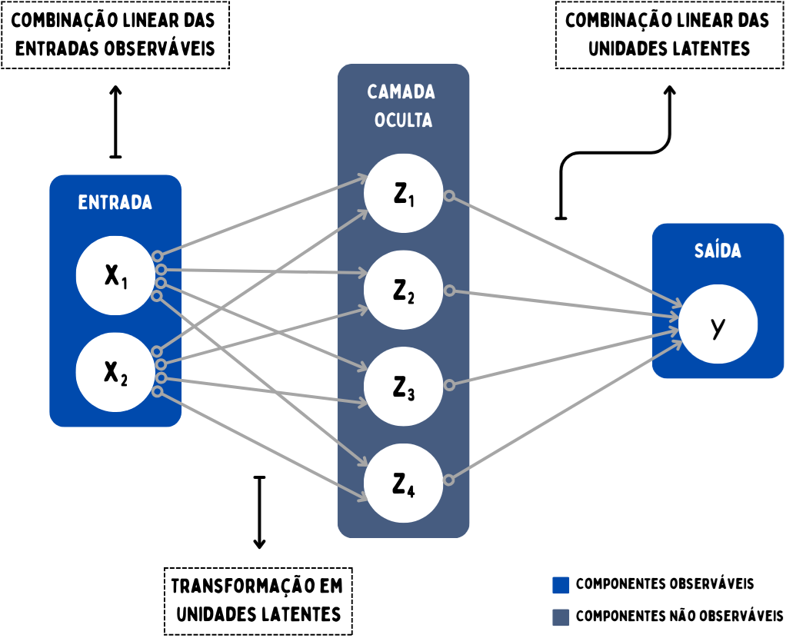

**Fonte:** Elaborado pelo Autor (2025).

Na arquitetura considerada na Figura 2.7, as entradas observáveis $X_1$ e $X_2$ são combinadas linearmente, através da Equação 2.4, e transformadas em unidades latentes que vão de $Z_1$ à $Z_4$. A transformação ocorre por meio de uma função de ativação, como a sigmoide, ReLU ou tangente hiperbólica, que possuem capacidade de transformar a combinação linear de entradas e pesos em um novo sinal, geralmente dentro de um intervalo finito (Cerulli, 2023).

$$Z_m = \sigma\left( \alpha_{0m} + \sum_{i=1} \alpha_{im} \cdot X_i \right) \tag{2.4}$$

Onde $Z_m$ é o valor ativado do neurônio $m$ na camada oculta, $\sigma$ é a função de ativação escolhida, $\alpha _{0m}$ é o viés associado ao neurônio $m$, $\alpha _{im}$ é peso conectando à entrada $X_i$ ao neurônio oculto $m$, e $X_i$ é o valor da entrada, sendo para a arquitetura demonstrada $X_1$ e $X_2$. Por fim, combinações lineares das unidades latentes, através da Equação 2.5, geram a saída final para o método de regressão de saída única, a unidade $y$. A rede é totalmente conectada, com cada unidade ligada a todas as unidades seguintes por pesos específicos (Cerulli, 2023).

$$y = \beta_{0} + \sum_{m=1} \beta_{m} \cdot Z_m \tag{2.5}$$

Onde $y$ é a saída final da rede, $\beta _0$ é o viés da saída, $\beta _m$ é o peso que conecta os neurônios ocultos à saída, e $Z_m$ a ativação dos neurônios da camada oculta, que são as transformações não-lineares das entradas. Na arquitetura descrita, os índices $\beta _1$ à $\beta _4$ e $Z_1$ à $Z_4$ representam os pesos e as ativações dos quatro neurônios da camada oculta.

Seguindo para arquiteturas mais avançadas, em aprendizado profundo, duas que se popularizaram em aplicações na literatura foram as redes neurais recorrentes e convolucionais (Cerulli, 2023). Tratando das recorrentes, elas tem seu uso na modelagem e predição de dados sequenciais, como processamento de linguagem natural, e séries temporais.

A arquitetura das redes neurais recorrentes se diferenciam das *feedforward* devido a sua dinâmica temporal recursiva, como mostra a Figura 2.8, onde a nível da camada oculta se é permitido que cada estado receba informações tanto da entrada atual quanto do estado anterior. Essa característica permite a captura da dependência entre dados de forma temporal (Mienye, Swart e Obaido, 2024).

**Figura 2.8** – Comparação entre redes neurais recorrentes e *feedforward*.

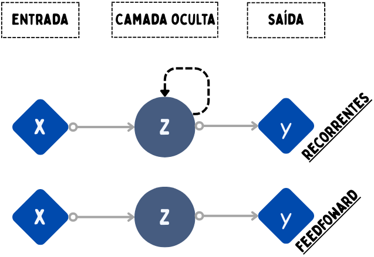

**Fonte:** Elaborado pelo Autor (2025).

Quanto as redes neurais convolucionais (*convolutional Neural Network*, CNN), foram desenvolvidas por LeCun *et al.* (1998), e demonstraram alta capacidade em tarefas como reconhecimento, classificação e segmentação de imagens, processamento de linguagem natural, e previsão de séries temporais de alta frequência. De maneira geral, a arquitetura de uma CNN é composta por camadas de convolução, de *pooling* e totalmente conectadas. As primeiras aplicam filtros compartilhados para gerar mapas de características, enquanto as de *pooling* reduzem a dimensionalidade dos dados sem estimar pesos. Por fim, as camadas totalmente conectadas formam uma rede neural padrão e a finalizam a arquitetura com os nós de saída (Cerulli, 2023). Uma abstração de uma arquitetura de CNN pode ser observada na Figura 2.9.

**Figura 2.9** – Modelo de arquitetura de rede neural convolucional.

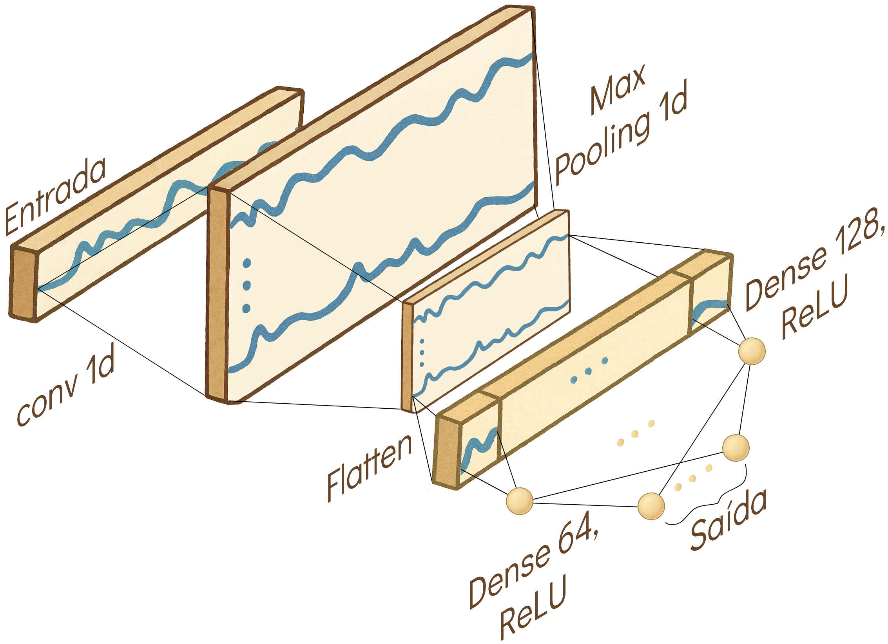

**Fonte:** Elaborado pelo Autor (2025).

O processo visto na Figura 2.9 se inicia com os dados de entrada. A primeira camada é uma Conv1D, que aplica 64 filtros de convolução de tamanho 3 para extrair características dos dados sequenciais de entrada, utilizando a função de ativação ReLU para introduzir não-linearidade. Em seguida, há uma camada MaxPooling1D que reduz a dimensionalidade realizando uma operação de pooling de tamanho 2 para simplificar a representação. A camada Flatten transforma a saída 2D em um vetor 1D. Após isso, é aplicada uma camada densa com 128 unidades e função ReLU, seguida por uma camada densa com 64 unidades e ReLU é utilizada antes da camada final, que possui uma única unidade responsável pela saída.

### 2.3.4 Métricas e Avaliação de Desempenho

A literatura de dados e AM apresenta uma variedade de métricas para avaliar variáveis numéricas e a qualidade do ajuste da regressão de um determinado modelo ao longo dos anos. Dentre as mais populares é possível citar o $MSE$ e o $r$ (Berman, 2016; Cerulli, 2023). Cita-se também o $RMSE$, que é a raíz do $MSE$ e o apresenta de uma nova perspectiva ao retratar os dados em sua unidade original.

O $MSE$, de Equação 2.6 é uma medida de risco que representa a média dos erros quadráticos das previsões. Ele indica o quão distantes, em média, as previsões estão dos valores reais e depende da unidade de medida da variável analisada (Cerulli, 2023). Assim como o $MSE$, o $RMSE$ mede a partir da equação Equação 2.7, a diferença entre os valores previstos e observados, com o adendo de ser por meio da raiz quadrada média do erro quadrático, fornecendo resultados na mesma unidade da variável analisada. Quanto menor o $RMSE$, melhor. É uma medida facilmente interpretável, pois seu resultado é expresso na mesma unidade da variável analisada. No entanto, é sensível a dados discrepantes. Embora penalize erros grandes, pode amplificar excessivamente a influência de valores atípicos (Kuhn e Johnson, 2013).

O $r$, conhecido como correlação de Pearson, é calculado conforme a Equação 2.8. Ela mede o grau de associação linear entre os valores observados e previstos, variando entre -1 e +1. Um valor próximo de +1 indica que os valores previstos seguem de forma consistente os valores observados. Um valor próximo de 0 indica ausência de correlação linear, e um valor próximo de -1 indica uma correlação negativa, significando que quando os valores observados aumentam, os previstos tendem a diminuir, e vice-versa (Berman, 2016). Faixas e interpretações do coeficiente de Pearson podem ser vistas na Tabela 2.1.

$$MSE = \frac{1}{n}\sum _{i=1}^{n}(O_i - E_i)^2 \tag{2.6}$$

$$RMSE = \sqrt{\frac{1}{n}\sum _{i=1}^{n}(O_i - E_i)^2} \tag{2.7}$$

$$r = \frac{\sum_{i=1}^{n} (O_i - O)(E_i - \bar{E})}{\sqrt{\sum_{i=1}^{n} (O_i - O)^2} \sqrt{\sum_{i=1}^{n} (E_i - \bar{E})^2}} \tag{2.8}$$

Onde $O_i$ representa os valores observados, $E_i$ os valores estimados, $O$ a média dos valores observados, e $n$ O número de observações.

**Tabela 2.1** – Intervalos e interpretações da correlação de Pearson

| Correlação de Pearson (r) |    Interpretação    |
|:-------------------------:|:-------------------:|
|       0.00 \< 0.10        |   Insignificante    |
|       0.10 \< 0.20        |        Fraco        |
|       0.20 \< 0.40        |      Moderado       |
|       0.40 \< 0.60        | Relativamente forte |
|       0.60 \< 0.80        |        Forte        |
|       0.80 \< 1.00        |     Muito Forte     |

**Fonte:** Adaptado de Liyew e Melese (2021).

Assim, entendendo a importância das métricas na estimativa da capacidade preditiva dos modelos, é fundamental garantir que elas irão os representar bem, sem influência de tendências ou sobreajustes. Para isso têm-se métodos como a validação cruzada, que é uma técnica essencial para estimar o erro de teste e ajustar modelos em AM.

A validação cruzada de forma seccional consiste em dividir aleatoriamente o conjunto de dados em $K$ partes iguais. Em cada iteração, uma parte é deixado de fora para teste, enquanto as outras são usados para treinar o modelo. Esse processo é repetido $K$ vezes, uma para cada parte, e o erro, como $MSE$ ou $r$ é calculado em cada rodada. Por fim, os erros obtidos são combinados por meio da média (Cerulli, 2023). O caso para dados espaciais é justamente esse, onde seus pontos distribuídos no espaço são embaralhados de forma aleatória em conjuntos de treino e teste.

Para séries temporais, os dados têm uma ordem natural, então não faz sentido embara-lhá-los, devendo se respeitar a ordem temporal deles. Então, para o caso das séries temporais existem duas abordagens principais, com janela de treino variável e com janela de treino fixa. Na janela variável, o conjunto de treino aumenta a cada iteração, acumulando novas observações, enquanto o conjunto de teste permanece com tamanho fixo, simulando um aprendizado contínuo. Já na janela fixa, o tamanho do treino é constante, e a cada nova iteração, dados antigos são descartados para dar lugar aos novos, mantendo um equilíbrio entre os conjuntos de treino e teste ao longo do tempo (Cerulli, 2023).

Além disso, outra forma eficaz de validação consiste na comparação dos modelos de AM com linhas de base (ou *benchmarks*), que servem como modelos de referência. Essas linhas de base podem ser tanto modelos simples, que estabelecem um desempenho mínimo aceitável a ser superado, quanto métodos estatísticos consolidados, que já apresentam desempenhos conhecidos e estabelecidos. Nesses casos, o modelo de AM deve apresentar em relação aos modelos simples, melhorias consideráveis para justificativa de uso, enquanto em relação aos métodos consolidados, melhores métricas e desempenho computacional para justificar sua adoção em relação às abordagens tradicionais.

Para séries temporais, essa questão é frequentemente expressa como *forecast skills* por meio de comparações que representem a habilidade preditiva relativa do modelo frente a previsões de referência, como a climatologia com a média histórica, a persistência com valor do período anterior ou até previsões aleatórias baseadas nas frequências históricas dos eventos. Entre essas abordagens, a previsão por persistência é uma das mais utilizadas como linha de base, especialmente em séries de precipitação, por sua simplicidade e interpretação direta, onde assume-se que o valor do mês atual será igual ao do mês anterior para cada ponto da série (Wilks, 2006).

Já no que se refere à espacialização (ou interpolação) de dados espaciais, o uso de métodos estatísticos tradicionais, como o IDW, mostra-se bastante vantajoso como ponto de comparação, pois como já visto anteriormente, é uma técnica amplamente empregada em estudos hidrológicos e meteorológicos. Dessa forma, qualquer melhoria obtida pelos modelos de AM, seja em termos de métricas de acurácia, ou em eficiência computacional na interpolação de grandes volumes de dados, representa um avanço significativo. Mesmo pequenos ganhos em desempenho já se mostram relevantes, uma vez que o IDW é considerado um método robusto e estável, e superá-lo indica que o modelo proposto é capaz de capturar relações espaciais mais complexas e gerar previsões mais precisas em cenários de alta variabilidade espacial.

# 3 Revisão do Estado da Arte

Este capítulo desenvolve uma Mapeamento Sistemática da Literatura (MSL), para que assim se possa entender o estado da arte em que se encontra o uso de SD para dados temporais de precipitação com influência de mudanças climáticas a partir do uso de IA. Com isso, é possível perceber tendências e espaços vazios, que os estudos que abordam esse tema possuem.

## 3.1 Metodologia

A necessidade da execução do MSL se origina da importância que é explorar, mapear e entender um assunto e suas nuances em uma vasta diversidade de cenários e experimentos, como explica Kitchenham (2004). A autora também expõe como o MSL é relevante para a fundamentação de novos trabalhos de pesquisa, identificação de possíveis lacunas nos estudos mais recentes, além de um resumo das evidências que tendem a ser mais relevantes. Entendendo isso, no presente capítulo conduz-se, através de etapas e critérios definidos, a pesquisa de estudos que permitam a compreensão do estado da arte do tema em pesquisa.

### 3.1.1 Questões de pesquisa

A fim de entender quais as principais tendências e técnicas de aprendizado de máquinas para a realização do SD em dados pluviométricos com influência das mudanças climáticas, além do atual estado das pesquisas que envolvem o tema, foram definidas Questões de Pesquisa (QP).

- **QP1**: Quais métodos e modelos de aprendizado de máquinas estão sendo usados e obtendo melhor desempenho na realização do SD?

  Com a QP1, é possível mapear quais os modelos de aprendizado de máquinas da literatura obtém melhores resultados preditivos, quando se trata da realização do SD. A partir desse conhecimento, torna-se possível uma redução no escopo de modelos usados durante os testes de quais melhor se ajustam aos dados de uma determinada localidade, em aplicações de redução de escala.

- **QP2**: Quais temporalidades dos dados das séries pluviométricas estão sendo utilizadas para realização das previsões?

  A QP2 permite o entendimento de quais temporalidades das séries são mais utilizadas e melhor se encaixam, para a análise preditiva de modelos de SD de modo a facilitar sua escolha em estudos.

- **QP3**: Quais GCMs estão sendo utilizados para redução de dimensionalidade dos dados pluviométricos?

  Dado a diversidade modelos de circulação geral, com a QP3, reúne-se os principais usados na literatura, empregados tanto na avaliação da capacidade dos modelos, como nos estudos que visam entender as mudanças climáticas de uma localidade.

- **QP4**: Quais cenários climáticos estão sendo utilizados na realização das predições de mudanças no clima?

  Sabendo sobre como diferentes cenários podem resultar em mudanças tão distintas, com a QP4 é possível entender quais são os com maiores expectativas para predições, visto que os autores dão maior prioridade de uso em seus estudos.

- **QP5**: Quais as métricas mais usadas para avaliação dos modelos de predição treinados?

  A partir da QP5, tem-se o agrupamento das métricas mais usadas na avaliação da aplicação do SD, permitindo que se compreenda quais realmente possuem capacidade de mensurar a acurácia dos modelos, tornando viável uma melhor escolha de quais utilizar em estudos do tema.

### 3.1.2 Processo de pesquisa

Para realizar a busca de estudos com os temas relacionados às perguntas que se pretende responder, algumas palavras-chave foram definidas na seguinte string de busca:

```
"statistical downscaling" AND ("precipitation" OR "rainfall") AND ("ipcc" OR "cmip") AND ("artificial intelligence" OR "machine learn" OR "deep learn")
```

Na realização da pesquisa, utilizou-se a base de dados Scopus, desenvolvido pela Elsevier, ela indexa mais de 25000 periódicos revisados por pares de mais de 7000 editoras internacionais dentre as quais algumas importantes podem ser vistas na Tabela 3.1.

**Tabela 3.1** – Repositórios renomados indexados ao Scopus

| **Nome**             | **Endereço**                       |
|:---------------------|:-----------------------------------|
| IEEE Xplore          | `https://ieeexplore.ieee.org/`     |
| ScienceDirect        | `https://sciencedirect.com/`       |
| SpringerLink         | `https://link.springer.com/`       |
| ACM Digital Library  | `https://dl.acm.org/`              |
| Wiley Online Library | `https://onlinelibrary.wiley.com/` |

**Fonte:** Elaborado pelo autor (2025).

### 3.1.3 Critérios e procedimentos de inclusão e exclusão

Para a revisão foram incluídos estudos em inglês ou português com no máximo vinte anos desde a data de publicação, além de quaisquer tipos de documentos, incluindo estudos revisados por pares. Já para a exclusão, alguns critérios foram estabelecidos.

- Estudos duplicados, sendo considerado apenas o mais completo;

- Estudos sem a possibilidade de acesso ao manuscrito;

- Estudos que não fazem nenhuma aplicação de SD;

- Estudos que não utilizam IA para realização do SD;

- Estudos que não utilizam GCMs e cenários climáticos para as predições.

### 3.1.4 Avaliação de qualidade de estudos

A avaliação dos trabalhos pesquisados separados para a leitura profunda se deu por meio de critérios definidos através de Questões de Avaliação (QA).

- QA1: O estudo é conciso e coerente quanto aos objetivos definidos na pesquisa?

- QA2: O contexto pelo qual foi produzida a pesquisa está descrito de forma adequada?

- QA3: O trabalho expõe com clareza os resultados obtidos?

De forma a responder os três critérios apresentados, estabeleceu-se uma escala de pontos que serão usados para avalia-los individualmente, definindo quão bem os atributos dos trabalhos os respondem.

- 2 - Atende completamente aos critérios estabelecidos;

- 1 - Atende em partes aos critérios estabelecidos;

- 0 - Não atende aos critérios estabelecidos.

Logo, a soma da pontuação dos trabalhos varia de zero a seis, onde quanto maior ela for, maior será a qualidade do estudo, considerando os critérios estabelecidos.

### 3.1.5 Extração, análise e seleção de trabalhos

O processo de análise dos estudos se deu através de três etapas, de forma a filtrar para uma leitura profunda os trabalhos que se mostraram mais relevantes e apropriados para com o tema em análise. Assim, possibilitou-se que os estudos filtrados fossem classificados segundo as QA, além da obtenção das respostas para as QP.

1.  A primeira etapa se deu a partir da extração dos trabalhos recuperados do repositório Scopus com base na *string* de busca. Foram obtidos 301 estudos. Destes, foram separados 266 trabalhos que possibilitavam acesso ao manuscrito, recolhendo deles dados referentes ao ano de publicação, caminho para acesso, idioma escrito, número de citações em outros estudos, título e resumo, para cada um deles.

2.  Na segunda etapa foram analisados os títulos e resumos dos trabalhos selecionados na primeira etapa, filtrando-os com base nos critérios de inclusão e exclusão, o que resultou na obtenção de 46 estudos.

3.  Já na terceira etapa, deu-se a leitura da introdução e conclusão dos trabalhos escolhidos na segunda etapa. Foram separados os estudos que mostraram potencial para responder de forma satisfatória as QP, resultando em 22 para a leitura profunda.

É possível observar um fluxograma especificando as etapas de análise e separação dos estudos na Figura 3.1.

**Figura 3.1** – Fluxograma do estado da arte.


**Fonte:** Elaborado pelo autor (2025).

## 3.2 Resultados

Assim, após a filtragem foram elaboradas planilhas eletrônicas que armazenam todos os dados recuperados e atribuídos, dos trabalhos analisados, disponível em \<https://bit.ly/ 4dWcd2l\>. Ressalta-se que mais de oitenta por cento dos trabalhos recuperados nas planilhas foram artigos científicos, com o restante dos documentos se dividindo entre publicações em conferências, revisões, capítulos de livros e livros.

As três planilhas, que podem ser acessadas a partir do caminho fornecido anteriormente, foram organizadas em três guias. A primeira fornece um compilado dos trabalhos recuperados a partir das *strings* de busca, com colunas como o ID, ano de publicação, caminho para acesso, idioma, quantidade de citações, título e resumo dos estudos, além da etapa de filtragem até onde eles foram analisados, vistas na Figura 2.

A segunda guia trata das QA, onde possui colunas para armazenar a pontuação do trabalho para cada QA e sua soma geral, de modo a classificar os trabalhos segundo sua qualidade. Por fim a terceira guia está relacionada às QP, que estabelece colunas que armazenam de forma sucinta as respostas às perguntas estabelecidas nelas, no caso de haver. Para as duas guias, a segunda e a terceira, serão tratados apenas os estudos que passaram por uma leitura profunda, como estabelecido anteriormente.

Dessa forma, é possível através da Tabela 3.2 observar de forma geral e resumida os estudos que passaram pela leitura profunda, os resultados obtidos através deles e dispostos de forma completa nas planilhas mencionadas anteriormente.

**Tabela 3.2** – Estudos analisados em leitura profunda

| ID  | Autores                                                | Soma das QA’s | QP’s não Respondidas |
|:----|:-------------------------------------------------------|:--------------|:---------------------|
| 1   | Coulibaly, Dibike e Anctil (2005)                      | 3             | \-                   |
| 15  | Ghosh (2010)                                           | 4             | \-                   |
| 26  | Goyal e Ojha (2012)                                    | 4             | \-                   |
| 49  | Sachindra et al. (2015)                                | 2             | QP3, QP4             |
| 60  | Kueh e Kuok (2016)                                     | 3             | \-                   |
| 84  | Pour et al. (2018)                                     | 5             | \-                   |
| 87  | Nourani, Baghanam e Gokcekus (2018)                    | 6             | \-                   |
| 88  | Sehgal et al. (2018)                                   | 4             | QP4                  |
| 111 | Baghanam et al. (2019)                                 | 6             | \-                   |
| 117 | Montenegro-Murillo, Pérez-Ortiz e Vargas-Franco (2019) | 4             | \-                   |
| 136 | Hosseini, Golian e Yazdi (2020)                        | 5             | \-                   |
| 152 | Harilal, Singh e Bhatia (2021)                         | 4             | QP4                  |
| 156 | Sadeghfam et al. (2021)                                | 5             | \-                   |
| 196 | Boateng e Mutz (2023)                                  | 6             | \-                   |
| 225 | Anaraki et al. (2023)                                  | 6             | \-                   |
| 232 | Prathom e Champrasert (2023b)                          | 5             | \-                   |
| 236 | Nourani et al. (2023)                                  | 5             | \-                   |
| 238 | Nishant et al. (2023)                                  | 1             | QP3, QP4             |
| 248 | Prathom e Champrasert (2023a)                          | 3             | QP4                  |
| 277 | Soares et al. (2024)                                   | 4             | \-                   |
| 290 | Nacar et al. (2024)                                    | 5             | \-                   |
| 293 | Pinthong et al. (2024)                                 | 6             | \-                   |

**Fonte:** Elaborado pelo autor (2025).

Com a Tabela 3.2 observa-se o ID gerado nas planilhas para melhor identificação dos estudos, os autores dos que passaram pela leitura profunda, a soma das três QA’s deles, e as QP’s não respondidas. Nessa última curiosamente a minoria dos trabalhos tiveram alguma QP não respondida, sendo apenas cinco dos vinte dois, e se restringiram apenas a QP3 e QP4.

Referente a temporalidade dos estudos, ao decorrer dos últimos vinte anos estabelecidos nos critérios e procedimentos de exclusão, nota-se uma clara evolução no interesse pelo tema pesquisado, dado o aumento na quantidade de trabalhos que podem ser melhor observados na Figura 3.2.

**Figura 3.2** – Linha temporal de quantidade de estudos analisados.

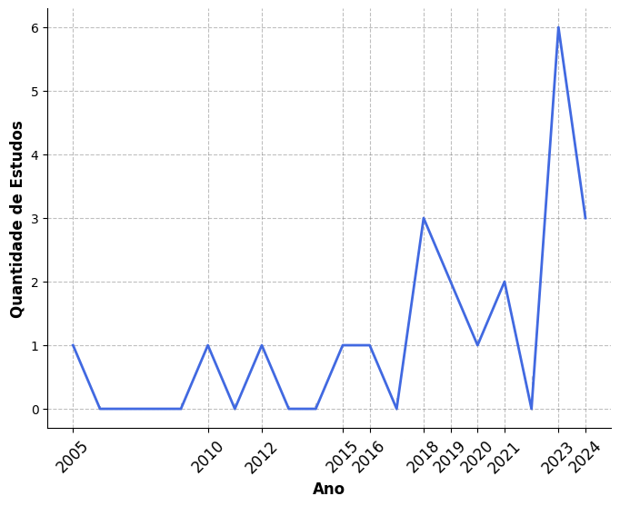

**Fonte:** Elaborado pelo autor (2025).

Contudo, por mais que se veja na Figura 3.2 um aumento de estudos pesquisados, o ano de 2022 apresenta uma lacuna com nenhum estudo, e logo em seguida o ano de 2023 mostra o maior pico. Para verificar as palavras mais usadas nos resumos dos estudos em questão, tem-se a Figura 3.3 com uma nuvem de palavras.

**Figura 3.3** – Nuvem de palavras mais usadas nos estudos analisados.

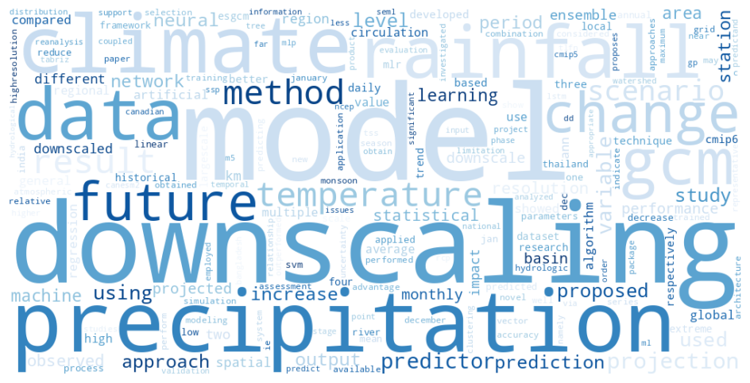

**Fonte:** Elaborado pelo autor (2025).

Na Figura 3.3, o tamanho da palavra representa a quantidade de aparições nos resumos dos trabalhos que passaram por leitura profunda. Através delas percebe-se que os estudos possuem um bom e forte alinhados com o tema em pesquisa, e palavras chaves definidas na *string* de busca. E como explicado anteriormente, para avaliar a qualidade desses estudos foram elaboradas três QA’s, as médias de pontuações delas podem ser vistas na Figura 3.4.

**Figura 3.4** – Media de pontuação das QA’s para os estudos analisados.

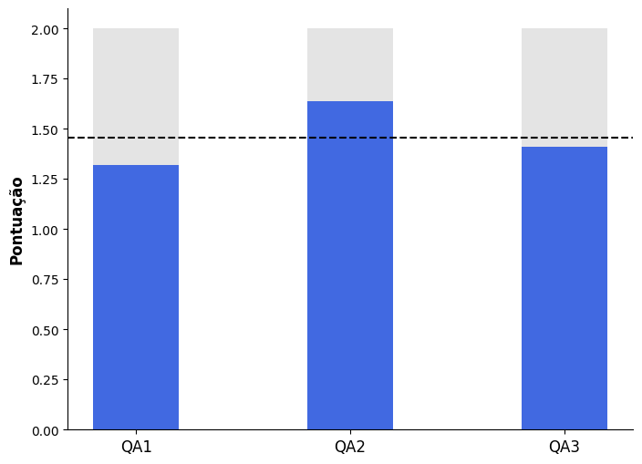

**Fonte:** Elaborado pelo autor (2025).

A Figura 3.4 mostra que todas as três QA’s possuíram médias acima de um, sendo a média geral próxima a um e meio. O gráfico também mostra que representa elas atendem em média, mais que individualmente, os critérios estabelecidos, devido à QA2. Para analisar melhor a qualidade total dos estudos, têm-se a Figura 3.5 com a soma das QA’s.

**Figura 3.5** – Pontuação total dos estudos analisados a partir das QA’s.

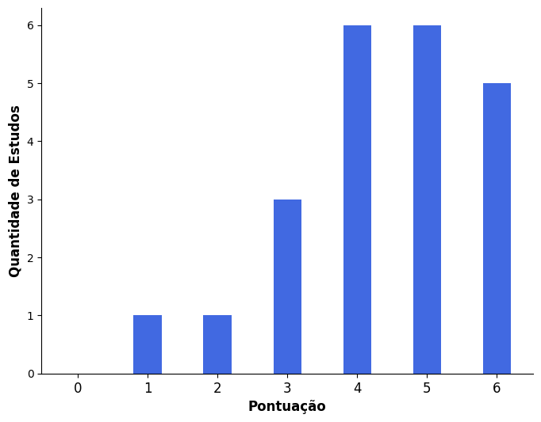

**Fonte:** Elaborado pelo autor (2025).

Na Figura 3.5 fica claro que a pontuação total dos estudos se concentra entre quatro e seis, revelando uma boa qualidade em relação aos critérios estabelecidos, dado que quando não atingem a pontuação máxima, se aproximam. Além disso nenhum estudo foi completamente incompatível segundo os critérios, visto que nenhum deixou de pontuar, com apenas dois com pontuação inferior a três.

Seguindo para a análise dos dados coletados das QP’s, a partir da Figura 3.6 é possível observar o número de citação de modelos de IA realizados na QP1.

**Figura 3.6** – Número de citações de modelos de IA obtidas para a QP1.

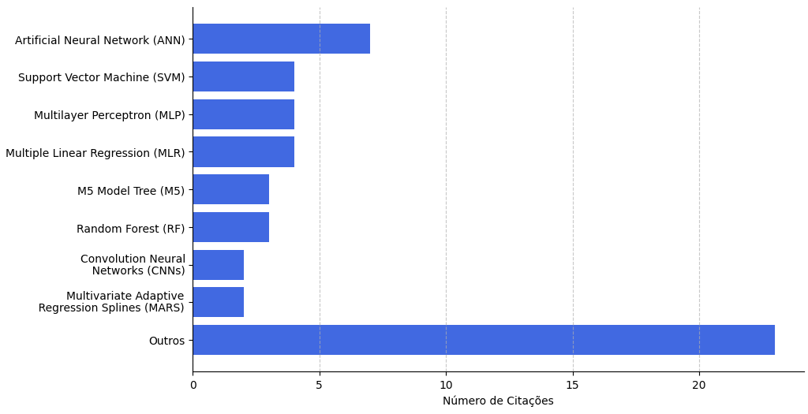

**Fonte:** Elaborado pelo autor (2025).

O modelo mais citado na QP1 como visto na Figura 3.6 é o ANN. Contudo é preciso entender que nos estudos, esses modelos são citados sem uma arquitetura específica, como por exemplo o CNN, que também aparecem no gráfico, revelando assim que caso houvesse uma generalização de todas as redes neurais artificiais, algumas como o CNN e MLP desapareceriam do gráfico, aumentando o número de citações do ANN. Contudo, buscando uma análise minuciosa, quando possível as arquiteturas foram separadas como modelos específicos, de forma a evidenciar de fato o que é mais usado.

Além disso, outros modelos de aprendizado de máquinas presentes na Figura 3.6 que ganharam destaque foram o SVM, MLR, M5, RF e o MARS que não se utilizam de ANN em seu processo de aprendizado. Em relação a QP2 e as temporalidade dos dados mais utilizadas tem-se a Figura 3.7.

**Figura 3.7** – Porcentagem de temporalidade dos dados obtidos para a QP2.

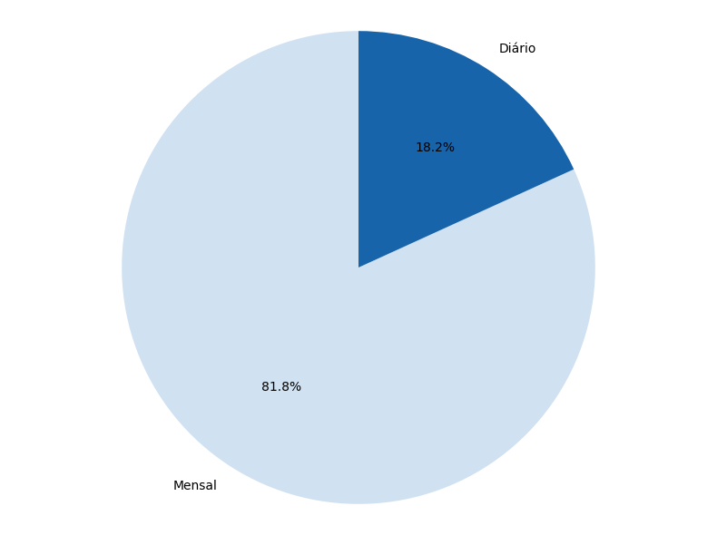

**Fonte:** Elaborado pelo autor (2025).

Os dados de precipitação se resumiram a diários e mensais, como mostra a Figura 3.7 com os dados mensais se destacando por seu maior uso. Seguindo para a QP3 e QP4 que tratam dos modelos de circulação geral e cenários climáticos usados para o treinamento dos modelos de aprendizado de máquinas, observa-se a Figura 3.8.

**Figura 3.8** – Porcentagem de citações de GCM’s e cenários climáticos para as QP3 e QP4.

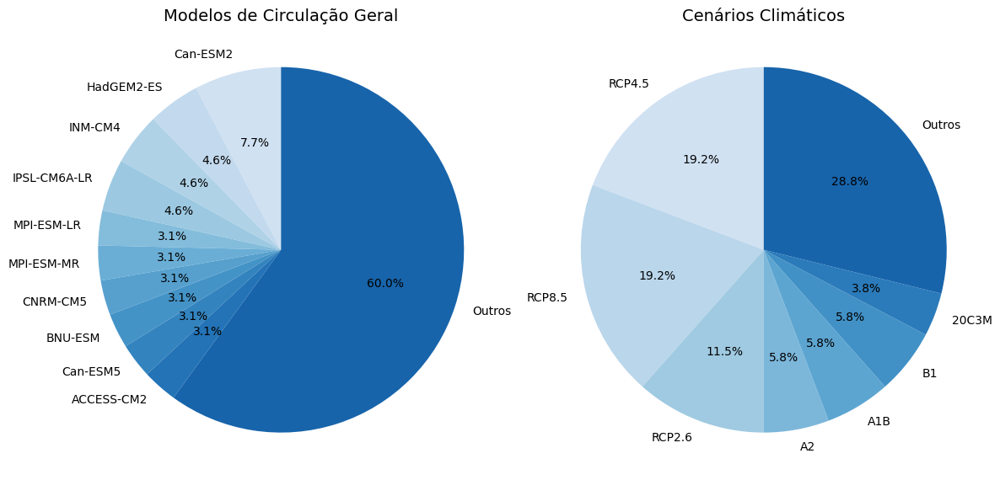

**Fonte:** Elaborado pelo autor (2024).

A Figura 3.8 mostra que os modelos de circulação geral usados são diversos, e a repetição de seu uso nos diferentes estudos é baixa, com alguns poucos ganhando destaque mas não chegando a cinco por cento de uso. Em contrapartida os cenários climáticos tendem a se repetir nos trabalhos, com destaque para o RCP4.5 e o RCP8.5, revelando uma tendencia dos autores na escolha de quais cenários acreditam ser o mais interessantes para realizar a predição de dados futuros. Por fim, o resultado da QP3 com as métricas mais utilizadas nos estudos pode ser visto na Figura 3.9.

**Figura 3.9** – Número de citações de métricas obtidas para a QP5.

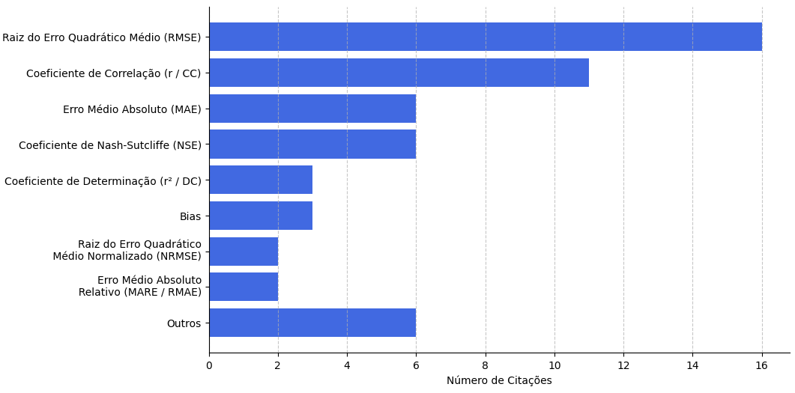

**Fonte:** Elaborado pelo autor (2024).

As métricas utilizadas pelos autores em seus estudos, tanto para a calibração dos modelos de aprendizado de máquinas como para a mensuração de sua acurácia, costumam ser sempre os mesmos como mostra a Figura 3.9, com o RMSE liderando o número de citações com uma boa vantagem, seguindo pelo r que possui quase o dobro de citações do terceiro colocado.

## 3.3 Discussão

A análise dos estudos selecionados para leitura profunda, guiada pelos resultados expostos anteriormente, permite desenvolver discussões que ampliam seu entendimento. Em relação à QP1, 55,56% dos modelos de IA mencionados não são baseados em ANN. No entanto, apesar da tendência geral não favorecer esse tipo de modelo, o mais citado foi o ANN. Esse fato releva que esses trabalhos buscam um maior foco na análise estatística e não no modelo usado, pois como notado anteriormente, o ANN não é uma arquitetura, mas sim uma categoria de modelos que se utilizam de ANN.

Porém, analisando os estudos que o citam e comparando com os outros, por mais que não mencionem de forma direta a arquitetura utilizada, infere-se através das descrições e comparação dos modelos nos estudos que possívelmente na maioria dos casos tratam-se do MLP (Nourani, Baghanam e Gokcekus, 2018; Sehgal et al., 2018; Baghanam et al., 2019; Montenegro-Murillo, Pérez-Ortiz e Vargas-Franco, 2019; Hosseini, Golian e Yazdi, 2020; Prathom e Champrasert, 2023a, 2023b).

Seguindo para os outros modelos de ANN dentro os mais citados de forma direta, têm-se o MLP e o CNN. Os estudos justificam o uso do MLP devido ao seu custo computacional reduzido, velocidade de treinamento e possibilidade de se utilizar de arquiteturas simplificadas do modelo (Boateng e Mutz, 2023; Nourani et al., 2023), além disso também se é relatado seu amplo uso em pesquisas que envolvem hidrologia e climatologia (Sachindra et al., 2015; Pinthong et al., 2024). Em relação ao CNN, sua aplicação é justificada não só pelo crescente uso em trabalhos que envolvem geociências, mas também pelos bons resultados obtidos (Harilal, Singh e Bhatia, 2021; Soares et al., 2024).

Quanto aos modelos mais citados que não usam ANN, tem-se o SVM e o MLR. O SVM ganhou destaque nos trabalhos por seu desempenho razoável e por vezes superior em comparação direta com outros, com uma boa capacidade de simular dados altamente não lineares, como o caso de dados de precipitação, e cuidados adicionais com sobreajuste (Ghosh, 2010; Sachindra et al., 2015; Pour et al., 2018; Sadeghfam et al., 2021). Já o MLR é um modelo simples de aprendizado de máquina e um método estatístico tradicional, usado pelos autores principalmente como referência para comparar e avaliar o desempenho de modelos mais complexos (Nourani, Baghanam e Gokcekus, 2018; Sehgal et al., 2018; Baghanam et al., 2019; Anaraki et al., 2023).

Tratando do restante das arquiteturas de IA mencionadas, nota-se uma alta variabilidade de uso que pode ser constatada através da Figura 3.6, com o modelo mais citado não chegando nem a metade da quantidade de menções em outros. Uma explicação sólida isso, é que por meio da tentativa e erro, os autores fazem comparações entre os modelos na busca do que melhor performa para os dados que possuem. Avançando para a QP2, fica clara a preferência dos autores por dados mensais à diários de precipitação. Nos estudos, não existem justificativas diretas para a escolha de uma determinada temporalidade. No entanto, razões lógicas podem explicar a ampla utilização de dados mensais.

Os dados de precipitação diária são altamente variáveis, apresentando mudanças abruptas, como longos períodos sem chuva seguidos de eventos extremos. Essa volatilidade aumenta a incerteza na predição e na capacidade de generalização dos modelos de IA. Em contrapartida, a agregação desses dados em médias mensais suaviza essas oscilações, tornando as tendências mais evidentes e facilitando a captura de padrões sazonais. Além disso, bases de dados mensais exigem menos armazenamento, reduzindo os custos e tornando as simulações computacionalmente mais eficientes, uma vez que a quantidade de dados processados é menor. Outro benefício dos dados mensais é a maior completude e consistência das medições, minimizando lacunas e facilitando o preenchimento de falhas, além de reduzir o impacto de flutuações bruscas.

Continuando para a QP3, nota-se sua relação direta com a QP4, por mais que os GCM’s citados possuem uma grande variabilidade, enquanto os cenários climáticos tendem a se repetir, como visto na Figura 3.8. Isso ocorre porque diferentes instituições ao redor do mundo desenvolvem seus próprios GCM’s, cada um com características específicas. Esses modelos variam em diversos aspectos, como a resolução espacial, conjunto de variáveis climáticas consideradas e a região de interesse para a qual foram otimizados (Baghanam et al., 2019). Como resultado, alguns modelos podem representar melhor determinadas áreas geográficas do que outros, devido às diferenças em suas parametrizações e abordagens de modelagem.

Esses fatores levam os pesquisadores a selecionar os GCMs que apresentam melhor desempenho para a região de estudo, possuem maior número de referências na literatura, que após tentativa e erro mostraram melhor desempenho, e até mesmo combinar múltiplos deles, o que contribui para a alta variabilidade observada (Pitong et al., 2024). No entanto, os cenários climáticos adotados tendem a ser repetir, pois apesar das variabilidades entre os GCMs, estes, são desenvolvidos com o objetivo de simular os cenários climáticos mais amplamente aceitos e utilizados pela comunidade científica, como os definidos pelo IPCC. Constata-se isso ao analisar os cenários mais utilizados na Figura 3.8 a partir da Tabela 3.3, que detalha suas equivalências e nível de emissões.

**Tabela 3.3** – Cenários climáticos mais citados

| SRES (AR4 - CMIP3) | RCP (AR5 - CMIP5)     | Nível de Emissões  |
|:-------------------|:----------------------|:-------------------|
| \-                 | RCP2.6                | Muito Baixo        |
| B1                 | RCP4.5                | Baixo a Moderado   |
| A1B                | Entre RCP4.5 e RCP6.0 | Moderado           |
| A2                 | RCP8.5                | Alto               |
| 20C3M              | \-                    | Clima do Século XX |

**Fonte:** Elaborado pelo autor (2025).

Assim, a Tabela 3.3 também mostra a relação entre os cenários climáticos mais citados na Figura 3.8, que pertencem aos relatórios AR4 e AR5 e utilizam simulações dos modelos CMIP3 e CMIP5, respectivamente. O AR5 representa uma evolução do AR4, incorporando novos modelos, dados e projeções climáticas aprimoradas. Entre os cenários listados, apenas o RCP2.6 e o 20C3M não possuem equivalentes diretos entre o CMIP3 e o CMIP5. Isso confirma que os pesquisadores tendem a utilizar os mesmos e equivalentes cenários climáticos ao longo das diferentes gerações de modelos. É importante mencionar que embora não estejam entre os mais citados, o uso dos cenários climáticos SSPs do modelo CMIP6 vem crescendo. Isso é esperado, já que os estudos tendem a acompanhar os modelos climáticos mais atualizados. Essa transição também foi observada ao longo dos anos, com a mudança do AR4 para o AR5.

Por fim, tem-se o QP5, onde, conforme ilustrado na Figura 3.9 e já relatado anteriormente, os métodos RMSE e r são os mais citados, destacando-se com ampla vantagem em relação às demais métricas. A análise dos estudos revela que a maioria dos autores utiliza mais de uma métrica para avaliar o desempenho dos modelos, sendo que apenas três trabalhos se restringiram a uma única (Ghosh, 2010; Montenegro-Murillo, Pérez-Ortiz e Vargas-Franco, 2019; Nishant et al., 2023). O uso combinado de diferentes delas é fundamental para obter uma visão mais precisa dos resultados, reduzindo possíveis vieses, pois cada métrica avalia aspectos distintos da modelagem (Sachindra et al., 2015).

O RMSE pode ser descrito como adequado para avaliar a precisão absoluta das previsões. Já o coeficiente de correlação r indica o quão bem as previsões seguem a tendência dos dados reais (Kueh e Kuok, 2016). Dessa forma, o alto número de citações do RMSE e r pode ser explicado pela preferência dos autores em combiná-los com outras métricas, como MAE, NSE, dentre outras. Assim, eles garantem uma avaliação mais robusta e abrangente da qualidade dos modelos climáticos. Um dado relevante é que, entre os estudos que utilizaram r, 75% também empregaram o RMSE, reforçando a tendência de usar essas métricas em conjunto para capturar diferentes aspectos do desempenho dos modelos.

## 3.4 Conclusão

Assim, apresentou-se um MSL sobre o uso de modelos de IA para a análise de dados temporais de precipitação sob a influência das mudanças climáticas. Através da análise criteriosa e filtragem dos trabalhos acadêmicos que mais se relacionavam com o tema em destaque, foi possível responder as QP’s e QA’s de forma a identificar tendências predominantes, lacunas e desenvolvimentos futuros dentro deste campo de pesquisa. A partir dela também se possibilitou a organização dos dados em planilhas eletrônicas, que permitem uma visão minuciosa das abordagens utilizadas, destacando os modelos de aprendizado de máquinas mais citados, as métricas de avaliação, GCM’s e os cenários climáticos frequentemente adotados.

A análise dos estudos revelou que é consistente o uso de uma diversidade de modelos de aprendizado de máquinas, inclusive os baseados em ANN’s, como o MLP e o SVM, além de modelos mais tradicionais da literatura como o MLR, empregados como referência comparativa. A escolha de dados mensais de precipitação, em detrimento dos dados diários, foi frequentemente observada, e essa preferência pode ser explicada por uma série de fatores, dentre eles uma maior estabilidade e consistência desses dados. No entanto, foi notado que a escolha entre dados diários e mensais não foi amplamente discutida pelos autores, o que indica um campo em aberto para investigações mais aprofundadas.

Outro ponto de destaque foi a diversidade de GCM’s utilizados, em contraste com os uso dos cenários climáticos que tendem a se repetir seguindo os padrões estabelecidos pelos relatórios do IPCC mais atualizados, e projeções climáticas mais aceitas e amplamente utilizadas pela comunidade científica. Assim, observa-se outro campo para estudos, sobre os cenários climáticos mais novos do CMIP6, que não estavam entre os mais citados, mas têm grande adesão nos estudos mais novos. Além disso, a análise das métricas de avaliação mostrou que o RMSE e o coeficiente de correlação r são as mais utilizadas, frequentemente combinadas para proporcionar uma avaliação mais robusta do desempenho dos modelos.

Nota-se também a falta de uma padronização nos processos que integram os conceitos, métodos e modelos na realização do SD. Muitas vezes, os estudos não fornecem detalhes suficientes sobre como os dados são manipulados e tratados, e os passos necessários para a implementação do SD nem sempre são claramente definidos. Por fim, a sistematização apresentada neste estudo contribui para o entendimento do estado da arte, fornecendo uma base sólida para futuras pesquisas que busquem otimizar modelos de IA na realização do SD, especialmente em um cenário de mudanças climáticas cada vez mais dinâmico.

Destaca-se então, que a presente dissertação busca explorar justamente essas lacunas encontradas nos trabalhos analisados, desenvolvendo uma metodologia que se diferencie das empregadas neles ao propor uma padronização, replicabilidade, fortalecimento metodológico e maior clareza do processo de realização do SD utilizando técnicas modernas de AM, além de trazer a generalização dos dados para qualquer ponto da região estudada através da espacialização de dados, com passos e etapas de todo o desenvolvimento detalhados.

# 4 Metodologia de Redução de Escala Estatística

Este capítulo apresenta a metodologia utilizada para a construção de modelos de aprendizado de máquina para previsão de séries temporais mensais de precipitação acumulada sob influência das mudanças climáticas. Os modelos desenvolvidos geram séries a partir de localizações específicas, utilizando dados espacializados de uma determinada região, que passaram por um processo de SD, combinando informações de fontes locais e de GCMs. A abordagem considera cenários climáticos futuros do CMIP6, com projeções até o ano de 2100. O objetivo é padronizar a construção desses modelos, permitindo sua replicação para diferentes regiões.

## 4.1 Estrutura de projeto

Para a realização do SD, foram utilizadas diversas bibliotecas da linguagem Python (2025), que possui uma grande comunidade e popularidade no desenvolvimento de soluções voltadas para o AM. O xarray foi fundamental para lidar com os dados climáticos em formato multidimensional do CMIP6, como NetCDF, que se destaca por sua capacidade de manipulação de grandes volumes de dados geoespaciais com rótulos multidimensionais, de forma rápida e otimizada (Hoyer e Hamman, 2017). A biblioteca pandas foi empregado para manipulação e análise de dados tabulares, devido à sua facilidade na limpeza, transformação e organização de séries temporais e dados estruturados, dado sua sintaxe simples, variedade de ferramentas, e boa performance (McKinney, 2010).

A biblioteca scikit-learn foi escolhida para implementação de algoritmos de AM clássicos, pois oferece ferramentas amplas e eficientes para pré-processamento, treinamento e avaliação de modelos (F. Pedregosa *et al.*, 2011). Já o TensorFlow foi empregado no desenvolvimento e treinamento de modelos de redes neurais profundas, devido sua performance e capacidade de exploração de arquiteturas mais complexas (Abadi *et al.* 2016). Por fim, os Jupyter Notebooks serviram como ambiente interativo de desenvolvimento, teste e visualização dos resultados de forma organizada e replicável (Kluyver *et al.* 2016).

Para a estrutura dos diretórios e arquivos utilizada no desenvolvimento do modelo de AM, pensou-se em algo que garanta reprodutibilidade e organização, visto na Tabela 4.1.

**Tabela 4.1** – Estrutura de pastas para treinamento de modelo de AM

```
rainscale/            # Diretorio raiz;
|-- datas/            # Dados do projeto (.csv .geojson .nc);
|   |-- external/     # Dados de fontes externas;
|   |-- interim/      # Dados intermediarios;
|   |-- processed/    # Dados finais;
|   `-- raw/          # Dados originais;
|-- downscaling/      # Codigo-fonte do projeto;
|   |-- __init__.py   # Torna o diretorio um pacote Python;
|   |-- config.py     # Arquivo de configuracao geral;
|   |-- predict.py    # Previsoes com modelo treinado;
|   `-- train.py      # Treinamento dos modelos;
|-- models/           # Modelos treinados (.joblib .h5);
|-- notebooks/        # Jupyter Notebooks (.ipynb);
|-- manage.py         # Arquivo para automatizar tarefas;
|-- README.md         # Documento explicando o projeto;
`-- requirements.txt  # Lista de dependencias.
```

**Fonte:** Elaborado pelo autor (2025).

A organização dos arquivos e diretórios disposta na Tabela 4.1 foi pensada de forma a tornar o projeto lógico, flexível e razoavelmente padronizado para modelos de AM, levando em consideração aspectos como o pré-processamento de dados, a avaliação do modelo e a integração com fontes externas.

## 4.2 Área de Estudo

O estado brasileiro da Paraíba foi selecionado para área de estudo dos primeiros modelos inseridos na ferramenta devido à grande quantidade de dados de alta qualidade disponíveis em sua agência de recursos hídricos, além de suas características climatológicas pertinentes. É importante destacar que este estudo pode ser replicado em qualquer região que possua dados com características semelhantes às mencionadas anteriormente. A Paraíba possui uma área de 56.467,242 km² e 232 municípios (IBGE, 2024), com pelo menos 98% de seu território localizado dentro do polígono das secas, que segundo a ANA (2023) é chamado de semiárido brasileiro, e reconhecido pela legislação como um local suscetível a longos e críticos períodos de estiagem.

Assim sendo, o clima semiárido predomina na região central e na maior parte da Paraíba. A região do sertão apresenta os menores índices pluviométricos, variando de 300 mm a 900 mm, concentrados no primeiro semestre do ano. No entanto, as regiões do agreste (zona de transição semiárida) e do litoral têm sua estação chuvosa de abril a junho, com precipitação anual superior a 1200 mm (Gurgel, 1984; Francisco e Santos, 2017). Os dados sobre a precipitação máxima diária anual e a precipitação acumulada para o estado da Paraíba são disponibilizados pela Agência Executiva de Gestão das Águas do Estado da Paraíba (AESA) (2023) e abrangem o período de 1994 a 2023, incluindo pelo menos 242 estações pluviométricas. Um mapa do estado é apresentado na Figura 4.1, mostrando um grande número de estações pluviométricas distribuídas por todo o território, permitindo uma espacialização de alta qualidade.

**Figura 4.1** – Estações pluviométricas do estado da Paraíba.

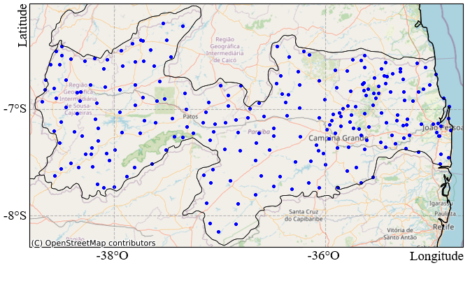

**Fonte:** Elaborado pelo autor (2025).

Os dados fornecidos pela AESA estão armazenados no formato de valores separados por vírgula (Comma Separated Values, CSV), com pelo menos 79096 linhas. As colunas de interesse da base de dados original podem ser vistas a partir da Tabela 4.2, que apresenta base de dados da AESA. Nela existem 35 colunas relevantes, com variáveis quantitativas. Elas registram a quantidade de chuva diária em milímetros, com dados distribuídos nas colunas correspondentes aos dias do mês, que vão do 1 ao 31. Para meses com menos de 31 dias, as colunas dos dias ausentes ficam vazias. As linhas da base de dados são organizadas por pontos específicos e datas, referenciadas nas colunas de latitude, longitude, ano e mês.

**Tabela 4.2** – Colunas de interesse da base de dados original da AESA

| Coluna    | Quantidade |   Tipo    |
|:----------|:----------:|:---------:|
| Latitude  |   79096    | flutuante |
| Longitude |   79096    | flutuante |
| Ano       |   79096    |  inteiro  |
| Mês       |   79096    |  inteiro  |
| Dia 1     |   79096    | flutuante |
| ...       |            |           |
| Dia 31    |   79096    | flutuante |

**Fonte:** Elaborado pelo autor (2025).

## 4.3 Dados para redução de escala estatística

Para realizar o SD e obter dados futuros de precipitação para a área de estudos, foi usado o GCM CNRM-CM6-1-HR do CMIP6 produzido pelo *Centre National de Recherches Météorologiques - Centre Européen de Recherche et de Formation Avancée en Calcul Scientifique* (CNRM-CERFACS). É possível observar a malha de pontos do GCM, cobrindo apenas a região da Paraíba, através da Figura 4.2.

**Figura 4.2** – Pontos do modelo CNRM-CM6-1-HR.

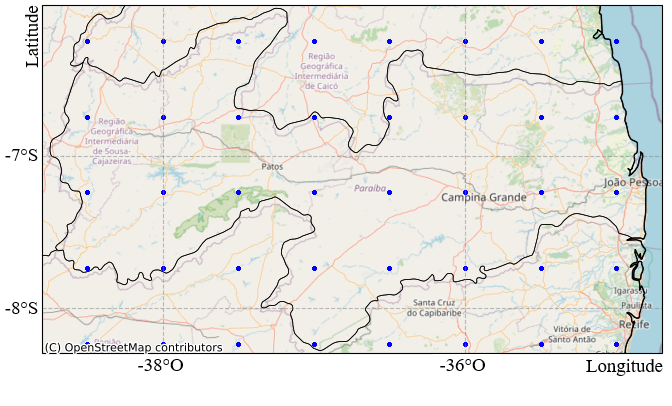

**Fonte:** Elaborado pelo autor (2025).

Sua escolha se dá devido a alta resolução, indicado pelo HR no fim da sigla. Isso resulta em uma boa cobertura da região estudada, com uma resolução aproximada de 50 quilômetros por ponto. Os dados foram ajustados para uma malha de 360 pontos ao longo da longitude e 720 pontos ao longo da latitude, o que significa que cada ponto representa uma área de cerca de 50 quilômetros quadrados na superfície da Terra (Voldoire, 2019a, 2019b). Foram escolhidos dois experimentos para o GCM CNRM-CM6-1-HR.

É importante destacar que os modelos climáticos do CMIP6 podem ser integrados em abordagens multimodelo, o que tende a ampliar a representatividade da variabilidade espacial e a robustez estatística das projeções em escala global. A combinação de diferentes GCMs permite capturar incertezas estruturais associadas às distintas parametrizações físicas e dinâmicas empregadas por cada centro de modelagem. No entanto, essa estratégia também implica em aumento significativo do custo computacional, maior complexidade no processamento e na análise dos dados e, nem sempre, resulta em ganhos proporcionais na qualidade das projeções regionais. Assim, a escolha por um modelo específico, como o CNRM-CM6-1-HR, busca equilibrar resolução espacial, consistência científica e viabilidade computacional para a área de estudo.

O primeiro foi histórico, com dados que vão de 1994 à 2014 (Voldoire, 2019a). O segundo experimento foi do cenário climático de emissões de GEEs SSP5-8.5, uma atualização do RCP5-8.5 com dados que vão de 2015 à 2100 (Voldoire, 2019b). O SSP5-8.5 tem como característica emissões muito elevadas de GEEs, sendo elas triplicadas até o ano de 2075 para o dióxido de carbono. Os dados dos experimentos estão relacionados aos fenômenos atmosféricos, dado a variável estudada que é a precipitação, com frequência de ocorrência diária e unidade medida em $kg m^{-2} s^{-1}$.

Os dados dos modelos com os experimentos explicados são armazenados no formato NC, que é a extensão de arquivos *Network Common Data Form* (NetCDF), com um total de 1954050 linhas. A quantidade de linhas se justifica devido a malha de pontos, que cobre todo o globo, e a soma dos experimentos, que resultam em dados que vão de 1994 à 2100. As colunas de interesse presentes na base de dados podem ser vistas na Tabela 4.3.

**Tabela 4.3** – Colunas de interesse da base de dados do experimento do CMIP6

| Coluna       | Quantidade |   Tipo    |
|:-------------|:----------:|:---------:|
| Latitude     |  1954050   | flutuante |
| Longitude    |  1954050   | flutuante |
| Ano          |  1954050   |  inteiro  |
| Mês          |  1954050   |  inteiro  |
| Dia          |  1954050   |  inteiro  |
| Precipitação |  1954050   | flutuante |

**Fonte:** Elaborado pelo autor (2025).

A estrutura da base da dados vista na Tabela 4.3 apresenta 6 colunas relevantes. As linhas se guiam pelas precipitações que se ordenam através da localização e tempo. Todos os dados dos experimentos foram fornecidos pelo *World Climate Research Programme* (WCRP), através da interface de pesquisa do CMIP6 (WCRP, 2024).

## 4.4 Modelo de Aprendizado de Máquina

Para que se desenvolva um modelo final de AM da forma mais replicável possível, com capacidade de gerar séries temporais futuras de precipitação a partir de cenários climáticos, para qualquer localidade de uma determinada região, se faz necessário a realização de uma três de etapas. De forma simplificada, a primeira etapa se inicia com a criação de um primeiro modelo de AM para espacialização, também conhecida como interpolação, de dados locais de precipitação, possuindo variáveis de espaço e tempo, para o período de 1994 à 2023. Com esse modelo, gera-se uma nova base de dados locais nos pontos exatos do experimento climático CMIP6, que abrange o período de 1994 a 2100. Ressalta-se que tanto a base de dados local espacializada como a do experimento CMIP6 possuem as mesmas variáveis espaciais e temporais, se distinguindo apenas nas colunas de precipitação, que são únicas para cada base de dados. Assim inicia-se a segunda etapa.

Nela, segue-se o processo realizando a união dessas duas bases para as colunas espaciais e temporais, associando os dados de precipitação local espacializada e do experimento para os mesmos pontos e períodos. A partir dessa base unificada, treina-se um segundo modelo de SD com AM para prever a precipitação local espacializada que se limita até o ano de 2023, com base na precipitação do experimento que vai até o ano de 2100, focando especialmente nos anos futuros de 2024 a 2100. Com a base de dados resultante, têm-se a terceira etapa ao se treinar um terceiro modelo final de espacialização de AM para gerar precipitações futuras em qualquer localidade da região. Ele representa o produto de SD espacializado. Em resumo, o primeiro modelo seve para que se obtenha as precipitações locais para os mesmos pontos das precipitações do CMIP6, o segundo modelo para fazer a predição dessas precipitações para os anos futuros simulados pelo CMIP6, e o terceiro e último modelo, que é o usado, para que se possa obter essas precipitações preditas para qualquer lugar da região estudada, que é a Paraíba.

Um fluxograma geral do processo é mostrado na Figura 4.3. É importante deixar claro que dentre os modelos de AM vistos nela, o primeiro e o final tratam-se de modelos desenvolvidos para a predição de dados espaciais a partir de vizinhos conhecidos, ou seja, espacialização de dados baseado em AM. Já o segundo modelo trata da predição de dados de séries temporais com influência dos dados simulados para anos futuros do CMIP6, ou seja, a aplicação do SD. Assim sendo, o tratamento e treinamento dos dados do primeiro e do modelo final possuem características diferentes do segundo modelo.

**Figura 4.3** – Fluxograma de desenvolvimento do modelo de espacializado dos dados de SD.

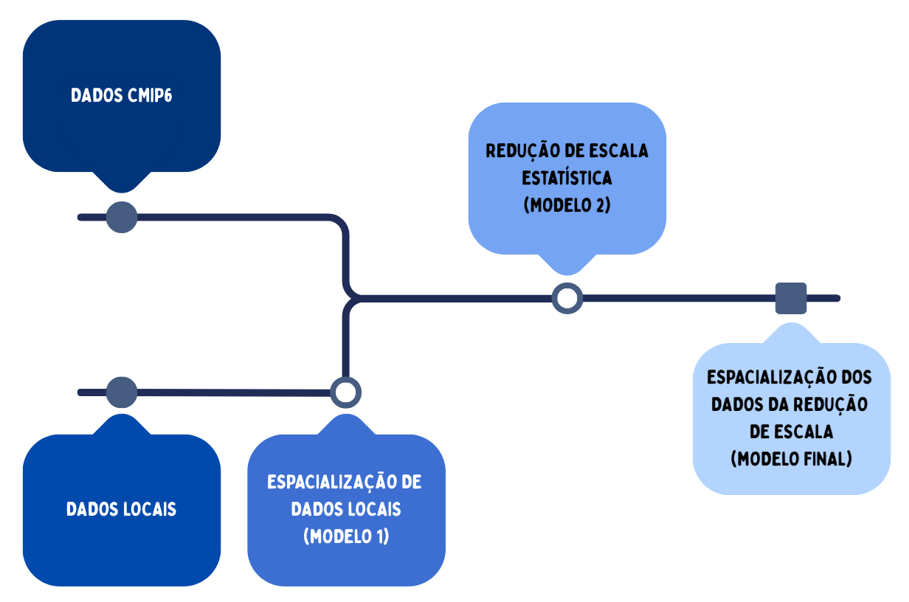

**Fonte:** Elaborado pelo autor (2025).

### 4.4.1 Base de dados locais espacializados

O treinamento do modelo 1 que gera a base de dados espacializada inicia-se com a preparação dos dados. A base de dados original, com colunas conforme descrito na Tabela 4.2, contém informações de precipitação diária. Para calcular a precipitação mensal acumulada, cria-se uma nova coluna que representa esse valor, obtido pela soma das precipitações diárias de cada mês presente em cada linha. Após esse processo, as colunas de precipitação diária são descartadas da base de dados. Nota-se a precipitação mensal acumulada do primeiro mês de 2023, último ano da base de dados local usada como retroanálise, para seus pontos na Figura 4.4.

Ela mostra de forma discreta as tendências de chuva em cada região do mapa, onde os locais com maiores precipitações acumuladas são mais próximos do amarelo, e os com menos mais próximos do roxo. Ressalta-se que a base de dados disposta no mapa permite apenas a obtenção dessas séries temporais para os pontos onde se tem registro. Seguindo o processo para treinamento do modelo 1 com a frequência temporal ajustada, observa-se que alguns meses estão sem dados de precipitação. Para preencher esses dados faltantes, usa-se a interpolação por meio do método de IDW, utilizando as precipitações dos pontos mais próximos no mesmo período. Além disso, adiciona-se uma nova coluna com valores interpolados à base de dados, contribuindo para aprimorar a capacidade de generalização do modelo a ser treinado.

**Figura 4.4** – Precipitação acumulada para dados locais na Paraíba.

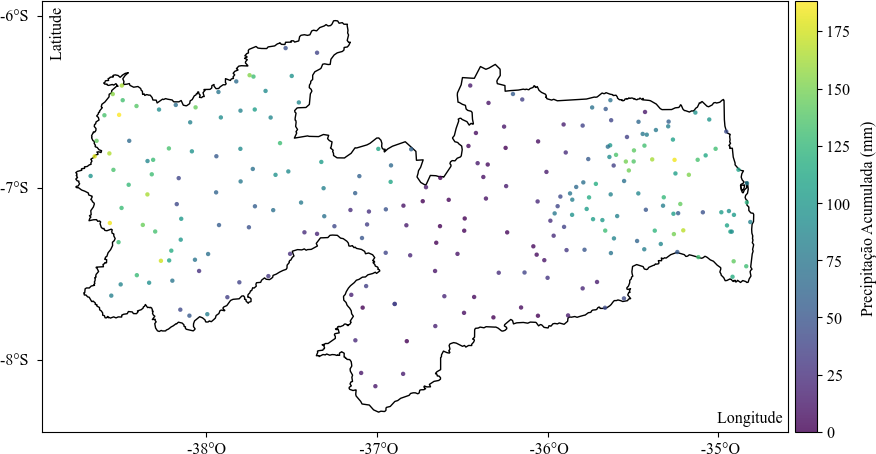

**Fonte:** Elaborado pelo autor (2025).

Com a base de dados consolidada, ela é dividida em conjuntos de treino e teste, permitindo a avaliação da performance preditiva dos modelos. Em seguida, utiliza-se a validação cruzada espacial, onde, em cada iteração, 30% dos pontos são selecionados aleatoriamente no espaço para compor o conjunto de validação. Esse processo é repetido por 5 iterações, o que possibilita a análise de diferentes subconjuntos espaciais e proporciona uma avaliação mais robusta da capacidade de generalização dos modelos. Durante o treinamento, os modelos são avaliados pelas métricas $RMSE$, $r$ e $MAE$, com o objetivo de identificar aquele que apresenta o melhor desempenho na previsão da variável de interesse. Uma representação visual desse processo é visto na Figura 4.5.

**Figura 4.5** – Validação cruzada para dados espaciais.

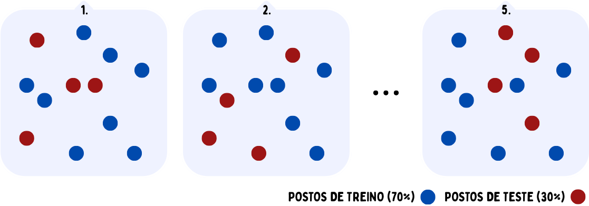

**Fonte:** Elaborado pelo autor (2025).

Para efeito de comparação, como forma de avaliar o desempenho dos modelos de AM para espacialização frente a um método consagrado, foi usado o método IDW para interpolar os mesmos pontos. Os resultados dos modelos treinados e do método IDW podem ser vistos na Tabela 4.4.

**Tabela 4.4** – Desempenho dos primeiros modelos de espacialização.

| Modelo            |  $r$   |  RMSE   |   MAE   |
|:------------------|:------:|:-------:|:-------:|
| ExtraTrees        | 0.9429 | 28.9271 | 4.1104  |
| Random Forest     | 0.9415 | 29.3022 | 4.1378  |
| KNN               | 0.9378 | 30.1935 | 4.2120  |
| Gradient Boosting | 0.9379 | 41.1795 | 5.3948  |
| CNN               | 0.9484 | 34.7361 | 20.3816 |
| MLP               | 0.9436 | 47.6710 | 27.5590 |
| LSTM              | 0.9275 | 34.4790 | 20.7947 |
| IDW               | 0.9270 | 30.8732 | 4.3063  |

**Fonte:** Elaborado pelo autor (2025).

Realizando a validação cruzada para diferentes modelos de AM vistos na Tabela 4.4, a média das cinco iterações com $RMSE$, $r$ e $MAE$ indicou o ExtraTrees com melhor desempenho para a tarefa em questão, mostrando métricas superiores de maneira geral aos outros modelos, com destaque ao modelo comparativo IDW. Após isso, buscou-se a melhor combinação de hiperparâmetros do modelo Extratrees através de buscas em grade, onde os melhores podem ser vistos através de sua arquitetura, mostrada na Tabela 4.5.

**Tabela 4.5** – Arquitetura Extratrees para primeiro modelo.

```python
# Bibliotecas utilizadas
from sklearn.ensemble import ExtraTreesRegressor

# Definindo o modelo e parametros
model = ExtraTreesRegressor(
    'max_depth': 15,
    'max_features': 2,
    'min_samples_leaf': 1,
    'min_samples_split': 4,
    'n_estimators': 50
)

# Treinando o modelo
model.fit(X, y)
```

**Fonte:** Elaborado pelo autor (2025).

O modelo treinado visto na Tabela 4.5 obteve um $MAE$ de 3.9758mm, um $RMSE$ de 27.1211mm, e um $r$ de 0.9437. A Figura 4.6 através de um gráfico de dispersão, entre as precipitações observadas e preditas, detalham a capacidade de predição do modelo 1. A proximidade dos pontos com o eixo de paridade junto da forma como se agrupam em uma linha de quarenta e cinco graus no gráfico da Figura 4.6 atesta a boa capacidade de generalização do modelo. Assim, após a escolha do ExtraTrees, realiza-se o treinamento final utilizando toda a base de dados. Em seguida, as precipitações acumuladas mensais são espacializadas para os pontos utilizados no experimento CMIP6, ilustrados na Figura 4.2, criando uma nova base de dados de precipitações mensais acumuladas para esses pontos específicos.

**Figura 4.6** – Dispersão entre dados locais preditos e observados.

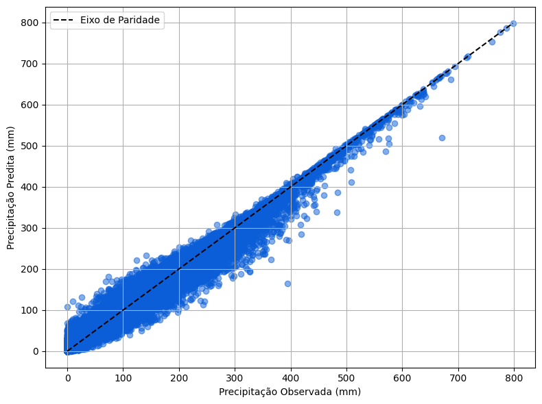

**Fonte:** Elaborado pelo autor (2025).

### 4.4.2 Base de dados de redução de escala

Para treinar um modelo de SD que permita a geração de séries temporais com dados futuros, é necessário processar os dados dos experimentos CMIP6, fornecidos no formato NetCDF. Utilizando a biblioteca xarray, é possível acessar tanto os dados do experimento histórico quanto os do cenário SSP, extrair as variáveis de interesse para pontos específicos e, em seguida, convertê-los em arquivos CSV por meio do pandas. Após essa conversão, os arquivos podem ser unificados em uma única base de dados, já que compartilham as mesmas variáveis, diferindo apenas no período temporal coberto por cada experimento. O resultado dessa união é a base de dados apresentada na Tabela 4.3.

Contudo, a frequência original das precipitações nos dados unidos é diária. Para convertê-la para uma escala mensal, somam-se os valores de precipitação referentes ao mesmo mês e ano, e em seguida a coluna com o dia é removida. Observa-se a precipitação mensal acumulada do primeiro mês do ano de 2023 da base de dados dos experimentos CMIP6, em seus respectivos pontos, na Figura 4.7.

**Figura 4.7** – Precipitação acumulada para dados CMIP6 na Paraíba.

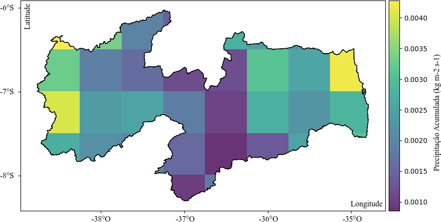

**Fonte:** Elaborado pelo autor (2025).

A Figura 4.7 mostra de forma clara a baixa resolução dos dados CMIP6. Após o ajuste na frequência temporal, tanto os dados locais espacializados quanto os dados unidos dos experimentos do CMIP6 passam a ter a mesma estrutura espacial, diferenciando-se apenas pela origem das variáveis de precipitação e suas janelas temporais, onde uma é medida localmente e vai de 1994 à 2023 e outra na escala dos experimentos climáticos e vai de 1994 à 2100.

Com as frequências harmonizadas, as duas bases são integradas em uma nova para o treino do segundo modelo preditivo, mantendo-se as colunas espaciais e o recorte temporal baseado nos dados locais. Logo, as variáveis de precipitação são identificadas conforme sua origem. Como o objetivo é prever as precipitações locais espacializadas para anos futuros, as novas colunas criados serão baseadas em outras variáveis que não ela. Assim foram desenvolvidos novos atributos relacionados aos dados de precipitação do CMIP6, baseados em uma análise dos gráficos das Funções de Autocorrelação (FAC), e de Autocorrelação Parcial (FPAC) da precipitação local, vistas na Figura 4.8.

Os gráficos de FAC e FACP foram analisados para a série de chuvas locais ao longo de 24 meses, com o objetivo de identificar possíveis padrões cíclicos. Com base nessa análise, foram selecionadas as defasagens ou *lags* de 1, 6 e 12 meses para inclusão no modelo preditivo 2. A escolha do *lag 1* se deve à persistência mensal da precipitação, indicando que o volume de chuva de um mês tende a estar associado ao do mês anterior. Já os *lags* 6 e 12 refletem padrões semestrais e sazonais anuais, observados pelos picos recorrentes nos gráficos da FAC, sugerindo uma alternância cíclica entre períodos secos e chuvosos. Por sua vez, o gráfico da FACP confirma esses comportamentos, há uma forte dependência direta entre o mês atual e o anterior, enquanto os *lags* de 6 e 12 meses reforçam a presença de periodicidades semestrais e anuais na série histórica de precipitação. Destaca-se que aos gerar os *lags*, os primeiros meses acabam por ficar com valores nulos pela falta de dados de meses anteriores, que por sua vez foram preenchidos com a média dos valores da coluna.

**Figura 4.8** – Autocorrelação e Autocorrelação Parcial da precipitação local.

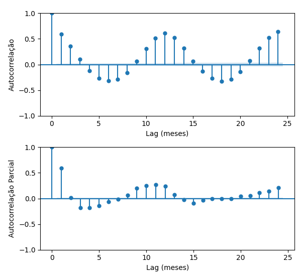

**Fonte:** Elaborado pelo autor (2025).

Além disso, foi adicionada uma coluna com a classificação dos dados em quatro grupos, definida por meio do algoritmo K-Means, de forma a evidenciar nos dados suas características regionais. As colunas geradas com precipitações de meses anteriores apresentam valores ausentes nos primeiros meses, que foram preenchidos com a média da respectiva coluna. Por fim, toda a base de dados foi normalizada para uma mesma escala numérica, e suas colunas observadas na Tabela 4.6.

**Tabela 4.6** – Colunas de dados para SD.

| Coluna                           | Quantidade |   Tipo    |
|:---------------------------------|:----------:|:---------:|
| Latitude                         |   64200    | flutuante |
| Longitude                        |   64200    | flutuante |
| Ano                              |   64200    |  inteiro  |
| Mês                              |   64200    |  inteiro  |
| Agrupamentos                     |   64200    |  inteiro  |
| Precipitação CMIP6               |   64200    | flutuante |
| Precipitação CMIP6 (*lag* 1)     |   64200    | flutuante |
| Precipitação CMIP6 (*lag* 6)     |   64200    | flutuante |
| Precipitação CMIP6 (*lag* 12)    |   64200    | flutuante |
| Precipitação Local Espacializada |   18000    | flutuante |

**Fonte:** Elaborado pelo autor (2025).

Em seguida, os dados foram divididos em conjuntos de treino e teste. Para a etapa de validação do modelo 2, utilizou-se validação cruzada para séries temporais, onde o conjunto de treino iniciou com 70% dos dados e foi aumentado progressivamente em intervalos de 5% até atingir 90%. Uma demonstração desse processo é mostrado na Figura 4.9.

**Figura 4.9** – Validação cruzada para dados temporais.

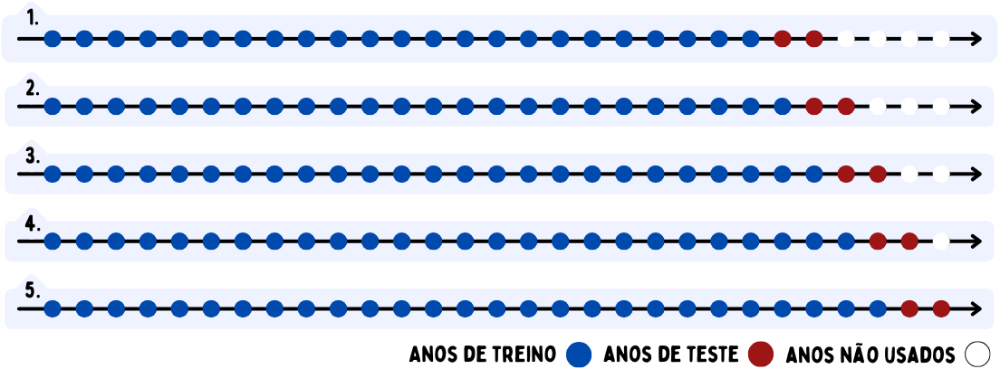

**Fonte:** Elaborado pelo autor (2025).

Os modelos de AM foram também avaliados pelas métricas $RMSE$, $r$ e $MAE$, sendo diferentes modelos testados. Para efeito comparativo, e para validar a superioridade preditiva dos modelos de AM, foi elaborada uma previsão de persistência, utilizando como estimativa para o mês atual o valor de precipitação observado no mês anterior para cada ponto espacial. Os resultados podem ser vistos na Tabela 4.7.

**Tabela 4.7** – Desempenho dos segundos modelos de espacialização.

| Modelo                |  $r$   |  RMSE   |   MAE   |
|:----------------------|:------:|:-------:|:-------:|
| ExtraTrees            | 0.7816 | 55.0087 | 34.9636 |
| Random Forest         | 0.7816 | 54.8045 | 35.2220 |
| Gradient Boosting     | 0.7880 | 64.8789 | 45.1829 |
| KNN                   | 0.7197 | 63.0329 | 39.4314 |
| CNN                   | 0.7671 | 57.3030 | 36.5433 |
| LSTM                  | 0.7819 | 57.7876 | 36.0757 |
| MLP                   | 0.7350 | 61.2837 | 38.4351 |
| Prev. de Persistência | 0.5906 | 75.5548 | 48.8518 |

**Fonte:** Elaborado pelo autor (2025).

Para o modelo 2 de redução de escala, o que demonstrou melhor desempenho geral na previsão das precipitações após a validação cruzada e comparação entre modelos, inclusive o de linha de base, foi novamente o ExtraTrees, com melhores médias de $r$, $RMSE$ e $MAE$. Assim, novamente se seguiu para a definição dos hiperparâmetros através da busca em grade. O resultado pode ser visto através da arquitetura disposta na Tabela 4.8. E após o treinamento do segundo modelo com essa arquitetura chegou-se a um $MAE$ de 32.9828mm, um $RMSE$ de 52.0175mm, e um $r$ de 0.8108.

**Tabela 4.8** – Arquitetura Extratrees para segundo modelo.

```python
# Bibliotecas utilizadas
from sklearn.ensemble import ExtraTreesRegressor

# Definindo o modelo e parametros
model = ExtraTreesRegressor(
    'max_depth': 50,
    'max_features': 3,
    'min_samples_leaf': 1,
    'min_samples_split': 4,
    'n_estimators': 100
)

# Treinando o modelo
model.fit(X, y)
```

**Fonte:** Elaborado pelo autor (2025).

Assim, o segundo modelo foi treinado com a arquitetura vista na Tabela 4.8 com todos os dados disponíveis, e a partir dele foram feitas as predições das precipitações locais espacializadas para os anos que vão de 2024 à 2100, utilizando como entrada as informações dos dados do CMIP6 desse mesmo período, com adição dos recursos de valores acumulados de meses anteriores e classificação de grupos. Um gráfico de comparação entre as precipitações locais espacializadas, representadas pela linha continua azul, e as precipitações locais espacializadas para os pontos dos dados CMIP6 com escala reduzida preditas por SD, retratadas pela linha pontilhada preta, pode ser visto na Figura 4.10.

**Figura 4.10** – Comparação anual entre séries de dados de SD.

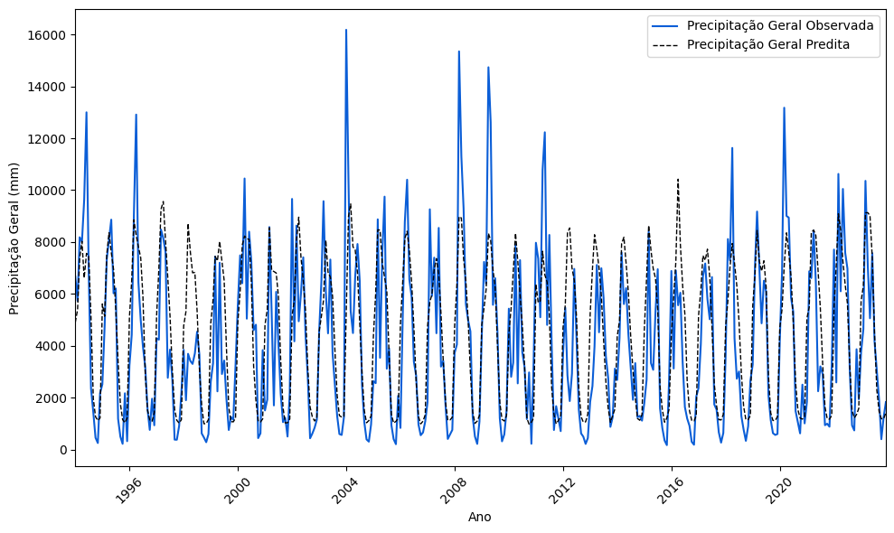

**Fonte:** Elaborado pelo autor (2025).

Observa-se que o modelo conseguiu capturar adequadamente o padrão sazonal da série temporal, representando de forma satisfatória a variabilidade intra-anual e interanual da precipitação. Isso sugere que o modelo assimilou bem a estrutura estatística dos dados climáticos históricos usados no treinamento. Entretanto, algumas limitações importantes são evidentes na Figura 4.10, como a dificuldade do modelo em representar com precisão os picos máximos e mínimos de precipitação, que costumam aparecer atenuados em relação aos dados observados.

Isso é comum em modelos de AM aplicados a séries temporais com alta variabilidade, especialmente quando envolvem eventos raros ou extremos. Assim, observa-se no gráfico a tendência de subestimar ou superestimar anomalias em anos atípicos, o que pode indicar limitações na captura de mudanças abruptas nos padrões climáticos, muitas vezes relacionadas a fenômenos de larga escala. Apesar das limitações relatadas, o modelo se mostra promissor para predições futuras, especialmente ao considerar tendências e padrões médios capturados dos dados locais e do CMIP6. A fidelidade à estrutura geral da série observada é um indicativo importante da robustez da metodologia empregada no processo de SD.

Seguindo o restante do processo, com a predição realizada a partir do segundo modelo, se finaliza uma base de dados de SD unindo os dados preditos com os já existentes, observados na Tabela 4.9, definindo as colunas de interesse como as mesmas, porém garantindo uma janela temporal que vai de 1994 à 2100 para os dados locais.

**Tabela 4.9** – Colunas de dados para espacialização de SD

| Coluna                           | Quantidade |   Tipo    |
|:---------------------------------|:----------:|:---------:|
| Latitude                         |   64200    | flutuante |
| Longitude                        |   64200    | flutuante |
| Ano                              |   64200    |  inteiro  |
| Mês                              |   64200    |  inteiro  |
| Precipitação Local Espacializada |   64200    | flutuante |

**Fonte:** Elaborado pelo autor (2025).

### 4.4.3 Modelo de espacialização de dados de redução de escala

A base de dados que passou pelo SD possui todos os atributos necessários para que se crie um terceiro e último modelo de espacialização que garanta a possibilidade de obtenção de dados de séries temporais de precipitação de uma região, para um período que vai até 2100. O treinamento desse modelo de AM se assemelha ao desenvolvido para a espacialização dos dados locais, onde os dados são divididos em conjuntos de treino e teste, e a performance é avaliada por meio do treinamento de diferentes modelos, incluindo o IDW para linha de base comparativa, a validação cruzada espacial desses modelos, e o cálculo das métricas como $MAE$, $RMSE$ e $r$, assegurando a robustez e a capacidade de generalização deles. A média dessas métricas para cada modelo pode ser visto a partir da Tabela 4.10

**Tabela 4.10** – Desempenho dos modelos finais de espacialização.

| Modelo            |  $r$   |  RMSE   |   MAE   |
|:------------------|:------:|:-------:|:-------:|
| ExtraTrees        | 0.9658 | 18.1736 | 3.3412  |
| Random Forest     | 0.9567 | 19.9960 | 3.4309  |
| KNN               | 0.9598 | 21.1921 | 3.6353  |
| Gradient Boosting | 0.9597 | 29.1586 | 4.6728  |
| CNN               | 0.6860 | 49.7035 | 32.7036 |
| MLP               | 0.6873 | 63.2114 | 39.4497 |
| LSTM              | 0.8869 | 30.0946 | 17.1383 |
| IDW               | 0.9527 | 21.9382 | 3.7391  |

**Fonte:** Elaborado pelo autor (2025).

O modelo de AM que melhor desempenhou para a base de dados exposta na Tabela 4.9 foi novamente o ExtraTrees. Assim, os hiperparâmetros foram definidos através da busca em grade, vistos na Tabela 4.11.

**Tabela 4.11** – Arquitetura Extratrees para modelo final.

```python
# Bibliotecas utilizadas
from sklearn.ensemble import ExtraTreesRegressor

# Definindo o modelo e parametros
model = ExtraTreesRegressor(
    'max_depth': 50,
    'max_features': 2,
    'min_samples_leaf': 1,
    'min_samples_split': 2,
    'n_estimators': 50
)

# Treinando o modelo
model.fit(X, y)
```

**Fonte:** Elaborado pelo autor (2025).

O modelo final obtido através da Tabela 4.11 obteve um $MAE$ de 2.9773mm, um $RMSE$ de 14.6021mm, e um $r$ de 0.9758. Assim, todos os dados disponíveis e vistos na Tabela 4.9 foram usados para o treinar o terceiro e último modelo. Entretanto, além de avaliar a acurácia do modelo por meio de métricas de desempenho aplicadas aos conjuntos de treino e teste, que são de extrema importância, é essencial comparar as precipitações previstas pelo modelo, obtidas após o processo de SD e espacialização, com as precipitações reais observadas localmente em seus respectivos pontos e datas. Essa comparação ajuda a entender como os dados dos experimentos CMIP6 influenciaram as previsões do modelo, inclusive para períodos em que já existem medições reais conhecidas.

É importante destacar que, mesmo ao prever dados de precipitação para anos em que já existem registros locais, o modelo não será capaz de reproduzir exatamente os mesmos valores históricos. Isso ocorre porque, com adendo dos motivos já relatados anteriormente durante a explicação da Figura 4.10, ao incorporar as informações do CMIP6 no processo de redução de escala, o modelo é impactado pelas características próprias desses dados, que são simulados, e representam tendências climáticas de larga escala. Como resultado, essas características não afetam apenas as projeções futuras, mas também influenciam as previsões passadas e já conhecidas, desviando-as em certa medida dos valores reais. A comparação mencionada pode ser visualizada na Figura 4.11.

**Figura 4.11** – Dispersão entre dados de espacialização de SD.

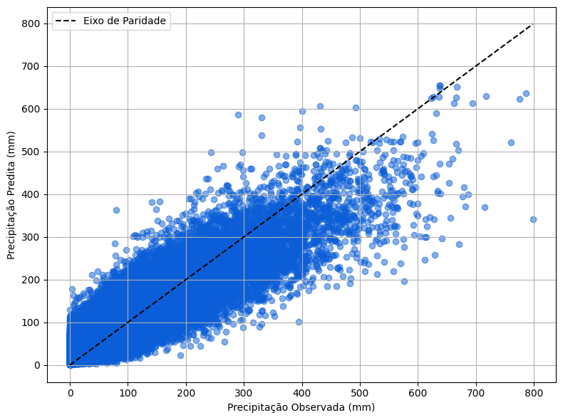

**Fonte:** Elaborado pelo autor (2025).

O gráfico da Figura 4.11 mostra que os dados seguiram o mesmo padrão do gráfico da Figura 4.6, de forma retilínea ao entorno do eixo de paridade. É possível notar que os pontos se tornam mais espaçados em torno do eixo, relatando uma maior diferença, já esperada, dos dados preditos para os valores reais. Outra diferença notada em relação à Figura 4.6 é a menor quantidade de dados atingindo grandes picos de precipitação, uma informação já obtida e analisada anteriormente sobre outra perspectiva, através do gráfico da Figura 4.10.

De forma geral, o gráfico expõe uniformidade dos dados gerados pelo modelo em relação aos dados reais, indicando que, apesar das influências desejadas para a predição das precipitações futuros, e inerentes aos dados do CMIP6, além das inevitáveis discrepâncias nos extremos, o modelo captura de maneira satisfatória o padrão espacial e temporal das precipitações na região. Essa consistência reforça a viabilidade do uso do modelo para projeções futuras, ao mesmo tempo em que destaca a importância de considerar as limitações introduzidas pelos dados de entrada simulados no processo de SD.

Finalmente, a partir do modelo final de espacialização, é possível gerar uma grade de pontos com as precipitações acumuladas em milímetros para um determinado mês e ano, que para a Figura 4.12 foram de janeiro de 2023.

**Figura 4.12** – Precipitação acumulada para dados de SD espacializados na Paraíba.

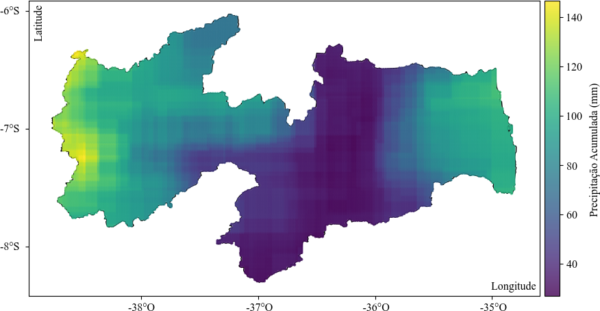

**Fonte:** Elaborado pelo autor (2025).

Nota-se que o mapa apresentado na Figura 4.12, que mostra as precipitações espacializadas após o SD, apresenta um padrão semelhante ao dos acúmulos de chuva indicados pelas cores nos mapas da Figura 4.4 dos dados locais, e da Figura 4.7 dos dados CMIP6. Em todos os casos, nota-se uma maior concentração de chuva nas bordas do mapa e uma redução no centro do estado. Esse comportamento indica que, para a data analisada, o modelo foi capaz de generalizar bem os padrões espaciais de precipitação, apresentando boa correlação com as bases utilizadas no seu treinamento.

Assim, gera-se um arquivo contendo o modelo final treinado. No caso do uso do scikit-learn, o modelo treinado foi salvo em formato JOBLIB, que preserva a estrutura e os parâmetros do modelo. Já o modelo treinado com TensorFlow foi salvo em formato H5, contendo os pesos, a arquitetura e as funções de otimização. Esses modelos podem ser carregados posteriormente, e utilizados para fazer previsões em novos conjuntos de dados, garantindo reprodutibilidade e integração com aplicações futuras sem a necessidade de retreinamento. Para além, é possível acessar o repositório do estudo de caso a partir do caminho \<https://github.com/alexandre11aa/rainscale/tree/main/research\>.

### 4.4.4 Conclusão

O presente estudo demonstrou a viabilidade da aplicação integrada de técnicas de AM e SD na geração de séries temporais futuras de precipitação mensal acumulada no estado da Paraíba. A metodologia proposta, estruturada em três etapas sequenciais, a espacialização dos dados locais, redução de escala com base em modelo climático global e nova espacialização das projeções, mostrou-se consistente, replicável e tecnicamente robusta. Já a utilização de dados observacionais provenientes da AESA garantiu elevada qualidade à base histórica, enquanto os dados do modelo climático CNRM-CM6-1-HR, integrante do CMIP6, possibilitaram a incorporação de cenários futuros sob o experimento SSP5-8.5. A integração dessas bases permitiu que o modelo assimilasse tanto a variabilidade climática regional observada quanto as tendências projetadas em escala global, possibilitando um horizonte de previsão para precipitações em escala regional que vai até o ano de 2100.

Os resultados indicaram que o ExtraTrees apresentou desempenho superior nas três etapas, com altos coeficientes de correlação e baixos erros médios. Esse desempenho pode ser atribuído às características estruturais do próprio algoritmo e à natureza da precipitação, que é altamente não linear, espacial e temporalmente heterogênea, assimétrica e marcada por forte variabilidade. Isso porque, o maior nível de aleatorização na escolha dos pontos de corte contribui para reduzir a variância e melhorar a generalização, especialmente em bases ambientais que combinam dados observados e simulados, como os da AESA e do modelo climático CNRM-CM6-1-HR do CMIP6. O modelo de redução de escala também demonstrou capacidade satisfatória de representar a sazonalidade e os padrões interanuais da precipitação, embora ainda apresente limitações na reprodução de eventos extremos, característica comum em abordagens estatísticas aplicadas a dados climáticos.

Os resultados indicaram que o ExtraTrees apresentou desempenho superior nas três etapas, com altos coeficientes de correlação e baixos erros médios. Tal desempenho decorre da capacidade do algoritmo de lidar com a natureza não linear, heterogênea e altamente variável da precipitação, capturando interações complexas sem pressupostos de linearidade. Além disso, o maior nível de aleatorização na escolha dos pontos de corte contribui para reduzir a variância e melhorar a generalização, especialmente em bases ambientais que integram dados observados da AESA e simulados do modelo climático CNRM-CM6-1-HR do CMIP6. O modelo de redução de escala também representou adequadamente a sazonalidade e a variabilidade interanual, embora ainda apresente limitações na simulação de eventos extremos, característica comum em abordagens estatísticas aplicadas a dados climáticos.

A análise comparativa com métodos tradicionais, como o IDW e o modelo de persistência, reforçou a superioridade dos modelos de AM tanto na capacidade de generalização espacial quanto na previsão temporal. Além disso, a validação cruzada espacial e temporal empregada contribuiu para garantir maior confiabilidade estatística aos resultados.

Por outro lado, os eventos extremos de precipitação representam uma limitação estrutural importante para qualquer abordagem estatística de redução de escala. Esses eventos são raros, apresentam distribuição com cauda pesada e estão frequentemente associados a fenômenos atmosféricos complexos e não lineares, muitas vezes de natureza convectiva e altamente localizada. Como são pouco frequentes na base histórica, exercem menor influência sobre funções de perda baseadas em erro médio, como MAE e RMSE, o que leva os modelos a priorizarem o ajuste do comportamento médio da série.

Além disso, os dados do CMIP6, por possuírem resolução espacial mais grossa, tendem a suavizar sistemas atmosféricos intensos, reduzindo a amplitude dos picos extremos antes mesmo da etapa de modelagem estatística. Como resultado, observa-se a atenuação dos máximos e mínimos nas previsões, fenômeno comum em modelos de aprendizado supervisionado aplicados a séries climáticas. Assim, embora o modelo capture adequadamente padrões sazonais e tendências gerais, a representação precisa de extremos permanece como um dos principais desafios metodológicos, exigindo abordagens complementares quando o foco analítico estiver voltado especificamente para riscos hidrológicos ou eventos severos.

Apesar das limitações observadas, especialmente na subestimação ou suavização de picos extremos, o modelo final mostrou-se capaz de preservar a coerência espacial e temporal das precipitações, mantendo padrões compatíveis com os dados históricos e com as projeções do modelo climático. Isso reforça sua aplicabilidade como ferramenta de apoio ao planejamento hídrico, à gestão de recursos naturais e à avaliação de impactos climáticos em regiões semiáridas.

Por fim, destaca-se que a metodologia desenvolvida não se restringe à Paraíba, podendo ser replicada em qualquer região que disponha de dados observacionais de qualidade e informações provenientes de modelos climáticos globais. Assim, o trabalho contribui metodologicamente para a integração entre modelagem climática e AM, oferecendo uma base estruturado para projeções climáticas regionalizadas com potencial aplicação em diferentes contextos geográficos.

# 5 Rainscale: Ferramenta para previsão de séries temporais de precipitação em cenários de mudança climática

Este capítulo apresenta a ferramenta Rainscale, desenvolvida para a previsão de séries temporais de precipitação em cenários de mudança climática. Inicialmente, são descritos os requisitos que orientaram seu desenvolvimento. Segue-se então com os detalhes de sua arquitetura, e por fim os aspectos técnicos envolvidos em sua implementação e as funcionalidades oferecidas para seu uso.

## 5.1 Requisitos

Nesta seção são descritos os requisitos do sistema desenvolvido, dividido em Requisitos Funcionais (RF) e Requisitos Não Funcionais (RNF).

### 5.1.1 Requisitos Funcionais

- **RF01:** *Login* e *logout* do sistema  
  O sistema deve permitir que apenas usuários com perfil de administrador realizem *login* e *logout*, mediante autenticação com nome de usuário e senha válidos.

- **RF02:** Administração do sistema  
  O sistema deve disponibilizar uma interface restrita a administradores autenticados, permitindo a criação, edição e exclusão de dados, incluindo o gerenciamento de outros administradores e demais entidades controladas pela aplicação.

- **RF03:** Busca por modelos de AM  
  O sistema deve permitir que visitantes busquem modelos de AM disponíveis a partir da seleção de um país, região e modelo específico.

- **RF04:** Exibição de modelo  
  O sistema deve exibir o modelo buscado, as informações dos dados usados para o treinar e um mapa interativo com os pontos de onde esses dados foram extraídos.

- **RF05:** Seleção de coordenadas  
  O sistema deve permitir a seleção de coordenadas de latitude e longitude através do mapa interativo com a obtenção dessas a partir do clique no local desejado, ou com a inserção manual nos campos correspondentes.

- **RF06:** Geração de séries temporais  
  O sistema deve produzir e permitir o *download* no formato CSV de séries temporais geradas pelo modelo selecionado e coordenadas fornecidas.

- **RF07:** Informações de desenvolvimento  
  O sistema deve conter uma página com informações sobre o desenvolvedor e *link* para repositório com código-fonte e estudos usados no desenvolvimento.

- **RF08:** Informações de uso  
  O sistema deve conter uma página guia explicando como utilizar a aplicação para gerar séries temporais a partir de modelos e coordenadas.

### 5.1.2 Requisitos Não Funcionais

- **RNF01:** Responsividade  
  A aplicação deve ser responsiva, adaptando-se a diferentes tamanhos de tela, incluindo dispositivos móveis.

- **RNF02:** Tecnologias  
  O *backend* da aplicação deve ser implementado em Python utilizando o framework Django. O frontend deve ser desenvolvido com Django Templates, HTML5, CSS3, Bootstrap e JavaScript. O sistema de gerenciamento de banco de dados adotado deve ser o SQLite.

- **RNF03:** Hospedagem  
  A aplicação deve ser hospedada gratuitamente na plataforma PythonAnywhere, acessível via navegador web, e funcionar de maneira eficiente dentro das limitações da hospedagem.

- **RNF05:** Compatibilidade com navegadores modernos  
  A aplicação deve ser compatível com as versões atuais dos principais navegadores modernos, incluindo Google Chrome, Mozilla Firefox, Microsoft Edge e Safari, garantindo a correta renderização e funcionamento das funcionalidades da interface.

## 5.2 Arquitetura

A tecnologia principal para criação da ferramenta, é o *framework* para desenvolvimento web Django. Alinhado a isso, a arquitetura para seu desenvolvimento é monolítica, com toda a aplicação em um único projeto, além de seguir o padrão organizacional próprio do Django, denominado *Model-Template-View* (MTV), com seu processo observado na Figura 5.1.

**Figura 5.1** – Arquitetura monolítica com padrão MTV.

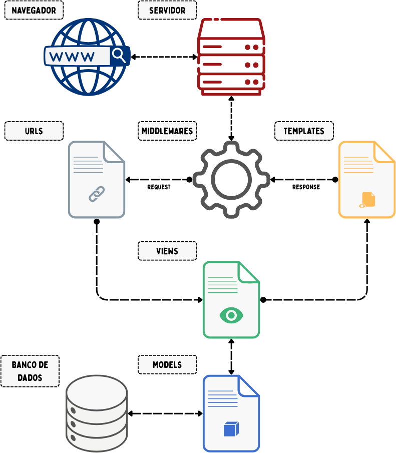

**Fonte:** Elaborado pelo autor (2025).

Como explica Alchin (2008), o padrão MTV visto na Figura 5.1, trata-se de uma variação da *Model-View-Controller* (MVC), que separam as responsabilidades entre o *model* que trata da lógica de dados e interação com o banco de dados, a *view* que é a camada de visualização, ou seja, a interface para o usuário, e o *controller* que responsável por gerenciar a interação entre o modelo e a visualização, controlando o fluxo de dados e a lógica de apresentação. O MTV segue o mesmo fundamento do MVC, e se diferencia ao adaptar os papéis das camadas, onde a *view* no MVC se torna o *template* no MTV, o *controller* do MVC é substituído pela *view* do MTV, e o *model* permanece o mesmo nas duas abordagens. Além disso, cada componente da Figura 5.1 possui uma função específica:

- **Navegador:** ponto inicial da interação, responsável por enviar requisições e exibir as respostas;

- **Servidor:** hospeda a aplicação Django e gerencia o recebimento e envio das requisições;

- **Middlewares:** executam tarefas intermediárias automáticas, como autenticação e segurança;

- **URLs:** definem o mapeamento entre os endereços requisitados e as *views* correspondentes;

- **Views:** concentram a lógica de controle da aplicação, processando os dados e determinando qual *template* será renderizado;

- **Models:** representam as estruturas de dados e se comunicam com o banco de dados por meio do *Object-Relational Mapping* (ORM);

- **Banco de Dados:** armazena e recupera as informações de forma persistente;

- **Templates:** formam a camada de apresentação, sendo responsáveis pela exibição dos dados na interface do usuário.

O funcionamento da arquitetura, vista na Figura 5.1, têm seu fluxo de dados iniciado quando o usuário faz uma requisição por meio do navegador, enviando-a ao servidor onde a aplicação Django está hospedada. O servidor então a repassa ao Django, que a processa inicialmente por uma cadeia de *middlewares*, responsáveis por funções intermediárias como autenticação, segurança ou manipulação de sessão. Após isso, a requisição segue para o roteador de *urls*, onde o Django identifica qual *view* deve ser executada com base no padrão de *url* requisitado.

A *view* então, como explicado anteriormente, atua como o centro de controle da aplicação, decidindo a lógica necessária para processar a requisição, e quando necessário, interage com os *models* para acessar ou manipular dados armazenados no banco de dados. Os *models*, por sua vez, utilizam o ORM do Django para realizar essas operações diretamente no banco. Com os dados obtidos, a *view* prepara a resposta utilizando os *templates*, que geram o conteúdo final com base nos dados fornecidos. Esse conteúdo é então enviado de volta, passando novamente pelos *middlewares*, até alcançar o servidor, que finalmente envia a resposta ao navegador do usuário, encerrando o ciclo da requisição com a exibição do conteúdo na interface do cliente.

## 5.3 Implementação

A proposta da ferramenta Rainscale é facilitar a obtenção de séries temporais de precipitação influenciadas por mudanças climáticas. Sabendo disso, pensou-se no protótipo de uma ferramenta simples e direta, com apenas as informações necessárias para que se obtenha essas séries da região desejada. Assim, o protótipo da ferramenta foi hospedada de forma gratuita no PythonAnywhere, e as principais tecnologias junto de suas respectivas versões podem ser visualizadas na Tabela 5.1.

**Tabela 5.1** – Tecnologias usadas no Rainscale.

| Tecnologia   |      Tipo      | Versão |
|:-------------|:--------------:|:------:|
| Bootstrap    |   Framework    | 5.3.0  |
| Django       |   Framework    | 5.1.3  |
| Javascript   |   Linguagem    | ES2023 |
| joblib       |   Biblioteca   | 1.4.2  |
| Leaflet      |   Biblioteca   | 1.9.4  |
| pandas       |   Biblioteca   | 2.2.2  |
| Python       |   Linguagem    | 3.13.1 |
| scikit-learn |   Biblioteca   | 1.5.0  |
| SQLite       | Banco de Dados | 3.37.2 |

**Fonte:** Elaborado pelo autor (2025).

Para o desenvolvimento do Rainscale, cada tecnologia listada na Tabela 5.1 teve um papel. O Python foi a linguagem utilizada para toda a lógica do sistema, incluindo o processamento dos dados e a integração dos modelos climáticos. O Django, como já explicado, atuou como *framework* web, estruturando o *backend* da aplicação, gerenciando requisições, roteamento e comunicação com o banco de dados SQLite, que armazena todos os dados necessários para exibição dos modelos climáticos a geração das séries temporais.

Para o *frontend*, o Bootstrap forneceu uma boa base de estilos responsiva e facilitou a criação de uma interface amigável, enquanto o Javascript permitiu a manipulação dinâmica da interface, incluindo a interação com o mapa e a seleção das coordenadas. O mapa interativo foi implementado com a biblioteca Leaflet, que possibilitou a escolha intuitiva de latitude e longitude diretamente na interface visual, além da exposição dos pontos usados no treinamento dos modelos de AM obtidos do banco de dados.

Para a manipulação dos dados, especialmente na geração das séries temporais, foi utilizada a biblioteca pandas, que facilitou o tratamento de tabelas e a exportação dos resultados em formato CSV. A biblioteca scikit-learn foi utilizada para carregar e aplicar os modelos de AM armazenados, enquanto o joblib foi fundamental para o carregamento eficiente desses modelos, permitindo que a ferramenta executasse previsões rápidas e precisas a partir das coordenadas selecionadas.

Dessa forma, foram desenvolvidas quatro páginas, a inicial, a do mapa, a de tutorial e a com informações da ferramenta e autor. Além disso, foi configurada a interface administrativa do Django, e toda essa estrutura de páginas pode ser vista na Figura 5.2, através do mapa da ferramenta.

**Figura 5.2** – Mapa da ferramenta.

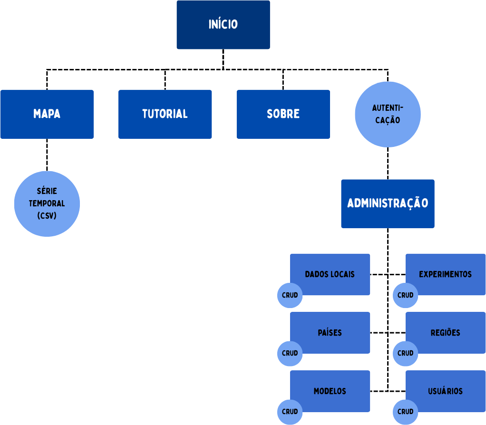

**Fonte:** Elaborado pelo autor (2025).

A primeira página é a inicial, e através dela é possível acessar todas as outras. Sua interface pode ser vista através da Figura 5.3.

**Figura 5.3** – Página inicial.

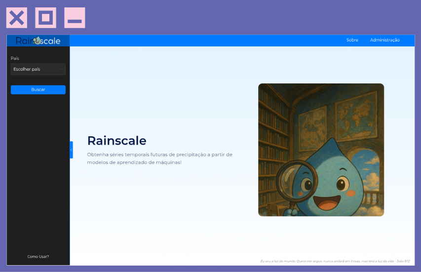

**Fonte:** Elaborado pelo autor (2025).

Seguindo para a página do mapa, observada na Figura 5.4, ela só pode ser acessada pela inicial, através da busca de um modelo ao escolher o país e região. Nela é apresentado um mapa com os pontos usados no treinamento do modelo de SD, além de todas as informações dos dados usados, junto com a possibilidade de selecionar uma coordenada, e obter uma série temporal gerada pelo modelo em CSV, da localidade escolhida.

**Figura 5.4** – Página do mapa.

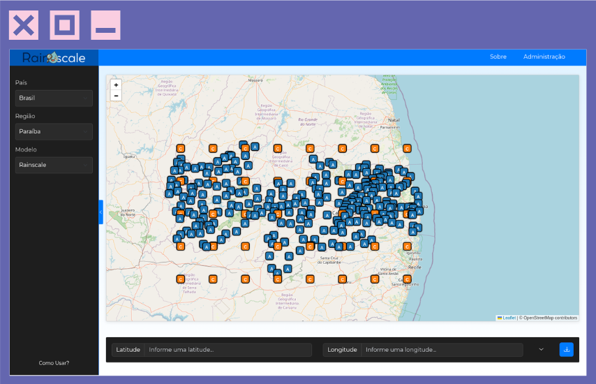

**Fonte:** Elaborado pelo autor (2025).

Tratando do uso da ferramenta, tem-se a página de tutorial, que explica a sequência de passos a se seguir para encontrar um modelo e obter a série temporal de uma coordenada escolhida, em CSV. A página pode ser visualizada a partir da Figura 5.5.

**Figura 5.5** – Página do tutorial.


**Fonte:** Elaborado pelo autor (2025).

A última tela criada apresenta informações sobre o autor, a ferramenta utilizada e o repositório do projeto. Como mostrado na Figura 5.6, essa tela foi desenvolvida com o objetivo de garantir transparência e facilitar o acesso dos usuários ao conteúdo e aos recursos utilizados no desenvolvimento da aplicação.

**Figura 5.6** – Página de informações da ferramenta.

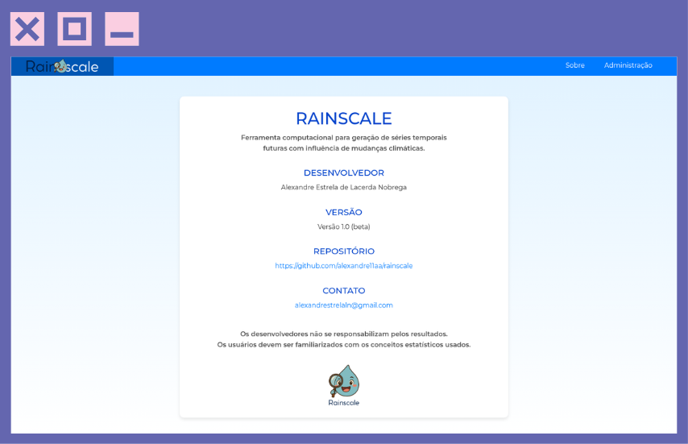

**Fonte:** Elaborado pelo autor (2025).

Por fim, tem-se a tela de administração vista na Figura 5.7, com acesso restrito à administradores autenticdos.

**Figura 5.7** – Página de administração.


**Fonte:** Elaborado pelo autor (2025).

A página da Figura 5.7 é disponibilizada nativamente pelo *framework* Django, que já oferece os recursos de criar, ler, atualizar e deletar (Create, Read, Update and Delete, CRUD) para as entidades do sistema. Essa interface é gerada automaticamente a partir dos modelos definidos na aplicação, exigindo apenas uma configuração básica, o que torna a gestão dos dados simples e eficiente. Por fim, o repositório com o código-fonte da ferramenta está disponível em \<https://github.com/alexandre11aa/rainscale/tree/prod\>.

# 6 Considerações Finais

Este capítulo apresenta as considerações finais deste trabalho. Inicialmente, é realizada uma síntese das principais contribuições obtidas ao longo da pesquisa. Em seguida, discutem-se as limitações identificadas durante o desenvolvimento do estudo. Por fim, são sugeridas possíveis direções para trabalhos futuros, com o intuito de aprofundar e expandir as investigações iniciadas nesta dissertação.

## 6.1 Principais contribuições

As principais contribuições deste trabalho para áreas que utilizam a espacialização e a predição de séries temporais de precipitação, especialmente em cenários de mudanças climáticas, são:

- Pesquisa e determinação de estado da arte do uso de AM para a realização do SD em dados pluviométricos com influência das mudanças climática;

- Metodologia de SD, que une a espacialização e predição de dados de chuva, a partir de dados locais e simulações do CMIP6, com modelos de AM;

- Desenvolvimento de ferramenta que permite a obtenção de séries temporais futuras de precipitação com influência de cenários de mudanças climáticas, para regiões englobadas em modelos treinados;

- Publicação dos cadernos Jupyter e códigos-fonte do estudo de caso e da ferramenta em repositório *online*.

A partir do presente trabalho, também se originou um artigo publicado em periódico, que trata da espacialização de dados de precipitação através do uso de AM:

- *A. E. L. Nobrega and I. M. Barroca Filho. Analysis of Machine Learning Performance in Spatial Interpolation of Rainfall Data. IEEE Access, vol. 13, pp. 84727-84737, 2025, doi: 10.1109/ACCESS.2025.3569261.*

## 6.2 Limitações

Embora os objetivos tenham sido alcançados quanto a elaboração da metodologia e proposta de ferramenta computacional, algumas limitações foram encontradas, e representam espaço para melhoria para trabalhos futuros:

- Capacidade computacional limitada: a restrição do poder computacional limitou a escolha de uma base de dados simulados do CMIP6 a uma com menor resolução do que outras disponíveis para a mesma área, diminuindo a precisão do aumento de resolução que o SD propicia, e consequentemente a predição de dados;

- Subestimação de eventos extremos: o modelo apresenta dificuldades em reproduzir picos de precipitação, o que leva à perda de precisão em eventos raros, anômalos ou extremos. Uma limitação é comum em abordagens baseadas em AM, que tendem a suavizar valores fora do padrão devido ao processo de generalização, porém que pode ser trabalhada e suavizada;

- Dependência da qualidade dos dados de entrada: O desempenho do modelo depende fortemente da qualidade, consistência e representatividade dos dados utilizados no treinamento, tanto do CMIP6 quanto das séries observadas dos postos pluviométricos. Lacunas ou erros nessas bases podem comprometer a calibração e reduzir a confiabilidade das projeções geradas pelo processo de SD;

- Ausência de validação por profissionais da área: o modelo desenvolvido a partir da metodologia proposta ainda não foi avaliado ou utilizado por engenheiros, projetistas, pesquisadores ou outros profissionais que poderiam se beneficiar das séries de precipitação futura geradas. Essa limitação restringe o aprimoramento e a calibração prática da metodologia;

- Validação limitada a ambiente controlado: a ferramenta foi validada apenas em ambiente experimental e sob condições controladas de teste. Essa limitação impede a avaliação do desempenho do modelo frente às variabilidades e incertezas típicas de situações reais, restringindo a análise de sua robustez, aplicabilidade prática e potencial de generalização.

## 6.3 Trabalhos futuros

Assim, a presente dissertação abre margem para o desenvolvimento dos seguintes trabalhos futuros na área:

- Melhoria na representação de eventos extremos, com o desenvolvimento ou integração de técnicas de modelagem que reduzam a subestimação de picos de precipitação, com abordagens híbridas, e até mesmo o uso de funções de custo que priorizem a reprodução de valores extremos;

- Expansão e qualificação das bases de dados, com a curadoria e ampliação das séries históricas locais, além da busca de bases do CMIP6 com melhores resoluções, com foco na correção de falhas, preenchimento de lacunas e aumento da representatividade espacial e temporal dos dados;

- Integração de múltiplos modelos climáticos provenientes do CMIP6, de forma a testar diversas abordagens de SD, comparando desempenhos na busca de reduzir incertezas e aumentar a robustez das projeções;

- Validação prática e colaborativa com especialistas, aplicando a metodologia e os modelos gerados em estudos, projetos ou trabalhos reais, contando com a análise de profissionais da área para os calibrar, validar e aprimorar em cenários práticos.

# Referências

ABADI, Martín et al. TensorFlow: Large-Scale Machine Learning on Heterogeneous Distributed Systems. **arXiv preprint arXiv:1603.04467**, 2016. Disponível em: https://www.tensorflow.org/. Acesso em: 5 de maio de 2025.

ABIODUN, O. I. et al. Comprehensive Review of Artificial Neural Network Applications to Pattern Recognition. **IEEE Access**, v. 7, p. 158820-158846, 2019. Disponível em: <https://doi.org/10.1109/ACCESS.2019.2945545>. Acesso em 21 de maio de 2024.

ABIODUN, O. I. et al. State of-the-art in artificial neural network applications: A survey. **Heliyon**, v. 4, n. 11, 2018. Disponível em: <https://doi.org/10.1016/j.heliyon.2018.e00938>. Acesso em 21 de maio de 2024.

AESA. **Agência Executiva de Gestão das Águas do Estado da Paraíba – Meteorologia – Chuvas**. 2023. Disponível em: <http://www.aesa.pb.gov.br/aesa-website/meteorologia-chuvas/?formdate=&produto=municipio&periodo=anual/>. Acesso em 16 de outubro de 2023.

ALCHIN, M. **Pro Django**. Nova Iorque, EUA, Apress, 2008. ISBN 1430210478.

AMINI, M. A. et al. Analysis of deterministic and geostatistical interpolation techniques for mapping meteorological variables at large watershed scales. **Simpósio Brasileiro De Ciências Geodésicas E Tecnologias Da Geoinformação**, v. 67, n. 1, p. 191-203, 2019. Acta Geophysica, Varsóvia.

ANA. **Agência Nacional de Águas – Catálogo de Metadados da ANA – Semiárido**. 2023. Disponível em: <https://metadados.snirh.gov.br/geonetwork/srv/api/records/3c8b249e-8ec3-4db1-b188-bab3c3c3240f/>. Acesso em 16 de outubro de 2023.

ANARAKI, M. V. et al. Predicting rainfall response to climate change and uncertainty analysis: Introducing a novel downscaling CMIP6 models technique based on the stacking ensemble machine learning. **Journal of Water and Climate Change**, v. 14, n. 10, p. 3671-3691, 2023.

BAGHANAM, A. H. et al. Conjunction of wavelet-entropy and SOM clustering for multi-GCM statistical downscaling. **Hydrology Research**, v. 50, n. 1, p. 1-23, 2019.

BAÑO-MEDINA, J.; MANZANAS, R.; GUTIÉRREZ, J. M. Configuration and intercomparison of deep learning neural models for statistical downscaling. **Geosci. Model Dev.**, v. 13, p. 2109-2124, 2020.

BAPTISTA, D.; MORGADO-DIAS, F. A survey of artificial neural network training tools. **Neural Computing and Applications**, v. 23, n. 3–4, p. 609-615, 2013. Disponível em: < https://doi.org/10.1007/s00521-013-1408-9>. Acesso em 21 de maio de 2024.

BARBOSA, H. M. J.; MARENGO, J. A. CONGRESSO BRASILEIRO DE METEOROLOGIA. In: **Proceedings of the IEEE Congress on Evolutionary Computation**. São Paulo: SBMet, 2023.

BENESTAD, R. Oxford Research Encyclopedia of Climate Science: Downscaling Climate Information. **Climate Information. Oxford University Press**, 2016.

BERMAN, J. J. **Data Simplification: Chapter 4 - Understanding Your Data**. 2016. 135-187 p. Disponível em: <https://doi.org/10.1016/B978-0-12-803781-2.00004-7>. Acesso em 21 de maio de 2024. ISBN 978-0-1280-3781-2.

BISHOP, C. M.; NASRABADI, N. M. Pattern recognition and machine learning. **Springer, New York**, v. 4, n. 4, p. 738, 2006.

BOATENG, D.; MUTZ, S. G. pyESDv1.0.1: an open-source Python framework for empirical-statistical downscaling of climate information. **Geoscientific Model Development**, v. 16, n. 22, p. 6479-6514, 2023.

BRANDS, S. et al. On the use of reanalysis data for downscaling. **Journal of Climate**, v. 25, p. 2517-2526, 2012.

BREIMAN, L. et al. **Classification and Regression Trees**. 1984. 368 p. Disponível em: <https://doi.org/10.1201/9781315139470>. Acesso em 21 de maio de 2024. ISBN 978-1-3151-3947-0.

BREIMAN, L. Random forests. **Machine learning**, v. 45, p. 5-32, 2001. Disponível em: <https://doi.org/10.1023/A:1010933404324>. Acesso em 21 de maio de 2024.

BRETHERTON, F. et al. Time-dependent greenhouse-gas-induced climate change. **Cambridge University Press**, p. 173-193, 1990.

CALDANA, N. F. S. et al. Ocorrências De Alagamentos, Enxurradas E Inundações E A Variabilidade Pluviométrica Na Bacia Hidrográfica Do Rio Iguaçu. **Revista Brasileira De Climatologia**, v. 23, 2021. Disponível em: https://ojs.ufgd.edu.br/index.php/rbclima/article/view/14099/. Acesso em 29 de maio de 2024.

CERULLI, G. **Fundamentals of Supervised Machine Learning: With Applications in Python, R, and Stata**. Springer International Publishing, 2023. 391 p. Disponível em: <https://doi.org/10.1007/978-3-031-41337-7>. Acesso em 21 de maio de 2024. ISBN 978-3-031-41337-7.

CHAUDHARY, S.; AGARWAL, A.; NAKAMURA, T. Rainfall Projection in Yamuna River Basin, India, Using Statistical Downscaling. **Water Resources and Environmental Engineering II**, p. 13-23, 2019.

CMIP. **Coupled Model Intercomparison Project: CMIP Overview**. 2025. Disponível em: <https://wcrp-cmip.org/cmip-overview/>. Acesso em 16 de outubro de 2023.

COLLISCHONN, W.; DORNELLES, F. Hidrologia para Engenharia e Ciências Ambientais. **Associação Brasileira de Recursos Hídricos**, v. 1, p. 53-75, 2015.

COULIBALY, P.; DIBIKE, Y.; ANCTIL, F. Downscaling Precipitation and Temperature with Temporal Neural Networks. **Journal of Hydrometeorology**, v. 6, n. 4, p. 483-496, 2005.

DAS, M. et al. Comparison of spatial interpolation methods for estimation of weekly rainfall in West Bengal, India. **Simpósio Brasileiro De Ciências Geodésicas E Tecnologias Da Geoinformação**, v. 68, n. 1, p. 41-50, 2017. Mausam, Calcutá.

DEUS, B. V. et al. Interpolação pluviométrica na Bacia do Alto e Médio Rio Teles Pires: uma análise de séries históricas e interpoladores. In: **Simpósio Brasileiro De Ciências Geodésicas E Tecnologias Da Geoinformação**. 2010. p. 1-7. Recife: UFPE.

DIRKS, K. N. et al. High-resolution studies of rainfall on Norfolk Island Part II: Interpolation of rainfall data. **Journal of Hydrology**, v. 208, p. 187-193, 1998. Disponível em: https://www.sciencedirect.com/science/article/abs/pii/S0022169498001553/. Acesso em 29 de maio de 2024.

EUGENIO, F. C. et al. Zoneamento agroclimatológico do Coffea canephora para Espírito Santo mediante interpolação espacial. **Coffee Science**, v. 9, n. 3, p. 319-328, 2014. Disponível em: http://www.sbicafe.ufv.br/handle/123456789/8056/. Acesso em 29 de maio de 2024.

FAHEY, D. W. et al. Physical drivers of climate change. **In: Climate Science Special Report: Fourth National Climate Assessment, Volume I. U.S. Global Change Research Program, Washington, DC, USA**, p. 77-113, 2017. Disponível em: <https://science2017.globalchange.gov/chapter/2/>. Acesso em 16 de outubro de 2023.

FAOUZI, J.; COLLIOT, O. **Classic Machine Learning Methods**. Machine Learning for Brain Disorders. Springer, 2023. 25-75 p. Disponível em: <https://doi.org/10.1007/978-1-0716-3195-9_2>. Acesso em 21 de maio de 2024. ISBN 978-1-0716-3194-2.

FLATO, G. et al. Evaluation of climate models. **Cambridge University Press**, p. 741-866, 2013. Disponível em: <https://www.climatechange2013.org/full-report/>. Acesso em 16 de outubro de 2023.

FRANCISCO, R. M. F.; SANTOS, D. Climatologia do Estado da Paraíba. **1st ed. Campina Grande-PB: EDUFCG**, 2017. Disponível em: <https://educapes.capes.gov.br/bitstream/capes/573985/2/Climatologia%20 <u>do%20Estado%20da%20Paraiba.pdf/</u>>. Acesso em 21 de maio de 2024.

GEURTS, P.; ERNST, D.; WEHENKEL, L. Extremely randomized trees. **Mach Learn**, v. 63, p. 3-42, 2006. Disponível em: <https://doi.org/10.1007/s10994-006-6226-1>. Acesso em 21 de maio de 2024.

GHOSH, S. SVM‐PGSL coupled approach for statistical downscaling to predict rainfall from GCM output. **Journal of Geophysical Research**, v. 115, p. 1-18, 2010.

GOYAL, M. K.; OJHA, C. S. P. Downscaling of precipitation on a lake basin: evaluation of rule and decision tree induction algorithms. **Hydrology Research**, v. 43, n. 3, p. 215-230, 2012.

GURGEL, J. J. S. Sobre a produção de pescado dos açudes públicos do semi-árido nordeste brasileiro. **presented at Taller internacional sobre ecología y manejo de peces en lagos y embalses, Santiago de Chile, COPESCAL Doc. Téc.**, v. 4, 1984. Disponível em: <https://www.fao.org/4/ad772s/AD772S05.htm#ch5/>. Acesso em 21 de maio de 2024.

HARILAL, N.; SINGH, M.; BHATIA, U. Augmented Convolutional LSTMs for Generation of High-Resolution Climate Change Projections. **IEEE Access**, v. 9, p. 25208-25218, 2021.

HASTIE, G.; TIBSHIRANI, R.; FRIEDMAN, J. The elements of statistical learning: Data mining, inference, and prediction. **(2nd ed.) Springer Series in Statistics**, 2009. Disponível em: <https://www.springer.com/gp/book/9780387848570>. Acesso em 21 de maio de 2024.

HAYHOE, K. et al. Climate models, scenarios, and projections. **In: Climate Science Special Report: Fourth National Climate Assessment, Volume I. U.S. Global Change Research Program, Washington, DC, USA**, p. 133-160, 2017. Disponível em: <https://science2017.globalchange.gov/chapter/4/>. Acesso em 16 de outubro de 2023.

HE, X. et al. Spatial downscaling of precipitation using adaptable random forests. **Water Resources Research**, v. 52, n. 10, p. 8217-8237, 2016.

HOSSEINI, R. H.; GOLIAN, S.; YAZDI, J. Evaluation of data-driven models to downscale rainfall parameters from global climate models outputs: the case study of Latyan watershed. **Journal of Water and Climate Change**, v. 11, n. 1, p. 200-216, 2020.

HOYER, Stephan; HAMMAN, Joe. xarray: N-D labeled Arrays and Datasets in Python. **Journal of Open Research Software**, v. 5, n. 1, p. 10, 2017. Disponível em: https://doi.org/10.5334/jors.148/. Acesso em: 5 de maio de 2025.

IBGE. **Instituto Brasileiro de Geografia e Estatística**. Cidades e Estados - Paraíba. 2024. Disponível em: <https://www.ibge.gov.br/cidades-e-estados/pb.html/>. Acesso em 21 de maio de 2024.

IPCC. **Intergovernmental Panel on Climate Change: About the IPCC**. 2025. Disponível em: <https://www.ipcc.ch/about/>. Acesso em 16 de outubro de 2023.

IPCC. Climate Change 1995: The Science of Climate Change. Contribution of Working Group I to the Second Assessment Report of the Intergovernmental Panel on Climate Change. **Cambridge University Press**, p. 584, 1996.

IPCC. Climate Change 2001: The Scientific Basis. Contribution of Working Group I to the Third Assessment Report of the Intergovernmental Panel on Climate Change. **Cambridge University Press**, p. 881, 2001.

IPCC. Climate Change 2007: The Physical Science Basis. Contribution of Working Group I to the Fourth Assessment Report of the Intergovernmental Panel on Climate Change. **Cambridge University Press**, p. 996, 2007.

IPCC. Climate Change 2013: The Physical Science Basis. Contribution of Working Group I to the Fifth Assessment Report of the Intergovernmental Panel on Climate Change. **Cambridge University Press**, p. 1535, 2013.

IPCC. Intergovernmental Panel on Climate Change: Climate Change: The IPCC Scientific Assessment. **Cambridge University Press**, p. 212, 1990.

IPCC. Summary for Policymakers. In: Climate Change 2023: Synthesis Report. Contribution of Working Groups I, II and III to the Sixth Assessment Report of the Intergovernmental Panel on Climate Change. **IPCC, Geneva, Switzerland, doi: 10.59327/IPCC/AR6-9789291691647.001**, p. 1-34, 2023.

JUNIOR, W. E. Mapeamento e Análise Espacial de Dados Climáticos do Município de Ribas do Rio Pardo-MS. **Fundação Universidade Federal de Mato Grosso do Sul**, 2023. Disponível em: https://repositorio.ufms.br/jspui/retrieve/4f33f9d0-7a03-4e9d-ae2a-58ce1/0fd53a1/9826.pdf/. Acesso em 29 de maio de 2024.

KITCHENHAM, B. Procedures for Performing Systematic Reviews. **Keele, UK, Keele University**, p. 33, 2004.

KLUYVER, Thomas et al. Jupyter Notebooks – a publishing format for reproducible computational workflows. **Proceedings of the 20th International Conference on Electronic Publishing**, p. 87-90, 2016. Disponível em: https://jupyter.org/. Acesso em: 5 de maio de 2025.

KOTAMARTHI, R. et al. Use of Climate Information for Decision-Making and Impact Research. **U.S. Department of Defense, Strategic Environment Research and Development Program Report**, p. 55, 2016.

KUEH, S. M.; KUOK, K. K. Precipitation downscaling using the artificial neural network BatNN and development of future rainfall intensity-duration-frequency curves. **Climate Research**, v. 68, p. 73-89, 2016.

KUHN, M.; JOHNSON, K. Applied Predictive Modeling. **Springer, New York, Heidelberg, Dordrecht, London**, p. 95-97, 2013.

KUMAR, B. et al. On the modern deep learning approaches for precipitation downscaling. **Earth Science Informatics**, 2023. Disponível em: https://doi.org/10.1007/s12145-023-00970-4. Acesso em 5 de março de 2025.

LECUN et al. Gradient-based learning applied to document recognition. **Proceedings of the IEEE**, v. 86, 1998. Disponível em: <https://doi.org/10.1109/5.726791>. Acesso em 21 de maio de 2024.

LEGGETT, J. et al. Emissions scenarios for the IPCC: An update. **Cambridge University Press**, p. 73-95, 1992.

LENNON, J. J.; TURNER, J. R. G. Predicting the spatial distribution of climate: temperature in Great Britain. **Journal of Animal Ecology**, v. 64, n. 3, p. 670-692, 1995.

LIYEW, C. M.; MELESE, H. A. Machine learning techniques to predict daily rainfall amount. **Journal of Big Data**, v. 153, n. 8, 2021. Disponível em: <https://doi.org/10.1186/s40537-021-00545-4>. Acesso em 21 de maio de 2024.

LOPES, J. R. R. F. M. Metodologias Para Avaliação dos Impactes das Mudanças Climáticas na Agricultura de Regadio e nos Sistemas de Rega. **Universidade Técnica De Lisboa, Instituto Superior De Agronomia**, 2013. Disponível em: https://www.proquest.com/openview/cbd6c942a99522fe5768f8589fe8de0. Acesso em 29 de maio de 2024.

MCKINNEY, Wes. Data Structures for Statistical Computing in Python. **Proceedings of the 9th Python in Science Conference**, p. 56-61, 2010. Disponível em: https://pandas.pydata.org/. Acesso em: 5 de maio de 2025.

MIENYE, I. D.; SWART, T. G.; OBAIDO, G. Recurrent Neural Networks: A Comprehensive Review of Architectures, Variants, and Applications. **Information**, v. 15, 2024. Disponível em: <https://doi.org/10.3390/info15090517>. Acesso em 21 de maio de 2024.

MONTENEGRO-MURILLO, D. D.; PÉREZ-ORTIZ, M. A.; VARGAS-FRANCO, V. Using Artificial Neural Networks to predict monthly precipitation for the Cali river basin, Colombia. **Universidad Nacional de Colombia**, v. 86, n. 211, p. 122-130, 2019.

MOSS, R. H. et al. The next generation of scenarios for climate change research and assessment. **Nature**, v. 463, p. 747-756, 2010.

MURPHY, K. P. **Machine learning: a probabilistic perspective**. MIT Press, Cambridge, MA, 2012.

MURTAGH, F. Multilayer perceptrons for classification and regression. **Neurocomputing**, v. 2, p. 183-197, 1991.

NACAR, S. et al. Trends and amount changes of temperature and precipitation under future projections in high–low groups and intra‐period for the Eastern Black Sea, the Wettest Basin in Türkiye. **Natural Hazards**, v. 120, p. 9833-9866, 2024.

NAGHETTINI, M.; PINTO, E. J. A. Hidrologia Estatística. **CPRM, Serviço Geológico do Brasil**, p. 462, 2007.

NAKICENOVIC, N.; SWART, R. (Eds.) IPCC Special Report on Emission Scenarios. **Cambridge University Press**, p. 570, 2000.

NETO, T. P. D. Ecopolítica das mudanças climáticas: o IPCC e o ecologismo dos pobres. **Centro Edelstein de Pesquisas Sociais, ISBN: 978-85-7982-049-6**, p. 155, 2010. Disponível em: <https://static.scielo.org/scielobooks/x9z8z/pdf/tilio-9788579820496.pdf>. Acesso em 16 de outubro de 2023.

NISHANT, N. et al. Comparison of a novel machine learning approach with dynamical downscaling for Australian precipitation. **Environmental Research**, v. 18, p. 1-10, 2023.

NOURANI, V. et al. Uncertainty Quantification of Deep Learning–Based Statistical Downscaling of Climatic Parameters. **Journal of Applied Meteorology and Climatology**, v. 62, p. 1223-1242, 2023.

NOURANI, V.; BAGHANAM, A. H.; GOKCEKUS, H. Data-driven ensemble model to statistically downscale rainfall using nonlinear predictor screening approach. **Journal of Hydrology**, v. 565, p. 538-551, 2018.

O’NEILL, B. C. et al. A new scenario framework for climate change research: The concept of shared socioeconomic pathways. **Climatic Change**, v. 122, p. 387-400, 2014.

PEDREGOSA, F. et al. Scikit-learn: Machine Learning in Python. **Journal of Machine Learning Research**, v. 12, p. 2825-2830, 2011. Disponível em: https://scikit-learn.org/. Acesso em: 5 de maio de 2025.

PIMENTEL, L. Hidrologia - Engenharia e Meio Ambiente. **GEN LTC; 1ª edição**, p. 127-160, 2015.

PINTHONG, S. et al. Combining Long Short-Term Memory and Genetic Programming for Monthly Rainfall Downscaling in Southern Thailand’s Thale Sap Songkhla River Basin. **Engineered Science**, v. 28, p. 1-29, 2024.

PORTNER, Hans-Otto et al. Climate Change 2022: Impacts, Adaptation and Vulnerability. **Contribution of Working Group II to the Sixth Assessment Report of the Intergovernmental Panel on Climate Change, Technical report, Cambridge**, v. 6, 2022.

POUR, S. H. et al. Model output statistics downscaling using support vector machine for the projection of spatial and temporal changes in rainfall of Bangladesh. **Atmospheric Research**, v. 213, p. 149-162, 2018.

PRATHOM, C.; CHAMPRASERT, P. An Exploration of Interpolation - Machine Learning Model for Climate Model Downscaling Under the Limitation of Data Quantity. **International Technical Conference on Circuits/Systems, Computers, and Communications (ITC-CSCC), Jeju, Korea**, p. 1-6, 2023a.

PRATHOM, C.; CHAMPRASERT, P. General Circulation Model Downscaling Using Interpolation—Machine Learning Model Combination—Case Study: Thailand. **Thailand, Sustainability**, v. 15, p. 1-24, 2023b.

PROTOCOL, The Kyoto. The Kyoto Protocol to the United Nations Frame Convention on Climate Change., 1997. Disponível em: <https://www.un.org/ru/documents/decl_conv/conventions/kyoto.shtml/>. Acesso em 21 de maio de 2024.

Python Software Foundation. **Python Language Reference, version X.X**. 2025. Disponível em: https://www.python.org/. Acesso em: 5 de maio de 2025.

ROSENBLATT, F. The perceptron: A probabilistic model for information storage and organization in the brain. **Psychological Review**, v. 65, n. 6, p. 386-408, 1958.

SACHINDRA, D. A. et al. Statistical downscaling of precipitation using machine learning techniques. **Atmospheric Research**, v. 212, p. 240-258, 2015.

SADEGHFAM et al. Statistical downscaling of precipitation using inclusive multiple modelling (IMM) at two levels. **Journal of Water and Climate Change**, v. 12, n. 7, p. 3373-3387, 2021.

SAMUEL, A. L. Some studies in machine learning using the game of checkers. **IBM Journal of Research and Development**, v. 3, n. 3, p. 210-229, 1959.

SEHGAL, V. et al. Application of multi-scale wavelet entropy and multi-resolution Volterra models for climatic downscaling. **Journal of Hydrology**, v. 556, p. 1078-1095, 2018.

SHALEV-SHWARTZ, S.; BEN-DAVID, S. **Understanding Machine Learning: From Theory to Algorithms**. New York, NY, USA: Cambridge University Press, 2014. Disponível em: <www.cambridge.org/9781107057135>. Acesso em 21 de maio de 2024. ISBN 978-1-107-05713-5.

SILVA, V. A.; PEIXOTO, M.; SANTOS, F. L. Previsão de precipitação mensal no município de Barra Mansa/RJ usando técnicas de deep learning time series. **Revista Holos**, v. 5, n. 39, 2023. Disponível em: https://www2.ifrn.edu.br/ojs/index.php/HOLOS/article/view/16340/. Acesso em 29 de maio de 2024.

SOARES, P. et al. High-resolution downscaling of CMIP6 Earth system and global climate models using deep learning for Iberia. **Geoscientific Model Development**, v. 17, p. 229-259, 2024.

THRASHER, B. et al. Downscaled climate projections suitable for resource management. **Eos, Transactions, American Geophysical Union**, v. 94, p. 321-323, 2013.

VAPNIK, V.; LERNER, A. Pattern recognition using generalized portrait method. **Automation and Remote Control**, v. 24, p. 774-780, 1963.

VIOLA, M. R. et al. Spatial interpolation methods for mapping of rainfall. **Revista Brasileira de Engenharia Agrícola e Ambiental**, v. 14, n. 9, p. 970-978, 2010. Campina Grande, PB.

VOLDOIRE, Aurore. CNRM-CERFACS CNRM-CM6-1-HR model output prepared for CMIP6 CMIP historical. **Earth System Grid Federation**, 2019a. Disponível em: <https://https://doi.org/10.22033/ESGF/CMIP6.4067/>. Acesso em 16 de outubro de 2023.

VOLDOIRE, Aurore. CNRM-CERFACS CNRM-CM6-1-HR model output prepared for CMIP6 ScenarioMIP ssp585. **Earth System Grid Federation**, 2019b. Disponível em: <https://https://doi.org/10.22033/ESGF/CMIP6.4225/>. Acesso em 16 de outubro de 2023.

WANDERLEY, H. S.; AMORIM, R. F. C.; CARVALHO, F. O. Interpolação espacial de dados médios mensais pluviométricos com redes neurais artificiais. **Revista Brasileira de Meteorologia**, v. 29, n. 3, p. 389-396, 2014. Disponível em: https://www.scielo.br/j/rbmet/a/9Njh63QG7X8xtBkTmRK7XJS/?lang=pt/. Acesso em 29 de maio de 2024.

WARD, A. D.; ELLIOT, W. J. Environmental Hydrology. **CRC Press, Inc., Boca Raton**, p. 462, 1995.

WILKS, D. S. **Statistical Methods in the Atmospheric Sciences**. Elsevier Inc., 2006. ISBN 100127519661.

World Climate Research Programme (WCRP). **Coupled Model Intercomparison Project Phase 6 (CMIP6) – ESGF Node at IPSL**. 2024. Disponível em: https://esgf-node.ipsl.upmc.fr/projects/cmip6-ipsl/. Acesso em: 5 de maio de 2025.

WUEBBLES, D. J. et al. Our globally changing climate. **In: Climate Science Special Report: Fourth National Climate Assessment, Volume I. U.S. Global Change Research Program, Washington, DC, USA**, p. 33-72, 2017. Disponível em: <https://science2017.globalchange.gov/chapter/1/>. Acesso em 16 de outubro de 2023.

YAMAMOTO, J. K.; LANDIM, P. M. B. Geoestatística: conceitos e aplicações. **Oficina de Textos**, v. 1, 2013. São Paulo, SP.

ZANDI, O. et al. Stacking machine learning models versus a locally weighted linear model to generate high-resolution monthly precipitation over a topographically complex area. **Atmospheric Research**, 2022. Disponível em: https://doi.org/10.1016/j.atmosres.2022.106159. Acesso em 5 de março de 2025.
