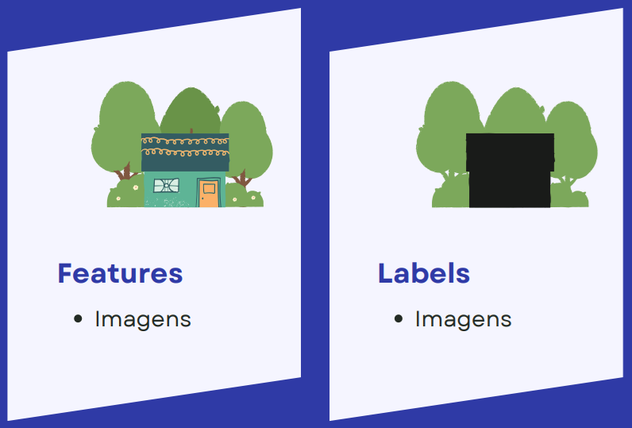
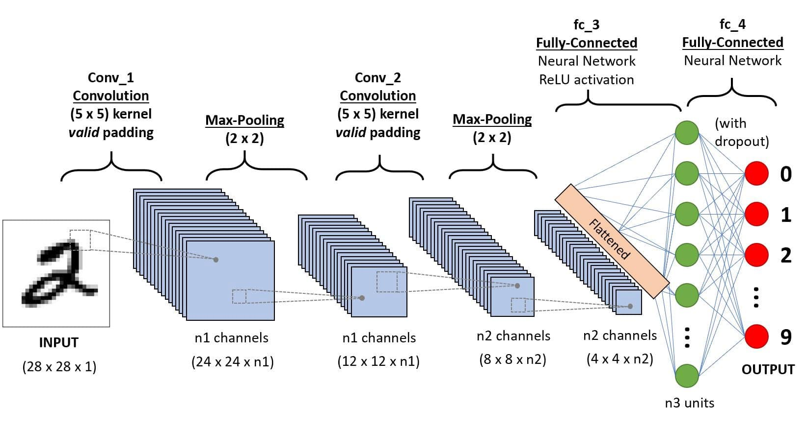
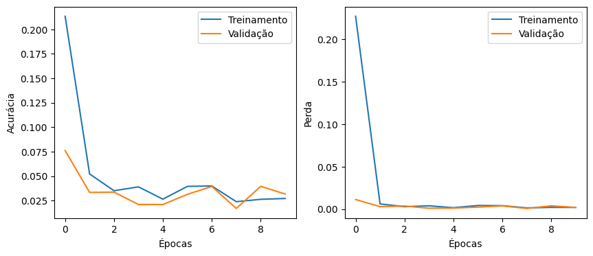
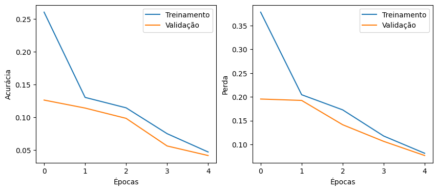
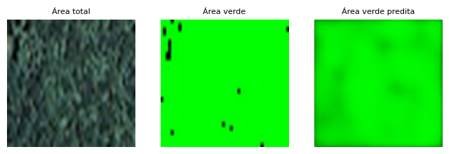
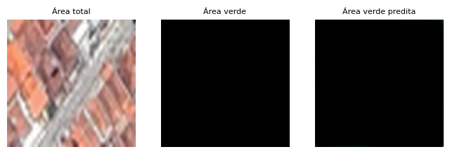
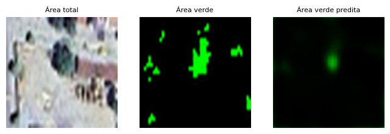
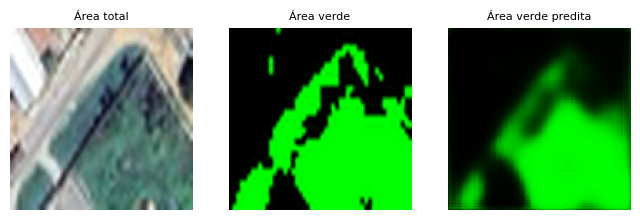
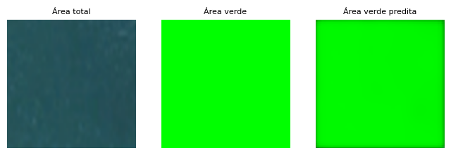

**Detecção de áreas verdes e seu percentual em imagens de satélite com redes neurais convolucionais**

Alexandre Estrela de Lacerda Nobrega

**Resumo**

A detecção e quantificação de áreas verdes em imagens de satélite são cruciais para monitorar desmatamento, planejar sistemas de microdrenagem urbana e melhorar o planejamento urbano, beneficiando a qualidade de vida e a sustentabilidade ambiental. Algoritmos para detecção de cores usados para sua detecção enfrentam desafios como altos custos computacionais e imprecisões na detecção de áreas verdes, incluindo erroneamente rios ou construções e excluindo sombras de árvores ou variações de cor. O presente trabalho se propõe a usar a linguagem Python, empregando TensorFlow no desenvolvimento de redes neurais artificiais convolucionais, Numpy e Pandas para tratamento de dados, OpenCV e Matplotlib para visualização e tratamento de imagens de forma a treinar modelos de aprendizado de máquinas supervisionado que possibilite a detecção e mensuração de áreas verdes.

**Palavras-chave**: áreas verdes; redes neurais convolucionais; aprendizado de máquinas.

**Abstract**

Detection and quantification of green areas in satellite images are crucial for monitoring deforestation, planning urban microdrainage systems, and improving urban planning, benefiting quality of life and environmental sustainability. Color detection algorithms used for this purpose face challenges such as high computational costs and inaccuracies in detecting green areas, including erroneously identifying rivers or buildings and excluding tree shadows or color variations. This work aims to use the Python language, employing TensorFlow for developing convolutional neural networks, Numpy and Pandas for data processing, OpenCV and Matplotlib for visualization and image processing to train supervised machine learning models that enable the detection and quantification of green areas.

**Keywords**: green areas; convolutional neural networks; machine learning.

# 1 Introdução

Em zonas urbanas as construções dividem espaço com áreas verdes, de forma planejada e remanescentes às construções. O Ministério do Meio Ambiente do Brasil \[dMA24\] as define como espaços dentro das cidades que possuem cobertura vegetal, incluindo árvores nativas e introduzidas, arbustos e gramíneas, e que desempenham um papel importante na melhoria da qualidade de vida e no equilíbrio ambiental. Esses espaços verdes podem ser encontrados em diversas situações, como áreas públicas, áreas de preservação permanente, canteiros centrais, praças, parques, florestas e unidades de conservação urbanas, jardins institucionais e terrenos públicos não edificados.

Entende-se a partir disso, que a detecção e quantificação de áreas verdes a partir de imagens de satélite são essenciais para monitorar o desmatamento de áreas de preservação, planejar sistemas de microdrenagem urbana e aprimorar o planejamento urbano, promovendo a qualidade de vida e a sustentabilidade ambiental. Contudo, aplicações tecnológicas para tal fim são escassas, como explica Fantin *et al*. \[FPM+22\], e os algoritmos mais antigos para tal fim se utilizam de detecção e segmentação de cores, contudo eles enfrentam desafios como altos custos computacionais e imprecisões na identificação das áreas verdes, incluindo erroneamente rios ou construções e excluindo sombras de árvores ou variações de cor.

Compreendendo esses desafios, o presente trabalho se propõe a utilizar a linguagem Python, com TensorFlow para o desenvolvimento de redes neurais artificiais convolucionais, Numpy e Pandas para manipulação de dados, OpenCV e Matplotlib para visualização e processamento de imagens, a fim de treinar modelos de aprendizado supervisionado que permitam a detecção e quantificação de áreas verdes. Assim, espera-se auxiliar no desenvolvimento de mais possibilidades para a detecção de áreas verdes, abrindo margem para novos desafios.

# 2 Desenvolvimento

Nesta seção serão explorados os assuntos abordados e passos que levaram ao desenvolvimento do trabalho.

## 2.1 Base de dados

Para as bases de dados necessitava-se de imagens de satélite para lugares variadas, como cidades, florestas, zonas rurais, rios e mares. Para isso, foram extraídas imagens 1501x936 da ferramenta Google Earth para diferentes locais com as características citadas, que disponibiliza imagens de satélite do globo terrestre. A partir dessas imagens, foi construído um algoritmo para fragmentá-las na dimensão 128x128. Após isso, foram criadas duas bases de dados, uma para a detecção das áreas verdes e outra para a quantificação, cada uma com suas devidas características.

Os rótulos das duas bases de dados foram desenvolvidas a partir de um algoritmo de detecção de espectro de cores em imagens, sendo o verde para o presente trabalho. Com isso, foi possível mensurar o percentual dessas cores das imagens fragmentadas, e a partir delas criou-se a base de dados para mensuração, com os atributos sendo as imagens fragmentadas, e os rótulos o percentual descoberto a partir do algoritmo citado. É possível entender a base de dados a partir da Figura 1.

**Figura 1** – Base e dados de mensuração.


**Fonte:** Elaboração Própria (2024).

Já para a detecção, com o mesmo algoritmo que mediu o percentual foi possível gerar também novas imagens, porém com pequenos ajustes que tornou as cores em um monocromático verde para as áreas que se queria destacar, e para as que se queria ignorar apenas a cor preta. Assim, a base de dados passou a possuir em sua composição as imagens fragmentadas, e essas mesmas tratadas da forma mencionada anteriormente. É possível entender sua disposição a partir da Figura 2.

**Figura 2** – Base e dados de mensuração.



**Fonte:** Elaboração Própria (2024).

## 2.2 Treinamento

Diante das duas bases de dados gearas, cada uma com um propósito diferente, dois modelos de treinamento com redes neurais foram pensados. Para isso, foi utilizada a biblioteca TensorFlow, desenvolvida com o propósito de permitir a criação de modelos de aprendizado de máquinas \[Ten24\]. A arquitetura deles foi projetada de forma a permitir o aprendizado supervisionado a partir dos atributos e rótulos, com redes neurais convolucionais, que vêm sendo aplicadas com êxito no processamento e análise de imagens \[EK18\]. É possível visualizar o funcionamento básico de uma rede neural convolucional a partir da Figura 3., ela representa bem a arquitetura da rede para mensuração que será apresentada adiante.

**Figura 3** – Exemplo de rede neural convolucional.



**Fonte:** finePROXY (2024) \[fin24\].

A arquitetura da rede para a base de dados de mensuração, foi pensada de forma que os neurônios ajustem seus pesos a partir de um vetores, a partir de convoluções e reduções de dimensionalidade. Em seu treinamento, foram usados nos atributos pelo menos 5000 imagens diferentes, de forma a não tornar tão custoso o aprendizado dado as limitações da máquina usada. É possível visualizar sua arquitetura no código a seguir.

``` python
Sequential([
    Conv2D(32, (3, 3), activation='relu',
           input_shape=(desired_size[0], desired_size[1], 3)),
    MaxPooling2D((2, 2)),
    Conv2D(64, (3, 3), activation='relu'),
    MaxPooling2D((2, 2)),
    Conv2D(128, (3, 3), activation='relu'),
    MaxPooling2D((2, 2)),
    Flatten(),
    Dense(64, activation='relu'),
    Dense(1)
])
```

Já arquitetura da rede para a base de dados de detecção, foi desenvolvida para que os neurônios ajustem seus pesos a partir de imagens, com de convoluções, reduções e aumentos de dimensionalidade. Para o treinamento, foram usadas 2500 imagens diferentes nos atributos, e o mesmo número nos rótulos. A baixa quantidade de dados usado para o aprendizado, menor até que o da arquitetura anterior, é devido ao motivo já citado. A quantidade menor de dados permite uma boa avaliação do algoritmo de aprendizado com um menor custo computacional. Contudo, é importante avaliar ao fim dos treinamentos as implicações que uma pequena quantidade de dados causou, para que não se afete a avaliação dos resultados que realmente interessam. A arquitetura usada para a detecção das áreas verdes pode ser vista no código que se segue.

``` python
Sequential([
    Conv2D(32, (3, 3), activation='relu', padding='same', 
           input_shape=(128, 128, 3)),
    MaxPooling2D((2, 2), padding='same'),
    Conv2D(64, (3, 3), activation='relu', padding='same'),
    MaxPooling2D((2, 2), padding='same'),
    Conv2D(64, (3, 3), activation='relu', padding='same'),
    MaxPooling2D((2, 2), padding='same'),
    UpSampling2D((2, 2)),
    Conv2D(64, (3, 3), activation='relu', padding='same'),
    UpSampling2D((2, 2)),
    Conv2D(32, (3, 3), activation='relu', padding='same'),
    UpSampling2D((2, 2)),
    Conv2D(3, (3, 3), activation='sigmoid', padding='same')
])
```

# 3 Resultados

Nesta seção serão apresentados os resultados obtidos para as diferentes bases de dados, além de suas implicações.

## 3.1 Base de dados para mensuração

No treinamento dos neurônios artificiais, foi definida a métrica de avaliação de acurácia do erro médio absoluto (MAE), para que seja possível avaliar o desempenho do aprendizado. Com esse propósito, vinte por cento dos dados para o treinamento foram separados de forma aleatória, sendo possível observar o quão bem ou mal o modelo está se saindo durante o treinamento. É possível visualizar os gráficos dele a partir da Figura 4.

**Figura 4** – Avaliação do modelo de mensuração de áreas verdes.



**Fonte:** Elaboração Própria (2024).

Em uma primeira análise da Figura 4, por mais que o modelo apresente bons ajustes ao passar das épocas, principalmente segundo o gráfico de perda, nota-se a presença leve de *underfitting* no gráfico de acurácia, o que é esperado visto que a base de dados usada é pequena. Mesmo com essa limitação, o modelo se mostrou promissor com um bom ajuste. Continuando a verificação, 500 novas imagens com rótulos conhecidos foram usadas na avaliação o modelo com outras métricas, como o coeficiente de determinação (R²), o erro quadrático médio (MSE) e sua raiz (RMSE), e seus resultados podem ser vistos na Tabela 1.

**Tabela 1** – Avaliação do modelo a partir de dados não antes vistos.

| **Métrica** | **Valor** |
|:-----------:|:---------:|
|     MAE     |  3.0945   |
|     MSE     |  19.5039  |
|    RMSE     |  4.4163   |
|     R²      |  0.9864   |

**Fonte:** Elaboração Própria (2024).

Observa-se na Tabela 1 boas predições para dados novos, o que reforça o argumento de que mesmo com poucos dados o modelo está bem ajustado. Isso leva a crer as medidas podem obter desempenhos até melhores com uma base de dados mais robusta, com o MAE, MSE e RMSE se aproximando ainda mais de 0, e o R² de 1. Para ter uma melhor noção de como o modelo está prevendo dados novos, nota-se a comparação deles na condição real e predita a partir da Tabela 2.

**Tabela 2** – Valores reais e preditos para modelo treinado.

| **Real** | **Predito** |
|:--------:|:-----------:|
|  0.0000  |   -0.4613   |
| 100.0000 |   97.1969   |
| 26.9032  |   15.8453   |
| 51.5484  |   44.5796   |
|  0.0000  |   -0.4361   |

**Fonte:** Elaboração Própria (2024).

A Tabela 2 mostra características interessantes. De fato são apenas cinco exemplos, porém da pra ter uma noção de como se comportam os valores preditos em relação aos reais. Por exemplo, em situações onde há zero presença de áreas verdes, os valores se mostraram negativos, onde há total presença, o valor se aproximou muito de 100, e onde há mescla entre áreas verdes e não verdes, uma maior variação, porém, valores relativamente próximos. Mais uma vez isso reforça que uma base de dados mais robusta produziria resultados ainda melhores visto que o modelo está bem ajustado, evidenciando que o maior problema é justamente o *underfitting*, que já era esperado.

## 3.2 Base de dados para detecção

A avaliação do modelo para a base de dados de detecção se mostrará um tanto mais empírica, dado que ela partirá da análise das imagens preditas. Contudo, quanto ao aprendizado em si, também é possível analisar a acurácia e perda semelhante ao modelo anterior, a partir da métrica MAE com os gráficos da Figura 5.

**Figura 5** – Avaliação do modelo de detecção de áreas verdes.



**Fonte:** Elaboração Própria (2024).

Os gráficos da Figura 5 demonstra um modelo com um bom ajuste, porém *underfitting* mais acentuado que o modelo para mensuração, o que é justificável, dado que ele foi treinado com metade da quantidade de imagens qual foram usadas no modelo anterior. Contudo, a curva decrescente e a forma natural como as linhas de treinamento e validação estão indo de encontro demonstram um modelo de aprendizado muito promissor.

Para ter uma melhor noção de como se dá a predição do modelo, um grupo de quinhentas novas imagens ainda não vistas por ele foram usadas para a predição de áreas verdes. Cinco casos foram selecionados de forma a capturar aspectos dos resultados preditos, para análise empírica e visual de como está se dando o desempenho real do modelo treinado, elas contam com a imagem original, rótulo real e predito, é possível visualizar a primeira delas na Figura 6.

**Figura 6** – Primeiro caso de predição de imagem a partir de modelo de detecção.



**Fonte:** Elaboração Própria (2024).

Na Figura 6 é possível ver um problema claro no rótulo, onde a imagem deveria ser completamente verde, visto que a original se trata de uma completa área verde. Contudo, fica claro a falha devido ao algoritmo de detecção do espectro de cores em sua criação, pois ele que não capturou as sombras das árvores, e isso gerou uma predição que não identificou a imagem como completamente verde. Contudo, a predição se mostrou promissora, visto que se mostrou mais representativa do caso real em comparação o próprio rótulo. Seguindo para mais exemplos, têm-se o segundo caso com a Figura 7.

**Figura 7** – Segundo caso de predição de imagem a partir de modelo de detecção.



**Fonte:** Elaboração Própria (2024).

O exemplo da Figura 7 mostra uma predição com cem por cento de acurácia, demonstrando que para zonas urbanas sem presença de áreas verdes, o algoritmo de detecção do espectro de cores se mostrou efetivo, e o modelo de aprendizado apresentou um excelente ajuste. Seguindo para terceiro exemplo, têm-se a Figura 8.

**Figura 8** – Terceiro caso de predição de imagem a partir de modelo de detecção.



**Fonte:** Elaboração Própria (2024).

A Figura 7 revela uma rotulação assertiva do algoritmo de detecção de cores, isolando bem as árvores na imagem rotulada como áreas verdes. Entretanto, a predição não se mostrou tão clara, destacando de forma superficial as partes verdes. O fato de ter poucas imagens para o treinamento talvez tenha impactado mais as zonas mescladas com pouca ocorrência de áreas verdes, dado que são áreas com alta predominância da cor que destaca as áreas não construídas, que é o preto, revelando maior impacto do *underfitting*. Continuando a análise das imagens preditas, segue-se com a Figura 9.

**Figura 9** – Quarto caso de predição de imagem a partir de modelo de detecção.



**Fonte:** Elaboração Própria (2024).

De forma semelhante a Figura 8, a Figura 9 também possui mescla entre as áreas construídas e verdes, porém com uma maior incidência da segunda do que a Figura anterior. Mais uma vez o algoritmo de detecção do espectro de cores se mostrou efetivo, e o modelo de aprendizado também demonstrou um melhor desempenho para esse caso em comparação ao visto anteriormente, generalizando bem as áreas verdes atribuídas no rótulo. Seguindo para o último caso de predição, tem-se a Figura 10.

**Figura 10** – Quinto caso de predição de imagem a partir de modelo de detecção.



**Fonte:** Elaboração Própria (2024).

A Figura 10 trata-se de uma área preenchida completamente com água, podendo ser um rio ou mar. Claramente há um erro de rotulagem por parte do algoritmo de detecção de espectro de cores, atribuindo cem por cento da imagem como sendo verde, induzindo o aprendizado de máquinas ao erro. Nota-se a partir das imagens, que os principais motivos que afetaram negativamente a predição do modelo foram rótulos errôneos, e o *underfitting*. Por fim, o caminho para o repositório com os códigos do presente trabalho se encontram nas referências \[Nob24\].

# 4 Conclusão

Os modelos de aprendizado de máquinas supervisionado de redes neurais convolucionais se mostraram efetivos e promissores. Os principais problemas notados, e que afetaram a acurácia da predição, não se revelaram na arquitetura dos modelos, mas sim na base de dados em geral, com uma clara abertura para melhoras. Em relação ao modelo para mensuração, um aumento significativo da quantidade de imagens usadas e de épocas para o treinamento, pode proporcionar maiores ajustes se tratando da precisão dos resultados, desde que é claro, os rótulos estejam percentualmente bem representadas.

Já para o modelo de detecção, não só um aumento na quantidade de imagens para aprendizado será o suficiente, visto que a necessidade uma boa rotulação das características se mostrou necessária. Indo além do algoritmo de detecção de espectro de cores, uma rotulação inteligente pode levar a bons desempenhos, isolando em imagens de satélite áreas de rios ou completamente construídas e lhes atribuindo rótulos totalmente pretos, e o mesmo para áreas completamente verdes, diferenciando apenas para o monocromático desta cor.

Além disso, o isolamento manual para a rotulação áreas com mescla, se tratando de zonas rurais com muita presença de áreas verdes, e urbana com pouca presença delas, antes da fragmentação que propriamente gerará os rótulos, não se mostrará tão trabalhoso, diminuindo os erros vistos por exemplo na 7. O principal foco para trabalhos futuros então, mostra-se como o trabalho em alternativas para melhorar os rótulos da base de dados, considerando que as arquiteturas dos modelos estão bem ajustadas, permitindo assim melhoras significativas na capacidade de predição deles.

# Referências

\[dMA24\] Ministério do Meio Ambiente. Parques e Áreas verdes. *gov.br*, 2024. Disponível em: https://antigo.mma.gov.br/cidades-sustentaveis/areas-verdes-urbanas/parques-e-%C3%A1reas-verdes.html. Acesso em: 05 de jul. de 2024.

\[EK18\] E. Eberman and R. A. Krohling. Uma introdução compreensiva às redes neurais convolucionais: Um estudo de caso para reconhecimento de caracteres alfabéticos. *Revista de Sistemas de Informação da FSMA*, pages 49–59, 2018. Disponível em: https://www.fsma.edu.br/si/edicao21/FSMA_SI_2018_1_Principal_08.pdf. Acesso em: 05 de jul. de 2024.

\[fin24\] finePROXY. Redes neurais convolucionais (cnn). *fineproxy.org*, 2024. https://fineproxy.org/pt/wiki/convolutional-neural-networks-cnn/. Acesso em: 05 de jul. de 2024.

\[FPM+22\] M. Fantin, J. C. Pedrassoli, B. M. de Melo, G. P. Menezes, and M. R. Martines. Inteligência geográfica na construção de políticas públicas: rumo à plataforma de monitoramento de áreas verdes urbanas do estado de são paulo. *Interações*, 23(3):907–922, 2022. Disponível em: https://interacoes.ucdb.br/interacoes/article/view/3533. Acesso em: 05 de jul. de 2024.

\[Nob24\] A. E. L. Nobrega. Detecção e quantificação de Áreas verdes. *IMD/UFRN, Natal-RN*, 2024. https://github.com/alexandre11aa/notebooks/blob/main/studies/areas_verdes/final_project.ipynb. Acesso em: 05 de jul. de 2024.

\[Ten24\] TensorFlow. Introdução ao tensorflow. *tensorflow.org*, 2024. https://www.tensorflow.org/learn?hl=pt-br. Acesso em: 05 de jul. de 2024.
