CENTRO UNIVERSITÁRIO DE PATOS - UNIFIP  
BACHARELADO EM ENGENHARIA CIVIL

ALEXANDRE ESTRELA DE LACERDA NÓBREGA

**DESENVOLVIMENTO DE FERRAMENTA COMPUTACIONAL PARA DETERMINAÇÃO DE EQUAÇÕES DE CHUVAS INTENSAS**

PATOS  
2023

ALEXANDRE ESTRELA DE LACERDA NÓBREGA

**DESENVOLVIMENTO DE FERRAMENTA COMPUTACIONAL PARA DETERMINAÇÃO DE EQUAÇÕES DE CHUVAS INTENSAS**

Trabalho de Conclusão de Curso, apresentado ao Curso de Bacharelado em Engenharia Civil do UNIFIP Centro Universitário, como parte dos requisitos para obtenção do grau de Bacharel em Engenharia Civil.

**Orientador:** Prof. Me. Yuri Tomaz Neves

PATOS  
2023

*\[Documento incluído como PDF: documentos/ficha_catalografica.pdf\]*

*\[Documento incluído como PDF: documentos/folha_de_aprovacao.pdf\]*

**AGRADECIMENTOS**

Agradeço a princípio a Deus, que me presenteou imerecidamente com o dom da vida, por meio de seu filho Jesus Cristo.

Agradeço também à minha mãe Sara Lacerda, que sem dúvidas é a pessoa mais importante da minha vida.

Agradeço às minhas tias Samira Lacerda e Silva Lacerda, que nunca me negaram o bem mais necessário ao ser humano, o amor.

Agradeço à minha tia Wilma da Nóbrega, que sempre dedicou seu tempo ao meu ensino infantil na matemática básica.

Agradeço ao meu orientador Yuri Neves e à professora Luísa Medeiros, que me auxiliaram durante toda a elaboração do presente trabalho.

Agradeço por fim a todos que de alguma forma contribuíram ou se fizeram presentes durante minha trajetória.

*"Deus faz aritmética."*

*- Carl F. Gauss*

**RESUMO**

Compreender o comportamento das precipitações pluviais intensas de uma região através da equação das chuvas é uma etapa importante do desenvolvimento de projetos e estudos que envolvem a análise, e controle das águas pluviométricas. As operações que conduzem a equação citada envolvem o entendimento da relação entre intensidade, duração e frequência, além de cálculos que passam por tratamento de dados de séries históricas, métodos de otimização, distribuições probabilísticas, e testes estatísticos de aderência, tendência e acurácia. Devido a complexidade que há na compreensão e determinação dessas equações, correspondente aos cálculos e análises probabilísticas extensas, o presente trabalho se propôs a desenvolver uma ferramenta computacional com interface gráfica de código aberto. Ela permite aos projetistas e estudiosos que necessitam da intensidade das chuvas, calcularem a equação desta para regiões escolhidas a partir de suas próprias bases de dados, ou estudarem os algoritmos e o embasamento teórico que conduzem todo o processo de cálculo.

**Palavras chave:** Ferramenta computacional; Desenvolvimento em Python; Equação das chuvas intensas; Intensidade-Duração-Frequência.

**ABSTRACT**

Comprehend the behavior of intense rainfall in a region through the rainfall intensity-duration-frequency equation is an important step in the development of projects and studies that involve the analysis and control of pluviometric waters. The calculations that lead to the equation mentioned involve the grasp of the relationship between intensity, duration and frequency, as well as calculations that go through treatment of historical data series, optimization methods, probabilistic distributions, and statistical tests of adherence, trend and accuracy. Due to the complexity that exists in the understanding and determination of these equations, corresponding to the extensive probabilistic calculations and analyses, the present work proposed to develop a computational tool with an open source graphical interface. It enables engineers and scholars who require rainfall intensity to calculate the equation for chosen regions using their own datasets, or to study the algorithms and theoretical foundations that drive the entire calculation process.

**Keywords:** Computational tool; Python development; Intense rainfall equation; Intensity-Duration-Frequency.

# LISTA DE ABREVIATURAS E SIGLAS

| Sigla | Significado |
|:--|:--|
| AESA | Agência Executiva de Gestão das Águas do Estado da Paraíba |
| AD | Anderson-Darling |
| CETESB | Companhia Ambiental do Estado de São Paulo |
| COBYLA | *Constrained Optimization By Linear Approximations* |
| CG | *Conjugate Gradient* |
| CSV | *Comma-Separated-Values* |
| DA | *Dual-Annealing* |
| DAEE | Departamento de Águas e Energia Elétrica |
| DE | *Differential Evolution* |
| IDF | Intensidade-Duração-Frequência |
| IDW | Ponderação do inverso da distância |
| INPE | Instituto Nacional de Pesquisas Espaciais |
| KS | Kolmogorov-Smirnov |
| L-BFGS-B | Broyden-Fletcher-Goldfarb-Shanno |
| LM | Levenberg-Marquardt |
| MMQ | Método dos mínimos quadrados |
| MK | Mann-Kendall |
| MVS | Máxima verossimilhança |
| NM | Nelder-Mead |
| NS | Nash–Sutcliffe |
| NWS | *National Weather Service* |
| RMSE | Raiz do Erro Quadrático Médio |
| PDF | *Portable Document Format* |
| TNC | *Truncated* Newton |

# LISTA DE SÍMBOLOS

**Símbolos do Alfabeto Grego**

| Símbolo | Significado |
|:--|:--|
| $\alpha  \ $ | Parâmetro de escala de Kolmogorov-Smirnov |
| $\beta_{1}$ | Parâmetro de escala da distribuição de Gumbel |
| $\beta_{2}$ | Parâmetro de posição de Kolmogorov-Smirnov |
| $\gamma$ | Constante de Euler-Mascheroni |
| $\delta$ | Desvio padrão |
| $\mu$ | Moda de Gumbel |
| $\pi$ | Constante pi |

**Símbolos do Alfabeto Latino**

| Símbolo | Significado |
|:--|:--|
| $a$, $b$, $c$, $d$ | Parâmetros da equação da intensidade das chuvas |
| $a_1$, $b_1$, $a_2$, $b_2$ | Ajustes matemáticos do método dos mínimos quadrados |
| $C$ | Coeficiente de desagregação |
| $c_i$ | Parâmetro $c$ de um determinado período de retorno |
| $Crit$ | Valor crítico da estatística |
| $Crit_1$ | Valor crítico da estatística de 1% |
| $Crit_5$ | Valor crítico da estatística de 5% |
| $D$ | Distância entre os dois pontos |
| $Dn$ | Diferença |
| $Dn_{max}$ | Diferença máxima |
| $e$ | Constante de Euler |
| $F(Xt)$ | Função cumulativa de Gumbel |
| $Fr_{Exced}$ | Frequência excedida da distribuição analisada |
| $Fr_{n\_Exced}$ | Frequência não excedida da distribuição analisada |
| $Fr$ | Frequência da distribuição analisada |

| Símbolo | Significado |
|:--|:--|
| $I  \ \ \ $ | Intensidade |
| $i$ | Posição do ano precipitado |
| $i_1$ | Intensidade com menor duração do tempo de retorno utilizado |
| $i_2$ | Intensidade com maior duração do tempo de retorno utilizado |
| $i_3$ | Intensidade resultante |
| $n$ | Número total de algum item |
| $P$ | Potência elevada da distância |
| $P(x_i ; y_i)$ | Precipitação a ser descoberta |
| $P(y_i ; x_i)$ | Precipitação já existente |
| $Pr$ | Precipitação desagregada |
| $t$ | Duração |
| $Tr$ | Tempo de retorno |
| $t_1$ | Tempo de menor duração |
| $t_2$ | Tempo de maior duração |
| $t_3$ | Tempo resultante |
| $w$ | Peso do ponto amostral |
| $W_j$ | Peso do ponto amostral das precipitações existentes |
| $\bar{X}$ | Média das precipitações diárias anuais máximas |
| $x$, $y$ | Incógnitas que representam pontos das funções linear e de potência |
| $x_i$ | Latitude do ponto que se quer descobrir a precipitação |
| $\bar{X_i}$ | Precipitação diária anual máxima |
| $x_j$ | Latitude do ponto próximo |
| $Xt$ | Mediana de Gumbel |
| $y_i$ | Longitude do ponto que se quer descobrir a precipitação |
| $y_j$ | Longitude do ponto próximo |

# 1 INTRODUÇÃO

Ao reparar a chuva, não se considera tamanha complexidade concebida por um ser superior, devido da naturalidade em seu uso cotidiano. Porém a ausência de entendimento sobre esses eventos climáticos, em especial as precipitações pluviométricas de nível extremo, provoca catástrofes de ordem natural e antrópica, que impactam negativamente a sociedade. Isto posto, cabe aos profissionais que se dedicam aos estudos hidrológicos, desenvolverem os conhecimentos necessários para a resolução dos problemas causados pelas chuvas intensas.

Wilken (1978) deixa claro que, quanto ao projetista de águas pluviais, a parte que lhe interessa do ciclo hidrológico é justamente a precipitação de chuvas. Nesta área, métodos foram desenvolvidos para às previsões dos eventos citados, e aliado à tecnologia, a precisão atinge níveis cada vez maiores. Sobre isto, Bertoni e Tucci (2012) declaram que para o desenvolvimento de projetos de estruturas hidráulicas pautados no movimento da água da chuva, necessita-se de grandezas que caracterizem a precipitação pluvial máxima. Elas são conhecidas como a intensidade, duração e frequência.

A necessidade de expressar essas grandezas de forma matemática para tornar possível a análise desse tipo fenômeno pluviométrico, propiciou a elaboração da equação de intensidade-duração-frequência (IDF), uma função que estima a intensidade da chuva. Ela é descrita por Chow, Maidment e Mays (1988) como a taxa média de precipitação em unidade de comprimento por unidade de tempo para uma determinada bacia ou sub-bacia de drenagem. Sendo necessária para o dimensionamento dos projetos citados, ela ajuda a compreender e sanar problemas que envolvem as chuvas intensas, a citar o gerenciamento de riscos naturais, o planejamento urbano, a agricultura e gerenciamento de recursos hídricos, os estudos climáticos, dentre outras questões. Entende-se então que a possibilidade de elaborar e fazer estudos sobre as equações IDF, de maneira mais acessível e confiável, se torna extremamente necessária para a sociedade.

Todavia, é notada a carência de dispositivos livres, elaborados e disponíveis para esses fins. Entendendo esses problemas, o presente trabalho se propõe a desenvolver uma ferramenta computacional simples e intuitiva, para auxiliar na determinação das equações das chuvas intensas. Ela servirá de auxílio aos projetistas que contarão com mais um instrumento para aumentar a precisão dos seus dimensionamentos. Também terá o intuito de facilitar estudos sobre o tema, e por isso, após desenvolvida será disponibilizada em código aberto para análises e possíveis aprimoramentos.

# 2 OBJETIVOS

Neste item serão apresentados os objetivos da presente pesquisa.

## 2.1 OBJETIVO GERAL

Conceber ferramenta computacional com capacidade de determinar as equações de chuvas intensas.

## 2.2 OBJETIVOS ESPECÍFICOS

- Elaborar uma interface gráfica que possibilite o usuário alimentar a ferramenta em um ambiente atrativo;

- Desenvolver algoritmos de equacionamento para o cálculo dos parâmetros de equações de chuvas intensas, e interpolação de dados de precipitação;

- Criar rotinas que irão tornar o programa mais modular e organizado, dividindo o código em funções menores e mais gerenciáveis;

- Implementar validação das equações da ferramenta computacional utilizando testes de acurácia entre os dados observados, e os dados obtidos;

- Aplicar ferramenta computacional na obtenção de equações das chuvas intensas para todo o estado da Paraíba;

- Elaborar instruções sobre como utilizar a ferramenta através de páginas informativas e um manual de uso;

- Fornecer instalador e código da ferramenta computacional no GitHub, tornando-o aberto.

# 3 REFERENCIAL TEÓRICO

Nesse item serão apresentados conceitos primordiais para compreensão da presente pesquisa.

## 3.1 CICLO HIDROLÓGICO

Para que se chegue ao entendimento de um assunto, faz-se necessária a compreensão de tudo aquilo que o toca em seu entorno, e com as chuvas intensas não é diferente. Assim sendo, é notório que as primeiras noções precisam ser acerca do elemento que rege todo o tema, que é a água, além da ciência que busca conhecer a sua relação com o objeto de estudo.

A água é o elemento mais importante e comum no planeta Terra. Sendo essencial à existência, está presente de diferentes formas na vida dos seres. Ela pode ser encontrada em três formas físicas diferentes, a sólida, a líquida e a gasosa.

A ciência que estuda a água na Terra é a hidrologia. Segundo Wisler e Brater (1959), ela trata dos processos que guiam o reabastecimento e perda de água sobre o mar, do transporte dela através do ar, da terra, sobre e abaixo de sua superfície. Em suma, ela trata das várias partes do ciclo hidrológico. Collischonn e Dornelles (2015) entendem que suas áreas de conhecimento percorrem à hidráulica, física e estatística, que por sua vez são utilizados na descrição dos mecanismos do ciclo da água, e compreensão de suas variáveis.

Collischonn e Dornelles (2015) ainda mencionam que o que diferencia a Hidrologia das outras ciências que almejam compreender como a água se comporta, é a dedicação principal à busca do entendimento dos processos do ciclo hidrológico em contato com os continentes, de forma a tentar responder o que ocorre com a água da precipitação.

Porém, por mais que a hidrologia busque principalmente respostas a respeito da água precipitada, é importante entender que para o ciclo deste elemento, a precipitação é apenas um dos processos que ele engloba. Silveira (2012) descreve o ciclo hidrológico como um fenômeno global fechado. Este que impulsionado pela energia do sol junto à gravidade e rotação da Terra, permite a circulação da água por entre a superfície terrestre que envolve os continentes, oceanos e a atmosfera com suas diferentes camadas, em especial a troposfera, onde acontece grande parte dos fenômenos meteorológicos.

Silveira (2012) ainda explica os sentidos qual ocorrem as circulações do ciclo hidrológico, sendo eles divididos em dois. Um no sentido superfície-atmosfera, onde através de fenômenos como a evaporação e transpiração das plantas, se é determinado o fluxo fundamentalmente na forma de vapor. O outro ocorre no sentido oposto, sendo ele atmosfera-superfície, onde a transferência da água se dá em qualquer um dos estados físicos, com as principais precipitações sendo de neve e chuva.

É dito por Wilken (1978) que a água quando precipitada grande parte atinge o mar, uma pequena quantia evapora antes de chegar ao chão, ou é transpirada pelas plantas. Da fração que atinge o terreno uma parcela escoa da superfície e chega estagnações ou cursos d’água, podendo ser rios ou bacias hidrográficas. Uma porção também infiltra no terreno, ficando armazenada na zona subterrânea da Terra, em lençóis freáticos por exemplo, ou escoando para outros cursos. De forma simplificada, grande parte dessa água retorna à atmosfera através da evaporação. Resume-se então o ciclo hidrológico completo na evaporação, condensação, precipitação e escoamento, sendo possível ver de forma representativa na Figura 3.1.

**Figura 3.1** – Ciclo hidrológico.

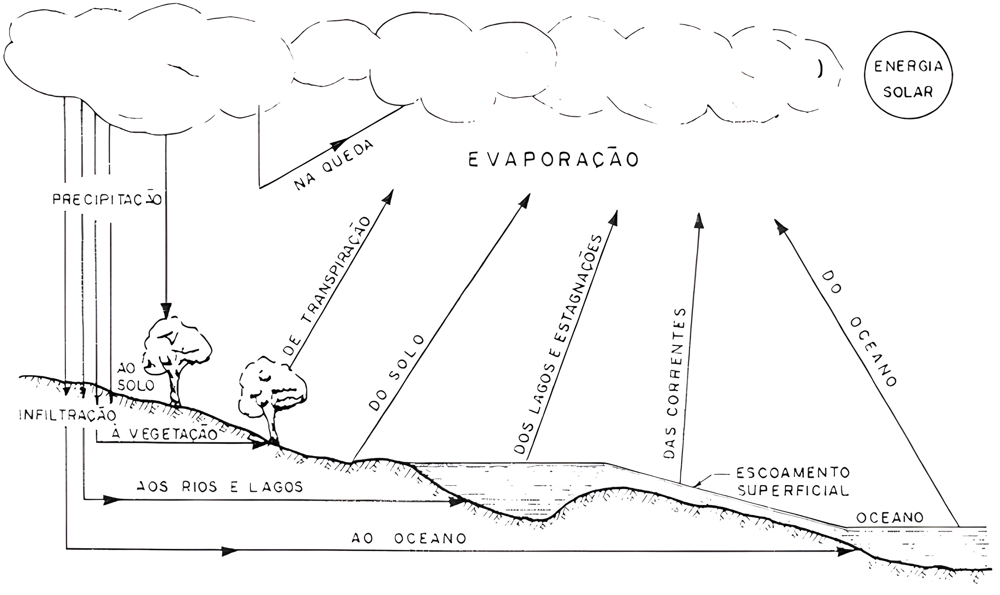

**Fonte:** Adaptado de Wilken (1978, p. 2).

## 3.2 TIPOS DE PRECIPITAÇÃO

Existem vários tipos de precipitação, e cada uma delas possui sua própria particularidade. Bertoni e Tucci (2012) classificaram pelo menos sete delas. Eles citam a neve formada por cristais de gelo, a saraiva que consistem em pedras de gelo arredondadas com diâmetros de até cinco milímetros e o granizo que é descrito como pedras de gelo irregulares que possuem diâmetros iguais ou maiores que cinco milímetros.

Também é falado sobre o orvalho e a geada. É dito que o primeiro é a condensação do vapor de água em objetos, formando gotículas em seu entorno, e geralmente acontece devido ao resfriamento noturno. No segundo, o processo é semelhante ao primeiro, porém a água condensada congela, formando cristais de gelo em temperaturas inferiores a 0°.

Já o chuvisco, é descrito como neblina ou garoa, e é uma precipitação fina de baixa intensidade. Por fim, é falado sobre à chuva, que é o tipo de precipitação que será o foco do presente trabalho, e acontece na forma líquida da água em formato de gotas.

## 3.3 FORMAÇÃO DAS CHUVAS

A formação das chuvas inicia-se pela água presente na atmosfera em forma de vapor. Todo esse processo acontece através do acúmulo do mesmo em diferentes temperaturas, que vai decaindo ao longo do tempo. Tudo se encaminhará até o ponto em que irá ocorrer a saturação e condensação, iniciando assim a chuva.

Para Collischonn e Dornelles (2015), as nuvens em geral se formam de maneira associada à movimentação das massas de ar úmido de maneira ascendente. Esse movimento por sua vez, é usado para diferenciar os tipos de chuva, as principais são as orográficas, as convectivas e as frontais também chamadas de ciclônicas.

É possível entender a partir das definições de Bertoni e Tucci (2012) como se dão esses tipos de chuva. Eles explicam as orográficas como de pequena intensidade e grande duração, provindas do deslocamento de ar quente e úmido advindos geralmente do mar indo de encontro às montanhas, que o eleva e resfria, condensando e dando origem a chuva.

Já as convectivas, eles dizem ser conhecidas por ter uma grande intensidade e pequena duração. Acontecem caracteristicamente em regiões equatoriais, após o ar úmido aquecido e em equilíbrio entorno do solo, elevar-se de forma brusca depois de uma perturbação, gerando por vezes a condensação e a chuva.

Tratando das chuvas frontais, elas são relatadas como de longas durações e média intensidade, com ventos fortes de circulação ciclônica. Este tipo de chuva advém do impulsionamento à atmosfera gerado pela interação das massas de ar úmido de diferentes temperaturas, ocorrendo então o resfriamento e condensação, podendo assim haver às chuvas. A seguir é possível visualizar o comportamento dos tipos de chuva citadas, na Figura 3.2.

**Figura 3.2** – Tipos de chuva segundo a origem do processo.

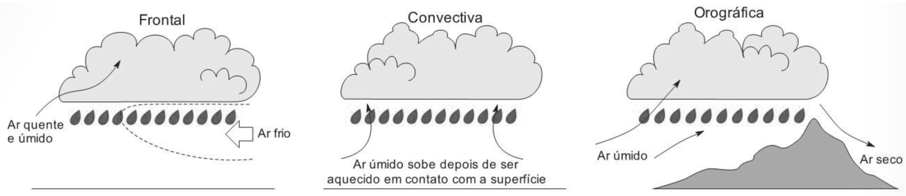

**Fonte:** Adaptado de Collischonn e Dornelles (2015, p. 54).

## 3.4 VARIÁVEIS E GRANDEZAS DE CHUVAS

Independente dos tipos de chuva e a forma como se originam, algumas de suas características se mantêm, possibilitando assim que se trace grandezas em comum. Porém, antes de abordar as definições destas feita pela literatura, o entendimento da incerteza em eventos que envolvem o clima, o tempo e a natureza é imprescindível.

A estatística e teoria da probabilidade, incluindo em especial os sistemas estocásticos, são comumente usados para lidar com a imprevisibilidade do comportamento de eventos climáticos como a chuva. A incerteza explicitada nos eventos climáticos faz com que se entenda a ideia de um dos matemáticos que fez grandes contribuições em diversas áreas da estocástica. Gauss (1900) afirma que, mesmo o espaço tendo uma realidade fora da mente, não se pode descrever completamente suas propriedades a priori.

Aplicando esses conceitos aos eventos de precipitação de chuva, é inquestionável que os padrões climáticos geradores da mesma são interconectados, a exemplo da temperatura do ar, da topografia, da umidade, entre outros. Fica claro então, que qualquer variação em qualquer uma dessas variáveis, além dos fatores desconhecidos ou imprevisíveis, pode afetar significativamente às chuvas, dificultando a sua antecipação.

Assim sendo, a estocástica é usada justamente para lidar com os processos aleatórios gerados por variáveis como as citadas anteriormente, modelando sistemas que se utilizam de probabilidade e estatística, para elaborar previsões através do entendimento do comportamento de sistemas complexos e incertos.

E é a partir desses processos matemáticos que são definidas as grandezas necessárias para estimar e descrever os eventos de precipitações de chuvas, para que assim haja a obtenção de informações que auxiliem nos projetos e dimensionamentos que envolvem águas pluviais. Bertoni e Tucci (2012) descrevem pelo menos quatro grandezas, que por sua vez são usadas para caracterizar as chuvas.

A altura pluviométrica como sendo uma delas, é relatada como a espessura média da lâmina de uma determinada região, medida habitualmente como milímetro de chuva. Outra delas é a duração, que é resumidamente o período de tempo que ocorre a queda de chuva, representada geralmente em minutos ou horas.

A intensidade também é definida como uma das grandezas. Observada como a precipitação por unidade de tempo, é a relação da altura pluviométrica pela duração, e se expressa normalmente em milímetros por hora ou milímetros por minuto. Por fim tem-se a frequência de probabilidade e tempo de recorrência, que é a interpretação do número médio de anos em que se é esperado que a precipitação analisada seja igualada ou superada.

## 3.5 MEDIÇÃO DE CHUVAS

A medição das chuvas origina-se da necessidade de obtenção dos dados, para o desenvolvimento de análises, estudos e previsões. Collischonn e Dornelles (2015) expõem que o instrumento utilizado para medir a chuva é chamado de pluviômetro, sendo os primeiros de medição manual como mostrado na Figura 3.3, ele é definindo como recipientes para coleta da água precipitada com algumas dimensões estabelecidas. Eles são instalados distantes de casas e árvores a uma altura de um metro e meio do solo, para que haja o mínimo de interferência possível na quantidade de água captada.

**Figura 3.3** – Características de pluviômetro manual.

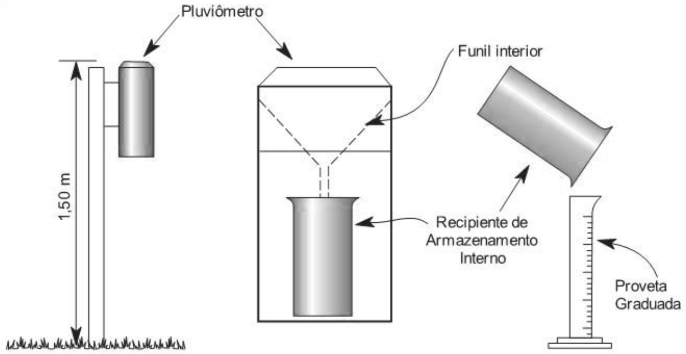

**Fonte:** Adaptado de Collischonn e Dornelles (2015, p. 56).

Collischonn e Dornelles (2015) também citam os pluviômetros adaptados para medições automáticas, também chamados de pluviógrafos, que de início eram mecânicos e se utilizavam de balança para pesagem e papel para registro. Representados pela Figura 3.4, os atuais são digitais e registram os dados em uma memória. Eles possuem vantagens sobre o pluviômetro de medição manual, visto que consegue analisar de forma mais detalhada a chuva ao longo do dia, além da possibilidade de acoplação a sistemas de transmissão de dados.

**Figura 3.4** – Características de pluviômetro automático de cubas basculantes.

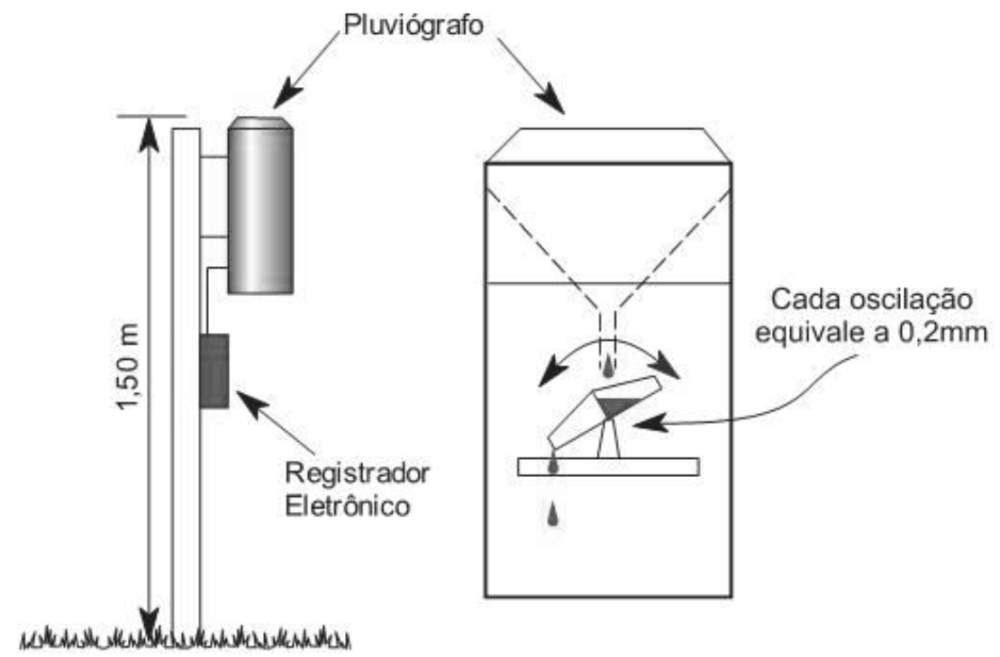

**Fonte:** Adaptado de Collischonn e Dornelles (2015, p. 56).

Existem também outros métodos conhecidos, sendo um deles o de medição de chuva através de radares meteorológicos, que é baseado na emissão de pulsos de radiação eletromagnética refletidos pelas partículas de água de chuva na atmosfera, e medição da intensidade do sinal refletido. Outro método é o da estimativa de precipitação através de imagens retiradas de sensores instalados em satélites.

## 3.6 CHUVAS INTENSAS

É possível perceber que o estudo acerca do fenômeno que é a chuva é complexo, mas existem caminhos que podem ser seguidos, para que haja a obtenção de bons resultados baseado no que se deseja alcançar. Tendo isso em vista, o presente trabalho trata de um tipo específico de precipitação pluviométrica conhecida como chuva intensa.

Esse tipo de aguaceiro caracteriza-se por a queda de uma grande quantidade de água em um curto período de tempo. É perceptível que este tipo de chuva é a causa de problemas diversos como deslizamentos, inundações, destruição em zonas populadas principalmente de baixa infraestrutura, dentre outros desastres naturais.

São notáveis os impactos das chuvas intensas tanto no meio ambiente, como no meio urbano e rural, como observado por Bertoni e Tucci (2012). E restando ao homem adaptar-se a este tipo de evento imposto pela natureza, é possível se utilizar do conhecimento científico e popular, como os apresentados até aqui, para diminuir os impactos, e se aproveitar das benesses desse tipo de evento climático.

## 3.7 EQUAÇÃO DE CHUVAS INTENSAS

Para explicar e deduzir matematicamente o fenômeno das chuvas intensas, métodos matemáticos que serão explicados mais adiante são utilizados resultando em curvas que podem ser deduzidas através de uma equação. Ela é chamada por Wilken (1978) de equação intensidade-duração-frequência ou equação de chuvas, também conhecida popularmente como equação de chuvas intensas. Foi desenvolvida para diversos fins, a citar alguns deles, como o dimensionamento de projetos de drenagem de águas pluviais e de barragens, sistemas de irrigação, controles de inundação e planejamento urbano.

Sobre os cálculos, Wilken (1978) é claro ao afirmar que a equação IDF é gerada a partir das relações entre a intensidade, duração e frequência, que por sinal a nomeiam. Elas são relacionadas através da observação de dados de séries históricas de precipitação em um tempo suficientemente grande para que seja possível aceitar às frequências como probabilidade. Como resultado, têm-se as curvas mencionadas, de intensidade-duração-frequência para cada frequência, com uma regularidade entre as mesmas que possibilita a tradução uniforme delas através do equacionamento. Existem equações que podem ser usadas para explicar as curvas matematicamente, porém apenas uma será tratada neste trabalho que é a apresentada a seguir, descrita por Bertoni e Tucci (2012) como genérica e boa representante das frequências citadas.

$$I = \frac{a * Tr^b}{(t + c)^d} \tag{3.1}$$

onde: *I* é a intensidade da chuva, (mm/h); *Tr* é o tempo de retorno, (ano); *t* é a duração, (min); *a, b, c, d* são os parâmetros da equação da intensidade das chuvas, (adimensional).

Sabendo disso, é necessário entender os processos matemáticos que levam aos resultados que se desejam, que são os parâmetros da equação da intensidade das chuvas. Baseado nos resumos esquemáticos dos estudos de Pinto (2013) e de Neto (2020), foi elaborado para o presente trabalho um fluxograma visualizado através da Figura 3.5, que define os passos a se seguir para determinar os parâmetros da equação IDF.

**Figura 3.5** – Fluxograma de equação das chuvas intensas.

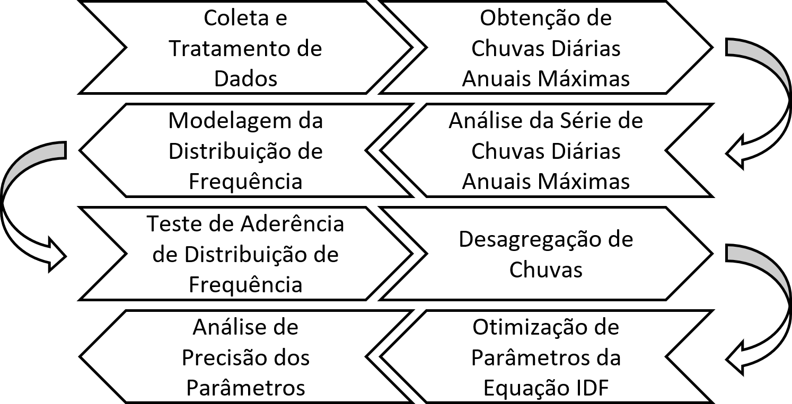

**Fonte:** De autoria própria (2023).

### 3.7.1 O tratamento de dados

A partir da coleta de dados já explicada, é preciso pensar sobre as falhas presente neles. É comum a falta de informações de precipitação em alguns dias durante o ano. Se tratando de dados de chuvas, devido à incerteza presente nesses eventos temporais, são notórias as dificuldades que se encontra para os preenchimentos de suas falhas. Para um melhor entendimento, é possível usar de exemplo regiões onde a variação do tempo é brusca, e a maioria dos dias do ano simplesmente não chove, além das chuvas esporádicas entre os dias de estiagem, tornando o preenchimento das falhas extremamente problemático.

Para que se faça uma boa análise de dados falhos, é importante estabelecer um limiar de falhas que caso ultrapassado, desconsidera-se a série analisada. É possível estabelecer esse limite de forma empírica, como no caso de trabalhos como o de Santos (2017) e Beskow *et al.* (2013), e de forma estatística, como no estudo de Kim e Ryu (2015).

Caso o limiar não seja ultrapassado, é possível utilizar métodos de preenchimento de dados. Bertoni e Tucci (2012) descrevem os de ponderação regional, regressão linear simples e múltipla, e até mesmo a ponderação regional com base em regressões lineares. Os autores destacam que essas formas de preenchimento de falhas são principalmente usadas em séries mensais e anuais. A interpolação também é uma maneira viável de preencher falhas, e será explicada em um tópico mais adiante.

Uma forma mais simples de lidar com dados ausentes é a explicada por Allison (2001), chamada de *complete case analysis*, que apenas exclui os dados ausentes. O autor a descreve como de fácil implementação, porém destaca que deve ser usada com cuidado visto que a depender das falhas, ela pode excluir uma grande parcela da amostra original. Cabe ao calculista analisar e decidir qual método melhor se encaixa nas especificações de sua base de dados.

### 3.7.2 As chuvas diárias anuais máximas

Em posse dos devidos dados, faz-se importante a análise da quantidade de anos que se tem informações de precipitação, e a interpretação de diferentes autores sobre qual seria o mínimo tempo necessário de medição de dados de chuva diária para que sejam desenvolvidas as frequências probabilísticas. Isto porque bons dados iniciais influenciam diretamente na precisão das previsões de intensidade feitas com a equação IDF.

O Instituto Nacional de Pesquisas Espaciais (INPE) recomenda que para o comportamento estatístico das variáveis de tempo como temperatura, chuva e vento, possua-se dados de um período de pelo menos 30 anos. Porém, devido à escassez de informações para um tempo tão longo, alguns autores admitem menores períodos mínimos. É possível comprovar essa afirmação através de estudos como o de Pfafstetter (1957), que elaborou equações com dados de 98 postos meteorológicos ao longo de todo o Brasil, possuindo elas séries históricas com uma média de aproximadamente 22 anos. É visível também no trabalho de Martinez e Magni (1999), convênio do Departamento de Águas e Energia Elétrica e da Escola Politécnica da Universidade de São Paulo, a apresentação de períodos de anos menores que o recomendado pelo INPE, com uma média de 27 anos para 30 cidades do estado brasileiro de São Paulo.

Compreendendo essa questão, organiza-se os dados que serão usados no cálculo da equação das chuvas intensas e se seleciona a maior chuva diária de cada ano do conjunto de dados. Em posse da série histórica de chuva diária anual máxima, aplica-se o teste de Mann-Kendall (MK) proposto por Helsel *et al.* (2020), para busca por tendências em dados hidrológicos, que indica entre outras questões as mudanças climáticas, que por sua vez podem afetar previsões estatísticas.

### 3.7.3 A modelagem probabilística

Não havendo tendência na série de precipitações máximas diárias anuais segue-se para modelagem probabilística dos dados de precipitação máxima diária anual que é feita através de distribuições de probabilidade. Estas são usadas para análise de frequência, e estimam as precipitações para diferentes tempos de retorno. Dito isso, nota-se a existência de variadas distribuições, que se ajustam de maneiras diferentes a depender dos dados, resultando em precisões diversas.

A escolha da distribuição probabilística para a modelagem será sempre a que, quando comparada com outras que apresentam bons ajustes para dados hidrológicos, terá a melhor precisão. Sabendo disso, é possível citar às distribuições de probabilidade Exponencial, Gama, de Gumbel, e Log-Normal que possuem dois parâmetros. Quando se trata de possuir três parâmetros, têm-se as Generalizada de Pareto, Logística Generalizada, Normal Generalizada, de Pearson tipo III, e de Weibull. Com quatro parâmetros, menciona-se a de Kappa 4.

Neghettini e Pinto (2007) tratando de hidrologia estatística, analisam todas as distribuições probabilísticas citadas, com exceção de Kappa 4. Lanna (2012) em sua abordagem de modelos probabilísticos cita como boas para aplicação na hidrologia as distribuições Exponencial, Gama, de Gumbel, Log-Normal, Normal e de Weibull.

Já Pinto (2013) em seu trabalho de elaboração da metodologia de cálculo das equações IDF para o Atlas Pluviométrico do Brasil, utiliza das distribuições de probabilidade Exponencial, Gama, de Gumbel, Generalizada de Pareto, e Generalizada Logística. Como única com quatro parâmetros, a distribuição de probabilidade de Kappa 4 se faz necessária para comparação com outras funções de menor quantidade de parâmetros, sendo descrita por Hosking e Wallis (1997) como ótima para este fim, aumentando a precisão dos modelos estatísticos.

Os parâmetros das distribuições citadas, necessitam de um método estimativo que facilite o seu cálculo, e ao mesmo tempo gere precisão. Entre os métodos citados por Neghettini e Pinto (2007), têm-se o da máxima verossimilhança (MVS), sendo ele destacado como o de maior eficiência por produzir os estimadores de menor variância.

### 3.7.4 As funções de aderência de distribuições probabilísticas

A escolha de uma distribuição probabilística também está ligada a aderência que ela tem com os dados utilizados. Para conferir se os dados observados estão realmente bons, precisa-se de um método estatístico que verifique se eles são provenientes de uma distribuição determinada.

Dentre os principais testes de aderência citados por Neghettini e Pinto (2007) empregados em hidrologia estatística, é possível citar o de Kolmogorov-Smirnov (KS) e o de Anderson-Darling (AD). Como explicado pelos autores, eles comparam as funções de distribuição acumulada empíricas das teóricas.

Neste sentido, há um cálculo estatístico de teste que mede a distância entre elas, descrita como a diferença máxima entre as duas distribuições. No caso dela ser maior que um valor crítico, encontrado a partir da significância arbitrada, então a hipótese nula é rejeitada e conclui-se que as amostras são extraídas de distribuições de probabilidade diferentes.

### 3.7.5 A desagregação de dados pluviométricos

Após definir uma distribuição de probabilidade que se adeque aos dados observados, é necessário estabelecer uma relação entre as precipitações das chuvas e suas durações. Como é dito por Back e Wildner (2021), inicialmente ela era estabelecida a partir da observação das chuvas de curta duração através de pluviógrafos.

Porém como explicado anteriormente, existe uma enorme dificuldade na obtenção de longas séries de dados devido a escassez dessas informações no vasto território brasileiro. E essa afirmação é endossada em diversos trabalhos, a citar o de Cecílio e Pruski (2003), que visa contornar esse problema através da interpolação dos parâmetros da equação IDF.

Entretanto, uma maneira eficaz de encarar a carência de dados é através da desagregação das chuvas. Explicada por Bertoni e Tucci (2012) por meio do método da relação entre durações, nele são aplicados os coeficientes de correção elaborados para desagregar chuvas máximas anuais de um dia em precipitações pluviométricas de menores durações.

Os coeficientes mais utilizados em estudos e projetos que recorrem à desagregação de chuvas no Brasil, são os desenvolvidos pela DAEE/CETESB (1980), que podem ser observados na Tabela 3.1, elaborados para abranger todo o território nacional.

**Tabela 3.1** – Relação entre chuvas de diferentes durações.

| Relação entre Alturas Pluviométricas | Coeficientes de Desagregação |
|:------------------------------------:|:----------------------------:|
|           05 min / 30 min            |             0.34             |
|           10 min / 30 min            |             0.54             |
|           15 min / 30 min            |             0.70             |
|           20 min / 30 min            |             0.81             |
|           25 min / 30 min            |             0.91             |
|            30 min / 01 h             |             0.74             |
|             01 h / 24 h              |             0.42             |
|             06 h / 24 h              |             0.72             |
|             08 h / 24 h              |             0.78             |
|             10 h / 24 h              |             0.82             |
|             12 h / 24 h              |             0.85             |

**Fonte:** DAEE/CETESB (1980, p. 22).

Bertoni e Tucci (2012) avaliam que o coeficiente da relação de 1 dia para 24 horas pode ser menor em regiões onde chuvas convectivas são predominantes. O valor fixado neste estudo será de 1.14, utilizado na cidade de São Paulo.

No trabalho da DAEE/CETESB (1980), também é possível ver diversos coeficientes de desagregação de outras fontes, a exemplo dos adotados pelo *United State Weather Bureau* conhecida atualmente por *National Weather Service* (NWS). Logo, fica claro que é possível se utilizar de coeficientes de desagregação de outras fontes, ou até mesmo elaborados pelo próprio calculista. Com base na Tabela 3.1, Silveira (2000) desenvolveu a equação (3.2) com o menor erro possível através de regressões lineares e ajustes bi-logarítmicos, permitindo uma maior flexibilidade nos cálculos para durações iguais ou maiores a 5 minutos e menores que 24 horas.

$$C = e^{1.5 * \ln{\left(\frac{ln{\left(t\right)}}{7.3}\right)}} \tag{3.2}$$

onde: *C* é o coeficiente de desagregação, (adimensional); *e* é a constante de Euler, (adimensional); *t* é a duração qual se quer extrair o coeficiente, (min).

### 3.7.6 Os métodos de otimização para ajuste de parâmetros de funções

As intensidades nascem da relação entre as precipitações desagregadas em chuvas de menores durações, e as durações que definiram os coeficientes. Obtidas às intensidades, Wilken (1978) descreve a análise da frequência que estabelece uma relação analítica já explicada entre a intensidade, a duração e a frequência. Traça-se então, curvas dos pontos das várias frequências com as intensidades nas ordenadas, e as durações nas abscissas, vistas na Figura 3.6.

**Figura 3.6** – Curvas da relação entre intensidade e duração.

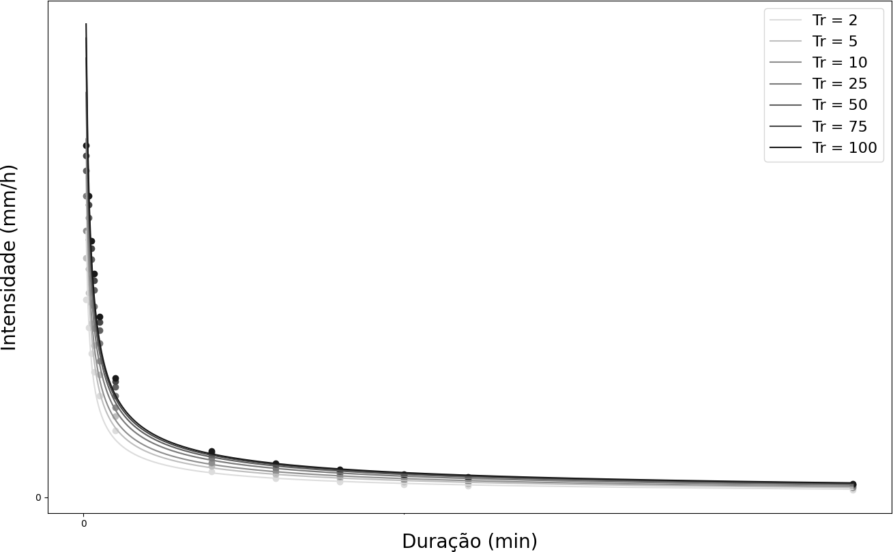

**Fonte:** De autoria própria (2023).

Reiterando que os tempos de retorno definidos são as frequências citadas inicialmente, onde são geradas curvas para cada uma delas com a mesma forma geral citada anteriormente, visto que elas possuem séries de intensidades diferentes.

Para a obtenção dos parâmetros da equação (3.1), que representa todas as curvas numericamente, fazem-se necessários métodos de otimização matemática, que podem ser desenvolvidos através de cálculos manuais, ou de algoritmos projetados para encontrar valores mínimos ou máximos a partir de iteração e métodos numéricos avançados.

O mais simples dentre os que serão citados é justamente um que se utiliza apenas do cálculo manual, em prol de extrair as funções das curvas. Denominado de método dos mínimos quadrados (MMQ), foi descoberto e justificado pelo matemático Carl F. Gauss como descrito por Boyer (1968). Nele serão utilizadas a função com ajustes de potência, para gráficos em que a disposição dos pontos tende a formar curvas, e a com ajustes lineares para gráficos que seus pontos tendem a estar dispostos em forma de reta.

Já os de otimização que se utilizam de algoritmos, necessitam de implementação em linguagens de programação para seu pleno funcionamento, promovendo robustez em suas buscas, além de precisão a depender de seus números para partida, intervalos de busca referentes aos parâmetros a se ajustar, além da quantidade de interações. Inicialmente esses métodos eram implementados em linguagens de programação de baixo nível, que desenvolviam as execuções dos mesmos promovendo alto desempenho.

Com o avanço da tecnologia, foi possível desenvolver otimizações de funções em linguagens de programação de alto nível. O presente trabalho dá enfoque ao Python, que através de bibliotecas como o NumPy e SciPy, pode usar esses métodos de forma ágil ao utilizar a compilação de suas rotinas mais críticas nas linguagens de programação de baixo nível, em especial C, C++ e Fortran. Vale ressaltar que as bibliotecas citadas são desenvolvidas em código aberto, promovendo acessibilidade e avanço científico.

Partindo para métodos de otimização global que visam o ajuste de múltiplos parâmetros de uma função disponibilizados pelo SciPy e adequados à dados com séries hidrológicas, é possível citar os determinísticos e os estocásticos. Para o primeiro, tem-se *Constrained Optimization By Linear Approximations* (COBYLA), *Conjugate Gradient* (CG), Broyden-Fletcher-Goldfarb-Shanno (L-BFGS-B), Levenberg-Marquardt (LM), Nelder-Mead (NM), Powell e *Truncated* Newton (TNC). Já em relação ao segundo, cita-se *Dual-Annealing* (DA) e *Differential Evolution* (DE).

A escolha de qual utilizar para encontrar os melhores parâmetros, que representam as curvas de frequência em uma equação IDF, dependerá unicamente da precisão que desempenharão de acordo com os dados e necessidades informadas pelo calculista. A melhor resposta nascerá da tentativa e erro, que é desenvolvida pela máquina de processamento ao relacionar a melhor modelagem probabilística junto do melhor método de otimização.

O desempenho dos resultados representado pelo grau de sua precisão, que informará qual equação IDF melhor se ajustou aos dados informados após as sucessivas tentativas explicadas anteriormente, será determinado a partir do coeficiente de Nash e Sutcliffe (NS) (1970), que detalharam seu uso para dados hidrológicos. Ele varia de infinito negativo até a maior precisão possível representada pelo número um. Já para viés de aferição em conjunto com NS, é possível usar a Raiz do Erro Quadrático Médio (RMSE), onde o seu resultado representará na unidade de medida da intensidade, o seu erro para mais ou para menos.

### 3.7.7 O cálculo simplificado da equação de chuva intensas

É bem verdade que a otimização usada no ajuste dos parâmetros da equação das chuvas intensas, torna o todo o cálculo envolto a ela menos tátil, visto que o uso de algoritmos computacionais se torna essencial para resultados satisfatórios. Porém é importante dizer que os passos para chegar a equação se mantém, que é o tratamento de dados, seguido da modelagem probabilística, para que assim haja a desagregação e geração das curvas de intensidade, duração e frequência, e a partir delas se descubra os parâmetros e a equação IDF.

Tendo isso em mente, se faz importante entender esses passos de uma maneira menos abstrata, através de equações e do cálculo manual, empregando as fórmulas matemáticas para a obtenção de um resultado. Obviamente o nível de precisão não é o mesmo que o de um computador que itera múltiplas vezes diferentes distribuições de frequência e otimizações, em busca da solução ideal. Porém é de se pensar que a observação de cálculos palpáveis torna bem mais digerível o entendimento dos processos que os próprios algoritmos levam em busca de ajustes para a equação que melhor representem os dados observados.

Pensando nisso, o presente tópico visa abordar as partes mais sensíveis do cálculo da equação das chuvas intensas, que é a modelagem probabilística, a desagregação e a elaboração das curvas IDF, encontrando a partir delas a equação das chuvas intensas. Não será abordada a parte de tratamento de dados inicial, focando apenas no cálculo da equação a partir de precipitações máximas diárias anuais já determinadas para uso. Será possível observar um exemplo seguindo os passos apresentados, no apêndice do trabalho.

#### 3.7.7.1 A distribuição de frequências

Iniciando a modelagem probabilística, para o cálculo da distribuição de frequências optou-se pelo uso de Gumbel, por ser um método de cálculo relativamente simples, com apenas dois parâmetros. O cálculo se inicia com a média das precipitações diárias anuais máximas (3.3), obtidas a partir dos dados coletados.

$$\bar{X} = \frac{\sum(Xi)}{n} \tag{3.3}$$

onde: $\bar{X}$ é a média das precipitações diárias anuais máximas, (mm); $X_i$ é a precipitação diária anual máxima, (mm); *n* é o número total de anos precipitados, (adimensional).

Após descobrir a média das precipitações diárias anuais máximas (3.3), é possível fazer o cálculo do desvio padrão (3.4).

$$\delta = \sqrt{\frac{\sum(Xi - \bar{X})^2}{n - 1}} \tag{3.4}$$

onde: $\delta$ é o desvio padrão, (adimensional); $X_i$ é a precipitação diária anual máxima, (mm); $\bar{X}$ é a média das precipitações diárias anuais máximas, (mm); *n* é o número total de anos precipitados, (adimensional).

Em posse do desvio padrão (3.4), consegue-se encontrar o parâmetro de escala da distribuição de Gumbel (3.5).

$$\beta_{1} = \sqrt{\frac{6}{\pi}} * \delta \tag{3.5}$$

onde: $\beta_{1}$ é o parâmetro de escala da distribuição, (adimensional); $\pi$ é a constante pi, (adimensional); $\delta$ é o desvio padrão, (adimensional).

Com a obtenção do parâmetro de escala de distribuição (3.5), junto da média das precipitações diárias anuais máximas de (3.3), tem-se agora o necessário para encontrar a moda de Gumbel (3.6).

$$\mu = \bar{X} - \gamma * \beta_{1} \tag{3.6}$$

onde: $\mu$ é a moda de Gumbel, (mm); $\bar{X}$ é a média das precipitações máximas, (mm); $\gamma$ é a constante de Euler-Mascheroni, (adimensional); $\beta_{1}$ é o parâmetro de escala da distribuição de Gumbel, (adimensional).

O próximo passo é encontrar a mediana de Gumbel adaptada ao cálculo das precipitações máximas (3.7). Para acha-la, é necessário arbitrar tempos de retorno. Comumente, estes períodos são decididos a partir da análise da região e dos dados utilizados inicialmente.

$$Xt = \mu - \beta_{1} * \ln{\left(\ln{\left(\frac{Tr}{Tr - 1}\right)}\right)} \tag{3.7}$$

onde: *Xt* é a mediana de Gumbel, (mm); $\mu$ é a moda de Gumbel, em (mm); $\beta_{1}$ é o parâmetro de escala da distribuição de Gumbel, (adimensional); *Tr* é o tempo de retorno, (ano).

Por fim tem-se a função cumulativa de Gumbel (3.8), que dirá qual a probabilidade de ocorrer uma chuva de precipitação $Xt$ (3.7) nos determinados tempos de retorno arbitrados.

$$F(Xt) = e^{- e^{- \frac{Xt - \mu}{\beta_{1}}}} \tag{3.8}$$

onde: *F(Xt)* é a função cumulativa de Gumbel, (porcentagem); *e* é a constante de Euler, (adimensional); *Xt* é a mediana de Gumbel, (mm); $\mu$ é a moda de Gumbel, (mm); $\beta_{1}$ é o parâmetro de escala da distribuição, (adimensional).

#### 3.7.7.2 O Teste de aderência

O teste de aderência utilizado será o mais generalista dentre os citados, que é o de Kolmogorov-Smirnov. Para iniciar o cálculo, descobre-se os parâmetros de posição (3.9) e de escala (3.10) do teste de aderência. Nas fórmulas serão usados a média das precipitações diárias anuais máximas (3.3) e o desvio padrão (3.4).

$$\beta_{2} = \bar{X} - 0.45 * \delta \tag{3.9}$$

onde: $\beta_{2}$ é o parâmetro de posição de Kolmogorov-Smirnov, (adimensional); $\bar{X}$ é a média das precipitações máximas, (mm); $\delta$ é o desvio padrão, (adimensional).

$$\alpha = \frac{\delta}{1.283} \tag{3.10}$$

onde: $\alpha$ é o parâmetro de escala de Kolmogorov-Smirnov, (adimensional); $\delta$ é o desvio padrão, (adimensional).

Calculados os parâmetros, ordena-se as precipitações de forma decrescente, e após isso, numera-se cada uma de forma crescente, para que assim se calcule a frequência das precipitações diárias anuais máximas dos anos da distribuição (3.11).

$$Fr = \frac{i}{n} \tag{3.11}$$

onde: *Fr* é a frequência da distribuição analisada, (porcentagem); *i* é a posição do ano precipitado, (mm); *n* é o número total de anos precipitados, (adimensional).

Com a frequência, encontra-se a frequência não excedida das precipitações diárias anuais máximas (3.12), utilizando o parâmetro de posição (3.9), e o parâmetro de escala (3.10).

$$Fr_{n\_Exced} = e^{- e^{- \frac{Xi - \beta_2}{\alpha}}} \tag{3.12}$$

onde: $Fr_{n\_Exced}$ é a frequência não excedida da distribuição analisada, (porcentagem); *e* é a constante de Euler, (adimensional); *Xi* é a precipitação anual máxima, (mm); $\beta_2$ é o parâmetro de posição, (adimensional); $\alpha$ é o parâmetro de escala, (adimensional).

Já para encontrar a frequência excedida (3.13), basta fazer a diferença de um pela frequência não excedida (3.12).

$$Fr_{Exced} = 1 - Fr_{n\_Exced} \tag{3.13}$$

onde: $Fr_{Exced}$ é a frequência excedida da distribuição analisada, (porcentagem); $Fr_{n\_Exced}$ é a frequência não excedida da distribuição analisada, (porcentagem).

O próximo passo é encontrar a diferença (3.14), que é descoberta após fazer o módulo da subtração da frequência (3.11) pela frequência excedida (3.13).

$$Dn = Fr - Fr_{Exced} \tag{3.14}$$

onde: *Dn* é a diferença, (porcentagem); *Fr* é a frequência, (porcentagem); $Fr_{Exced}$ é a frequência excedida de Gumbel, (porcentagem).

Para finalizar os cálculos do método de KS, busca-se o valor crítico da estatística (3.15) com base na fórmula de sua determinada significância. Sabendo que quanto menor for a porcentagem desse valor, mais precisa será a aderência, têm-se fórmulas para os níveis de um e cinco por cento de significância. Será escolhida aquela que após ponderação, melhor se ajusta à realidade dos dados utilizados.

$$Crit_1 = \frac{1.6276}{\sqrt{n}} \tag{3.15}$$

onde: $Crit_1$ é o valor crítico da estatística de 1%, (porcentagem); *n* é o número total de anos precipitados, (adimensional).

$$Crit_5 = \frac{1.3581}{\sqrt{n}} \tag{3.16}$$

onde: $Crit_5$ é o valor crítico da estatística de 5%, (porcentagem); *n* é o número total de anos precipitados, (adimensional).

Após calcular todas as diferenças (3.14) basta comparar a maior diferença com o valor crítico arbitrado (3.15) ou (3.16). Caso a maior diferença for menor que o valor crítico estatístico, a aderência é boa, caso contrário a hipótese nula deve ser rejeitada, como se segue na sentença (3.17).

$$\begin{cases}
Dn_{max}<Crit,&\mbox{\textit{Boa }}\mbox{\textit{Aderência!}} \\
Dn_{max}>Crit,&\mbox{\textit{Hipótese }}\mbox{\textit{Rejeitada!}}
\end{cases} \tag{3.17}$$

onde: $Dn_{max}$ é a diferença máxima, (porcentagem); *Crit* é o valor crítico da estatística, (porcentagem).

#### 3.7.7.3 A Desagregação a partir da relação entre durações

Obtendo uma boa aderência verificada pelo método de KS, segue-se para a desagregação dos dados obtidos de Gumbel, utilizando a equação (3.2) para as durações arbitradas no cálculo.

Após determinar os coeficientes, basta fazer o produto deles pelas precipitações de diferentes períodos de retorno obtidas na fórmula (3.7), resultando nas chuvas desagregadas em durações menores para cada tempo de retorno escolhido (3.18).

$$Pr = Xt * C \tag{3.18}$$

onde: *Pr* é a precipitação desagregada, (mm); *Xt* é a mediana de Gumbel, (mm); *C* é o coeficiente de desagregação, (adimensional).

Com as precipitações desagregadas para seus determinados frequências, que neste caso são os períodos de retorno, é possível definir intensidades da chuva precipitada (3.19), a partir do quociente entre precipitações desagregadas e as durações.

$$I = \frac{Pr}{t} \tag{3.19}$$

onde: *I* é a intensidade para uma determinada duração, (mm/h); *Pr* é a precipitação desagregada, (mm); *t* é a duração da determinada precipitação, (h).

Após ter as intensidades encontradas, é possível gerar as curvas de frequência já mencionadas, relacionando-as com as durações arbitradas. A Figura 3.2 explicita o que foi falado, sendo cada curva representada por uma cor, um tempo de retorno diferente, e cada ponto, um dado de intensidade para sua respectiva duração.

#### 3.7.7.4 O Método dos mínimos quadrados

A equação das curvas IDF será encontrada a partir do método dos mínimos quadrados, já mencionado neste trabalho. A seguir é possível visualizar as fórmulas para ajustes de funções de potência (3.20) e de funções lineares (3.21).

$$y = b_1 * x^{a_1} \tag{3.20}$$

$$y = a_{1} * x + b_{1} \tag{3.21}$$

onde: $x$, $y$ são incógnitas que representam pontos da função; $a_2$, $b_2$ são ajustes do método dos mínimos quadrados, (adimensional).

Para encontrar os ajustes representados nas funções apresentadas (3.20) e (3.21), usa-se as fórmulas (3.22) e (3.23) propostas no método do mínimo quadrado.

$$a_2 = \frac{n * \sum{(x * y)} - \sum{x} * \sum{y}}{n * \sum{x^2} - (\sum{x})^2} \tag{3.22}$$

$$b_2 = \frac{\sum{x} * \sum{(x * y)} - \sum{x^2} * \sum{y}}{(\sum{x})^2 - n * \sum{x^2}} \tag{3.23}$$

onde: $x$, $y$ são incógnitas que representam pontos da função; $a_2$, $b_2$ são ajustes do método dos mínimos quadrados, (adimensional); *n* é a quantidade de itens de y.

O cálculo começará sendo feito para as intensidades e durações de cada tempo de retorno, gerando as funções das curvas da Figura 3.1 para cada um dos períodos de retorno arbitrados. Para achar tudo que se precisa, e aplicar nas equações dos ajustes (3.22) e (3.23), é necessário saber o que cada incógnita dessas equações representa.

Sobre elas, pode-se afirmar que $n$ é a quantidade de durações utilizadas, $x$ é o logaritmo natural das intensidades obtidas (3.19), e $y$ é o logaritmo natural das distâncias arbitradas. Assim é possível descobrir o valor dos ajustes $a_2$ e $b_2$ de acordo com as variáveis informadas anteriormente para cada curva e seu determinado período de retorno. Com esses valores encontra-se $a_1$ e $b_1$, vistos na sentença (3.24), para que assim se aplique na equação (3.20).

$$\begin{cases}
a_1 = a_2 \\
b_1 = e^{b_2}
\end{cases} \tag{3.24}$$

onde: $a_1$, $a_2$, $b_1$, $b_2$ são ajustes do método dos mínimos quadrados, (adimensional).

#### 3.7.7.5 Os parâmetros da equação de intensidade-duração-frequência

Em posse dessas funções, finalmente é possível iniciar a determinação dos parâmetros da equação (3.1). Wilken (1978) define bem os cálculos necessários para se encontrar os parâmetros da equação IDF utilizando o MMQ, esses que serão explicados mais adiante. Seguindo com o cálculo, o primeiro parâmetro que dá para se encontrar com as informações expressadas até o momento, é o $c$.

Novamente, os cálculos são feitos para os dados de cada tempo de retorno, sendo o processo feito de forma individualizada para cada um deles. Algumas novas variáveis precisam ser declaradas para a determinação do parâmetro citado anteriormente, e a primeira delas é a intensidade resultante (3.25).

$$i_3 = \sqrt{i_1 * i_2} \tag{3.25}$$

onde: *$i_3$* é a intensidade resultante, (mm/h); *$i_1$* é a intensidade com menor duração do tempo de retorno utilizado, (mm/h); *$i_2$* é a intensidade com maior duração do tempo de retorno utilizado, (mm/h).

A intensidade resultante permite que se encontre o tempo resultante (3.26), novamente para cada tempo de retorno arbitrado.

$$t_3 = {\left(\frac{i_3}{b_1}\right)}^{\frac{1}{a_1}} \tag{3.26}$$

onde: $t_3$ é o tempo resultante, (min); $i_3$ é a intensidade resultante, (mm/h); $a_1$, $b_1$ são ajustes do método dos mínimos quadrados, (adimensional).

Isto posto, basta utilizar o tempo resultante calculado de cada período de retorno, para cada para achar o parâmetro $c_i$ (3.27) de cada um deles.

$$c_i = \left(\frac{t_3^2 - t_1 * t_2}{t_1 + t_2 - t_3}\right) \tag{3.27}$$

onde: *$c_i$* é o parâmetro $c$ de um determinado período de retorno, (adimensional); *$t_3$* é o tempo resultante, (min)); *$t_1$* é o tempo de menor duração, (min); *$t_2$* é o tempo de maior duração, (min).

O parâmetro $c$ final da equação IDF será a média dos parâmetros $c_i$ (3.28) encontrados em todos os tempos de retorno arbitrados. Para encontrar os próximos parâmetros da equação, será necessário incorporar o parâmetro $c$ à duração, ocorrendo assim um deslocamento nos pontos, resultando em novas curvas.

$$c = \frac{\sum{c_i}}{n} \tag{3.28}$$

onde: *$c$* é um dos parâmetros da equação da intensidade das chuvas, (adimensional); *$c_i$* é o parâmetro $c$ de um determinado período de retorno, (adimensional); *n* é a quantidade total de $c_i$, (adimensional).

Por ilação, novas funções serão geradas para o gráfico da Figura 3.2. O processo de descoberta delas será o mesmo, utilizando as equações (3.22), (3.23), (3.24) e (3.20). O que muda neste segundo uso do MMQ são as variáveis usadas nas fórmulas citadas. Sobre elas, pode-se afirmar que $n$ continua sendo a quantidade de durações utilizadas, $x$ são os logaritmos de base dez das intensidades obtidas (3.19), e $y$ são os logaritmos de base dez das durações arbitradas com a adição do parâmetro $c$. A partir dessas informações, é possível observar um gráfico de curvas diferente na Figura 3.7.

**Figura 3.7** – Curvas da relação entre intensidade e duração mais complemento.

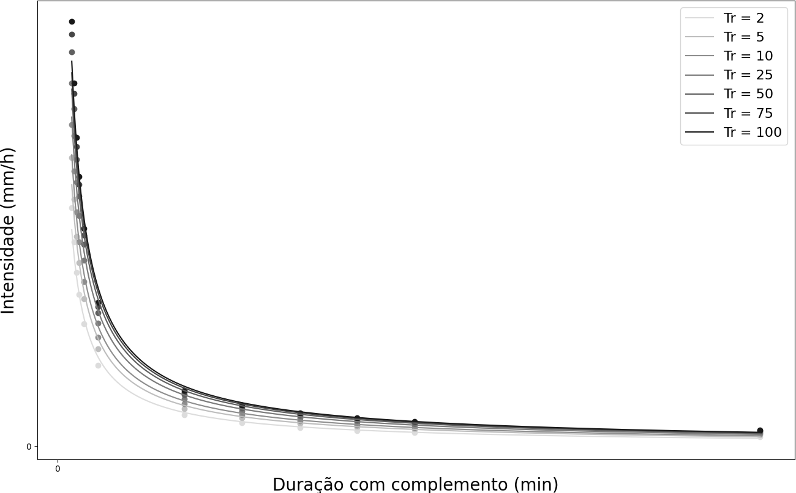

**Fonte:** De autoria própria (2023).

Um novo parâmetro da equação IDF já pode ser calculado com as informações obtidas do segundo uso do MMQ, que é o $d$ (3.29).

$$d = -1 * \frac{\sum{a_1}}{n} \tag{3.29}$$

onde: *d* é um dos parâmetros da equação da intensidade das chuvas, (adimensional); $a_1$ é um ajuste do segundo uso do método dos mínimos quadrados, (adimensional); *n* é a quantidade total de $a_1$, (adimensional).

Continuando com os cálculos dos parâmetros da IDF, será usado o MMQ pela terceira e última vez. Porém, a relação agora será entre o logaritmo de base dez dos tempos de retorno e os ajustes $b_2$ calculados a partir da relação da intensidade com a duração mais o parâmetro $c$. Isso resultará em uma nova relação entre os ajustes observado na sentença (3.30).

$$\begin{cases}
a_1 = a_2 \\
b_1 = 10^{b_2}
\end{cases} \tag{3.30}$$

onde: $a_1$, $a_2$, $b_1$, $b_2$ são ajustes do método dos mínimos quadrados, (adimensional).

Outro detalhe é que a função será traçada a partir de uma reta, com a da fórmula (3.21) para ajustes lineares, vista na Figura 3.8.

**Figura 3.8** – Reta da relação entre tempo de retorno e ajuste $b_2$.

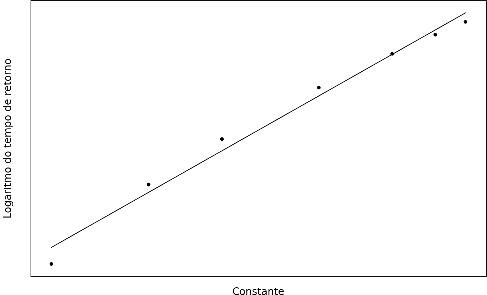

**Fonte:** De autoria própria (2023).

Para descobrir a função da reta que pode ser vista na Figura 3.3, novamente, é importante declarar quais serão as variáveis usadas nas fórmulas (3.22) e (3.23). Pode-se dizer que $n$ será a quantidade de tempos de retorno utilizados, $x$ são os logaritmos de base dez dos tempos de retorno, e $y$ são os ajustes $b_2$ calculados a partir da relação das intensidades com as durações mais o parâmetro $c$, no segundo uso do MMQ. As informações encontradas serão aplicadas na fórmula (3.21), após a relação entre os ajustes $a_1$ e $b_1$ feita em (3.30).

Tendo como base os ajustes da função da reta, tem-se então o necessário para descobrir os parâmetros que restam, $a$ (3.31) e $b$ (3.32), da equação IDF.

$$a = b_1 \tag{3.31}$$

onde: *a* é um dos parâmetros da equação da intensidade das chuvas, (adimensional); $b_1$ é um ajuste do terceiro uso do método dos mínimos quadrados, (adimensional).

$$b = a_1 \tag{3.32}$$

onde: *b* é um dos parâmetros da equação da intensidade das chuvas, (adimensional). $a_1$ é um ajuste do terceiro uso do método dos mínimos quadrados, (adimensional).

Assim sendo, possui-se todos os parâmetros necessários para montar a equação IDF exposta em (3.1).

## 3.8 MÉTODO DO INVERSO DA POTÊNCIA DAS DISTÂNCIAS

O inverso da potência da distância (IDW) é uma das diversas alternativas de interpolação espacial de dados. Quando se trata de precipitações mensais e diárias, Xavier, King e Scanlon (2015), Kim e Ryu (2016) e Silva *et al.* (2019) deixam claro que ele está sempre entre os métodos que apresentam os melhores resultados estatísticos em seus trabalhos. Mais adiante será apresentado de que forma seu cálculo é desenvolvido.

### 3.8.1 A Distância entre dois pontos

De início, é calculado a distância entre o ponto que se quer obter os dados de precipitação através de interpolação, e os demais que já possuem essas informações no espaço, através da fórmula da distância entre dois pontos (3.33).

$$D = \sqrt{{\left(x_j - x_i\right)}^2 + {\left(y_j - y_i\right)}^2} \tag{3.33}$$

onde: *D* é a distância entre os dois pontos, (adimensional); $x_j$ é a latitude do ponto próximo, (adimensional); $x_i$ é a latitude do ponto que se quer descobrir a precipitação, (adimensional); $y_j$ é a longitude do ponto próximo, (adimensional); $y_i$ é a longitude do ponto que se quer descobrir a precipitação, (adimensional).

### 3.8.2 O Inverso da potência das distâncias

Após descobrir às distâncias, é escolhido um dado número de pontos entre os mais próximos, e aplicar-se-á elas à formula do inverso da potência das distâncias. Assim encontra-se o peso do ponto amostral das mesmas.

A potência a se considerar na fórmula será de número dois, que segundo Silva *et al.* (2019) foi a que obteve os melhores resultados em seu trabalho. Isto porque dependendo da potência o seu comportamento muda, sendo possível analisar esta afirmação graficamente na Figura 3.9.

**Figura 3.9** – Potências do método do inverso da potência das distâncias

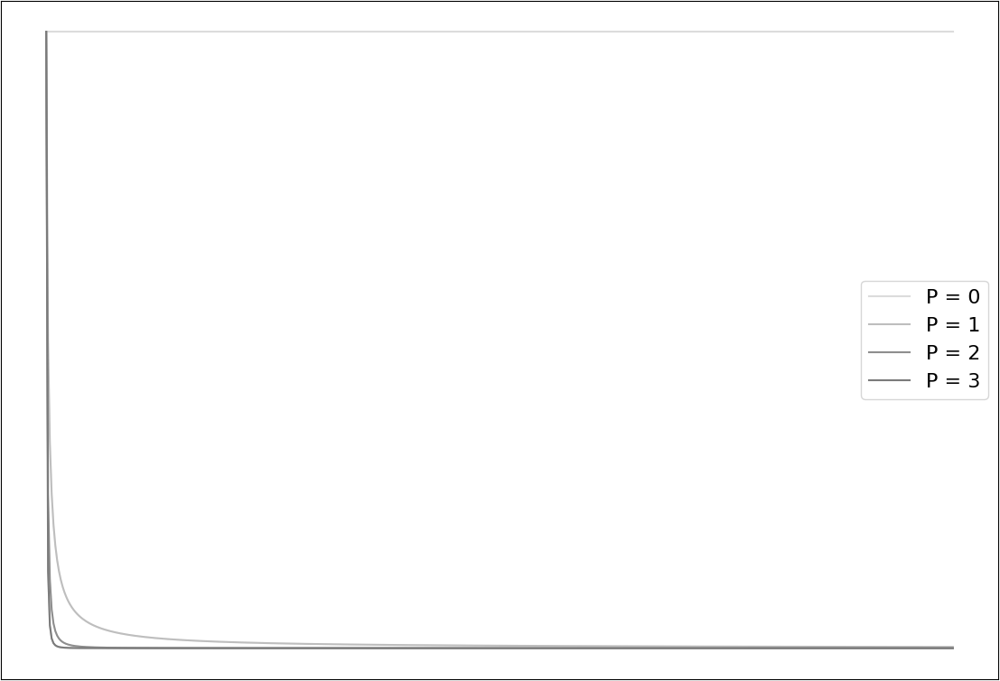

**Fonte:** De autoria própria (2023).

$$W = \frac{1}{D^P} = \frac{1}{D^2} \tag{3.34}$$

onde: *W* é o peso do ponto amostral, (adimensional); *D* é a distância entre os dois pontos, (adimensional); *P* é a potência elevada da distância, (adimensional).

### 3.8.3 A Média ponderada das precipitações

Obtendo o peso do ponto amostral para cada uma das distâncias mais próximas ao ponto que se quer interpolar a precipitação, basta fazer a média ponderada das precipitações (3.35) usando seus respectivos pesos encontrados na fórmula (3.34).

$$P(x_i ; y_i) = \frac{\sum{\left(P(x_j ; y_j) * W_j\right)}}{\sum{W_j}} \tag{3.35}$$

onde: $P(x_i ; y_i)$ é a precipitação a ser descoberta, (mm)); $P(x_j ; y_j)$ é a precipitação já existente, (mm)); $W_j$ é o peso do ponto amostral das precipitações existentes, (adimensional).

# 4 PROCEDIMENTOS METODOLÓGICOS

Nesse item serão apresentados aspectos metodológicos referentes a presente pesquisa.

## 4.1 TIPO DE PESQUISA

O método de pesquisa utilizado no presente trabalho é de caráter prático. Ela é descrita por Marconi e Lakatos (2017) como a busca por solução de problemas que ocorrem na realidade a partir da aplicação prática de resultados, que obviamente são gerados através de um conhecimento prévio. Através do fluxograma que se segue na Figura 4.1, é possível entender o processo utilizado para a realização da pesquisa.

**Figura 4.1** – Fluxograma da pesquisa.

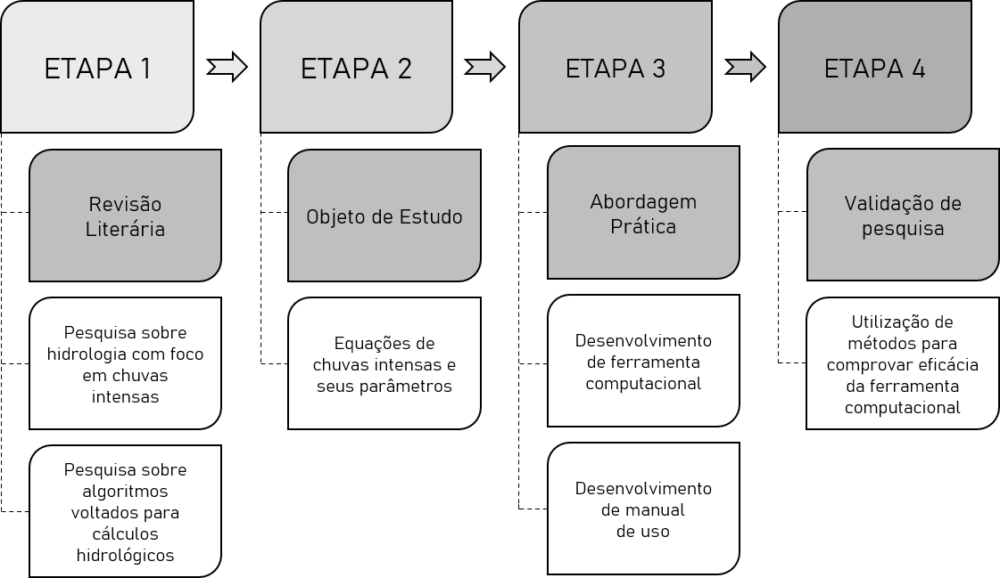

**Fonte:** De autoria própria (2023).

## 4.2 MÉTODOS

Para alcançar boas soluções na determinação da equação de chuvas intensas e seus parâmetros, de acordo os dados de precipitação utilizados, foi desenvolvida uma ferramenta computacional que cumpre essa finalidade.

### 4.2.1 A interface

O desenvolvimento iniciou-se com a elaboração de uma interface gráfica que permite a interação do usuário com a máquina, de forma que ele preencha a ferramenta computacional com todos os dados que se necessitam para a elaboração da equação, através do cálculo de seus parâmetros. É importante ter em mente, que durante o desenvolvimento da interface, priorizou-se a simplificação das funções de interação da ferramenta, visando torna-la intuitiva e de fácil compreensão, possibilitando um rápido aprendizado de uso.

A interface gráfica foi criada através da linguagem de programação Python, explicada no referencial teórico. Para o seu desenvolvimento, foi utilizado o Tkinter, que é uma biblioteca nativa do próprio Python. Ele permite a criação de telas, botões, tabelas, além de outras ferramentas. Através delas é possível a interação do usuário, pois todas as suas solicitações passam primeiramente por elas.

### 4.2.2 Os algoritmos de armazenamento e tratamento de dados

O cálculo da ferramenta computacional foi desenvolvido em duas direções, uma delas através de dados fornecidos pelo calculista, nomeada de independente para um melhor entendimento. A outra a direção segue a partir de um banco de dados prévio, sendo chamada de dependente. Fica claro então que para que ocorram os cálculos, são necessários dados.

Sabendo disso, de início foi programado um banco de dados com informações de precipitações diárias de postos pluviométricos que se estendem por todo o território da Paraíba. Sua escolha deu-se devido à precisão e vastidão das informações, disponibilizadas pela Agência Executiva de Gestão das Águas do Estado da Paraíba (AESA), com séries históricas que variam entre os anos de 1994 e 2022.

Para esses dados, foram desenvolvidos um mapa interativo da Paraíba na interface gráfica, que tem seu território traçado a partir de sua latitude e longitude, e um algoritmo de interpolação de dados. Nesse mapa, ao selecionar uma determinada coordenada, é feito uma interpolação das precipitações diárias pelo método IDW, a partir dos cinco postos pluviométricos mais próximos que possuem a mesma quantidade de anos iguais. Assim, a coordenada selecionada passa a ter uma nova série histórica teórica interpolada de precipitações diárias.

Também foi elaborado uma lista dos postos pluviométricos fornecidos pela AESA. Isso para que seja possível calcular as equações IDF desses locais. Entende-se então, que é possível replicar isso para outras regiões do globo, desde que se tenha seus dados.

Outra parte importante da ferramenta, está no algoritmo que permite a conversão de séries de precipitações diárias de vários anos, em séries de precipitações máximas diárias anuais. Ele auxiliará no tratamento dos dados interpolados do mapa paraibano, dos postos pluviométricos da Paraíba, e dos dados informados pelo usuário, de séries de precipitação de chuvas diárias de vários anos, para preenchimento de falhas.

No que tange lidar com os dados faltantes, foi programado um limiar de falhas, no qual caso um determinado ano tenha dias sem informações que ultrapassem esse limite, ele será desconsiderado. Estando dentro do limiar, os dados falhos das precipitações diárias serão ignorados.

### 4.2.3 Os algoritmos de cálculo

Tratando dos cálculos, o algoritmo que verifica se há tendência nas séries de precipitações máximas diárias anuais foi programado a partir das bibliotecas NumPy e pyMannKendall, estando a segunda delas disponível no PyPi, que é um repositório oficial de bibliotecas de terceiros do Python.

Os algoritmos de distribuições de probabilidade, testes de aderência e métodos de otimização tiveram como bibliotecas em seus desenvolvimentos o SciPy e o NumPy, com exceção da distribuição de Gumbel e do método dos mínimos quadrados que se utilizaram apenas da segunda citada. Os algoritmos de análise de precisão dos parâmetros da equação IDF foram desenvolvidos utilizando a biblioteca NumPy. Já o algoritmo de desagregação das chuvas não necessitou de nenhuma biblioteca específica além do ambiente padrão de desenvolvimento do Python.

A integração desses algoritmos possibilita a escolha por parte do usuário, dos tempos de retorno, durações, distribuição de frequência, teste de aderência e método de otimização, para o cálculo dos parâmetros da equação das chuvas intensas. Também é possível ajustar os intervalos ou números de partida dos métodos de otimização, para torna-los ainda mais precisos, além das funções que possibilitam a escolha dos melhores ajustes, no qual a ferramenta calcula todas as combinações possíveis para determinar a equação IDF mais precisa.

Deu-se então a implementação de todos esses códigos na interface gráfica, permitindo ao usuário chegar aos parâmetros da equação IDF de três formas, duas delas se direcionando de maneira dependente, e uma independente. Quando o usuário decide pela interpolação das coordenadas do mapa da Paraíba, ou pela escolha de algum posto pluviométrico da lista que permeia o território paraibano, o direcionamento é dependente. Já quando o usuário fornece sua própria série histórica de precipitações diárias, a direção é independente.

### 4.2.4 Os arquivos de instalação e guias de uso da ferramenta computacional

Foi escrito um manual de uso prático da ferramenta. Contudo, dentro desta, também foram criados guias básicos de ajuda, além de como acessar seu repositório de códigos e o referencial teórico que guiou sua criação. Após finalizar toda sua programação, foi desenvolvido um arquivo executável com a biblioteca PyInstaller e um instalador com o programa Inno Setup, com a finalidade de facilitar o acesso à ferramenta para as pessoas que possuem menos familiaridade com linguagens de programação, em específico o Python.

### 4.2.5 O código fonte da ferramenta computacional

Para que haja a possibilidade de estudos posteriores, adaptações, correções, e até mesmo melhoramentos e evoluções, todo o código fonte da ferramenta computacional foi disponibilizado no GitHub. A intenção é fomentar o desenvolvimento científico e facilitar a compreensão de tudo que foi elaborado.

# 5 RESULTADOS E DISCUSSÃO

Neste item serão apresentados os resultados obtidos do presente trabalho.

## 5.1 FERRAMENTA COMPUTACIONAL INTENSIO

As páginas da interface gráfica ficaram divididas entre as abas iniciais, e a barra de ferramentas.

### 5.1.1 As abas da ferramenta

A interface gráfica ficou dividida em três abas. A primeira e principal delas têm o nome de **Equações do Mapa** e mostra o mapa interativo da Paraíba, que como explicado anteriormente, permite o cálculo da equação IDF através da escolha de uma coordenada ao clicar no mapa, por meio de interpolação. Também é possível apenas escolher uma das cidades paraibanas contida na lista. Tudo isso pode ser visto na Figura 5.1.

**Figura 5.1** – Aba "Equações do Mapa".

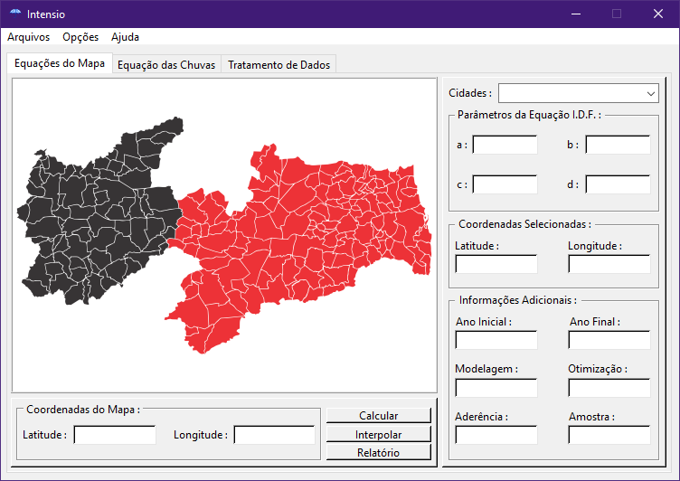

**Fonte:** De autoria própria (2023).

A segunda aba é chamada de **Equação das Chuvas** e envolve os cálculos da equação IDF com base nos dados de séries temporais inseridos pelo usuário. Nela também é possível configurar as durações, tempos de retorno e métodos usados tanto nos cálculos citados anteriormente, como nos da primeira aba que utilizam as precipitações do banco de dados. Ou seja, suas configurações afetam toda a ferramenta e podem ser vistas na Figura 5.2.

**Figura 5.2** – Aba "Equação das Chuvas".

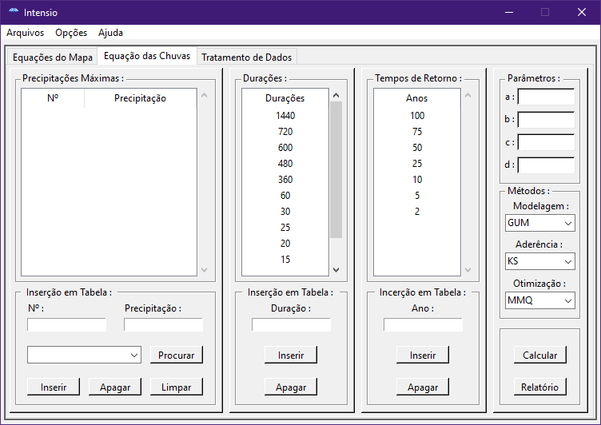

**Fonte:** De autoria própria (2023).

Observa-se a terceira e última aba na Figura 5.3, chamada de **Tratamento de Dados**, ela envolve o tratamento de séries históricas de precipitações diárias, resultando nas máximas diárias anuais, que podem ser exportadas para o cálculo da equação IDF na segunda aba.

**Figura 5.3** – Aba "Tratamento de Dados".

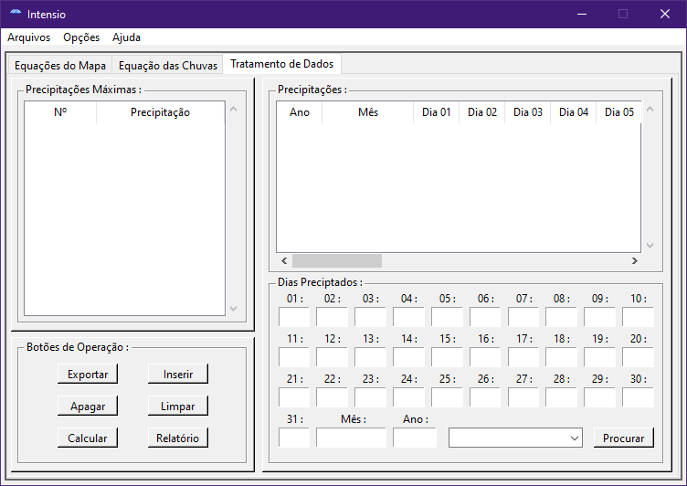

**Fonte:** De autoria própria (2023).

### 5.1.2 A barra de ferramentas

A primeira ferramenta da barra é chamada **Arquivos**, e nela há a possibilidade de reiniciar ou apenas sair do programa. Já em **Opções** é possível acessar o **Banco de Dados**, **Configurações** e **Varreduras**.

O item **Banco de Dados** contém as informações de precipitações diárias das cidades da Paraíba, que são usados no desenvolvimento do método de preenchimento de falhas por interpolação IDW nos cálculos do mapa paraibano e da lista de cidades. Também é possível exportar os dados da cidade escolhida para a aba de tratamento de dados ou salva-los na própria máquina do usuário, no formato de texto ou *Comma-Separated-Values* (CSV).

**Figura 5.4** – Banco de dados da ferramenta Opções.

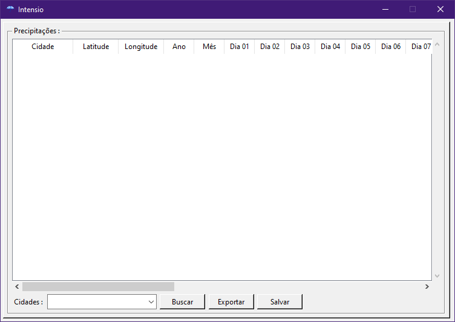

**Fonte:** De autoria própria (2023).

Já o item **Configurações** possibilita ao usuário definir manualmente algumas informações que são usadas nos cálculos. Seguindo pela ordem, é possível escolher entre coeficientes próprios de desagregação ou os estabelecidos pela DAEE/CETESB (1980), e a porcentagem de aderência usada no cálculo da equação IDF.

Também é possível decidir a quantidade de dias que representará o limiar de falhas usado na terceira aba, as otimizações de modelagem, aderência e otimização que caso ativados buscarão sempre os métodos que resultam em mais precisão nos parâmetros da equação IDF gerada. Por fim há a possibilidade de selecionar a quantidade de iteração que o algoritmo fará durante o uso dos métodos de otimização no cálculo dos parâmetros da equação. É importante salientar que o mau uso dessas ferramentas pode exigir altos níveis de processamento da máquina devido a quantidade de iterações. Observa-se na Figura 5.5 a página de configurações.

**Figura 5.5** – Configurações da ferramenta Opções.

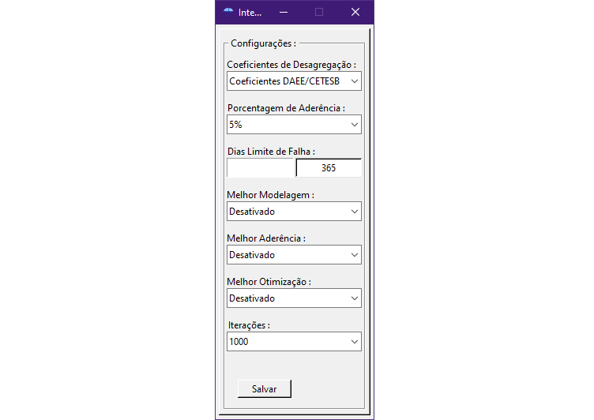

**Fonte:** De autoria própria (2023).

O item **Varreduras** pode ser vista na Figura 5.6. Ela permite ao usuário alterar os números de partida ou intervalos dos métodos de otimização. Bons ajustes manuais dos mesmos pode resultar em uma melhora na precisão das equações geradas, em contrapartida o mau uso pode diminuir as porcentagens de acurácia ou até mesmo inviabilizar o cálculo.

**Figura 5.6** – Varreduras da ferramenta Opções.

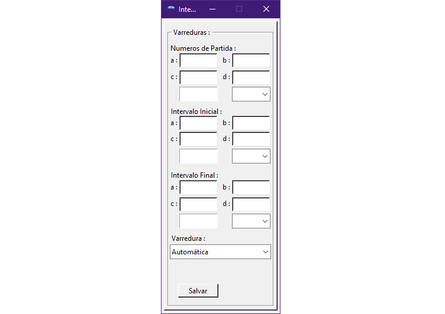

**Fonte:** De autoria própria (2023).

A última ferramenta é a de **Ajuda**, e nela tem-se os itens para auxílio do usuário. Em **Estudo** aborda-se o presente trabalho como visto na Figura 5.7.

**Figura 5.7** – Estudo da ferramenta Ajuda.

**Fonte:** De autoria própria (2023).

Já o item **Ferramenta** explica como funciona a inserção de dados e os cálculos computacionais, observado na Figura 5.8.

**Figura 5.8** – Ferramenta da ferramenta Ajuda.

**Fonte:** De autoria própria (2023).

O item **Manual** abre um arquivo no formato *Portable Document Format* (PDF) fora da ferramenta, que contém um manual de uso prático da ferramenta, como na Figura 5.9.

**Figura 5.9** – Manual da ferramenta Ajuda.

**Fonte:** De autoria própria (2023).

Por último, a ferramenta **Ajuda** possui o item **Siglas** que trata das abreviaturas utilizadas, visível na Figura 5.10.

**Figura 5.10** – Siglas da ferramenta Ajuda.

**Fonte:** De autoria própria (2023).

## 5.2 VALIDAÇÃO DAS EQUAÇÕES GERADAS

A validação das equações trata-se da análise da acurácia destas após geradas. Sempre que o usuário submeter dados, escolher uma coordenada do mapa ou cidade da lista e calcular os parâmetros da equação IDF, será gerado um relatório que pode ser acionado ao clicar no botão de mesmo nome, e visto tanto na Figura 5.1 como na Figura 5.2. Neles, estão contidos os testes de NS e RMSE, que informam quão precisos estão os parâmetros em relação às curvas IDF qual eles foram calculados.

É importante notar que cada equação será analisada individualmente, cabendo ao calculista decidir de acordo com os testes feitos, se ele está satisfeito com a precisão dos parâmetros gerados. Outra observação importante a se fazer é a de que, os testes de acurácia analisam apenas se os parâmetros calculados estão precisos em relação aos dados observados, logo, cabe ao usuário discernir se as séries históricas que ele está informando representam bem a realidade.

É possível salvar o relatório gerado em um arquivo de texto, que informa a representação da equação IDF, um resumo de todo o processo de cálculo feito junto de todas as variáveis calculadas e uma tabela com intensidades calculadas a partir da equação gerada, utilizando as durações e tempos de retorno informados no início do cálculo. Visualiza-se a página do relatório na Figura 5.11.

**Figura 5.11** – Relatório dos parâmetros da equação IDF.

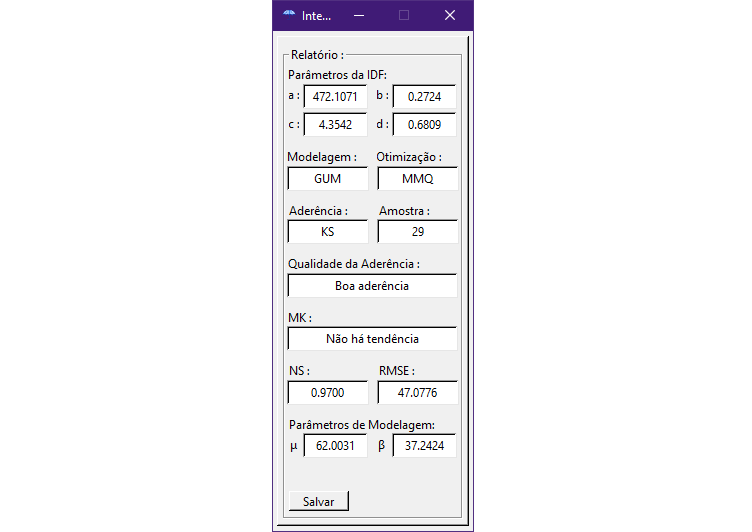

**Fonte:** De autoria própria (2023).

Existe também um relatório para o tratamento de dados que é acionado pelo botão de nome similar visto na Figura 5.3. Nele consegue-se analisar a quantidade de dias totais e faltantes, além da porcentagem de erros geral obtido, e anual permitido de acordo com o limiar de falhas informado. Também é possível salvar esse relatório em um arquivo de texto que contém as informações do tratamento de dados e uma tabela com as precipitações máximas diárias anuais geradas, e os dias faltantes de cada ano. Observa-se a página do relatório na Figura 5.12.

**Figura 5.12** – Relatório de falhas do tratamento de dados.

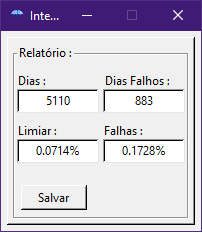

**Fonte:** De autoria própria (2023).

## 5.3 DISPONIBILIZAÇÃO DA FERRAMENTA

Como resultado final, foi disponibilizado por Nóbrega (2023) o acesso ao repositório do código fonte no GitHub, com todos os algoritmos criados no desenvolvimento da ferramenta. Nóbrega (2023) também disponibilizou o caminho para transferência do manual de uso prático da ferramenta no formato PDF, e do instalador da ferramenta computacional, de forma a facilitar o seu acesso.

## 5.4 EQUAÇÕES GERADAS ATRAVÉS DA FERRAMENTA

Como foi explicado anteriormente, a ferramenta possui dados de precipitação que compreendem todo o estado da Paraíba, que podem servir como modelo para posteriores inserções de dados de outras regiões. E para comprovar o pleno funcionamento da ferramenta, foram geradas equações para todas as cidades presentes no banco de dados.

Foi utilizado o método de otimização NM, e o teste de aderência de KS para um nível de significância de cinco por cento, otimizando apenas as distribuições probabilísticas. Foram geradas com sucesso um total de equações para 226 cidades, de um total de 242, vistas na Tabela 5.1.

**Tabela 5.1** – Equações IDF da Paraíba geradas através de ferramenta Intensio

(Continua)

|         **Cidade**         | **Am.** |   **a**   | **b**  | **c**  | **d**  | **NS** | **RMSE** | **Md.** |
|:--------------------------:|:-------:|:---------:|:------:|:------:|:------:|:------:|:--------:|:-------:|
|        Agua Branca         |   29    | 703,8389  | 0,1648 | 9,7910 | 0,7244 | 0,9980 |  8,8084  |   NOG   |
|           Aguiar           |   29    | 840,3493  | 0,1488 | 9,7910 | 0,7244 | 0,9994 |  5,4523  |   NOG   |
|       Alagoa Grande        |   29    | 566,1002  | 0,2063 | 9,7910 | 0,7244 | 0,9991 |  5,4753  |   GVE   |
|        Alagoa Nova         |   29    | 663,6596  | 0,1825 | 9,7910 | 0,7244 | 0,9976 |  9,6962  |   LOG   |
|         Alagoinha          |   29    | 592,6732  | 0,2387 | 9,7910 | 0,7244 | 0,9991 |  6,6931  |   GVE   |
|          Alcantil          |   23    | 504,2508  | 0,2199 | 9,7910 | 0,7244 | 0,9967 | 10,0432  |   LN2   |
|    Algodão de Jandaíra     |   29    | 499,3560  | 0,1772 | 9,7910 | 0,7244 | 0,9973 |  7,6612  |   LOG   |
|          Alhandra          |   29    | 956,9647  | 0,1718 | 9,7910 | 0,7244 | 0,9980 | 12,3251  |   LOG   |
|           Amparo           |   25    | 816,4717  | 0,1923 | 9,7910 | 0,7244 | 0,9969 | 14,2015  |   LOG   |
|          Araçagi           |   29    | 661,5735  | 0,1589 | 9,7910 | 0,7244 | 0,9984 |  7,1774  |   NOG   |
|           Arara            |   27    | 452,5077  | 0,2509 | 9,7910 | 0,7244 | 0,9989 |  5,7949  |   GVE   |
|          Araruna           |   29    | 631,8274  | 0,1833 | 9,7910 | 0,7244 | 0,9977 |  9,1662  |   NOG   |
|           Areia            |   29    | 725,5098  | 0,1723 | 9,7910 | 0,7244 | 0,9980 |  9,3919  |   LOG   |
|     Areia de Baraúnas      |   13    | 630,2953  | 0,2054 | 9,7910 | 0,7244 | 0,9984 |  8,2205  |   PT3   |
|           Areial           |   29    | 474,7496  | 0,1860 | 9,7910 | 0,7244 | 0,9981 |  6,2811  |   GVE   |
|          Aroeiras          |   29    | 473,3835  | 0,2400 | 9,7910 | 0,7244 | 0,9973 |  9,2688  |   GVE   |
|          Assunção          |   18    | 698,5792  | 0,1658 | 9,7910 | 0,7244 | 0,9980 |  8,8233  |   LOG   |
|      Baía da Traição       |   28    | 856,8386  | 0,2563 | 9,7910 | 0,7244 | 0,9997 |  6,1284  |   GVE   |
|         Bananeiras         |   29    | 680,1219  | 0,1704 | 9,7910 | 0,7244 | 0,9980 |  8,6129  |   LOG   |
|          Baraúna           |   17    | 546,7797  | 0,2192 | 9,7910 | 0,7244 | 0,9969 | 10,5098  |   GVE   |
|    Barra de Santa Rosa     |   29    | 471,2786  | 0,2675 | 9,7910 | 0,7244 | 0,9963 | 12,1375  |   GVE   |
|      Barra de Santana      |   27    | 445,1012  | 0,2311 | 9,7910 | 0,7244 | 0,9988 |  5,5923  |   NOG   |
|    Barra de São Miguel     |   29    | 607,0755  | 0,1917 | 9,7910 | 0,7244 | 0,9973 |  9,8449  |   NOG   |
|           Bayeux           |   27    | 987,0451  | 0,1722 | 9,7910 | 0,7244 | 0,9978 | 13,4115  |   LOG   |
|           Belém            |   29    | 657,9642  | 0,2119 | 9,7910 | 0,7244 | 0,9970 | 12,1619  |   GVE   |
|   Belém do Brejo do Cruz   |   29    | 672,7598  | 0,2550 | 9,7910 | 0,7244 | 0,9985 | 10,4801  |   GVE   |
|     Bernardino Batista     |   19    | 620,3196  | 0,2526 | 9,7910 | 0,7244 | 0,9997 |  3,9738  |   GVE   |
|        Boa Ventura         |   29    | 895,9545  | 0,1747 | 9,7910 | 0,7244 | 0,9979 | 11,9447  |   LOG   |
|         Boa Vista          |   29    | 484,3072  | 0,2989 | 9,7910 | 0,7244 | 0,9958 | 15,1673  |   LN2   |
|         Bom Jesus          |   28    | 828,9001  | 0,1604 | 9,7910 | 0,7244 | 0,9984 |  9,0966  |   NOG   |
|        Bom Sucesso         |   29    | 712,0361  | 0,1580 | 9,7910 | 0,7244 | 0,9984 |  7,7784  |   LOG   |
| Boqueirão/ Açude Boqueirão |   29    | 489,3461  | 0,2922 | 9,7910 | 0,7244 | 0,9969 | 12,7641  |   GVE   |
|         Borborema          |   27    | 686,2451  | 0,1794 | 9,7910 | 0,7244 | 0,9976 |  9,8761  |   LOG   |
|       Brejo do Cruz        |   29    | 779,4120  | 0,1945 | 9,7910 | 0,7244 | 0,9971 | 13,0705  |   LOG   |
|      Brejo dos Santos      |   29    | 735,2317  | 0,1669 | 9,7910 | 0,7244 | 0,9981 |  8,9273  |   LOG   |
|         Cabaceiras         |   29    | 478,3793  | 0,3120 | 9,7910 | 0,7244 | 0,9985 |  9,4610  |   NOG   |
|          Cabedelo          |   20    | 1041,7680 | 0,1636 | 9,7910 | 0,7244 | 0,9971 | 15,6854  |   LOG   |
|    Cachoeira dos Índios    |   28    | 766,6130  | 0,1314 | 9,7910 | 0,7244 | 0,9984 |  7,6301  |   LOG   |
|      Cacimba de Areia      |   29    | 775,8838  | 0,1955 | 9,7910 | 0,7244 | 0,9988 |  8,4599  |   NOG   |
|     Cacimba de Dentro      |   29    | 569,2094  | 0,1954 | 9,7910 | 0,7244 | 0,9974 |  9,0670  |   GVE   |
|          Cacimbas          |   19    | 855,6570  | 0,1751 | 9,7910 | 0,7244 | 0,9969 | 13,8633  |   LOG   |
|          Caiçara           |   29    | 547,5272  | 0,2155 | 9,7910 | 0,7244 | 0,9982 |  7,9850  |   GVE   |
|         Cajazeiras         |   29    | 790,2086  | 0,1861 | 9,7910 | 0,7244 | 0,9992 |  6,8471  |   NOG   |

**Tabela 5.1** - Equações IDF da Paraíba geradas através de ferramenta Intensio

(Continua)

|              **Cidade**               | **Am.** |  **a**   | **b**  | **c**  | **d**  | **NS** | **RMSE** | **Md.** |
|:-------------------------------------:|:-------:|:--------:|:------:|:------:|:------:|:------:|:--------:|:-------:|
|  Cajazeiras/Açude Engenheiro Avidos   |   29    | 825,6586 | 0,1655 | 9,7910 | 0,7244 | 0,9981 | 10,1543  |   LOG   |
|             Cajazeirinhas             |   23    | 655,7415 | 0,2815 | 9,7910 | 0,7244 | 0,9997 |  5,4178  |   NOG   |
|            Caldas Brandão             |   29    | 715,1540 | 0,1455 | 9,7910 | 0,7244 | 0,9983 |  7,5943  |   LOG   |
|                Camalaú                |   29    | 620,1916 | 0,2377 | 9,7910 | 0,7244 | 0,9988 |  8,0736  |   GVE   |
|        Campina Grande/ EMBRAPA        |   29    | 526,6675 | 0,1845 | 9,7910 | 0,7244 | 0,9975 |  7,8777  |   LOG   |
|         Campina Grande/ INSA          |   16    | 578,3930 | 0,1928 | 9,7910 | 0,7244 | 0,9965 | 10,7373  |   NOG   |
|   Campina Grande/ São José da Mata    |   29    | 477,9186 | 0,1887 | 9,7910 | 0,7244 | 0,9984 |  5,8855  |   NOG   |
| Campina Grande/ Sítio Açude de Dentro |   29    | 462,0710 | 0,2822 | 9,7910 | 0,7244 | 0,9995 |  4,7927  |   NOG   |
|       Campo de Santana/ Tacima        |   28    | 631,4019 | 0,2302 | 9,7910 | 0,7244 | 0,9966 | 13,4106  |   LN2   |
|                 Capim                 |   19    | 793,4762 | 0,1706 | 9,7910 | 0,7244 | 0,9975 | 11,3880  |   LOG   |
|               Caraúbas                |   29    | 530,8617 | 0,2294 | 9,7910 | 0,7244 | 0,9978 |  8,9885  |   NOG   |
|             Carrapateira              |   28    | 947,9802 | 0,1706 | 9,7910 | 0,7244 | 0,9974 | 13,7050  |   LOG   |
|      Casserengue/ Sítio Salgado       |   29    | 440,3983 | 0,1730 | 9,7910 | 0,7244 | 0,9978 |  5,9240  |   NOG   |
|              Catingueira              |   29    | 820,9140 | 0,1481 | 9,7910 | 0,7244 | 0,9980 |  9,5153  |   NOG   |
|            Catolé do Rocha            |   29    | 674,1147 | 0,2095 | 9,7910 | 0,7244 | 0,9990 |  7,1145  |   GVE   |
|    Catolé do Rocha/ Escola Técnica    |   29    | 744,9367 | 0,1482 | 9,7910 | 0,7244 | 0,9980 |  8,7413  |   LOG   |
|               Caturité                |   19    | 475,7168 | 0,2445 | 9,7910 | 0,7244 | 0,9964 | 11,0229  |   LN2   |
|    Caturité/Fazenda Campo de Emas     |   21    | 591,4445 | 0,3057 | 9,7910 | 0,7244 | 0,9957 | 19,1822  |   LN2   |
|               Conceição               |   29    | 739,5461 | 0,1366 | 9,7910 | 0,7244 | 0,9985 |  7,2430  |   LOG   |
|                Condado                |   29    | 748,9526 | 0,2358 | 9,7910 | 0,7244 | 0,9987 | 10,1404  |   GVE   |
|                 Conde                 |   22    | 993,2376 | 0,1672 | 9,7910 | 0,7244 | 0,9977 | 13,3432  |   LOG   |
|      Conde/Açude Gramame Mamuaba      |   28    | 901,5979 | 0,1571 | 9,7910 | 0,7244 | 0,9997 |  4,4141  |   NOG   |
|                 Congo                 |   29    | 681,8482 | 0,1807 | 9,7910 | 0,7244 | 0,9983 |  8,2533  |   NOG   |
|        Coremas/ Açude Coremas         |   29    | 901,9537 | 0,1389 | 9,7910 | 0,7244 | 0,9985 |  8,7597  |   NOG   |
|               Coxixola                |   29    | 774,2229 | 0,2616 | 9,7910 | 0,7244 | 0,9962 | 19,8017  |   LN2   |
|                Cubati                 |   27    | 512,7133 | 0,2726 | 9,7910 | 0,7244 | 0,9960 | 13,9494  |   LN2   |
|                 Cuité                 |   29    | 624,0487 | 0,2149 | 9,7910 | 0,7244 | 0,9992 |  6,0603  |   NOG   |
|          Cuité de Mamanguape          |   18    | 684,6720 | 0,2070 | 9,7910 | 0,7244 | 0,9966 | 13,1951  |   GUM   |
|                Cuitegi                |   22    | 649,3738 | 0,1590 | 9,7910 | 0,7244 | 0,9969 |  9,8508  |   LOG   |
|            Curral de Cima             |   18    | 725,6193 | 0,1773 | 9,7910 | 0,7244 | 0,9977 | 10,2991  |   LOG   |
|             Curral Velho              |   28    | 741,2223 | 0,1662 | 9,7910 | 0,7244 | 0,9998 |  3,2738  |   NOG   |
|                Damião                 |   23    | 420,0738 | 0,3036 | 9,7910 | 0,7244 | 0,9985 |  7,9805  |   GVE   |
|               Desterro                |   29    | 743,9167 | 0,2677 | 9,7910 | 0,7244 | 0,9985 | 12,0680  |   GVE   |
|               Diamante                |   28    | 795,4016 | 0,1625 | 9,7910 | 0,7244 | 0,9978 | 10,2250  |   LOG   |

**Tabela 5.1** - Equações IDF da Paraíba geradas através de ferramenta Intensio

(Continua)

|         **Cidade**         | **Am.** |   **a**   | **b**  | **c**  | **d**  | **NS** | **RMSE** | **Md.** |
|:--------------------------:|:-------:|:---------:|:------:|:------:|:------:|:------:|:--------:|:-------:|
|         Dona Inês          |   29    | 559,9324  | 0,2021 | 9,7910 | 0,7244 | 0,9985 |  7,1063  |   GVE   |
|       Duas Estradas        |   27    | 666,7060  | 0,1511 | 9,7910 | 0,7244 | 0,9986 |  6,6822  |   LOG   |
|            Emas            |   29    | 764,3276  | 0,1843 | 9,7910 | 0,7244 | 0,9975 | 11,4090  |   LOG   |
|         Esperança          |   28    | 556,2148  | 0,1836 | 9,7910 | 0,7244 | 0,9972 |  8,7953  |   LOG   |
|   Esperança/ São Miguel    |   27    | 465,4854  | 0,2561 | 9,7910 | 0,7244 | 0,9994 |  4,4333  |   GVE   |
|          Fagundes          |   29    | 586,3965  | 0,2842 | 9,7910 | 0,7244 | 0,9984 | 10,5983  |   GVE   |
|       Frei Martinho        |   27    | 557,2249  | 0,3148 | 9,7910 | 0,7244 | 0,9957 | 18,9249  |   LN2   |
|         Gado Bravo         |   19    | 537,3323  | 0,1663 | 9,7910 | 0,7244 | 0,9985 |  5,8451  |   NOG   |
|         Guarabira          |   29    | 691,6546  | 0,1825 | 9,7910 | 0,7244 | 0,9976 | 10,1027  |   LOG   |
|          Gurinhém          |   28    | 622,0467  | 0,1848 | 9,7910 | 0,7244 | 0,9975 |  9,3545  |   LOG   |
|           Gurjão           |   29    | 660,8858  | 0,2597 | 9,7910 | 0,7244 | 0,9962 | 16,7205  |   LN2   |
|           Ibiara           |   29    | 810,4714  | 0,1772 | 9,7910 | 0,7244 | 0,9973 | 12,4068  |   LOG   |
|          Igaracy           |   29    | 948,3099  | 0,1441 | 9,7910 | 0,7244 | 0,9985 |  9,5272  |   LOG   |
|         Imaculada          |   29    | 754,1749  | 0,1913 | 9,7910 | 0,7244 | 0,9970 | 12,7834  |   LOG   |
|            Ingá            |   29    | 425,3386  | 0,3311 | 9,7910 | 0,7244 | 0,9998 |  3,3805  |   GVE   |
|         Itaporanga         |   29    | 930,5906  | 0,1780 | 9,7910 | 0,7244 | 0,9990 |  8,8434  |   NOG   |
| Itaporanga/ Fazenda Veludo |   19    | 852,4966  | 0,2223 | 9,7910 | 0,7244 | 0,9967 | 17,2360  |   LN2   |
|        Itapororoca         |   28    | 764,1475  | 0,1349 | 9,7910 | 0,7244 | 0,9983 |  7,9604  |   NOG   |
|          Itatuba           |   28    | 507,5285  | 0,2293 | 9,7910 | 0,7244 | 0,9988 |  6,3528  |   NOG   |
|          Jacaraú           |   29    | 726,4185  | 0,1598 | 9,7910 | 0,7244 | 0,9993 |  5,1655  |   NOG   |
|           Jericó           |   29    | 686,7858  | 0,1512 | 9,7910 | 0,7244 | 0,9996 |  3,5521  |   NOG   |
|    João Pessoa/ CEDRES     |   17    | 1076,5964 | 0,1174 | 9,7910 | 0,7244 | 0,9985 |  9,7191  |   LOG   |
|    João Pessoa/ DFAARA     |   29    | 1267,3979 | 0,1228 | 9,7910 | 0,7244 | 0,9980 | 13,4584  |   LOG   |
|  João Pessoa/ Mangabeira   |   27    | 1154,5927 | 0,1454 | 9,7910 | 0,7244 | 0,9980 | 13,4466  |   LOG   |
|     João Pessoa/Mares      |   27    | 905,2674  | 0,1967 | 9,7910 | 0,7244 | 0,9985 | 11,0486  |   GVE   |
|  Joca Claudino/ Santarém   |   19    | 694,7098  | 0,1626 | 9,7910 | 0,7244 | 0,9982 |  8,2496  |   LOG   |
|       Juarez Távora        |   29    | 605,4752  | 0,1825 | 9,7910 | 0,7244 | 0,9976 |  8,9674  |   LOG   |
|        Juazeirinho         |   29    | 649,7521  | 0,1896 | 9,7910 | 0,7244 | 0,9971 | 10,7725  |   LOG   |
|      Junco do Seridó       |   29    | 692,0006  | 0,1725 | 9,7910 | 0,7244 | 0,9976 |  9,8063  |   LOG   |
|        Juripiranga         |   27    | 698,5518  | 0,2141 | 9,7910 | 0,7244 | 0,9994 |  5,6581  |   NOG   |
|            Juru            |   29    | 687,2482  | 0,1587 | 9,7910 | 0,7244 | 0,9984 |  7,5645  |   LOG   |
|           Lagoa            |   29    | 746,0658  | 0,1320 | 9,7910 | 0,7244 | 0,9986 |  6,9662  |   LOG   |
|      Lagoa de Dentro       |   28    | 616,7919  | 0,1869 | 9,7910 | 0,7244 | 0,9992 |  5,2577  |   GVE   |
|         Lagoa Seca         |   28    | 625,3672  | 0,1653 | 9,7910 | 0,7244 | 0,9996 |  3,4406  |   NOG   |
|           Lastro           |   28    | 642,9770  | 0,1923 | 9,7910 | 0,7244 | 0,9997 |  3,4302  |   NOG   |
|         Livramento         |   29    | 750,6357  | 0,2096 | 9,7910 | 0,7244 | 0,9969 | 13,9866  |   LN2   |
|         Logradouro         |   13    | 604,0265  | 0,1814 | 9,7910 | 0,7244 | 0,9983 |  7,4379  |   NOG   |
|           Lucena           |   21    | 1056,1091 | 0,1562 | 9,7910 | 0,7244 | 0,9967 | 16,4472  |   LOG   |
|         Mãe D‘Água         |   29    | 750,7769  | 0,1418 | 9,7910 | 0,7244 | 0,9987 |  6,8478  |   NOG   |
|          Manaíra           |   29    | 736,3101  | 0,1858 | 9,7910 | 0,7244 | 0,9979 | 10,2482  |   GVE   |
|            Mari            |   27    | 749,8562  | 0,1482 | 9,7910 | 0,7244 | 0,9983 |  8,1166  |   LOG   |

**Tabela 5.1** - Equações IDF da Paraíba geradas através de ferramenta Intensio

(Continua)

|      **Cidade**       | **Am.** |   **a**   | **b**  | **c**  | **d**  | **NS** | **RMSE** | **Md.** |
|:---------------------:|:-------:|:---------:|:------:|:------:|:------:|:------:|:--------:|:-------:|
|      Marizópolis      |   22    | 778,8124  | 0,1621 | 9,7910 | 0,7244 | 0,9983 |  8,9234  |   LOG   |
|     Massaranduba      |   28    | 553,3452  | 0,1211 | 9,7910 | 0,7244 | 0,9982 |  5,5368  |   LOG   |
|       Mataraca        |   27    | 962,9347  | 0,1447 | 9,7910 | 0,7244 | 0,9995 |  5,5926  |   NOG   |
|       Matinhas        |   23    | 531,7745  | 0,2557 | 9,7910 | 0,7244 | 0,9992 |  6,1868  |   GVE   |
|      Mato Grosso      |   19    | 731,6473  | 0,1585 | 9,7910 | 0,7244 | 0,9988 |  7,0016  |   PT3   |
|       Maturéia        |   12    | 838,9614  | 0,2343 | 9,7910 | 0,7244 | 0,9965 | 18,2834  |   LN2   |
|        Mogeiro        |   29    | 500,1811  | 0,1577 | 9,7910 | 0,7244 | 0,9990 |  4,2242  |   NOG   |
|       Montadas        |   26    | 532,1725  | 0,1233 | 9,7910 | 0,7244 | 0,9978 |  6,0337  |   LOG   |
|     Monte Horebe      |   28    | 706,6022  | 0,1531 | 9,7910 | 0,7244 | 0,9985 |  7,2455  |   LOG   |
|   Monteiro/ EMBRAPA   |   29    | 762,6728  | 0,1260 | 9,7910 | 0,7244 | 0,9985 |  7,1101  |   LOG   |
|        Mulungu        |   29    | 531,9263  | 0,2467 | 9,7910 | 0,7244 | 0,9990 |  6,6112  |   GVE   |
|      Nazarezinho      |   29    | 828,8126  | 0,1330 | 9,7910 | 0,7244 | 0,9990 |  6,6071  |   LOG   |
|     Nova Floresta     |   27    | 560,3292  | 0,2911 | 9,7910 | 0,7244 | 0,9991 |  7,8522  |   GVE   |
|      Nova Olinda      |   29    | 826,6675  | 0,1703 | 9,7910 | 0,7244 | 0,9977 | 11,2642  |   LOG   |
|     Nova Palmeira     |   27    | 533,9827  | 0,2328 | 9,7910 | 0,7244 | 0,9965 | 11,5256  |   LN2   |
|      Olho D‘Água      |   29    | 835,0842  | 0,1454 | 9,7910 | 0,7244 | 0,9984 |  8,7290  |   LOG   |
|       Olivedos        |   29    | 449,3736  | 0,2469 | 9,7910 | 0,7244 | 0,9963 | 10,5609  |   LN2   |
|      Ouro Velho       |   28    | 772,5141  | 0,2042 | 9,7910 | 0,7244 | 0,9962 | 15,4670  |   LOG   |
|        Parari         |   23    | 788,5007  | 0,2699 | 9,7910 | 0,7244 | 0,9969 | 18,8195  |   GVE   |
|       Passagem        |   29    | 675,5292  | 0,1795 | 9,7910 | 0,7244 | 0,9977 |  9,5228  |   LOG   |
|     Patos/EMBRAPA     |   29    | 601,1373  | 0,3340 | 9,7910 | 0,7244 | 0,9996 |  6,9527  |   GVE   |
|       Paulista        |   29    | 702,0637  | 0,2562 | 9,7910 | 0,7244 | 0,9988 |  9,9053  |   GVE   |
|     Pedra Branca      |   28    | 812,5440  | 0,2110 | 9,7910 | 0,7244 | 0,9987 |  9,6752  |   NOG   |
|     Pedra Lavrada     |   29    | 601,4822  | 0,2317 | 9,7910 | 0,7244 | 0,9965 | 12,9001  |   LN2   |
|    Pedras de Fogo     |   29    | 935,8572  | 0,1891 | 9,7910 | 0,7244 | 0,9974 | 14,7481  |   LOG   |
|         Picuí         |   29    | 586,6737  | 0,1996 | 9,7910 | 0,7244 | 0,9965 | 11,0945  |   LOG   |
|        Pilões         |   28    | 662,6506  | 0,1649 | 9,7910 | 0,7244 | 0,9984 |  7,4352  |   GVE   |
|      Pilõezinhos      |   24    | 713,3149  | 0,1539 | 9,7910 | 0,7244 | 0,9971 | 10,2237  |   LOG   |
|      Pirpirituba      |   27    | 554,5010  | 0,3032 | 9,7910 | 0,7244 | 0,9988 |  9,3436  |   GVE   |
|        Pitimbu        |   27    | 1000,4121 | 0,1730 | 9,7910 | 0,7244 | 0,9986 | 10,8522  |   NOG   |
|       Pocinhos        |   29    | 348,4671  | 0,3629 | 9,7910 | 0,7244 | 0,9996 |  4,5339  |   GVE   |
|      Poço Dantas      |   22    | 703,1607  | 0,1774 | 9,7910 | 0,7244 | 0,9986 |  7,6736  |   NOG   |
| Poço de José de Moura |   19    | 758,7989  | 0,1503 | 9,7910 | 0,7244 | 0,9976 |  9,8392  |   LOG   |
|        Pombal         |   29    | 909,7788  | 0,1571 | 9,7910 | 0,7244 | 0,9985 |  9,5545  |   NOG   |
|         Prata         |   29    | 778,6249  | 0,1640 | 9,7910 | 0,7244 | 0,9979 |  9,9401  |   LOG   |
|    Princesa Isabel    |   29    | 638,1010  | 0,2395 | 9,7910 | 0,7244 | 0,9990 |  7,4989  |   GVE   |
|       Puxinanã        |   29    | 491,6319  | 0,1990 | 9,7910 | 0,7244 | 0,9994 |  3,7492  |   NOG   |
|       Queimadas       |   27    | 397,3770  | 0,2933 | 9,7910 | 0,7244 | 0,9994 |  4,6135  |   NOG   |
|        Quixaba        |   28    | 776,6556  | 0,1766 | 9,7910 | 0,7244 | 0,9969 | 12,6130  |   LOG   |
|        Remígio        |   28    | 601,6786  | 0,1608 | 9,7910 | 0,7244 | 0,9982 |  7,0173  |   NOG   |
|         Malta         |   29    | 836,6726  | 0,1704 | 9,7910 | 0,7244 | 0,9980 | 10,6099  |   LOG   |
|      Mamanguape       |   29    | 857,1233  | 0,1691 | 9,7910 | 0,7244 | 0,9981 | 10,6825  |   LOG   |
|  Mamanguape/ ASPLAN   |   24    | 780,4651  | 0,2336 | 9,7910 | 0,7244 | 0,9992 |  7,9934  |   NOG   |

**Tabela 5.1** - Equações IDF da Paraíba geradas através de ferramenta Intensio

(Continua)

|                **Cidade**                 | **Am.** |  **a**   | **b**  | **c**  | **d**  | **NS** | **RMSE** | **Md.** |
|:-----------------------------------------:|:-------:|:--------:|:------:|:------:|:------:|:------:|:--------:|:-------:|
|                  Riachão                  |   19    | 670,5807 | 0,1834 | 9,7910 | 0,7244 | 0,9965 | 11,8733  |   LOG   |
|           Riachão do Bacamarte            |   19    | 532,5186 | 0,2077 | 9,7910 | 0,7244 | 0,9973 |  9,2237  |   NOG   |
|              Riachão do Poço              |   10    | 630,1390 | 0,2284 | 9,7910 | 0,7244 | 0,9966 | 13,2411  |   LN2   |
|          Riacho de Santo Antônio          |   29    | 614,9601 | 0,0812 | 9,7910 | 0,7244 | 0,9969 |  7,0317  |   LOG   |
|   Riacho dos Cavalos/ J. dos Carreiros    |   29    | 775,5066 | 0,1576 | 9,7910 | 0,7244 | 0,9981 |  9,2545  |   LOG   |
|                 Rio Tinto                 |   27    | 999,3187 | 0,1632 | 9,7910 | 0,7244 | 0,9980 | 12,3745  |   LOG   |
|                Salgadinho                 |   29    | 714,6000 | 0,2007 | 9,7910 | 0,7244 | 0,9969 | 12,8340  |   LOG   |
|               Santa Cecília               |   22    | 466,2561 | 0,1922 | 9,7910 | 0,7244 | 0,9972 |  7,6129  |   LOG   |
|                Santa Cruz                 |   28    | 669,5400 | 0,1669 | 9,7910 | 0,7244 | 0,9981 |  8,1282  |   LOG   |
|               Santa Helena                |   28    | 791,9182 | 0,1867 | 9,7910 | 0,7244 | 0,9972 | 12,6752  |   LOG   |
|                Santa Inês                 |   19    | 595,9785 | 0,3586 | 9,7910 | 0,7244 | 0,9998 |  5,2563  |   GVE   |
|                Santa Luzia                |   29    | 581,8271 | 0,2010 | 9,7910 | 0,7244 | 0,9967 | 10,8248  |   LOG   |
|        Santa Luzia/ Riacho do Saco        |   29    | 558,1211 | 0,1983 | 9,7910 | 0,7244 | 0,9986 |  6,7391  |   NOG   |
|              Santa Teresinha              |   29    | 845,6461 | 0,1636 | 9,7910 | 0,7244 | 0,9977 | 11,3553  |   LOG   |
|           Santana de Mangueira            |   29    | 728,9416 | 0,1366 | 9,7910 | 0,7244 | 0,9984 |  7,3803  |   NOG   |
|           Santana dos Garrotes            |   29    | 625,6420 | 0,2805 | 9,7910 | 0,7244 | 0,9998 |  4,2696  |   GVE   |
|                Santo André                |   19    | 809,0221 | 0,1827 | 9,7910 | 0,7244 | 0,9970 | 13,1946  |   LOG   |
|               São Bentinho                |   23    | 619,4389 | 0,2215 | 9,7910 | 0,7244 | 0,9980 |  9,6467  |   NOG   |
|                 São Bento                 |   29    | 821,7247 | 0,1747 | 9,7910 | 0,7244 | 0,9979 | 10,9589  |   LOG   |
|               São Domingos                |   22    | 873,2850 | 0,1187 | 9,7910 | 0,7244 | 0,9988 |  7,0603  |   LOG   |
|          São Domingos do Cariri           |   25    | 633,6986 | 0,1959 | 9,7910 | 0,7244 | 0,9983 |  8,2998  |   NOG   |
|               São Francisco               |   29    | 720,6174 | 0,1711 | 9,7910 | 0,7244 | 0,9979 |  9,3720  |   LOG   |
|            São João do Cariri             |   29    | 622,1315 | 0,3014 | 9,7910 | 0,7244 | 0,9996 |  6,2101  |   NOG   |
| São João do Rio do Peixe/ Antenor Navarro |   29    | 804,3098 | 0,2015 | 9,7910 | 0,7244 | 0,9982 | 11,0239  |   GVE   |
|             São João do Tigre             |   29    | 585,9945 | 0,1735 | 9,7910 | 0,7244 | 0,9970 |  9,2839  |   LOG   |
|         São José da Lagoa Tapada          |   29    | 810,9478 | 0,2337 | 9,7910 | 0,7244 | 0,9993 |  8,0772  |   GVE   |
|            São José de Caiana             |   28    | 844,6789 | 0,1987 | 9,7910 | 0,7244 | 0,9966 | 15,7070  |   LOG   |
|          São José de Espinharas           |   29    | 677,7457 | 0,2041 | 9,7910 | 0,7244 | 0,9984 |  8,7858  |   NOG   |
|           São José de Piranhas            |   29    | 835,7531 | 0,1647 | 9,7910 | 0,7244 | 0,9982 |  9,8810  |   LOG   |
|           São José de Princesa            |   19    | 679,7712 | 0,1986 | 9,7910 | 0,7244 | 0,9990 |  6,9259  |   NOG   |

**Tabela 5.1** - Equações IDF da Paraíba geradas através de ferramenta Intensio

(Conclusão)

|            **Cidade**            | **Am.** |  **a**   | **b**  | **c**  | **d**  | **NS** | **RMSE** | **Md.** |
|:--------------------------------:|:-------:|:--------:|:------:|:------:|:------:|:------:|:--------:|:-------:|
|        São José do Bonfim        |   28    | 767,5529 | 0,1826 | 9,7910 | 0,7244 | 0,9996 |  4,7417  |   NOG   |
|    São José do Brejo do Cruz     |   25    | 726,7349 | 0,1686 | 9,7910 | 0,7244 | 0,9973 | 10,6722  |   LOG   |
|        São José do Sabugi        |   29    | 636,5106 | 0,1773 | 9,7910 | 0,7244 | 0,9984 |  7,5357  |   NOG   |
|      São José dos Cordeiros      |   29    | 790,6358 | 0,3069 | 9,7910 | 0,7244 | 0,9957 | 25,7929  |   LN2   |
|        São José dos Ramos        |   24    | 664,7987 | 0,1585 | 9,7910 | 0,7244 | 0,9977 |  8,7363  |   LOG   |
|            São Mamede            |   29    | 744,6637 | 0,1435 | 9,7910 | 0,7244 | 0,9983 |  7,9017  |   LOG   |
|       São Miguel de Taipu        |   29    | 791,9634 | 0,1411 | 9,7910 | 0,7244 | 0,9982 |  8,6867  |   NOG   |
|  São Sebastião de Lagoa de Roça  |   27    | 595,4472 | 0,1581 | 9,7910 | 0,7244 | 0,9981 |  6,9788  |   NOG   |
|    São Sebastião do Umbuzeiro    |   29    | 615,8671 | 0,2411 | 9,7910 | 0,7244 | 0,9964 | 13,9850  |   LN2   |
|      São Vicente do Seridó       |   27    | 571,8072 | 0,2767 | 9,7910 | 0,7244 | 0,9960 | 15,9142  |   LN2   |
|   São Vicente do Seridó/Seridó   |   29    | 610,3090 | 0,2456 | 9,7910 | 0,7244 | 0,9963 | 14,2318  |   LN2   |
|               Sapé               |   29    | 758,9533 | 0,1892 | 9,7910 | 0,7244 | 0,9974 | 11,9795  |   LOG   |
|           Serra Branca           |   29    | 637,4833 | 0,2925 | 9,7910 | 0,7244 | 0,9958 | 19,3011  |   LN2   |
|          Serra da Raiz           |   28    | 811,2480 | 0,1189 | 9,7910 | 0,7244 | 0,9982 |  8,0398  |   LOG   |
|           Serra Grande           |   29    | 751,4500 | 0,2164 | 9,7910 | 0,7244 | 0,9997 |  4,3159  |   GVE   |
|          Serra Redonda           |   27    | 536,3227 | 0,2129 | 9,7910 | 0,7244 | 0,9977 |  8,6911  |   GVE   |
|             Serraria             |   29    | 708,3489 | 0,1801 | 9,7910 | 0,7244 | 0,9977 | 10,0646  |   LOG   |
|           Sertãozinho            |   13    | 679,3586 | 0,1588 | 9,7910 | 0,7244 | 0,9973 |  9,6783  |   LOG   |
|             Solânea              |   29    | 632,9955 | 0,1788 | 9,7910 | 0,7244 | 0,9978 |  8,8554  |   LOG   |
|             Soledade             |   29    | 497,0115 | 0,2637 | 9,7910 | 0,7244 | 0,9961 | 12,8645  |   LN2   |
|   Soledade/ Fazenda Pendência    |   29    | 674,4538 | 0,3272 | 9,7910 | 0,7244 | 0,9956 | 24,3541  |   LN2   |
|             Sossêgo              |   29    | 439,3459 | 0,3013 | 9,7910 | 0,7244 | 0,9973 | 11,0908  |   GVE   |
|        Sousa/São Gonçalo         |   29    | 924,0954 | 0,1435 | 9,7910 | 0,7244 | 0,9983 |  9,6760  |   LOG   |
|               Sumé               |   29    | 771,8498 | 0,1755 | 9,7910 | 0,7244 | 0,9965 | 13,2200  |   NOG   |
|             Taperoá              |   29    | 744,2761 | 0,2175 | 9,7910 | 0,7244 | 0,9968 | 14,5959  |   LN2   |
|             Tavares              |   28    | 702,7657 | 0,1694 | 9,7910 | 0,7244 | 0,9987 |  7,0594  |   NOG   |
|             Teixeira             |   29    | 871,7508 | 0,1705 | 9,7910 | 0,7244 | 0,9979 | 11,4392  |   LOG   |
|             Tenório              |   24    | 750,4841 | 0,1953 | 9,7910 | 0,7244 | 0,9968 | 13,2993  |   LOG   |
|             Triunfo              |   28    | 804,2744 | 0,1394 | 9,7910 | 0,7244 | 0,9985 |  8,0132  |   NOG   |
|             Uiraúna              |   29    | 728,0491 | 0,1506 | 9,7910 | 0,7244 | 0,9985 |  7,5168  |   LOG   |
|            Umbuzeiro             |   29    | 652,8062 | 0,1527 | 9,7910 | 0,7244 | 0,9975 |  8,7876  |   NOG   |
|              Várzea              |   29    | 613,5809 | 0,2386 | 9,7910 | 0,7244 | 0,9987 |  8,4090  |   GVE   |
|           Vieirópolis            |   19    | 694,5402 | 0,1335 | 9,7910 | 0,7244 | 0,9992 |  4,7205  |   NOG   |
| Vista Serrana/ Desterro de Malta |   29    | 800,0365 | 0,1571 | 9,7910 | 0,7244 | 0,9994 |  5,4229  |   NOG   |
|              Zabelê              |   19    | 722,9409 | 0,1877 | 9,7910 | 0,7244 | 0,9967 | 12,6337  |   LOG   |

**Fonte:** De autoria própria (2023).

As 16 cidades que ficaram de fora da Tabela 5.1 possuíam menos de 10 amostras, ou apresentaram tendência no teste de MK. Outras análises poderiam ser feitas em relação a elas, como o preenchimento de dados através de interpolação que pode ser feito no mapa interativo dentro da própria ferramenta. Porém, para fins de aplicação da ferramenta, essas cidades foram apenas dispensadas. Elas podem ser observadas na Tabela 5.2.

**Tabela 5.2** – Cidades com equações IDF desconsideradas

|           **Cidade**            | **Mann-Kendall** | **Am.** |
|:-------------------------------:|:----------------:|:-------:|
|            Aparecida            |   Há tendência   |   29    |
|       Bonito de Santa Fé        |   Há tendência   |   29    |
|             Caaporã             |   Há tendência   |   27    |
| Cajazeiras/Açude Lagoa do Arroz |   Há tendência   |   29    |
|     Cruz do Espírito Santo      |   Há tendência   |   28    |
|            Itabaiana            |   Há tendência   |   29    |
|            Marcação             | Não há tendência |    7    |
|             Natuba              |   Há tendência   |   28    |
|           Pedro Régis           | Não há tendência |    7    |
|             Piancó              |   Há tendência   |   29    |
|              Pilar              |   Há tendência   |   29    |
|      Salgado de São Félix       |   Há tendência   |   28    |
|           Santa Rita            |   Há tendência   |   26    |
|             Sobrado             |   Há tendência   |   13    |
|              Sousa              |   Há tendência   |   29    |
|            Sumé/UFCG            | Não há tendência |    8    |

**Fonte:** De autoria própria (2023).

Tratando das equações calculadas com sucesso, a que relatou maior precisão, obteve 0.9998 no teste de NS e 3.2738 no RMSE, sendo eles os melhores ajustes para os respectivos testes. É possível atribuir que os ajustes são verdadeiros, visto que a mesma equação obteve a melhor precisão para os dois testes de acurácia. Assim sendo, para os outros parâmetros gerados, os dois testes se mantinham relatando precisões semelhantes, dada suas respectivas diferenças na forma interpretativa dos dados.

Constata-se também que a maioria das equações possuem a acurácia maior que 0.9980, e a sombra do desvio padrão que pode ser vista na Figura 5.13 mantém-se esbelta seguindo a linha da regressão linear a aproximadamente 45°, principalmente para os dados que se aproximam de um, denotando alta precisão para as equações geradas.

**Figura 5.13** – Relação entre testes de acurácia.

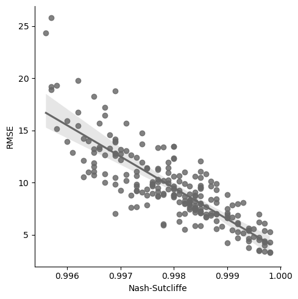

**Fonte:** De autoria própria (2023).

É importante deixar claro que essas equações não estão inseridas dentro da ferramenta, mas apenas os dados que permitem calculá-las. Assim sendo, é possível modificar parâmetros e métodos para gerar mais variações de equações para uma mesma cidade.

# 6 CONCLUSÕES

Entendendo tudo que envolve o desenvolvimento de uma equação IDF, fica claro que para chegar a um resultado consistente é necessário a compreensão de diversos fatores que vão além de seu cálculo. Entretanto, diante de tudo que foi criado, entende-se que a ferramenta cumpre seu dever no que se propõe, que é fornecer uma base sólida e confiável para o projetista que pretendem desenvolver a equação para um local específico.

Destaca-se que o programa não irá isentar o calculista da prévia análise da consistência dos dados de séries históricas que venha a ser usada como fonte, como também as particularidades do local alvo, tendo ele responsabilidade de uso. Contudo, a ferramenta lhe oferecerá um ambiente propício para que seja viável o máximo de cálculos e análises em torno da equação IDF do lugar pretendido.

Indo além do caráter prático da ferramenta, é importante salientar toda a pesquisa, tratamento de dados e algoritmos que foram desenvolvidos em torno da equação para que o programa se tornasse viável, além da verificação de sua funcionalidade através da aplicação em todo o território paraibano. Isso porque tudo que foi desenvolvido é público, e por isso, passível de análise, estudo, melhora, modificação e evolução.

Assim sendo, foi concluída a criação de uma ferramenta computacional com extensa aplicação e embasamento teórico, repositório de código aberto, instalador e manual de uso que servirá como auxilio aos projetistas e estudiosos das áreas que necessitam da variável de intensidade das chuvas, tendo como características a sua simplicidade, e facilidade de acesso em todos os seus âmbitos.

# REFERÊNCIAS

ALLISON, P. D. Missing Data. Sage University Papers Series on Quantitative Applications in the Social Sciences. 07-136. Thousand Oaks, CA: Sage. 2001. Páginas 1 e 2.

AMERICAN NATIONAL STANDARDS INSTITUTE. C Programming Language. Disponível em: \<https://www.ansi.org/\> Acesso em: 05 de setembro de 2023.

ASSOCIATION FOR COMPUTING MACHINERY. Fortran. Disponível em: \<https://www.acm.org/\> Acesso em: 05 de setembro de 2023.

BACK, A. J.; WILDNER, L. P. Equação de chuvas intensas por desagregação de precipitação máxima diária para o estado de Santa Catarina. Agropecuária Catarinense, Florianópolis, v.34, n.3, p. 43-47, 2021. Página 43.

BERTONI, J. C.; TUCCI, C. E. M. Hidrologia ciência e aplicação. Universidade Federal do Rio Grande do Sul, 4, 2012. Páginas 180-182, 200-203 e 207.

BESKOW, L; CORRÊA, L. L.; MAHL, M.; SIMÕES, M. C.; CALDEIRA, T. L.; NUNES, G. S.; LUCAS, E. H.; FARIA, L. C.; MELLO, C. R. Desenvolvimento de um sistema computacional de aquisição e análise de dados hidrológicos. In: XX Simpósio Brasileiro de Recursos Hídricos, 2013, Bento Gonçalves, RS. XX Simpósio Brasileiro de Recursos Hídricos – Água-Desenvolvimento Econômico e Socioambiental, 2013. Página 4.

BOYER, C. B. História da Matemática. 2. ed. São Paulo Edusp; Edgar Blucher Ltda, 1974. Página. 367.

CECILIO, R. A.; PRUSKI, F.F. Interpolação dos parâmetros de equações de chuvas intensas com uso do inverso de potências da distância. Revista Brasileira de Engenharia Agrícola e Ambiental, v.7, n.3, p.501-504, 2003. Página 501.

CHOW, V.; MAIDMENT, D.; MAYS, L. Applied Hydrology. McGraw-Hill Book Company, New York, 1988. Página 499.

COLLISCHONN, W.; DORNELLES, F. Hidrologia para engenharia e ciências ambientais. Edição 2 - revisada e ampliada. ed. Porto Alegre: Associação Brasileira de Recursos Hídricos, 2015. Páginas 13, 54, 56.

DAEE; CETESB. Drenagem Urbana 2a ed. São Paulo. 1980. Página 22.

FUNDAMENTAL ALGORITHMS FOR SCIENTIFIC COMPUTING IN PYTHON. SciPy. Disponível em: \<https://www.scipy.org/\> Acesso em: 05 de setembro de 2023.

GAUSS, J. C. F. CARL FRIEDRICH GAUSS WERKE. Edição crítica (volume 12). Gottingen Academy of Sciences and HumanitiesSpringer-Verlag, 2018 \[1900\]. Página 201.

HELSEL, D. R.; HIRSCH, R. M.; RYBERG, K. R.; ARCHFIELD, S. A.; GILROY, E. J. Statistical Methods in Water Resources. Capítulo 3. In: HYDROLOGIC ANALYSIS AND INTERPRETATION. Book 4. Reston, Virginia: U.S. Geological Survey, 2020. Página 327.

HOSKING, J. R. M., WALLIS, J. R. Regional Frequency Analysis: An Approach Based on L-Moments, 224p. Cambridge University Press, Cambridge, Reino Unido, 1997. Página 202.

INNO SETUP IS A FREE INSTALLER FOR WINDOWS PROGRAMS. Inno Setup, 1997. Disponível em: \<https://www.jrsoftware.org/\> Acesso em: 05/09/2023.

INSTITUTO NACIONAL DE PESQUISAS ESPACIAIS (INPE). Glossário de Meteorologia - Diferença entre Tempo Meteorológico e Clima. Disponível em: \<https://www.cptec.inpe.br/glossario.shtml\> Acesso em: 18/05/2023.

INTERNATIONAL ORGANIZATION FOR STANDARDIZANTION. C++ Programming Language Standard. Disponível em: \<https://www.iso.org/\> Acesso em: 05 de setembro de 2023.

KIM, J.; RYU, J. H. A Heuristic Gap Filling Method for Daily Precipitation Series. Water Resources Management, 30(7), 2275–2294. 2016. Página 2286.

KIM, J.; RYU, J. H. Quantifying a Threshold of Missing Values for Gap Filling Processes in Daily Precipitation Series. Water Resour. Manag. 29, 4173–4184. 2015. Página 4176.

LANNA, A. E. Hidrologia ciência e aplicação. Universidade Federal do Rio Grande do Sul, 4, 2012. Páginas 106-154.

MARCONI, M. de A.; LAKATOS, E. M. Técnicas de Pesquisa. 8. ed. São Paulo: Atlas. 2017. Página 20.

MARTINEZ JUNIOR, F.; MAGNI, N. L. G. Equações de chuvas intensas do Estado de São Paulo. São Paulo Departamento de Águas e Energia Elétrica, Escola Politécnica da Universidade de São Paulo, São Paulo. 1999. Páginas 2 e 3.

NAGHETTINI, M.; PINTO, E. J. A. (2007). Hidrologia Estatística. CPRM – Serviço Geológico do Brasil, páginas 130-173, 206, 271 e 275-278.

NASH, J. E.; SUTCLIFFE, J. V. River Flow Forecasting through Conceptual Model. Part 1—A Discussion of Principles. Journal of Hydrology, 10, 282-290. 1970.

NETO, E. de P. S. Atlas Pluviométrico do Brasil; Determinação de Parâmetros Ótimos da Equação Intensidade, Duração e Frequência de Chuvas Utilizando Otimização Heurística. Catalão-GO, UFG, 2020. Página 49.

NÓBREGA, A. E. L. Instalador da ferramenta computacional Intensio. Intensio, 2023. Disponível em: \<https://drive.google.com/file/d/1IkApxCR6-j-2dgzLQgXkitvOrcYOiiNe/view\> Acesso em: 21 de setembro de 2023.

NÓBREGA, A. E. L. Manual de uso da ferramenta computacional Intensio. Intensio, 2023. Disponível em: \<https://drive.google.com/file/d/13d4H1FsTQ_nRmmNXv0ytU7gUgkqNRu21/view\> Acesso em: 21 de setembro de 2023.

NÓBREGA, A. E. L. Repositório de código fonte da ferramenta computacional Intensio. Intensio, 2023. Disponível em: \<https://www.github.com/alexandre11aa/intensio\> Acesso em: 21 de setembro de 2023.

THE FUNDAMENTAL PACKAGE FOR SCIENTIFIC COMPUTING WITH PYTHON. NumPy. Disponível em: \<https://www.numpy.org/\> Acesso em: 18/05/2023.

PFAFSTETTER, O., Chuvas Intensas no Brasil, 2a. edição, Rio de Janeiro, DNOS, 1982, página 426.

PINTO, E. J. de A. Atlas Pluviométrico do Brasil; Metodologia para definição das equações Intensidade-Duração-Frequência do Projeto Atlas Pluviométrico. Belo Horizonte CPRM, 2013. Página 25.

PYINSTALLER BUNDLES A PYTHON APPLICATION AND ALL ITS DEPENDENCIES INTO A SINGLE PACKAGE. PyInstaller. Disponível em: \<https://www.pyinstaller.org/\> Acesso em: 05 de setembro de 2023.

PYTHON PACKAGE INDEX. PyPi, 1991. Disponível em: \<https://pypi.org/\> Acesso em: 05 de setembro de 2023.

PYTHON SOFTWARE FOUNDATION. Python.org, 1989. Disponível em: \<https://www.python.org/\> Acesso em: 05 de setembro de 2023.

SANTOS, V. C. Probabilidade de ocorrência de chuvas e sua variação espacial e temporal na Bacia Hidrográfica do Rio Tapajós. Dissertação de Mestrado – Universidade Federal do Pará. Instituto de Tecnologia. Programa de Pós-Graduação em Engenharia Civil, Belém, 2017.

SILVA, A. S. A.; STOSIC, B.; MENEZES, R. S. C.; SINGH, V. P. Comparison of interpolation methods for spatial distribution of monthly precipitation in the state of pernambuco, Brazil. 2019. Páginas 7 e 9.

SILVEIRA, A. L. L. da. Hidrologia ciência e aplicação. Universidade Federal do Rio Grande do Sul, 4, 2012. Página 36.

SILVEIRA, André. RBRH - Revista Brasileira de Recursos Hídricos, Volume 5 n.4, páginas 143-147. 2000. Página 45.

TKINTER - PYTHON INTERFACE TO TCL/TK. Python.org, 1989. Disponível em: \<https://docs.python.org/3/library/tkinter.html\> Acesso em: 05 de setembro de 2023.

WILKEN, P. S. Engenharia de drenagem superficial. São Paulo, Companhia de Tecnologia de Saneamento Ambiental, 1978. Páginas 1-2, 23, 50-51.

WISLER, C.O.; BRATER, E.F. Hydrology. 2nd Edition, John Wiley and Sons Inc., New York, 1959.

XAVIER, A. C.; KING, C. W.; SCANLON, B. R. Daily gridded meteorological variables in Brazil (1980–2013). International Journal of Climatology, Wiley Online Library, v. 36, n. 6, p. 2644–2659, 2016. Página 2658.

# APÊNDICE A

**Exemplo de Cálculo Manual da Equação de Chuvas Intensas**

Nesta seção, será apresentado um exemplo de cálculo da equação IDF, para um melhor entendimento das equações explicadas no referencial teórico. Primeiramente são definidos os dados de precipitação diária anual máxima na Tabela A.1, que serão usados nos cálculos e em diante todo o processo de cálculo se seguirá.

**Tabela A.1** – Simulação de Precipitação Máxima Diária Anual.

|  N   |  Xi  |
|:----:|:----:|
| 1969 | 56.5 |
| 1986 | 51.8 |
| 1970 | 46.0 |
| 1975 | 45.2 |
| 1977 | 41.0 |
| 1978 | 40.2 |
| 1968 | 39.7 |
| 1987 | 38.6 |
| 1981 | 36.9 |
| 1976 | 36.8 |
| 1982 | 34.5 |
| 1979 | 33.7 |
| 1971 | 33.6 |
| 1980 | 33.4 |
| 1974 | 31.7 |
| 1973 | 29.9 |
| 1972 | 28.0 |
| 1985 | 27.6 |
| 1983 | 26.4 |
| 1984 | 25.0 |

**Fonte:** De autoria própria (2023).

Inicia-se então o método de distribuição de Gumbel. Assim sendo tem-se a média em (A.1), a partir da fórmula (3.3) e dos dados da Tabela A.1:

$$\bar{X} = \frac{736.5}{20} = 36.825 mm \tag{A.1}$$

Desvio padrão (A.2), a partir da fórmula (3.4), Tabela A.1 e média obtida em (A.1):

$$\delta = \sqrt{\frac{1328.938}{20 - 1}} = 8.363 \tag{A.2}$$

Parâmetro de escala da distribuição de Gumbel (A.3), a partir da fórmula (3.5) e do desvio padrão obtido em (A.2):

$$\beta_1 = \frac{2.449}{\pi} * 8.363 = 6.521 \tag{A.3}$$

Moda de Gumbel (A.4), a partir da fórmula (3.6), da média obtida em (A.1) e do parâmetro de escala da distribuição de Gumbel obtido em (A.3):

$$\mu = 36.825 - \gamma * 6.521 = 33.061 mm \tag{A.4}$$

Mediana de Gumbel (A.5) à (A.11), a partir da fórmula (3.7), do parâmetro de escala da distribuição de Gumbel obtido em (A.3), da moda de Gumbel obtida em (A.4), e dos tempos de retorno arbitrados, que para esse exemplo serão de 2, 5, 10, 25, 50, 75 e 100:

$$Xt = 33.061 - 6.521 * \ln{\left(\ln{\left(\frac{2}{2 - 1}\right)}\right)} = 35.451 mm \tag{A.5}$$

$$Xt = 33.061 - 6.521 * \ln{\left(\ln{\left(\frac{5}{5 - 1}\right)}\right)} = 42.842 mm \tag{A.6}$$

$$Xt = 33.061 - 6.521 * \ln{\left(\ln{\left(\frac{10}{10 - 1}\right)}\right)} = 47.735 mm \tag{A.7}$$

$$Xt = 33.061 - 6.521 * \ln{\left(\ln{\left(\frac{25}{25 - 1}\right)}\right)} = 53.918 mm \tag{A.8}$$

$$Xt = 33.061 - 6.521 * \ln{\left(\ln{\left(\frac{50}{50 - 1}\right)}\right)} = 58.505 mm \tag{A.9}$$

$$Xt = 33.061 - 6.521 * \ln{\left(\ln{\left(\frac{75}{75 - 1}\right)}\right)} = 61.171 mm \tag{A.10}$$

$$Xt = 33.061 - 6.521 * \ln{\left(\ln{\left(\frac{100}{100 - 1}\right)}\right)} = 63.058 mm \tag{A.11}$$

Função cumulativa de Gumbel (A.12) à (A.18), a partir da fórmula (3.8), do parâmetro de escala da distribuição de Gumbel obtido em (A.3), da moda de Gumbel obtida em (A.4), e das medianas de Gumbel obtidas em (A.5) à (A.11):

$$F(35.451; 33.061; 6.521) = e^{- e^{- \frac{35.451 - 33.061}{6.521}}} \cong 50\% \tag{A.12}$$

$$F(42.842; 33.061; 6.521) = e^{- e^{- \frac{42.842 - 33.061}{6.521}}} \cong 80\% \tag{A.13}$$

$$F(47.735; 33.061; 6.521) = e^{- e^{- \frac{47.735 - 33.061}{6.521}}} \cong 90\% \tag{A.14}$$

$$F(53.918; 33.061; 6.521) = e^{- e^{- \frac{53.918 - 33.061}{6.521}}} \cong 96\% \tag{A.15}$$

$$F(58.505; 33.061; 6.521) = e^{- e^{- \frac{58.505 - 33.061}{6.521}}} \cong 98\% \tag{A.16}$$

$$F(61.171; 33.061; 6.521) = e^{- e^{- \frac{61.171 - 33.061}{6.521}}} \cong 99\% \tag{A.17}$$

$$F(63.058; 33.061; 6.521) = e^{- e^{- \frac{63.058 - 33.061}{6.521}}} \cong 99\% \tag{A.18}$$

Tabela A.2 gerada a partir das medianas de Gumbel, tempos de retorno e funções cumulativas de Gumbel, obtidas em (A.5) à (A.18):

**Tabela A.2** – Tempos de Retorno e Precipitações de 24 horas

| Tr (anos) | Xt (mm) | F(x) |
|:---------:|:-------:|:----:|
|     2     | 35.451  | 50%  |
|     5     | 42.842  | 80%  |
|    10     | 47.735  | 90%  |
|    25     | 53.918  | 96%  |
|    50     | 58.505  | 98%  |
|    75     | 61.171  | 99%  |
|    100    | 63.058  | 99%  |

**Fonte:** De autoria própria (2023).

Método de Gumbel finalizado, inicia-se o teste de aderência de KS. Assim sendo, tem-se o parâmetro de posição de KS (A.19), a partir da fórmula (3.9), da média obtida em (A.1) e do desvio padrão obtido em (A.2):

$$\beta_2 = 36.825 - 0.45 * 8.363 = 33.062 \tag{A.19}$$

Parâmetro de escala de KS (A.20), a partir da fórmula (3.10) e do desvio padrão obtido em (A.2):

$$\alpha = \frac{8.363}{1.283} = 6.511 \tag{A.20}$$

Tabela A.3 gerada a partir do parâmetro de posição de KS (A.19), do parâmetro de escala de KS (A.20), e das fórmulas (3.11) à (3.14):

**Tabela A.3** – KS para Precipitação Máxima Diária Anual.

|  i  | Anos | Xi (mm) |  Fr  | Fr_n_Exced | Fr_Exced |   Dn   |
|:---:|:----:|:-------:|:----:|:----------:|:--------:|:------:|
|  1  | 1969 |  56.5   | 0.05 |   0.9729   |  0.0271  | 0.0229 |
|  2  | 1986 |  51.8   | 0.10 |   0.9451   |  0.0549  | 0.0451 |
|  3  | 1970 |  46.0   | 0.15 |   0.8716   |  0.1284  | 0.0216 |
|  4  | 1975 |  45.2   | 0.20 |   0.8561   |  0.1439  | 0.0561 |
|  5  | 1977 |  41.0   | 0.25 |   0.7439   |  0.2561  | 0.0061 |
|  6  | 1978 |  40.2   | 0.30 |   0.7157   |  0.2843  | 0.0157 |
|  7  | 1968 |  39.7   | 0.35 |   0.6969   |  0.3031  | 0.0469 |
|  8  | 1987 |  38.6   | 0.40 |   0.6521   |  0.3479  | 0.0521 |
|  9  | 1981 |  36.9   | 0.45 |   0.5741   |  0.4259  | 0.0241 |
| 10  | 1976 |  36.8   | 0.50 |   0.5692   |  0.4308  | 0.0692 |
| 11  | 1982 |  34.5   | 0.55 |   0.4484   |  0.5516  | 0.0016 |
| 12  | 1979 |  33.7   | 0.60 |   0.4039   |  0.5961  | 0.0039 |
| 13  | 1971 |  33.6   | 0.65 |   0.3982   |  0.6018  | 0.0482 |
| 14  | 1980 |  33.4   | 0.70 |   0.3870   |  0.6130  | 0.0870 |
| 15  | 1974 |  31.7   | 0.75 |   0.2916   |  0.7084  | 0.0416 |
| 16  | 1973 |  29.9   | 0.80 |   0.1971   |  0.8029  | 0.0029 |
| 17  | 1972 |  28.0   | 0.85 |   0.1137   |  0.8863  | 0.0363 |
| 18  | 1985 |  27.6   | 0.90 |   0.0991   |  0.9009  | 0.0009 |
| 19  | 1983 |  26.4   | 0.95 |   0.0621   |  0.9379  | 0.0121 |
| 20  | 1984 |  25.0   | 1.00 |   0.0319   |  0.9681  | 0.0319 |

**Fonte:** De autoria própria (2023).

Diferença máxima (A.21), a partir da Tabela A.3:

$$Dn_{max} = 0.087 \tag{A.21}$$

Valor crítico estatístico (A.22), arbitrado para exemplo de 5% a partir da fórmula (3.16) e do número total de anos precipitados:

$$Crit_5 = \frac{1.36}{20} = 0.304 \tag{A.22}$$

Verificação da aderência (A.23), a partir da equação da sentença (3.17):

$$0.087 < 0.304 = \mbox{\textit{Boa }}\mbox{\textit{Aderência!}} \tag{A.23}$$

Aderência garantida após o método de KS, o cálculo continua com a desagregação a partir da relação entre durações. Assim sendo, tem-se a Tabela A.4 gerada da fórmula dos coeficientes de desagregação (3.2) e das durações arbitradas de 1440, 720, 600, 480, 360, 240, 60, 30, 20, 15, 10 e 5 minutos:

**Tabela A.4** – Coeficientes de Desagregação.

| t (min) |   C   |
|:-------:|:-----:|
|  1440   | 1.14  |
|   720   | 0.856 |
|   600   | 0.820 |
|   480   | 0.778 |
|   360   | 0.724 |
|   240   | 0.651 |
|   60    | 0.420 |
|   30    | 0.318 |
|   20    | 0.263 |
|   15    | 0.226 |
|   10    | 0.177 |
|    5    | 0.104 |

**Fonte:** De autoria própria (2023).

Tabela A.5 calculada da fórmula (3.18), a partir do produto das medianas de Gumbel da Tabela A.2 e dos coeficientes de desagregação da Tabela A.4, resultando nas precipitações:

**Tabela A.5** – Precipitações desagregadas em mm.

| t (min) | Pr – 2 anos | Pr – 5 anos | Pr – 10 anos | Pr – 25 anos | Pr – 50 anos | Pr – 75 anos | Pr – 100 anos |
|:-------:|:-----------:|:-----------:|:------------:|:------------:|:------------:|:------------:|:-------------:|
|  1440   |   40.414    |   48.840    |    54.418    |    61.467    |    66.696    |    69.735    |    71.886     |
|   720   |   30.333    |   36.656    |    40.843    |    46.133    |    50.058    |    52.339    |    53.954     |
|   600   |   29.081    |   35.143    |    39.157    |    44.229    |    47.992    |    50.179    |    51.726     |
|   480   |   27.572    |   33.321    |    37.126    |    41.935    |    45.503    |    47.576    |    49.044     |
|   360   |   25.668    |   31.019    |    34.562    |    39.038    |    42.359    |    44.290    |    45.656     |
|   240   |   23.062    |   27.870    |    31.053    |    35.075    |    38.059    |    39.793    |    41.021     |
|   60    |   14.891    |   17.995    |    20.051    |    22.648    |    24.575    |    25.694    |    26.487     |
|   30    |   11.274    |   13.625    |    15.181    |    17.147    |    18.606    |    19.454    |    20.054     |
|   20    |    9.320    |   11.263    |    12.549    |    14.174    |    15.380    |    16.081    |    16.577     |
|   15    |    8.010    |    9.680    |    10.786    |    12.182    |    13.219    |    13.821    |    14.248     |
|   10    |    6.280    |    7.589    |    8.456     |    9.552     |    10.364    |    10.836    |    11.171     |
|    5    |    3.670    |    4.435    |    4.942     |    5.582     |    6.056     |    6.332     |     6.528     |

**Fonte:** De autoria própria (2023).

Tabela A.6 calculada na fórmula (3.19), a partir do quociente das precipitações desagregadas, pelas durações transformadas em horas da Tabela A.5, resultando nas intensidades:

**Tabela A.6** – Intensidades da chuva em mm/h.

| t (min) | I – 2 anos | I – 5 anos | I – 10 anos | I – 25 anos | I – 50 anos | I – 75 anos | I – 100 anos |
|:-------:|:----------:|:----------:|:-----------:|:-----------:|:-----------:|:-----------:|:------------:|
|  1440   |   1.684    |   2.035    |    2.267    |    2.561    |    2.779    |    2.906    |    2.995     |
|   720   |   2.528    |   3.055    |    3.404    |    3.844    |    4.171    |    4.362    |    4.496     |
|   600   |   2.908    |   3.514    |    3.916    |    4.423    |    4.799    |    5.018    |    5.173     |
|   480   |   3.447    |   4.165    |    4.641    |    5.242    |    5.688    |    5.947    |    6.130     |
|   360   |   4.278    |   5.170    |    5.760    |    6.506    |    7.060    |    7.382    |    7.609     |
|   240   |   5.765    |   6.967    |    7.763    |    8.769    |    9.515    |    9.948    |    10.255    |
|   60    |   14.891   |   17.995   |   20.051    |   22.648    |   24.575    |   25.694    |    26.487    |
|   30    |   22.549   |   27.250   |   30.362    |   34.295    |   37.212    |   38.908    |    40.108    |
|   20    |   27.959   |   33.788   |   37.647    |   42.523    |   46.141    |   48.243    |    49.731    |
|   15    |   32.040   |   38.720   |   43.142    |   48.730    |   52.875    |   55.285    |    56.990    |
|   10    |   37.681   |   45.537   |   50.738    |   57.309    |   62.185    |   65.018    |    67.024    |
|    5    |   44.039   |   53.220   |   59.299    |   66.980    |   72.678    |   75.990    |    78.334    |

**Fonte:** De autoria própria (2023).

Obtidas as intensidades, inicia-se o primeiro dos três usos do MMQ. Assim sendo, tem-se a Tabela A.7 gerada a partir da Tabela A.6, resultando nas variáveis que são usadas nas fórmulas dos ajustes (3.22) e (3.23).

**Tabela A.7** – Variáveis usadas para o cálculo dos ajustes no primeiro uso do MMQ.

| ln(t) = y | ln(I) = x – 2 anos | ln(I) = x – 5 anos | ln(I) = x – 10 anos | ln(I) = x – 25 anos | ln(I) = x – 50 anos | ln(I) = x – 75 anos | ln(I) = x – 100 anos |
|:---------:|:------------------:|:------------------:|:-------------------:|:-------------------:|:-------------------:|:-------------------:|:--------------------:|
|   7.272   |       0.521        |       0.710        |        0.819        |        0.940        |        1.022        |        1.067        |        1.097         |
|   6.579   |       0.927        |       1.117        |        1.225        |        1.347        |        1.428        |        1.473        |        1.503         |
|   6.397   |       1.067        |       1.257        |        1.365        |        1.487        |        1.568        |        1.613        |        1.643         |
|   6.174   |       1.237        |       1.427        |        1.535        |        1.657        |        1.738        |        1.783        |        1.813         |
|   5.886   |       1.453        |       1.643        |        1.751        |        1.873        |        1.954        |        1.999        |        2.029         |
|   5.481   |       1.752        |       1.941        |        2.049        |        2.171        |        2.253        |        2.297        |        2.328         |
|   4.094   |       2.701        |       2.890        |        2.998        |        3.120        |        3.202        |        3.246        |        3.277         |
|   3.401   |       3.116        |       3.305        |        3.413        |        3.535        |        3.617        |        3.661        |        3.692         |
|   2.996   |       3.331        |       3.520        |        3.628        |        3.750        |        3.832        |        3.876        |        3.907         |
|   2.708   |       3.467        |       3.656        |        3.764        |        3.886        |        3.968        |        4.012        |        4.043         |
|   2.303   |       3.629        |       3.819        |        3.927        |        4.048        |        4.130        |        4.175        |        4.205         |
|   1.609   |       3.785        |       3.974        |        4.083        |        4.204        |        4.286        |        4.331        |        4.361         |

**Fonte:** De autoria própria (2023).

Tabela A.8, a partir da Tabela A.7, e das fórmulas dos ajustes (3.22), (3.23) e (3.24) usados na fórmula (3.20):

**Tabela A.8** – Ajustes do primeiro uso do MMQ.

| Tr  | $a_2$  | $a_1$  | $b_2$ | $b_1$  |
|:---:|:------:|:------:|:-----:|:------:|
|  2  | -0.618 | -0.618 | 5.075 | 159.93 |
|  5  | -0.618 | -0.618 | 5.264 | 193.27 |
| 10  | -0.618 | -0.618 | 5.372 | 215.35 |
| 25  | -0.618 | -0.618 | 5.494 | 243.24 |
| 50  | -0.618 | -0.618 | 5.576 | 263.93 |
| 75  | -0.618 | -0.618 | 5.620 | 275.96 |
| 100 | -0.618 | -0.618 | 5.651 | 284.47 |

**Fonte:** De autoria própria (2023).

Gráfico de curvas na Figura A.1, que representa o da Figura 3.6 no referencial teórico, gerado a partir da Tabela A.8 e da fórmula (3.20):

**Figura A.1** – Relação entre intensidades e durações

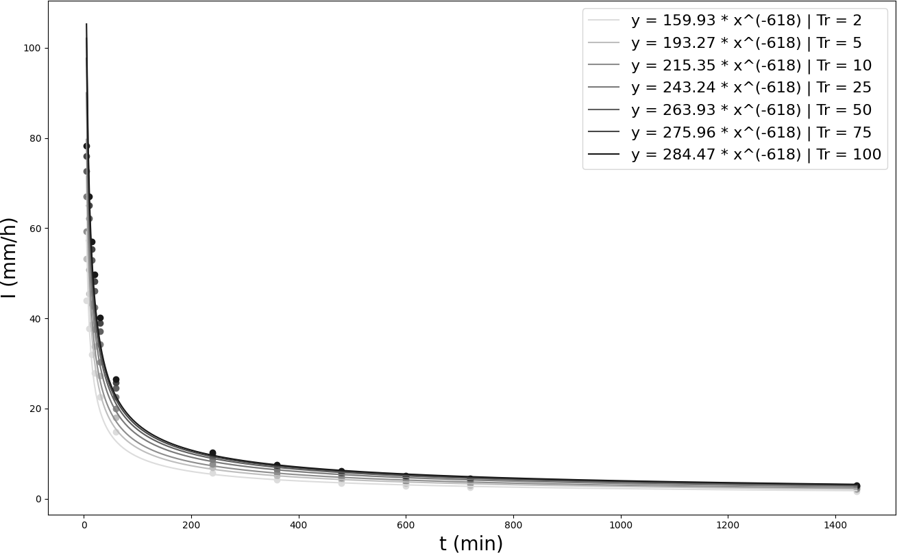

**Fonte:** De autoria própria (2023).

Tabela A.9 gerada a partir da Tabela A.6 e A.8, e das fórmulas (3.25) à (3.27):

**Tabela A.9** – Parâmetro *c* de diferentes tempos de retorno

| Tr  | $i_1$  | $t_1$ | $i_2$ | $t_2$ | $i_3$  |  $t_3$  | $c_i$ |
|:---:|:------:|:-----:|:-----:|:-----:|:------:|:-------:|:-----:|
|  2  | 44.039 |   5   | 1.684 | 1440  | 8.612  | 113.314 | 4.235 |
|  5  | 53.220 |   5   | 2.035 | 1440  | 10.407 | 113.314 | 4.235 |
| 10  | 59.299 |   5   | 2.267 | 1440  | 11.596 | 113.316 | 4.236 |
| 25  | 66.980 |   5   | 2.561 | 1440  | 13.097 | 113.314 | 4.235 |
| 50  | 72.678 |   5   | 2.779 | 1440  | 14.212 | 113.312 | 4.235 |
| 75  | 75.990 |   5   | 2.906 | 1440  | 14.859 | 113.314 | 4.235 |
| 100 | 78.334 |   5   | 2.995 | 1440  | 15.318 | 113.313 | 4.235 |

**Fonte:** De autoria própria (2023).

Parâmetro $c$ (A.24) da IDF, obtido a através da Tabela A.9 e da fórmula (3.28).

$$c = \frac{29.645}{7} = 4.235 \tag{A.24}$$

Ocorre então a soma do parâmetro $c$ (A.24) com as durações arbitradas como descrito no referencial teórico, para que assim se inicie o segundo uso do MMQ. Assim sendo, tem-se a Tabela A.10 gerada a partir da Tabela A.6 e das novas durações resultado da soma com o parâmetro $c$:

**Tabela A.10** – Duração mais parâmetro $c$ versus intensidades da chuva em mm/h

| t + c (min) | I – 2 anos | I – 5 anos | I – 10 anos | I – 25 anos | I – 50 anos | I – 75 anos | I – 100 anos |
|:-----------:|:----------:|:----------:|:-----------:|:-----------:|:-----------:|:-----------:|:------------:|
|  1444.235   |   1.684    |   2.035    |    2.267    |    2.561    |    2.779    |    2.906    |    2.995     |
|   724.235   |   2.528    |   3.055    |    3.404    |    3.844    |    4.171    |    4.362    |    4.496     |
|   604.235   |   2.908    |   3.514    |    3.916    |    4.423    |    4.799    |    5.018    |    5.173     |
|   484.235   |   3.447    |   4.165    |    4.641    |    5.242    |    5.688    |    5.947    |    6.130     |
|   364.235   |   4.278    |   5.170    |    5.760    |    6.506    |    7.060    |    7.382    |    7.609     |
|   244.235   |   5.765    |   6.967    |    7.763    |    8.769    |    9.515    |    9.948    |    10.255    |
|   64.235    |   14.891   |   17.995   |   20.051    |   22.648    |   24.575    |   25.694    |    26.487    |
|   34.235    |   22.549   |   27.250   |   30.362    |   34.295    |   37.212    |   38.908    |    40.108    |
|   24.235    |   27.959   |   33.788   |   37.647    |   42.523    |   46.141    |   48.243    |    49.731    |
|   19.235    |   32.040   |   38.720   |   43.142    |   48.730    |   52.875    |   55.285    |    56.990    |
|   14.235    |   37.681   |   45.537   |   50.738    |   57.309    |   62.185    |   65.018    |    67.024    |
|    9.235    |   44.039   |   53.220   |   59.299    |   66.980    |   72.678    |   75.990    |    78.334    |

**Fonte:** De autoria própria (2023).

Tabela A.11 gerada a partir da Tabela A.10, resultando nas variáveis que são usadas nas fórmulas dos ajustes (3.22) e (3.23):

**Tabela A.11** – Variáveis usadas para o cálculo dos ajustes no segundo uso do MMQ.

| log(t + c) = y | log(I) = x – 2 anos | log(I) = x – 5 anos | log(I) = x – 10 anos | log(I) = x – 25 anos | log(I) = x – 50 anos | log(I) = x – 75 anos | log(I) = x – 100 anos |
|:--------------:|:-------------------:|:-------------------:|:--------------------:|:--------------------:|:--------------------:|:--------------------:|:---------------------:|
|     3.160      |        0.226        |        0.309        |        0.356         |        0.408         |        0.444         |        0.463         |         0.476         |
|     2.860      |        0.403        |        0.485        |        0.532         |        0.585         |        0.620         |        0.640         |         0.653         |
|     2.781      |        0.464        |        0.546        |        0.593         |        0.646         |        0.681         |        0.701         |         0.714         |
|     2.685      |        0.537        |        0.620        |        0.667         |        0.719         |        0.755         |        0.774         |         0.787         |
|     2.561      |        0.631        |        0.713        |        0.760         |        0.813         |        0.849         |        0.868         |         0.881         |
|     2.388      |        0.761        |        0.843        |        0.890         |        0.943         |        0.978         |        0.998         |         1.011         |
|     1.808      |        1.173        |        1.255        |        1.302         |        1.355         |        1.390         |        1.410         |         1.423         |
|     1.534      |        1.353        |        1.435        |        1.482         |        1.535         |        1.571         |        1.590         |         1.603         |
|     1.384      |        1.447        |        1.529        |        1.576         |        1.629         |        1.664         |        1.683         |         1.697         |
|     1.284      |        1.506        |        1.588        |        1.635         |        1.688         |        1.723         |        1.743         |         1.756         |
|     1.153      |        1.576        |        1.658        |        1.705         |        1.758         |        1.794         |        1.813         |         1.826         |
|     0.965      |        1.644        |        1.726        |        1.773         |        1.826         |        1.861         |        1.881         |         1.894         |

**Fonte:** De autoria própria (2023).

Tabela A.12 gerada a partir da Tabela A.11, e das fórmulas dos ajustes (3.22), (3.23) e (3.24) usados na fórmula (3.20):

**Tabela A.12** – Ajustes do segundo uso do MMQ.

| Tr  | $a_2$  | $a_1$  | $b_2$ | $b_1$  |     |     |     |
|:---:|:------:|:------:|:-----:|:------:|:---:|:---:|:---:|
|  2  | -0.677 | -0.677 | 2.362 | 230.03 |     |     |     |
|  5  | -0.677 | -0.677 | 2.444 | 277.99 |     |     |     |
| 10  | -0.677 | -0.677 | 2.491 | 309.74 |     |     |     |
| 25  | -0.677 | -0.677 | 2.544 | 349.85 |     |     |     |
| 50  | -0.677 | -0.677 | 2.579 | 379.62 |     |     |     |
| 75  | -0.677 | -0.677 | 2.599 | 396.92 |     |     |     |
| 100 | -0.677 | -0.677 | 2.612 | 409.16 |     |     |     |

**Fonte:** De autoria própria (2023).

Gráfico de curvas na Figura A.2, que representa o da Figura 3.7 no referencial teórico, gerado a partir da Tabela A.12 e da fórmula (3.20):

**Figura A.2** – Relação entre intensidades e durações com complemento

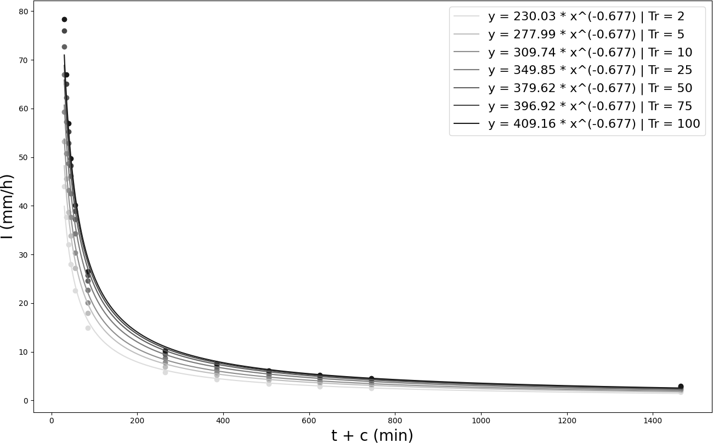

**Fonte:** De autoria própria (2023).

O parâmetro $d$ (A.25) da IDF é obtido a através da Tabela A.12, e da fórmula (3.29).

$$d = -1 * \frac{- 4.739}{7} = 0.677 \tag{A.25}$$

Chegando ao fim do cálculo, o terceiro uso do MMQ será iniciado, porém agora para funções de ajuste linear. Assim sendo, tem-se a Tabela A.13 gerada a partir da Tabela A.12, resultando nas variáveis que são usadas nas fórmulas dos ajustes (3.22) e (3.23):

**Tabela A.13** – Variáveis usadas para o cálculo dos ajustes no terceiro uso do MMQ.

| log(Tr) = y | $b_2$ = x |
|:-------:|:-----:|
|  2.000  | 2.612 |
|  1.875  | 2.599 |
|  1.699  | 2.579 |
|  1.398  | 2.544 |
|  1.000  | 2.491 |
|  0.699  | 2.444 |
|  0.301  | 2.362 |

**Fonte:** De autoria própria (2023).

Ajustes lineares (A.26) e (A.27) do terceiro uso do MMQ, a partir dos dados da Tabela A.13 aplicados às fórmulas (3.22), (3.23) e (3.30):

$$a_1 = a_2 = 0.143 \tag{A.26}$$

$$b_1 = 10^{b_2} = 10^{2.336} = 216.674 \tag{A.27}$$

Gráfico de linear na Figura A.3, que representa o da Figura 3.8 no referencial teórico, gerado a partir da Tabela A.13 e da fórmula (3.21):

**Figura A.3** – Relação entre tempos de retorno e ajustes

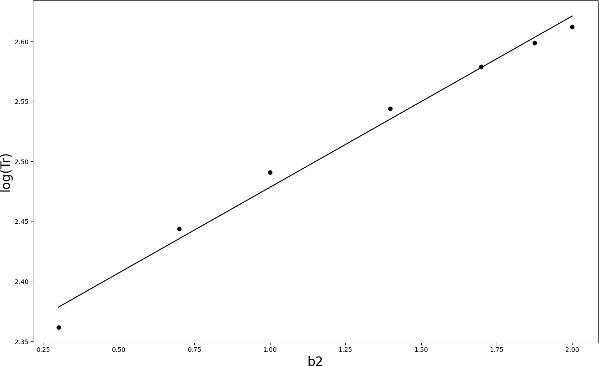

**Fonte:** De autoria própria (2023).

Parâmetros $a$ (A.28) e $b$ (A.29) da IDF obtidos através das fórmulas (3.31) e (3.32) sucessivamente.

$$a = b_1 = 216.674 \tag{A.28}$$

$$b = a_1 = 0.143 \tag{A.29}$$

Assim sendo, é possível gerar a IDF a partir da fórmula (3.1) e dos resultados (A.24), (A.25), (A.28) e (A.29):

$$I = \frac{216.743 * Tr^{0.143}}{(t + 4.235)^{0.677}} \tag{A.30}$$

E então, chega-se ao resultado final que é a equação para o local qual os dados foram coletados.

**APÊNDICE B**

O documento que segue a partir da próxima lauda trata-se do manual de uso prático da ferramenta computacional **Intensio**, elaborado para auxilio ao usuário da mesma como explicado anteriormente no presente trabalho.

*\[Documento incluído como PDF: documentos/manual_de_uso.pdf\]*
