**PROLOSS: UMA FERRAMENTA PARA O CÁLCULO DE PERDA DE PROTENSÃO**

Alexandre Estrela de Lacerda Nobrega

8 de março de 2025

**Resumo**

O uso de estruturas de concreto protendido cresceu e ganhou notoriedade após a Segunda Guerra Mundial devido ao desenvolvimento de aços de alta resistência, dado sua versatilidade construtiva para estruturas que exigem maiores vãos livres. Dentre os cálculos feitos no dimensionamento de projetos desse método construtivo estão as perdas de protensão, que se mostram um verdadeiro desafio dado sua extensão e complexidade. Embora o cálculo preciso dessas perdas seja crucial para a otimização estrutural, ele é frequentemente negligenciado, resultando em superdimensionamento e aumento de custos. Ferramentas computacionais existentes, muitas vezes opacas e pouco explicáveis, não abordam adequadamente esse aspecto, levando ao uso de constantes simplificadas. Dado esse cenário, o presente estudo propõe o desenvolvimento de uma ferramenta computacional acessível, gratuita e de código aberto, escrita na linguagem de programação *Python*, para facilitar o cálculo transparente e modificado de perdas de protensão, promovendo a clareza, eficiência e economia no dimensionamento de estruturas de concreto protendido.

**Palavras-chave**: concreto protendido; perda de protensão; ferramenta computacional.

**Abstract**

The use of prestressed concrete structures grew and gained prominence after World War II due to the development of high-strength steel, given their constructive versatility for structures requiring larger free spans. Among the calculations involved in designing projects using this construction method are prestress losses, which pose a real challenge due to their scope and complexity. Although the precise calculation of these losses is crucial for structural optimization, it is often neglected, resulting in over-dimensioning and increased costs. Existing computational tools, often opaque and lacking transparency, do not adequately address this aspect, leading to the use of simplified constants. Given this scenario, the present study proposes the development of an accessible, free, and open-source computational tool written in the Python programming language to facilitate the transparent and modified calculation of prestress losses, promoting clarity, efficiency, and economy in the design of prestressed concrete structures.

**Keywords**: prestressed concrete; prestress loss; computational tool.

# 1 Introdução

Apresentando-se como um método construtivo que possibilita a elaboração de grandes vãos, Veríssimo e Junior (1999) entendem que a consagração das estruturas de concreto protendido (CP) se dá através do grande número de obras diversificadas realizadas. Contudo como explica Bastos (2024), o CP inicialmente não teve sucesso devido à baixa resistência dos aços de protensão e às perdas significativas de força ao longo do tempo. Foi somente durante a Segunda Guerra Mundial, com o desenvolvimento de aços de alta resistência, que a técnica se tornou viável, impulsionada pelo engenheiro francês Eugène Freyssinet. Após a guerra, devido à necessidade de reconstrução de infraestruturas na Europa, a protensão ganhou ainda mais notoriedade. Nos Estados Unidos surgiram as primeiras patentes de protensão, enquanto se desenvolveu o conceito de protensão parcial na Inglaterra.

Entende-se que o método se expandiu globalmente, com contribuições significativas de engenheiros em vários países. Ele é descrito por Pfeil (1984) como uma técnica que envolve adicionar tensões previamente em uma estrutura para melhorar sua resistência e desempenho sob diferentes condições de carga. Carvalho (2012) analisa que no Brasil, as estruturas de CP e de concreto armado (CA) são encaradas como do mesmo tipo, visto que são regidas pelo mesmo documento no país, e dado que suas principais divergências estão no tipo de aço empregado e processo construtivo, utiliza de diferentes especificações quando é o caso. O documento descrito trata-se da Norma Brasileira (NBR) 6118, que sofre atualizações esporádicas, adquirindo em sua nomenclatura o ano delas.

Para o desenvolvimento de projetos estruturais de CP, necessita-se da aplicação de uma série de técnicas e cálculos, que particularmente se distinguem dos utilizados no dimensionamento de CA, com especial atenção ao controle da força de protensão, que garante o desempenho adequado da estrutura. Dentre eles destaca-se o abordado no presente estudo, que é o calculo das perdas de protensão. Cholfe e Bonilha (2013) entendem que em um projeto de CP, o elemento fundamental é a força de protensão, que depende dos componentes físicos das ferramentas de protensão e do comportamento intrínseco dos materiais utilizados, e ela relacionada ao aparelho tensor sofre de perdas que devem ser previstas. Estas ocorrem antes da transferência da protensão ao concreto como perdas iniciais, durante a transferência como perdas imediatas, e também ao longo da vida útil da estrutura como perdas progressivas.

Contudo, muitas vezes essa etapa do dimensionamento de estruturas de CP é negligenciada pelos projetistas, ao passo que autores como Pfeil (1984) e Boukendakdji *et al.* (2017) declaram que é comum o uso de constantes para as perdas de protensão de forma que os projetos acabam superdimensionados, elevando de forma desnecessária o custo da estrutura. Além disso, existem ferramentas computacionais pagas que se propõem a fazer o cálculo estrutural completo de estruturas de CP.

Porém dado a automatização e complexidade envolvida nos cálculos realizados por esse tipo de programa, etapas como a da perda de protensão acabam por ficar em segundo plano. Volta-se então ao prática já citada na definição das perdas de protensão por meio de constantes e valores definidos pelo usuário, a exemplo do TQS com as perdas progressivas de protensão, em que seu valor deve ser fornecido em porcentagem (2024). Revelam-se assim, sistemas não transparente em meio aos cálculos estruturais das ferramentas, dado sua baixa explicabilidade, tornando assim essencial o uso de alternativas auxiliares para validação e aumento da clareza do dimensionamento

Ainda sim, existe a possibilidade da realização dos cálculos de forma manual. Entretanto, Mascarenhas *et al.* (2022) julgam que o grande número de equações, processos e complexidade dos cálculos podem exigir uma grande parcela tempo que irá compor o desenvolvimento do projeto. Seguindo essa ideia, torna-se uma inviável o cálculo manual, dado que o prazo de entrega pode acabar não sendo competitivo em comparação a outros métodos construtivos. Labadan (2016) complementa esse argumento, ao colocar que a natureza iterativa dos cálculos de estruturas de CP para que se chegue ao Estado Limite de Serviço (ELS) e ao Estado Limite Último (ELU), podem levar projetistas que realizem o dimensionamento de forma manual dado a impaciência, assumindo valores de forma precipitada e chegando assim a proporções não econômicas.

Assim sendo, com o objetivo de elevar a clareza nos cálculos que de perda de protensão, de maneira que aumente a capacidade de modificação e explicação deles, fomentando o dimensionamento de estruturas mais bem otimizadas, e por consequência diminuindo seu custo, o presente estudo se propõe a desenvolver uma ferramenta computacional acessível, gratuita e de código aberto, para a realização dos cálculos de perda de protensão. Ela será desenvolvida através da linguagem de programação *Python*, com um instalador e interface gráfica interativa e intuitiva para os projetistas.

# 2 Referencial Teórico

Nesta seção serão explorados os assuntos abordados e passos que levaram ao desenvolvimento da ferramenta computacional.

## 2.1 Tipos de perda de protensão

Compreende-se que em um projeto de CP deve-se prever as perdas de força de protensão, que ocorrem tanto nas peças pré-tracionadas como nas pós-tracionadas, sendo elas iniciais, imediatas e progressivas (NBR 6118:2023 (2023). Trovarelli (2019) caracteriza a pré-tração pela aplicação de tensão nos cabos de aço após da concretagem da peça, já a pós-tração é definida por Machado (2002) como essa mesma aplicação, só que aplicada antes da concretagem da peça.

## 2.2 Perdas de protensão imediatas

Em relação as perdas imediatas a NBR 6118:2023 (2023) entende que a variação da força de protensão em elementos estruturais pré-tracionados, devido à aplicação da protensão no concreto e ao seu encurtamento, deve ser calculada no regime elástico, levando em conta a deformação da seção homogeneizada.

Já para os elementos pós-tracionados, nos sistemas usuais de protensão as perdas imediatas podem ser devido ao atrito entre as armaduras e as bainhas ou o concreto, ao deslizamento da armadura e acomodação na ancoragem e ao encurtamento imediato do concreto (NBR 6118:2023 (2023).

### 2.2.1 Perdas de protensão por atrito através de processo simplificado

A perda de protensão por atrito ocorre nos elementos com pós-tração e pode ser determinada pela Equação 1, conforme explica a NBR 6118:2023 (2023).

$$\Delta P_{(x)} = P_i [1 - e^{-(\mu \Sigma \alpha + kx)}] \tag{1}$$

Onde $P_i$ é a força aplicada pelo aparelho tensor na posição $x = 0$ (ancoragem ativa), $x$ é a abscissa do ponto onde se calcula $\Delta P$, medida a partir da ancoragem em metros, $\Sigma \alpha$ é o coeficiente de atrito entre o cabo e a bainha, e $k$ é o coeficiente de perda por metro provocada por curvaturas não intencionais do cabo.

No desenvolvimento da ferramenta, o algoritmo de cálculo da perda por atrito foi programado através do método simplificado. Conforme explicam Cholfe e Bonilha (2013), em vigas e lajes protendidas com cabos com traçados parabólicos, a variação angular entre dois pontos pode ser calculada dessa forma, acelerando os cálculos dentro de uma precisão aceitável e compatível com a maneira de apresentação dos projetos. Nesse caso, o desvio angular pode ser obtido através da Equação 2, que se segue.

$$\Sigma \alpha = \frac{\Sigma^n_{i=1} (2 \cdot \Delta Y_i)}{l_i} \tag{2}$$

Onde $\Sigma \alpha$ é o desvio angular em radianos, $n$ é o número de trechos, $l_1$ é o comprimento de cada trecho e $\Delta y_i$ é a variação das ordenadas.

### 2.2.2 Perdas de protensão por acomodação da ancoragem

Para as perdas por deslizamento da armadura na ancoragem e acomodação da ancoragem, a NBR 6118:2023 (2023) recomenda que sejam determinadas experimentalmente, ou considerados os valores ditados pelos fabricantes. Sabendo disso, Cholfe e Bonilha (2013) descrevem um método de cálculo que pode ser feito desde que se possua o valor do deslocamento da extremidade do cabo após a transferência da força de protensão para o cabo, que é justamente determinado de maneira experimental, fornecido em catálogos técnicos e normalmente variam de 2 a 6 milímetros.

Entendendo isso, têm-se a Equação 3 apresentada por Cholfe e Bonilha (2013), que permite determinar o valor da abscissa do ponto de equilíbrio do cabo protendido, e assim encontrar a perda de protensão por acomodação da ancoragem.

$$\Omega = \Delta w \cdot E_p \cdot A_p \tag{3}$$

Onde $\Omega$ é área do diagrama das forças perdidas, $\Delta w$ é a acomodação de ancoragem e $E_p \cdot A_p$ é a rigidez axial do cabo (tração). Toda sua dedução e especificidades foram implementadas na ferramenta computacional.

### 2.2.3 Perdas de protensão por encurtamento imediato do concreto

Para as perdas de protensão por encurtamento imediato do concreto, a NBR 6118:2023 (2023) explica que a deformação imediata e afrouxamento dos cabos protendidos ocorrem com a protensão sucessiva dos $n$ grupos de cabos protendidos simultaneamente. Esse processo resulta na perda média de protensão por cabo, que pode ser calculada e foi implementada na ferramenta através da Equação 4.

$$\Delta \sigma_p = \alpha_p (t) \cdot \frac{n - 1}{2n} \cdot \sigma_{cp0g} \tag{4}$$

Onde $\Delta \sigma_p$ é a perda média de protensão por encurtamento imediato do concreto, $\alpha_p (t)$ é a relação entre os módulos de deformação do aço e do concreto, $n$ é o numero de cabos protendidos sucessivos um a um e $\sigma_{cp0g}$ tensão no concreto adjacente ao cabo resultante, provocada pelo efeito conjunto da protensão (compressão) após todas as perdas imediatas, e pelo efeito da carga permanente (tração) mobilizada no instante $t_0$, sendo positiva se de compressão, onde sua dedução pode ser obtida a partir da Equação 5.

$$\sigma_{cp0g} = \sigma_{cp} + \sigma_{cg} \tag{5}$$

Onde $\sigma_{cp}$ é a tensão no concreto devido a protensão simultânea nos $n$ cabos, e $\sigma_{cg}$ é a tensão no concreto devido à ação das cargas permanentes mobilizadas pela protensão.

## 2.3 Perdas de protensão progressivas

Cholfe e Bonilha (2013) explicam que existe diminuição da força de protensão ao longo da vida útil da estrutura, e é preciso calcular essa redução de força para garantir que mesmo com ela, os diversos estados limites continuem sendo atendidos. Eles complementam que essa diminuição está relacionada ao comportamento do concreto e do aço como materiais estruturais, que sofrem de fluência e retração quando tensionados de forma permanente. A NBR 6118:2023 (2023) define que essas perdas de protensão decorrentes dessas causas devem ser determinadas a partir de suas interações.

### 2.3.1 Parâmetros auxiliares de cálculo

Como dito por Cholfe e Bonilha (2013), foi exigido dos pesquisadores padronizações nos cálculos para uma maior explicabilidade de seus processos, dado o alto número de variáveis de controle do concreto como material estrutural. Com isso, resultados experimentais podem ser aplicados a concretos e seções transversais de qualquer tipo. Um desses cálculos trata da espessura fictícia do concreto, em que a NBR 6118:2023 (2023) define sua determinação a partir da Equação 6.

$$h_{fic} = \gamma \cdot \frac{2A_c}{u_{ar}} \tag{6}$$

Onde $h_{fic}$ é a espessura fictícia, $\gamma$ é o coeficiente da umidade relativa do ambiente, $A_c$ é a área da seção transversal da peça e $u_ar$ é a parte do perímetro externo da seção transversal da peça em contato com o ar.

O outro cálculo auxiliar que pode ser feito é o da idade fictícia, onde a NBR 6118:2023 (2023) determina que caso o endurecimento do concreto for em um ambiente onde a temperatura do ambiente é de 20°C, considera-se a idade fictícia como $\alpha t_{ef}$, e nos demais casos onde não há cura a vapor, considera-se a Equação 7.

$$t = \alpha \sum_i \frac{T_i + 10}{30} \Delta t_{ef,i} \tag{7}$$

Onde $t_{fic}$ é a idade fictícia, $\alpha$ é o coeficiente dependente da velocidade de endurecimento do cimento, $T_i$ é a temperatura média do ambiente e $\Delta t_{ef,i}$ é o período de dias a qual $T_i$ pode ser admitida constante.

### 2.3.2 Retração, Fluência e seu Efeito Conjunto no Concreto

Dado as características do concreto, em ambientes com umidades diferentes e relativas ele sofre variações em suas dimensões, se contraindo ao secar, ou expandindo ao molhar. A retração ocorre justamente na perda de água sofrida pela pasta de cimento hidratada a medida que a umidade relativa do ambiente cai, e em estruturas protendidas a retração provoca a redução de alongamento da armadura e perda de protensão (Cholfe e Bonilha, 2013). Segundo a NBR 6118:2023 (2023), a retração do concreto pode ser calculada a partir da Equação 8.

$$\epsilon_{cs}(t, t_0) = e_{1s} \cdot e_{2s} \cdot [\beta_s(t) - \beta_s(t_0)] \tag{8}$$

Onde $\epsilon_{cs}$ é o valor da retração, $e_{1s}$ é o coeficiente dependente da umidade relativa do ambiente e da consistência do concreto, $e_{2s}$ é o coeficiente decorrente da espessura fictícia da peça, $t$ é a idade fictícia do concreto no instante considerado, $t_0$ é a idade fictícia do concreto no instante em que o efeito da retração na peça começa a ser considerado e $\beta_s$ é o coeficiente relativo à retração.

No continuo estado de tensão, a deformação do concreto se mantém ao longo do tempo, seu aumento sob tensão permanente chama-se deformação de fluência do concreto (Cholfe e Bonilha, 2013). Seu cálculo é especificado na NBR 6118:2023 (2023) através da Equação 9.

$$\epsilon_{cc} = \epsilon_{cca} \cdot \epsilon_{ccf} \cdot \epsilon_{ccd} \tag{9}$$

Onde $\epsilon_{cc}$ é a deformação por fluência do concreto, $\epsilon_{cca}$ é a deformação rápida e irreversível que ocorre durante as primeiras vinte e quatro horas após a aplicação da carga que a originou, $\epsilon_{ccf}$ é a deformação lenta irreversível e $\epsilon_{ccd}$ é a deformação lenta reversível.

Cholfe e Bonilha (2013) expõem que apenas se convenciona a separação da retração e fluência, mas na verdade são aspectos que acontecem de maneira interativa e simultânea. Para o cálculo dessa ação conjunta, eles indicam a recomendação da CEB FIP 78, na Equação 10, derivada do método da tensão média.

$$\Delta\sigma_{p,c+s}(t,t_0) = \frac{\epsilon_{cs}(t,t_0) \cdot E_P + \alpha_P \cdot \phi(t,t_0) \cdot (\sigma_{cP0} + \sigma_{c,g}) + \alpha_P \cdot \Sigma_i[\Delta \sigma_{c,gi} \cdot \phi(t,t_i)]}{1 - \alpha_P \cdot (\sigma_{cP0} / \sigma_{P0}) \cdot (1 + \frac{\phi(t,t_0)}{2})} \tag{10}$$

Onde $\Delta\sigma_{p,c+s}(t,t_0)$ é a perda de tensão da armadura protendida provocada pela retração e fluência do concreto no intervalo $(t,t_0)$, $\Delta\sigma_{c,gi}$ são as tensões na fibra da armadura protendida do concreto aplicadas nas idades $t_i$ sucessivas, $\epsilon_{cs}(t,t_0)$ é a deformação normal por retração do concreto no intervalo $(t,t_0)$, $E_p$ é o módulo de elasticidade do aço, $\phi(t,t_0)$ é o coeficiente de fluência no intervalo $(t,t_0)$, $\phi(t,t_i)$ são os coeficientes de fluência para os intervalos $(t,t_i)$, $\sigma_{cP0}$ é a tensão inicial na fibra da armadura protendida do concreto devido à protensão aplicada no instante $t_0$, $\sigma_{c,g}$ é a tensão na fibra da armadura protendida do concreto devido às ações permanentes mobilizadas na protensão no instante $t_0$, $\sigma_{cP0}$ é a tensão inicial na armadura protendida devido à protensão, $(t,t_0)$ é o intervalo de tempo (idades fictícias) no qual estão sendo avaliadas as perdas e $t_i$ são as idades fictícias de aplicação dos carregamentos.

### 2.3.3 Relaxação Pura e Relativa do Concreto

A relaxação pode ser descrita como as perdas de tensões que ocorrem nos aços protendidos que sob tensão elevada, são ancorados com comprimentos constantes ou sofrem deformações constantes (Cholfe e Bonilha, 2013). A perda por relaxação pura, também chamada de relaxação do aço, tem sua intensidade determinada a partir da Equação 11, segundo a NBR 6118:2023 (2023).

$$\psi(t,t_0) = \frac{\Delta\sigma_{pr}(t,t_0)}{\sigma_{pi}} \tag{11}$$

Onde $\Delta\sigma_{pr}(t,t_0)$ é a perda de tensão por relaxação pura desde o instante $t_0$ do estiramento da armadura até o instante $t$ considerado, $\psi(t,t_0)$ é o coeficiente de intensidade de relaxação do aço e $\sigma_{pi}$ é a tensão no aço calculada após as perdas imediatas mais os efeitos de ações permanentes posteriores.

Cholfe e Bonilha (2013) descrevem que a perda por relaxação pura é medida em laboratório, por outro lado, a perda por relaxação relativa que ocorre na estrutura, é encontrada através de processos de aproximação. Para este cálculo, eles indicam a Equação 12 recomendada pelo CEB FIP 78, que relaciona a relaxação pura com o efeito conjunto da retração e fluência no concreto.

$$\Delta\sigma_{pr}(t,t_0)_{,rel} = \Delta\sigma_{pr}(t,t_0) \cdot [1 - 2 \cdot \frac{|\Delta\sigma_{p}(t,t_0)_{c+s}|}{\sigma_{pi}}] \tag{12}$$

Onde $\Delta\sigma_{pr}(t,t_0)_{,rel}$ é a perda de tensão por relaxação relativa, $\Delta\sigma_{pr}(t,t_0)$ é a perda de tensão por relaxação pura, $\Delta\sigma_{pr}(t,t_0)_{c+s}$ é a perda de tensão provocada pela retração e fluência do concreto e $\sigma_{pi}$ é a tensão no aço calculada após as perdas imediatas mais os efeitos de ações permanentes posteriores.

### 2.3.4 Métodos de Cálculo das Perdas Progressivas

A perda de protensão progressiva pode ser encontrada por diferentes métodos de cálculo, que buscam unir os conceitos e equações apresentadas anteriormente. Dois desses métodos serão abordados no presente estudo, sendo um deles o processo simplificado para os casos de fases únicas de operação. Sobre ele, NBR 6118:2023 (2023) diz que sua aplicação se dá mediante algumas condições satisfeitas. Para isso, a concretagem e a protensão do elemento estrutural devem ser realizadas em fases próximas, para que os efeitos recíprocos de uma sobre a outra possam ser desprezados. Além disso, Os cabos de protensão devem ter afastamentos pequenos em relação à altura da seção do elemento estrutural, para que seus efeitos sejam equivalentes aos de um único cabo na posição da resultante das forças. Com essas condições satisfeitas, a norma indica o cálculo pelo processo simplificado a partir da Equação 13.

$$\Delta\sigma_{p}(t,t_0) = \frac{|\epsilon_{cs}(t,t_0)| \cdot E_p + \alpha_p(t) \cdot \sigma_{c,p0g} \cdot \phi(t,t_0) + \sigma_{p0} \cdot \chi(t,t_0)}{\chi_p + \chi_c \cdot \alpha_p \cdot \eta \cdot \rho_\rho} \tag{13}$$

Onde $\Delta\sigma_{p}(t,t_0)$ representa as perdas e deformações progressivas do concreto e do aço de protensão pelo processo simplificado, $\sigma_{c,p0g}$ é a tensão no concreto adjacente ao cabo resultante, provocada pelo efeito conjunto da protensão (compressão) após todas as perdas imediatas e pelo efeito da carga permanente mobilizada sendo positiva se de compressão, $\phi(t,t_0)$ é o coeficiente de fluência do concreto para protensão e carga permanente, $\sigma_{p0}$ é a tensão na armadura ativa após todas as perdas imediatas e sempre positiva por ser de tração, $\chi(t,t_0)$ é o coeficiente de fluência do aço, $\epsilon_{cs}(t,t_0)$ é a retração do concreto e $\rho_{p}$ é a taxa geométrica da armadura de protensão.

A outra forma abordada no presente estudo para o cálculo das perdas de protensão progressiva é o método geral de cálculo. A NBR 6118:2023 (2023) explica que quando as condições para aplicação do cálculo da perda de protensão progressiva pelo processo simplificado não forem satisfeitas, é possível aplicar o método geral. Para seu cálculo é possível utilizar a Equação 14, resumida e apresentada por Cholfe e Bonilha (2013).

$$\Delta\sigma_{p,c+s+r}(t,t_0) = \Delta\sigma_{p,c+s}(t,t_0) + \Delta\sigma_{pr}(t,t_0)_{,rel} \tag{14}$$

Onde $\Delta\sigma_{p,c+s+r}(t,t_0)$ representa as perdas e deformações progressivas do concreto e do aço de protensão pelo método geral, $\Delta\sigma_{p,c+s}(t,t_0)$ é a perda de tensão da armadura protendida provocada pela retração e fluência do concreto e $\Delta\sigma_{pr}(t,t_0)_{,rel}$ é a perda de tensão por relaxação relativa.

# 3 Metodologia

Com todos os processos de cálculos definidos, é possível traça-los de forma objetiva para que se chegue da maneira mais simplificada e entendível às perdas de protensão, e fique claro como devem ser programados de forma eficiente na ferramenta computacional. A partir do fluxograma presente na Figura 1, é possível compreender esse funcionamento.

**Figura 1** – Fluxograma de cálculo para perda de protensão.

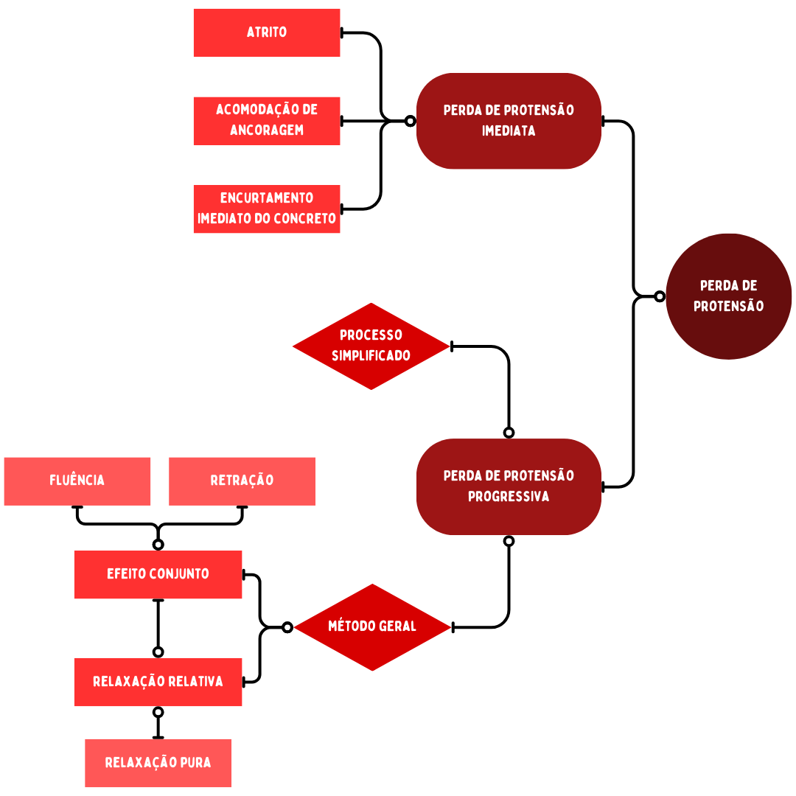

**Fonte:** Elaboração Própria (2024).

Com todos esses métodos de cálculos da Figura 1, é possível construir uma ferramenta que permita ao usuário explorar os processos de cálculo da maneira mais ampla possível, aumentando assim a explicabilidade de seu projeto. Isso posto, a ferramenta foi completamente desenvolvida na linguagem de programação de alto nível *Python* (2024). Toda sua interface gráfica foi criada a partir da biblioteca nativa da linguagem citada de nome Tkinter (2024), e as funções para cálculo foram programadas de forma a possibilitar ao usuário chegar à uma perda de protensão final, somando as perdas imediatas com as progressivas.

As funções citadas, para cálculo, foram desenvolvidas seguindo a lógica do fluxograma da Figura 1, e os processos expostos anteriormente. Nele é visto que para as perdas imediatas, três tipos de métodos se somam de maneira a compô-la. Já para as perdas progressivas, um entre dois métodos podem ser escolhidos, o processo simplificado que demanda um cálculo mais resumido e simples, com menos explicabilidade, ou o método geral que irá exigir cálculos complementares e mais trabalhosos, com um maior número de variáveis e maior explicabilidade do processo. Com a metodologia escolhida para a perdas de protensão progressivas, soma-se seu resultado com as perdas imediatas resultando na perda de protensão.

É importante entender que cada parte do cálculo das perdas de protensão possuem seu próprio espaço na interface gráfica, além de possuírem funções moduladas e próprias no código fonte para cada método de perda ou cálculo auxiliar. Ela foi pensada e desenvolvida dessa forma, para gerar um maior entendimento do funcionamento da ferramenta e boa capacidade de replicação das funções, junto de uma maior clareza de todo o processo de cálculo que está sendo realizado por trás da interface. Após o desenvolvimento, o código fonte foi disponibilizado em um repositório público (Nóbrega, 2023), e foi criado um executável através da biblioteca que transforma códigos *Python* em linguagem de máquinas chamada Pyinstaller (2024), e com ele um instalador utilizando-se do Inno *Setup* (2024), que facilita o empacotamento de arquivos e configurações do programa para o sistema operacional *Windows*.

# 4 Resultados

Nesta seção serão apresentados os resultados obtidos para as diferentes bases de dados, além de suas implicações.

## 4.1 Ferramenta computacional ProLoss

Tratando da estrutura do código da ferramenta computacional, como dito anteriormente, as funções de cálculo foram moduladas e divididas, de forma que os itens auxiliares, as perdas imediatas e as perdas progressivas possuem seu próprio diretório, como podem ser vistas na Figura 2.

**Figura 2** – Árvore de arquivos do código fonte.

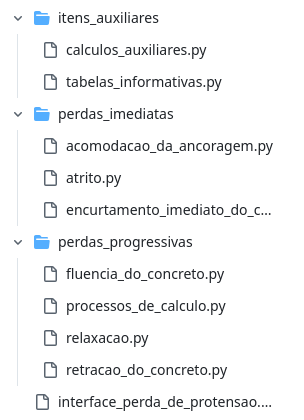

**Fonte:** Elaboração Própria (2024).

Como mencionado, elas foram pensadas e programadas de forma que ficassem de fácil acesso para auditoria do código do cálculo, e independentes da interface gráfica. Esta, ficou em um arquivo separado no mesmo nível dos diretórios de cálculo, onde importa todas as funções e integra os dados inseridos pelos usuários, os cálculos realizados nas funções e o resultado exposto na tela. O código com essas importações, além das outras bibliotecas utilizadas para operação da ferramenta podem ser vistos na Listagem 1.

**Listagem 1** – Importações de funções de cálculo e outras bibliotecas no código fonte

``` python
import tkinter as tk

import os
import sys
import base64

from tkinter import *
from tkinter import ttk
from tkinter.filedialog import askopenfilename
from matplotlib.backends.backend_tkagg import FigureCanvasTkAgg

import matplotlib.pyplot as plt
import pandas as pd
import numpy as np

from perdas_imediatas.atrito import atrito
from perdas_imediatas.acomodacao_da_ancoragem import acomodacao_da_ancoragem
from perdas_imediatas.encurtamento_imediato_do_concreto import encurtamento_imediato_do_concreto

from itens_auxiliares.tabelas_informativas import tabelas_informativas
from itens_auxiliares.calculos_auxiliares import calculo_da_espessura_ficticia
from itens_auxiliares.calculos_auxiliares import calculo_da_idade_ficticia
from itens_auxiliares.calculos_auxiliares import efeito_conjunto_retracao_e_fluencia

from perdas_progressivas.retracao_do_concreto import retracao_do_concreto
from perdas_progressivas.fluencia_do_concreto import fluencia_do_concreto
from perdas_progressivas.fluencia_do_concreto import superposicao_de_efeitos
from perdas_progressivas.relaxacao import relaxacao_pura
from perdas_progressivas.relaxacao import relaxacao_relativa
from perdas_progressivas.processos_de_calculo import perda_progressiva_processo_simplificado
from perdas_progressivas.processos_de_calculo import perda_progressiva_metodo_geral
```

**Fonte:** Elaboração Própria (2024).

Em relação as telas, as principais foram divididas em abas e definidas como os cálculos principais das perdas de protensão imediatas e progressivas. A primeira aba trata-se da perda de protensão imediata por atrito através de processo simplificado, descrita pela sigla de PIAT, como pode ser visto na Figura 3.

**Figura 3** – Perda de protensão imediata por atrito através de processo simplificado.

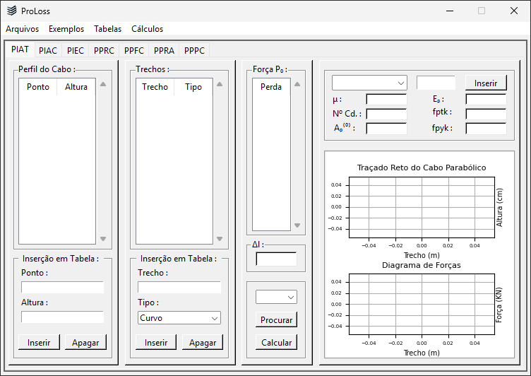

**Fonte:** Elaboração Própria (2024).

A segunda aba se refere a perda de protensão imediata por acomodação de ancoragem, representada pela sigla PIAC e presente na Figura 4

**Figura 4** – Perda de protensão imediata por acomodação de ancoragem.

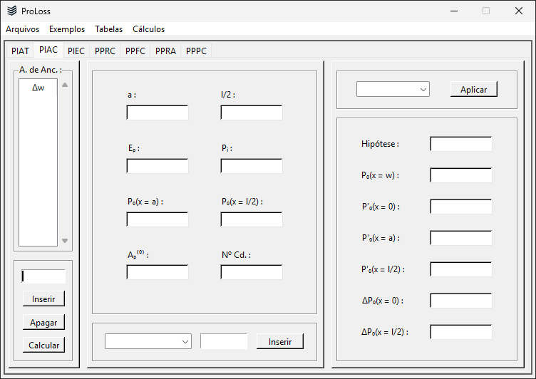

**Fonte:** Elaboração Própria (2024).

A terceira aba se refere ao último tipo de cálculo de perda imediata da ferramenta, que é a perda de protensão por encurtamento imediato do concreto, a PIEC, e pode ser visualizada na Figura 5.

**Figura 5** – Perda de protensão por encurtamento imediato do concreto.

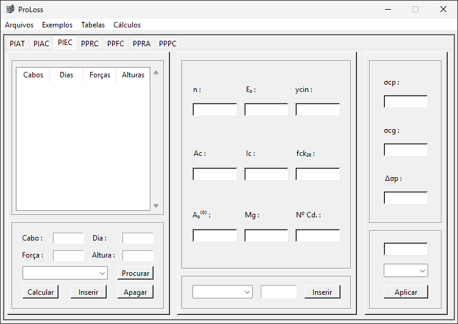

**Fonte:** Elaboração Própria (2024).

A soma do resultado das três abas, a depender do cálculo que o projetista irá realizar, pode representar justamente a perda imediata de protensão total da estrutura. Seguindo para as perdas progressivas, têm-se a quarta aba que se refere ao cálculo da retração do concreto, que compõe a fluência no cálculo do efeito conjunto no concreto. Ela é descrita pela sigla PPRC, como observada na Figura 6.

**Figura 6** – Cálculo da retração do concreto.

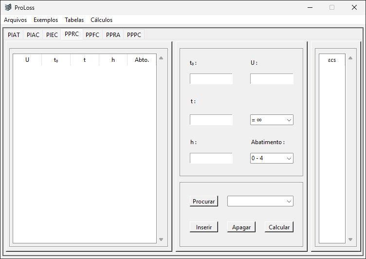

**Fonte:** Elaboração Própria (2024).

A quinta aba trata do cálculo da fluência do concreto, e como dito anteriormente, fará parte do cálculo do efeito conjunto em uma tela para cálculos auxiliares que será vista posteriormente. A aba é representada pela sigla PPFC e pode ser vista na Figura 7.

**Figura 7** – Cálculo da fluência do concreto.

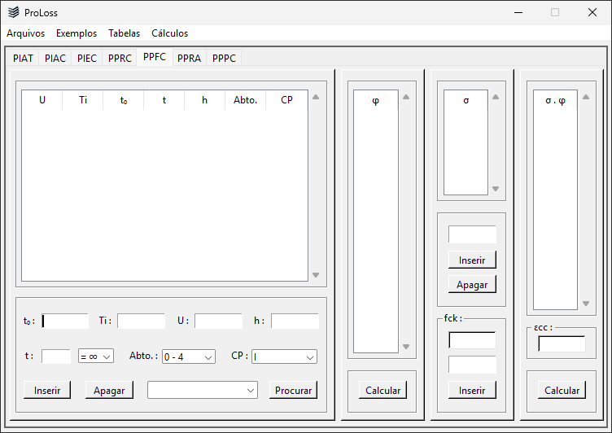

**Fonte:** Elaboração Própria (2024).

A sexta aba promove o cálculo da relaxação pura e relativa. Destaca-se que a relaxação relativa quando utilizada com o efeito conjunto da retração e fluência, possibilita o cálculo da perda de protensão progressiva pelo método geral. A sigla da aba é a PPRA, visualizada na Figura 8.

**Figura 8** – Cálculo da relaxação pura e relativa.

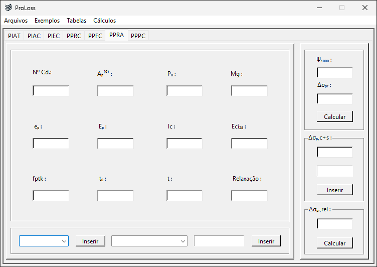

**Fonte:** Elaboração Própria (2024).

Ressalta-se que para a realização dos cálculos das abas das Figuras 6, 7 e 8 serão necessários cálculos auxiliares que terão suas telas vistas posteriormente, da idade e espessura fictícia. A sétima e última aba permitirá o cálculo da perda de protensão progressiva pelo método geral, ou pelo processo simplificado. Sua sigla é PPPC, e ela pode ser observada na Figura 9.

**Figura 9** – Cálculo da perda de protensão progressiva pelo método geral e processo simplificado.

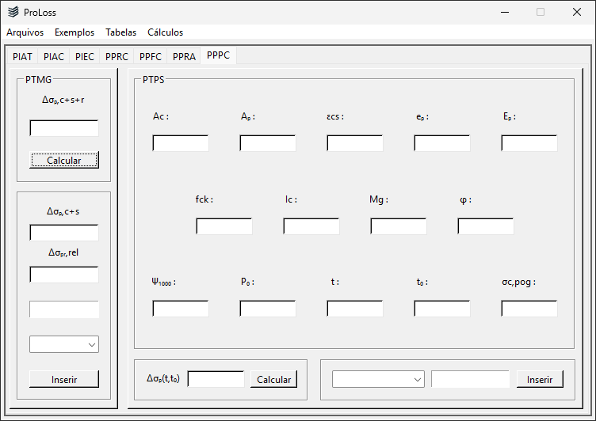

**Fonte:** Elaboração Própria (2024).

Faz-se necessário salientar que, caso o usuário opte pelo cálculo das perdas de protensão progressiva pelo método simplificado, apenas a aba da Figura 9 será necessária, através das variáveis presentes na parte da janela representada pela sigla PTPS. Já se o método geral for o preterido, necessitar-se-á dos cálculos das abas das Figuras 6 e 7 aliados ao efeito conjunto de retração e fluência, além dos cálculos da aba da Figura 8. A parte da janela que trata do método geral é composta pela sigla PTMG, na tela da da Figura 9.

Partindo para os itens da barra de ferramentas acima das abas, o primeiro deles é chamado Arquivos. Através de seus objetos é possível limpar todas as variáveis preenchidas, reiniciar a ferramenta computacional, abrir uma tela com informações sobre a ferramenta computacional, ou sair da mesma. Eles podem ser vistos na Figura 10.

**Figura 10** – Arquivos, da barra de ferramentas.

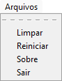

**Fonte:** Elaboração Própria (2024).

O segundo item da barra de ferramentas é chamado de exemplos, e nele contém exemplos retirados do livro de Cholfe e Bonilha (2013) e resolvidos. Existem exemplos para cada um dos cálculos auxiliares, de perdas imediatas e progressivas, conferidos com os resultados do livro. É possível distinguir cada um deles a partir da sigla qual ele se refere, e no código fonte onde estão dispostos os exemplos também há a referência da página exata de onde ele foi retirado do livro, para fins de aferição. É possível observar o item chamado exemplos a partir da Figura 11.

**Figura 11** – Exemplos, da barra de ferramentas.

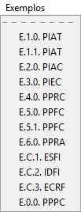

**Fonte:** Elaboração Própria (2024).

Seguindo para a terceira aba tem-se o item de tabelas. O primeiro objeto dele é chamado de siglas, e contém uma tela com o significado de todas as siglas usadas na ferramenta computacional. Logo após, vêm o objeto chamado variáveis, que segue a mesma lógica das siglas, porém informa todas as variáveis, seus significados e as unidades de medida de cada uma delas. Segue-se então para os últimos dois objetos chamados fluência e retração, e endurecimento do cimento. Eles dispõem de duas telas com gráficos que podem vir a auxiliar os projetistas nos cálculos da ferramenta computacional, de forma a promover uma maior facilidade de consultar, não precisando sair da ferramenta e recorrer à algum outro documento. Visualiza-se o item tabelas na Figura 12.

**Figura 12** – Tabelas, da barra de ferramentas.

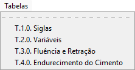

**Fonte:** Elaboração Própria (2024).

Por fim na barra de ferramentas têm-se o item de cálculos, que dispõe de objetos que resultaram em telas para permitir os cálculos complementares, como observado na Figura 13.

**Figura 13** – Cálculos, da barra de ferramentas.

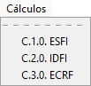

**Fonte:** Elaboração Própria (2024).

O primeiro objeto do item cálculos da barra de ferramentas trata-se do cálculo auxiliar da espessura fictícia, descrita pela sigla ESFI e com sua tela vista na Figura 14.

**Figura 14** – Cálculo da espessura fictícia.

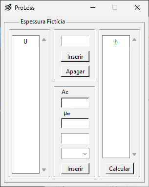

**Fonte:** Elaboração Própria (2024).

Já o segundo objeto do item cálculos é o cálculo auxiliar da idade fictícia, de sigla IDFI. Junto da espessura fictícia representada na Figura 14, eles podem ser usados para auxiliar cálculos como a da relaxação pura e relativa. Visualiza-se a tela da idade fictícia a partir da Figura 15.

**Figura 15** – Cálculo da idade fictícia.

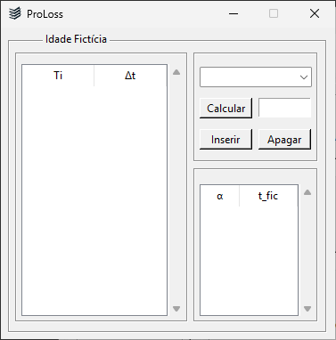

**Fonte:** Elaboração Própria (2024).

O terceiro e último objeto do item cálculos é o cálculo auxiliar do efeito conjunto da retração e fluência. Ele é importante em especial para os usuários que optarem por cálcular as perdas progressivas pelo método geral, como explicado anteriormente. A sigla que define o objeto é ECRF, e sua tela pode ser observada a partir da Figura 16.

**Figura 16** – Cálculo do efeito conjunto da retração e fluência.

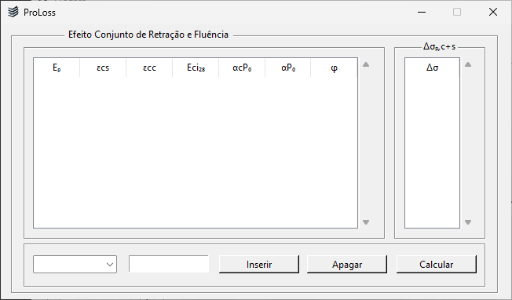

**Fonte:** Elaboração Própria (2024).

## 4.2 Validação da ferramenta computacional

A validação da ferramenta ocorreu por meio da comparação do resultado dos exemplos do livro resolvidos através da ferramenta computacional, onde todos os métodos e funções de cálculo implementados na ferramenta foram testados. Assim, é avaliado para os resultados calculados no livro e na ferramenta as diferenças absolutas e relativas entre os dois, de forma a entender se as diferenças nos resultados são apenas diferenças de aproximação, e se são relevantes para considerar ou não o uso da ferramenta.

### 4.2.1 Exemplo de aplicação numérica para cálculo de perdas imediatas de protensão por atrito através de processo simplificado

A aplicação numérica para o cálculo das perdas imediatas, trata-se de uma questão que se propõe a calcular a partir dos cabos de uma laje maciça, as perdas por atrito e o alongamento teórico (Cholfe e Bonilha, 2013, p. 142). Os cabos se alongam por seis seções divididas a partir de sete pontos que vão de A à G. Após os cálculos, é possível ver os resultados no gráfico do diagrama de forças da Figura 17.

**Figura 17** – Diagrama de forças considerando os resultados do livro e da ferramenta.

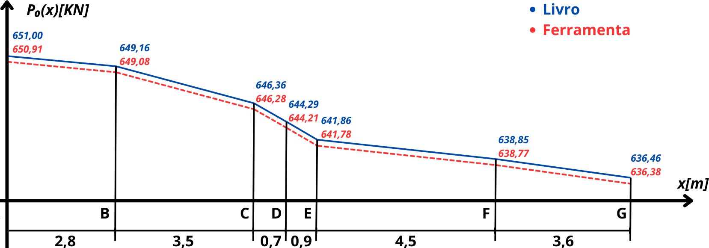

**Fonte:** Elaboração Própria (2024).

Através do gráfico da Figura 17 observa-se os valores das perdas dos trechos. As diferenças absolutas e relativas de todos os trechos são iguais considerando, sendo de 0,8 e 0,1% respectivamente, para duas casas de precisão, além de serem muito baixos, visto que a diferença relativa se mantém como 0,01%. Em relação ao alongamento teórico obtido das perdas, o valor do exemplo foi de 122,56mm enquanto o da ferramente foi de 122,79mm, com uma diferença absoluta de 0,23mm, com uma diferença relativa de aproximadamente 0,19%, relevando também resultados muito próximos.

### 4.2.2 Exemplo de aplicação numérica para cálculo de perdas imediatas de protensão por acomodação de ancoragem

Para acomodação de ancoragem, a aplicação numérica apresenta um exemplo de um cabo com seis cordoalhas, com ancoragens ativas e passivas. A partir dos dados do exemplo, espera-se determinar as perdas por atrito e a acomodação da ancoragem ativa (Cholfe e Bonilha, 2013, p. 151). Dados os requisitos da questão, foram realizados cálculos para acomodações de ancoragem de 2 e 3,5 milímetros.

Para uma acomodação de 2 milímetros, a hipótese 1 foi satisfeita, e os resultados obtidos tanto pelo livro quanto pela ferramenta numérica foram idênticos, apresentando valores de $Po(x=w)$ iguais a 1105,91 kN, $P'o(x=0)$ iguais a 1034,14 kN e $\Delta P(x = 0)$ iguais a 143,54 kN. Não houve diferença significativa entre os valores calculados, com diferenças absolutas e relativas iguais a zero, indicando uma correspondência exata entre os métodos. Seguindo para a acomodação de 3,5 milímetros, a hipótese 2 foi satisfeita, e os resultados podem ser vistos na Tabela 1.

**Tabela 1** – Resultados para cálculos de perdas por acomodação de acoragem de 3mm.

|     Variáveis     |   Livro    | Ferramenta | Diferença Absoluta | Diferença Relativa |
|:-----------------:|:----------:|:----------:|:------------------:|:------------------:|
|     Po(x = w)     | 1085,00 kN | 1084,99 kN |      0,01 kN       |       0,00%        |
|    P’o(x = 0)     | 992,32 kN  | 992,31 kN  |      0,01 kN       |       0,00%        |
|    P’o(x = a)     | 1076,62 kN | 1076,62 kN |      0,00 kN       |       0,00%        |
| $\Delta$Po(x = 0) | 185,36 kN  | 185,37 kN  |      0,01 kN       |       0,00%        |

**Fonte:** Elaboração Própria (2024).

Os resultados da Tabela 1 foram semelhantes aos encontrados no exemplo para acomodação de 2 milímetros, no aspecto de que a diferença absoluta foi ínfima, gerando diferenças relativas iguais de zero por cento para duas casas decimais.

### 4.2.3 Exemplo de aplicação numérica para cálculo de perdas de protensão por encurtamento imediato do concreto

A aplicação numérica para as perdas por encurtamento imediato do concreto usa um exemplo de estrutura com uma viga protendida com dez cabos em pós-tração (Cholfe e Bonilha, 2013, p. 155). Os resultados do cálculo das perdas médias tanto no livro como na ferramenta são apresentados na Tabela 2.

**Tabela 2** – Resultados para cálculos de perdas por encurtamento imediato do concreto.

|    Variáveis    |     Livro     |  Ferramenta   | Diferença Absoluta | Diferença Relativa |
|:---------------:|:-------------:|:-------------:|:------------------:|:------------------:|
|   $\sigma$cp    | -11549,59 kPa | -11549,59 kPa |      0,00 kPa      |       0,00%        |
|   $\sigma$cg    |  3315,00 kPa  |  3315,00 kPa  |      0,00 kPa      |       0,00%        |
| $\Delta\sigma$p | -22147,75 kPa | -22148,02 kPa |      0,27 kPa      |       0,00%        |

**Fonte:** Elaboração Própria (2024).

A Tabela 2 mostra que apenas a perda média de protensão resultou em diferença, porém mínima, e com uma diferença relativa de 0% para duas casas decimais.

### 4.2.4 Exemplos de aplicação numérica para cálculo de espessura e idade fictícia

Tratando do cálculo da espessura fictícia, o exemplo apresenta uma dada seção com medidas determinadas, e propõe a conta para as umidades de 40%, 60% e 80% (Cholfe e Bonilha, 2013, p. 162). Nota-se os resultados tanto dos livros como da ferramenta na Tabela 3.

**Tabela 3** – Resultados para cálculos de espessura fictícia.

| Umidade |  Livro   | Ferramenta | Diferença Absoluta | Diferença Relativa |
|:-------:|:--------:|:----------:|:------------------:|:------------------:|
|   40%   | 21,39 cm |  21,44 cm  |      0,05 cm       |       0,00%        |
|   60%   | 24,32 cm |  24,44 cm  |      0,12 cm       |       0,00%        |
|   80%   | 46,55 cm |  46,59 cm  |      0,04 cm       |       0,00%        |

**Fonte:** Elaboração Própria (2024).

Para a idade fictícia, o exemplo a pede para um concreto executado em 28 dias, com uma temperatura média de trinta graus nos sete primeiros dias, vinte e seis graus nos doze seguintes, e vinte graus nos nove dias finais (Cholfe e Bonilha, 2013, p. 163). Na Tabela 4 têm-se os valores para efeitos de fluência aplicado a diferentes tipos de cimento.

**Tabela 4** – Resultados para cálculos de idade fictícia.

| Cimento |   Livro    | Ferramenta | Diferença Absoluta | Diferença Relativa |
|:-------:|:----------:|:----------:|:------------------:|:------------------:|
|  CP I   | 65,46 dias | 65,47 dias |     0,01 dias      |       0,00%        |
| CP III  | 32,73 dias | 32,73 dias |     0,00 dias      |       0,00%        |
|  CP V   | 98,19 dias | 98,2 dias  |     0,01 dias      |       0,00%        |

**Fonte:** Elaboração Própria (2024).

As Tabelas 3 e 4 mostram mais uma vez pequenas diferenças absolutas, e diferenças relativas zeradas, reproduzindo os padrões dos outros exemplos.

### 4.2.5 Exemplos de aplicação numérica para cálculo de retração e fluência do concreto

Na aplicação numérica para o cálculo da retração, a questão pede para determinar o valor da retração do concreto de uma determinada peça para dois diferentes casos com características semelhantes, porém diferentes umidades e abatimentos (Cholfe e Bonilha, 2013, p. 166). Nota-se que, para o primeiro caso, os valores obtidos tanto no livro quanto na ferramenta são idênticos, resultando em uma diferença absoluta de 0,00000 e uma diferença relativa de 0,00%. Já para o segundo caso, nota-se uma discrepância mínima entre os valores, com o livro indicando -0,00029 e a ferramenta -0,00030. Essa variação gera uma diferença absoluta de 0,00001 e uma diferença relativa de 3,44%.

Quanto a aplicação numérica da deformação por fluência, é dada uma determinada seção e suas características para cálculo (Cholfe e Bonilha, 2013, p. 175). O livro apresenta o valor de -0,00092, em comparação ao valor da ferramenta de -0,00098, resultando em uma diferença absoluta de 0,00006 e uma diferença relativa de 6,52%. Mostra-se com isso uma pequena divergência, um pouco maior ao observado no cálculo da retração.

### 4.2.6 Exemplos de aplicação numérica para cálculo de efeito conjunto de retração e fluência do concreto

No efeito conjunto, a aplicação numérica apresenta uma viga protendida longitudinalmente com aderência posterior, e solicitada além da protensão por seus carregamentos permanente. A partir das suas características detalhadas na questão, pede-se as perdas de protensão provocadas pelo efeito da retração e fluência, em tipos de cabos diferentes ((Cholfe e Bonilha, (2013), p. 184)). Com o gráfico da Figura 18 é possível observar os resultados do livro e da ferramenta.

**Figura 18** – Diagrama de forças considerando os resultados do livro e da ferramenta.

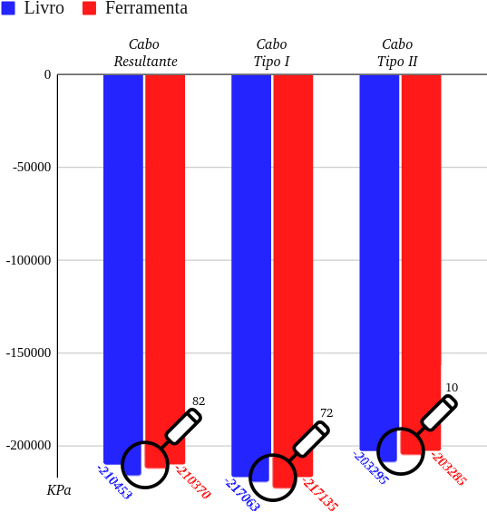

**Fonte:** Elaboração Própria (2024).

Na Tabela 18 as diferenças absolutas variam de 10 KPa a 83 KPa, com diferenças relativas máximas de 0,0394%, o que evidencia mais uma vez, a concordância muito próxima que há entre os valores do livro e da ferramenta.

### 4.2.7 Exemplo de aplicação numérica para cálculo de relaxação pura e relativa

A aplicação numérica para a relaxação pura e relativa apresenta-se como a determinação destas a partir de um determinado processo de cálculo de perdas progressivas (Cholfe e Bonilha, 2013, p. 192). A relaxação pura resultante do livro foi de 70,51 MPa, e a da ferramenta foi de 70,42 MPa, resultando em uma diferença absoluta de 0,09 MPa e uma diferença relativa de 0,13%. Já quanto à relaxação relativa, tem-se o valor do livro como de 46,63 MPa, enquanto o valor da ferramenta foi de 46,57 MPa, com em uma diferença absoluta de 0,06 MPa e uma diferença relativa também de 0,13%, ou seja, resultados muito próximos, e consistentes com os exemplos anteriores.

### 4.2.8 Exemplo de aplicação numérica para cálculo de perdas progressivas de protensão pelo método geral e processo simplificado

Chegando à aplicação numérica dos cálculos definitivos da perda de protensão progressiva, têm-se também uma viga protendida com aderência posterior e solicitada além da protensão por determinados momentos permanente e variável de acordo com o especificado na questão. Assim sendo, pede-se para determinar as perdas de protensão progressivas com efeitos da retração, fluência e relaxação a tempo infinito para um cabo resultante (Cholfe e Bonilha, 2013, p. 197).

No cálculo para o presente trabalho, foram considerados o método geral e o processo simplificado, onde no primeiro o livro obteve o valor de -207979 KPa, semelhante ao da ferramenta, com nenhuma diferença absoluta e relativa. Continuando, para o processo simplificado, observa-se uma diferença absoluta entre o valor obtido pelo livro de -189108 KPa e o valor calculado pela ferramenta de -188164 KPa, o que representa uma diferença de aproximadamente 944 KPa. Em termos de diferença relativa, isso representa cerca de 0,5%.

De modo geral, em todas as aplicações numéricas, as diferenças relativas ficaram abaixo de 1%, exceto para retração e fluência, que apresentaram valores inferiores a 10%. Isso indica que não houve nenhuma diferença absoluta significativa, o que permite atribuir essas variações a diferenças de aproximação. Esse argumento se fortalece principalmente porque os resultados com maiores diferenças são aqueles que dependem de pré-cálculos, como as perdas progressivas, que, para serem obtidas, exigem cálculos auxiliares. Esse acúmulo de aproximações gera, portanto, variações finais mais elevadas.

# 5 Conclusão

O presente estudo demonstrou que a ferramenta computacional desenvolvida é eficaz para análises comparativas com as aplicações numéricas propostas, produzindo resultados satisfatórios e totalmente coerentes para a avaliação de perdas de protensão em estruturas de concreto. Além de seu desempenho técnico, destaca-se sua fácil acessibilidade e a capacidade de esclarecer os cálculos envolvidos, graças ao repositório aberto, à presente documentação e à presença de exemplos bem elaborados e comparativos. A interface foi planejada com clareza e simplicidade, exibindo informações de forma organizada para facilitar o uso por usuários sem conhecimentos em programação.

Espera-se, portanto, que a ferramenta contribua para uma maior capacidade analítica dos processos de cálculo nos projetos de estruturas de concreto protendido, incentivando otimizações mais precisas e seguras. Além disso, é fundamental ressaltar novamente a importância das análises de perdas de protensão, que são cruciais para garantir a segurança e a eficiência das estruturas de concreto protendido. Em relação a estudos e projetos futuros, destaca-se a possibilidade de evolução da própria ferramenta, que, por ser de código aberto, está aberta a contribuições e melhorias contínuas, tanto da comunidade de usuários quanto de outros desenvolvedores interessados.

# Referências

ASSOCIAÇÃO BRASILEIRA DE NORMAS TÉCNICAS. NBR 6118:2023. **ABNT**, v. 4, p. 49-54, 207-214, 2023.

BASTOS, P. S. Fundamentos do Concreto Protendido. **Universidade Estadual Paulista, Departamento de Engenharia Civil e Ambiental, Campus de Bauru, São Paulo**, p. 10-11, 2024. Disponível em: https://wwwp.feb.unesp.br/pbastos/Protendido/Ap.%20Protendido.pdf. Acesso em: 07 de jul. de 2024.

BOUKENDAKDJI, M.; TOUAHMIA, M.; ACHOUR, B. Comparative Study of Prestress Losses. **Engineering. Technology & Applied Science Research**, v. 7, n. 3, 2017. Disponível em: https://www.etasr.com/index.php/ETASR/article/view/1172. Acesso em: 07 de jul. de 2024.

CARVALHO, R. C. Estruturas em Concreto Protendido. **PINI, São Paulo**, p. 10, 2012.

CHOLFE, L.; BONILHA, L. A. S. Concreto Protendido: Teoria e Prática. **PINI, São Paulo**, p. 125-181, 2013.

JORDAN RUSSELL. **Inno Setup, version 6.x**. Jordan Russell’s Software, 2024. Disponível em: https://jrsoftware.org/isinfo.php. Acesso em: 31 de out. de 2024.

LABADAN, R. S. DESIGN OF POST-TENSIONED PRESTRESSED CONCRETE BEAM USING EXCEL SPREADSHEET WITH VISUAL BASIC APPLICATIONS. **International Journal of Advances in Mechanical and Civil Engineering**, v. 3, n. 4, p. 2394-2827, 2016. Disponível em: https://iraj.in/journal/journal_file/journal_pdf/13-271-147184877610-16.pdf. Acesso em: 07 de jul. de 2024.

MACHADO, M. A. L. Aplicação do método dos elementos finitos para a análise elasto-viscoplástica de peças de concreto armado e protendido, submetidas a estados planos de tensão. **Universidade Federal do Rio Grande do Sul, Porto Alegre-RS**, 2002.

MASCARENHAS, F. J. R.; CHRISTOFORO, R. C.; LAHR F. A. R. Análise da perda de protensão com o auxílio de ferramenta de cálculo alternativa. **Universidade Federal de Viçosa, Centro de Ciências Exatas e Tecnológicas, Departamento de Engenharia Civil**, v. 8, 2022. Disponível em: https://www2.ifrn.edu.br/ojs/index.php/HOLOS/article/view/10409/3704. Acesso em: 07 de jul. de 2024.

NÓBREGA, A. E. L. **Repositório Público do ProLoss**. 2023. Disponível em: https://github.com/alexandre11aa/proloss. Acesso em: 31 de out. de 2024.

PFEIL, W. Concreto Protendido - Introdução. **LTC Editora, Rio de Janeiro**, v. 1, 1984.

PYINSTALLER DEVELOPMENT TEAM. **PyInstaller, version 5.x**. PyInstaller Development Team, 2024. Disponível em: https://pyinstaller.org/. Acesso em: 31 de out. de 2024.

PYTHON SOFTWARE FOUNDATION. **Python Programming Language, version 3.x**. Python Software Foundation, 2024. Disponível em: https://www.python.org/. Acesso em: 31 de out. de 2024.

TQS: SOFTWARES PARA ENGENHARIA DE ESTRUTURAS E GEOTECNIA. Aspectos Teóricos, Concreto Protendido. **TQSDocs**, 2024. Disponível em: https://docs.tqs.com.br/Docs/Details?id=3224&language=pt-BR. Acesso em: 20 de ago. de 2024.

TROVARELLI, M. L. Vídeos Ilustrativos Do Comportamento Físico Das Perdas De Protensão Em Vigas. **Instituto Federal De Educação, Ciência E Tecnologia De São Paulo, Votuporanga-SP**, 2019. Disponível em: https://vtp.ifsp.edu.br/nev/Mod-virtual/Marilia%20Trovarelli%20-%20TCC%20BIBLIOTECA.pdf. Acesso em: 07 de jul. de 2024.

VERÍSSIMO, G. S.; JUNIOR, K. M. L. C. Concreto Protendido: Fundamentos Básicos. **Universidade Federal de Viçosa, Centro de Ciências Exatas e Tecnológicas, Departamento de Engenharia Civil**, v. 1, n. 4, p. 1, 1999. Disponível em: https://wwwp.feb.unesp.br/lutt/Concreto%20Protendido/CP-vol1.pdf. Acesso em: 07 de jul. de 2024.
